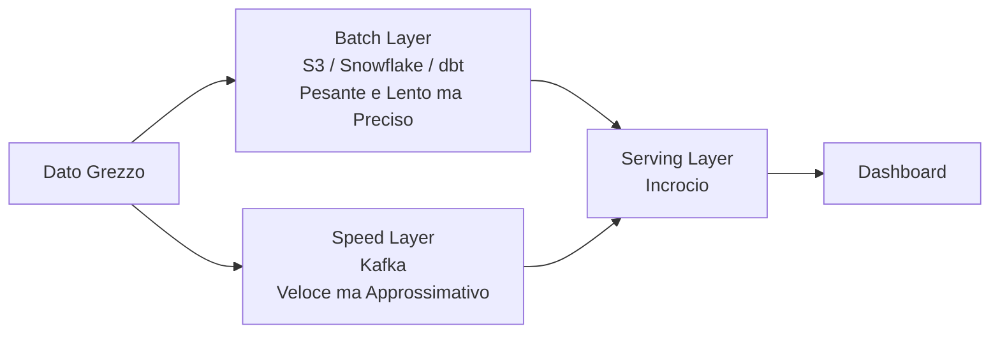
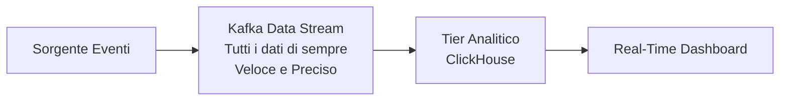

import { Aside, Steps, Tabs, TabItem, CardGrid, Card } from '@astrojs/starlight/components'

# Da Batch a Real-Time: L'Era dello Streaming

Per oltre tre decenni, l'ingegneria dei dati si è basata su un tacito accordo: *i dati si raccolgono di giorno e si calcolano di notte*. 
Questo è il dominio del **Batch Processing**. I server aziendali accumulano log per 24 ore, poi alle 3:00 del mattino un pesantissimo processo ETL si risveglia, mastica terabyte di dati in blocco, e alle 8:00 il CFO ha il suo report Excel aggiornato a "ieri".

Per la contabilità e i report di fine trimestre, questo ritardo (Latenza) è irrilevante.
Ma nel Marketing Digitale, un dato vecchio di 12 ore non è solo inutile: è **tossico**.
Se un utente abbandona un carrello da 5.000€ sul tuo e-commerce, inviargli l'email di recupero il mattino successivo significa che ha già acquistato dal tuo competitor. Nel Programmatic Advertising (RTB), le aste sui banner durano **100 millisecondi**. 

Benvenuti nell'era dello **Streaming Processing**.

---

## 1. Batch vs Micro-Batch vs Streaming

Per capire l'architettura che andremo a costruire, dividiamo i tre regimi temporali dell'Ingegneria dei Dati.

<CardGrid>
  <Card title="1. Batch (L'Autobus)" icon="document">
    Il veicolo non parte finché non è pieno o finché non scatta l'ora prefissata (Es. Mezzanotte).
    - **Latenza:** Ore o Giorni.
    - **Throughput:** Massivo (es. calcolare miliardi di vendite di un anno in un colpo solo).
    - **Tecnologie:** dbt, Apache Airflow, Snowflake.
  </Card>
  <Card title="2. Micro-Batch (La Navetta)" icon="setting">
    Un treno passa ogni 5-15 minuti. È un trucco: non è vero real-time, è semplicemente un Batch lanciato in modalità frenetica.
    - **Latenza:** Minuti.
    - **Tecnologie:** Cronjobs frequenti, Spark Structured Streaming.
  </Card>
  <Card title="3. Streaming (L'Acqua corrente)" icon="rocket">
    Ogni singolo evento (un click, un acquisto) viene processato e reso disponibile nel momento esatto in cui nasce. Il flusso non si ferma mai.
    - **Latenza:** Millisecondi.
    - **Tecnologie:** Apache Kafka, Flink, ClickHouse.
  </Card>
</CardGrid>

---

## 2. Event-Driven Architecture (Il Sistema Nervoso)

Passare allo streaming significa cambiare approccio mentale alla radice. Non fai più `SELECT` per chiedere "Cosa è successo?". 
Costruisci un sistema **Event-Driven**, in cui gli applicativi *gridano* al mondo quello che stanno facendo.

Nel paradigma tradizionale, il tuo software fa **Polling** (bussa al database ogni minuto chiedendo: *"Ci sono nuovi ordini?"*).
Nel paradigma Streaming, i sistemi reagiscono. 

### L'Anatomia di un Evento (Event)
Un evento è un fatto immutabile. Se l'utente aggiunge scarpe al carrello e poi le toglie, non vai ad azzerare il database. Crei *due* eventi sequenziali e registrati per l'eternità.

```json
// Questo è il combustibile di Kafka. Un messaggio JSON microscopico ma potente.
{
  "event_id": "evt_99801",
  "event_type": "cart_added",
  "timestamp": "2026-05-15T14:32:05.123Z",
  "actor": {
    "user_id": "usr_a8f3k2",
    "ip_address": "82.55.12.1"
  },
  "payload": {
    "item": "Nike Air Max",
    "price_eur": 129.90,
    "cart_total": 250.00
  }
}
```

<Aside type="note">
**L'Evento è Immutabile**. Nello streaming non esiste il comando `UPDATE`. La realtà non si cancella. Se c'è stato un errore nel prezzo (129€ invece di 80€), invieremo un nuovo evento di tipo `cart_corrected` con il valore compensativo. Registrare l'intera catena temporale è noto come **Event Sourcing**.
</Aside>

---

## 3. Perché il Marketing Ne Ha Fisicamente Bisogno

L'infrastruttura Streaming (sebbene complessa e costosa da mantenere) è l'unica arma per abilitare use-case moderni che distruggono la competizione:

<Steps>
1. **Dynamic Pricing (Prezzi Dinamici):** Uber e le compagnie aeree calcolano il prezzo in base a quante persone stanno guardando la tratta *in questo esatto secondo* incrociando il dato con i taxi disponibili nell'area.
2. **Personalizzazione in Sessione:** Un utente guarda 3 recensioni di smartphone Android di fila. Il motore di raccomandazione reagisce in 50 millisecondi e, alla pagina successiva, l'homepage del sito cambia graficamente per spingere accessori Android ignorando Apple.
3. **Fraud Detection Istantaneo:** Se uno script Bot sta simulando click sugli annunci Google Ads rubandoti il budget, un modello live blocca l'IP al secondo click anomalo, salvando migliaia di euro prima ancora che il database tradizionale se ne accorga.
4. **Trigger di Marketing Attivo:** Invio di una Push Notification "Sconto Flash del 10% per i prossimi 5 minuti" nel momento esatto in cui l'utente sta indugiando da troppo tempo sulla pagina di Checkout.
</Steps>

---

## 4. Lambda vs Kappa Architecture (La Battaglia del Design)

Quando si progetta una pipeline Dati, come gestisci la coesistenza tra lo storico profondo (i terabyte vecchi di anni per il Machine Learning) e il live millisecond (Kafka)? Ci sono due religioni dominanti nell'Ingegneria dei Sistemi.

### La Lambda Architecture (Il compromesso)
Ideata dai creatori di Twitter/X, accetta il fatto che lo streaming a volte perda pezzi. Così sdoppia il flusso.


**Il difetto:** Devi scrivere e mantenere due logiche di codice completamente separate (Una in SQL per dbt, una in Java/Python per Kafka). I costi e i developer impazziscono.

### La Kappa Architecture (Il design moderno)
Ideata da Jay Kreps (creatore di Kafka). Se lo stream di Kafka è stabile, perché non conserviamo *tutto il passato dell'azienda* dentro Kafka e facciamo passare tutto, sia lo storico che i dati nuovi di oggi, attraverso l'unico tubo ad altissima pressione?


**Il Vantaggio:** C'è un solo layer di calcolo, un solo linguaggio da mantenere, errori nulli e un debug facilissimo.

## Conclusione & Next Steps

Abbandonare il Batch non è per tutti. Gestire un cluster Kafka e garantire una disponibilità sub-secondo significa dover rispondere al cercapersone se un server crolla il venerdì sera.

Tuttavia, quando passi dal mostrare ai manager cruscotti che dicono *"Ecco cosa abbiamo fatto di sbagliato ieri"* a cruscotti pulsanti che gridano *"Ecco chi sta comprando adesso, e perché, in questo esatto secondo"*, l'azienda evolve.

Nel prossimo capitolo scenderemo nel metallo fuso di questa rivoluzione studiando il Re indiscusso dei database analitici in tempo reale: **ClickHouse**.
