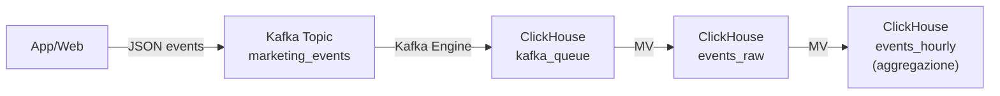

# Kafka + ClickHouse: Pipeline Real-Time per Marketing Analytics

> **Obiettivo:** Costruire una pipeline end-to-end che ingerisce eventi da Kafka in ClickHouse per analytics in tempo reale.

## 1. L'Architettura


## 2. Setup ClickHouse

```sql
-- 1. Tabella Kafka Engine (coda di ingestion)
CREATE TABLE kafka_marketing_events (
    event_id String,
    event_type String,
    user_id String,
    properties String,
    timestamp DateTime64(3)
) ENGINE = Kafka
SETTINGS
    kafka_broker_list = 'kafka:9092',
    kafka_topic_list = 'marketing_events',
    kafka_group_name = 'clickhouse_consumer',
    kafka_format = 'JSONEachRow',
    kafka_num_consumers = 3;

-- 2. Tabella di destinazione (storage ottimizzato)
CREATE TABLE events_raw (
    event_id String,
    event_type LowCardinality(String),
    user_id String,
    properties String,
    timestamp DateTime64(3),
    event_date Date DEFAULT toDate(timestamp)
) ENGINE = MergeTree()
PARTITION BY toYYYYMM(event_date)
ORDER BY (event_type, user_id, timestamp)
TTL event_date + INTERVAL 90 DAY;

-- 3. Materialized View (connettore automatico)
CREATE MATERIALIZED VIEW mv_kafka_to_raw TO events_raw AS
SELECT * FROM kafka_marketing_events;

-- 4. Aggregazione oraria per dashboard veloci
CREATE MATERIALIZED VIEW mv_events_hourly
ENGINE = SummingMergeTree()
ORDER BY (event_type, hour)
AS SELECT
    event_type,
    toStartOfHour(timestamp) AS hour,
    count() AS event_count,
    uniqExact(user_id) AS unique_users
FROM events_raw
GROUP BY event_type, hour;
```

## 3. Query per Dashboard Real-Time

```sql
-- Ultimi 60 minuti di eventi
SELECT
    event_type,
    count() AS events,
    uniqExact(user_id) AS users,
    round(count() / 60, 1) AS events_per_minute
FROM events_raw
WHERE timestamp >= now() - INTERVAL 60 MINUTE
GROUP BY event_type
ORDER BY events DESC;

-- Confronto ora corrente vs stessa ora ieri
SELECT
    event_type,
    countIf(timestamp >= now() - INTERVAL 1 HOUR) AS events_now,
    countIf(timestamp >= now() - INTERVAL 25 HOUR
        AND timestamp < now() - INTERVAL 24 HOUR) AS events_yesterday,
    round((events_now - events_yesterday) / events_yesterday * 100, 1) AS change_pct
FROM events_raw
WHERE timestamp >= now() - INTERVAL 25 HOUR
GROUP BY event_type;
```

## 4. Monitoring della Pipeline
```sql
-- Lag di ingestion
SELECT
    max(timestamp) AS latest_event,
    dateDiff('second', max(timestamp), now()) AS lag_seconds
FROM events_raw;
```

## Risorse
- **Doc:** ClickHouse Kafka Engine, Materialized Views
- **Best Practice:** Partition by month, TTL per cost control
