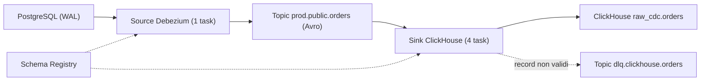

Un'azienda logistica italiana sincronizza il database PostgreSQL degli ordini verso ClickHouse e verso un indice di ricerca con tre script Python che eseguono `WHERE updated_at > last_run` ogni due minuti. Il lunedì mattina gli script saturano la CPU del primario, non vedono mai le righe cancellate con `DELETE` e si fermano per sei ore quando un team aggiunge una colonna inattesa. È uno scenario costruito con numeri di esempio, e la causa non sta in Python né nel database: sta nell'aver sostituito la lettura del log di transazione con query di polling scritte in casa, senza registro degli schemi e senza una coda dove isolare i messaggi sbagliati.

## Tre script di polling e sei ore al buio

L'azienda dello scenario gestisce 180.000 spedizioni al giorno su PostgreSQL e alimenta due destinazioni, ClickHouse per i cruscotti operativi e un indice di ricerca per l'assistenza clienti. A metà mattina un operatore corregge un errore di fatturazione cancellando 420 righe duplicate con un `DELETE` diretto. Lo script legge solo le righe presenti in tabella, quindi le 420 cancellazioni non vengono mai rilevate: restano vive in ClickHouse e gonfiano il fatturato giornaliero di 420 righe × 152 euro = 63.840 euro.

Due ore dopo un rilascio applicativo rinomina una colonna secondaria. Il consumatore va in eccezione sul primo messaggio, termina senza salvare il punto di lettura e alla ripartenza riscarica gli ultimi due giorni, saturando il disco del database per il resto del pomeriggio.

> **Idea chiave:** leggere lo stato corrente di una tabella perde la storia intermedia e le cancellazioni, mentre leggere il log delle transazioni cattura ogni modifica; e senza uno schema e una coda di scarto, un solo messaggio anomalo ferma l'intera pipeline.

Kafka Connect, il framework di integrazione incluso in Apache Kafka ([documentazione ufficiale](https://kafka.apache.org/documentation/#connect)), e Debezium ([documentazione](https://debezium.io/documentation/)) rispondono a entrambe le debolezze con un modello dichiarativo: si descrive cosa spostare in un file di configurazione, e il framework gestisce parallelismo, offset, riavvii e errori.

## Worker, connector e task: lo stato vive in Kafka

Un cluster Connect in modalità distribuita è un insieme di **worker**, processi JVM senza stato locale. Un **connector** è la configurazione logica di un'integrazione (per esempio "leggi queste due tabelle di PostgreSQL") e si divide in uno o più **task**, le unità che spostano fisicamente i dati. I task sono distribuiti sui worker e sono il livello di parallelismo.

Tutto lo stato è dentro Kafka, in tre topic interni compattati. `connect-configs` contiene le configurazioni dei connettori, `connect-offsets` le posizioni di lettura raggiunte dalle sorgenti e `connect-status` lo stato di salute di connettori e task. Se un worker muore, il cluster ridistribuisce i suoi task ai superstiti in pochi secondi, e i task ripartono dall'ultimo offset confermato. Per questo i tre topic devono avere `cleanup.policy=compact` e `replication.factor` pari ad almeno 3: perderli significa perdere la memoria del cluster.



Il parallelismo di un sink è limitato dalle partizioni del topic letto: un sink con `tasks.max=4` su un topic a 4 partizioni usa un task per partizione, mentre con 8 task ne userebbe 4 e lascerebbe gli altri inattivi. Un source Debezium per PostgreSQL usa sempre un solo task, perché il WAL è un flusso unico e ordinato.

## CDC sul WAL: cosa cambia rispetto al polling

Il *Change Data Capture* basato su log sfrutta un dato che il database scrive comunque per garantire la durabilità: il `Write-Ahead Log` in PostgreSQL, il `binlog` in MySQL. Debezium apre uno slot di replica logica e legge il flusso binario con il plugin `pgoutput`. Ogni `INSERT`, `UPDATE` e `DELETE` diventa un evento con lo stato precedente (`before`), quello nuovo (`after`) e un codice operazione (`c`, `u`, `d`, `r` per lo snapshot iniziale).

Le differenze rispetto al polling su `updated_at` sono tre. Le cancellazioni vengono catturate come eventi `d`, e non spariscono. Il carico sul database è quasi nullo, perché non si eseguono `SELECT` sulle tabelle. Infine l'ordine è quello del commit: il polling su timestamp può perdere righe quando due transazioni concorrenti scrivono lo stesso millisecondo in `updated_at` e fanno commit in ordine inverso, il log invece registra gli eventi nell'ordine di commit.

Perché Debezium funzioni, il database sorgente deve avere `wal_level = logical`, un utente con privilegio di replica e una *publication* che elenchi le tabelle da catturare.

## Schema Registry, SMT e Dead Letter Queue

Tre componenti rendono la pipeline robusta a errori e cambi di schema.

Lo **Schema Registry** conserva gli schemi Avro o Protobuf e applica regole di compatibilità (`BACKWARD`, `FORWARD`, `FULL`) prima di accettare una nuova versione. Il messaggio non trasporta lo schema per intero, ma solo un identificativo di quattro byte più il payload binario. Un `JsonConverter` con `schemas.enable=true` ripete invece l'albero dello schema in ogni messaggio.

Le **Single Message Transforms** (SMT) modificano un messaggio alla volta mentre passa dentro Connect: rinominano un campo, mascherano un dato personale, estraggono `after` dall'evento Debezium (`ExtractNewRecordState`) o instradano verso un altro topic. Non hanno stato e non vedono altri messaggi.

La **Dead Letter Queue** è una funzione dei connettori sink. Con `errors.tolerance=all` un record che non si converte o non si scrive viene dirottato in un topic di quarantena, con negli header il motivo dell'errore, e il task prosegue. Con `errors.tolerance=none` il task va in `FAILED` al primo errore e blocca i messaggi validi che lo seguono.

## Tre errori nella configurazione di Connect

Il file seguente è la tipica configurazione di partenza, valida per un test con dieci righe e fragile in produzione.

```json
{
  "name": "ordini-jdbc-source-fragile",
  "config": {
    "connector.class": "io.confluent.connect.jdbc.JdbcSourceConnector",
    "connection.url": "jdbc:postgresql://db-prod:5432/ecommerce",
    "mode": "timestamp",
    "timestamp.column.name": "updated_at",
    "poll.interval.ms": "1000",
    "value.converter": "org.apache.kafka.connect.json.JsonConverter",
    "value.converter.schemas.enable": "true",
    "errors.tolerance": "none"
  }
}
```

### Polling JDBC su timestamp al posto del CDC

Il sintomo è un database primario sotto pressione e dati che divergono dal sorgente. Il connettore JDBC in `mode: "timestamp"` sembra la strada più semplice perché non chiede permessi di replica. Con un intervallo di un secondo esegue 60 query al minuto sulla tabella, non vede mai i `DELETE` e perde le righe con `updated_at` identico. La correzione è passare a Debezium sul WAL; il polling resta accettabile solo per tabelle piccole, senza cancellazioni fisiche e con una colonna di versione affidabile.

### JsonConverter con schema incorporato

Il sintomo è un traffico di rete e un disco dei broker molto più grandi del previsto. Succede perché ogni messaggio da 180 byte porta con sé lo schema e arriva a 1.400 byte. Con 180.000 ordini al giorno il volume sale da 180.000 × 180 byte = 32,4 MB a 180.000 × 1.400 byte = 252 MB, circa 7,8 volte tanto. Si risolve con Avro o Protobuf e Schema Registry, o almeno con `schemas.enable=false`.

### errors.tolerance none senza Dead Letter Queue

Il sintomo è un cruscotto fermo nel mezzo della giornata con un task in `FAILED`. L'impostazione sembra prudente perché non vuole perdere dati, ma basta un solo messaggio su dieci milioni con una data fuori formato per bloccare tutti quelli validi che seguono: è l'effetto *poison pill*. Si usa `errors.tolerance=all` con DLQ e header diagnostici, e si monitora il numero di messaggi che entrano ogni minuto nel topic di quarantena.

## Configurare source Debezium e sink ClickHouse con DLQ

La coppia di configurazioni seguente applica quattro criteri: CDC sul WAL con publication esplicita e *heartbeat*, serializzazione Avro con Schema Registry, SMT per appiattire l'evento e mascherare il codice fiscale, sink con DLQ.

```sql
-- PostgreSQL: publication con le sole tabelle necessarie (wal_level deve essere logical)
CREATE PUBLICATION dbz_orders_pub FOR TABLE public.orders, public.order_items;
```

```json
{
  "name": "pg-ordini-cdc-source",
  "config": {
    "connector.class": "io.debezium.connector.postgresql.PostgresConnector",
    "tasks.max": "1",
    "database.hostname": "db-prod",
    "database.port": "5432",
    "database.user": "cdc_reader",
    "database.dbname": "ecommerce",
    "topic.prefix": "prod",
    "table.include.list": "public.orders,public.order_items",
    "plugin.name": "pgoutput",
    "slot.name": "debezium_orders_slot",
    "publication.name": "dbz_orders_pub",
    "heartbeat.interval.ms": "10000",
    "key.converter": "io.confluent.connect.avro.AvroConverter",
    "key.converter.schema.registry.url": "http://schema-registry:8081",
    "value.converter": "io.confluent.connect.avro.AvroConverter",
    "value.converter.schema.registry.url": "http://schema-registry:8081",
    "transforms": "unwrap,maskTax",
    "transforms.unwrap.type": "io.debezium.transforms.ExtractNewRecordState",
    "transforms.unwrap.drop.tombstones": "false",
    "transforms.unwrap.delete.handling.mode": "rewrite",
    "transforms.maskTax.type": "org.apache.kafka.connect.transforms.MaskField$Value",
    "transforms.maskTax.fields": "billing_tax_code",
    "transforms.maskTax.replacement": "***REDACTED***"
  }
}
```

```json
{
  "name": "clickhouse-ordini-sink",
  "config": {
    "connector.class": "com.clickhouse.kafka.connect.ClickHouseSinkConnector",
    "tasks.max": "4",
    "topics": "prod.public.orders",
    "hostname": "clickhouse-prod",
    "port": "8123",
    "database": "raw_cdc",
    "key.converter": "io.confluent.connect.avro.AvroConverter",
    "key.converter.schema.registry.url": "http://schema-registry:8081",
    "value.converter": "io.confluent.connect.avro.AvroConverter",
    "value.converter.schema.registry.url": "http://schema-registry:8081",
    "errors.tolerance": "all",
    "errors.deadletterqueue.topic.name": "dlq.clickhouse.orders",
    "errors.deadletterqueue.topic.replication.factor": "3",
    "errors.deadletterqueue.context.headers.enable": "true"
  }
}
```

I due connettori si registrano e si controllano con l'API REST del worker, senza riavviare il cluster:

```bash
# Registra il source Debezium (il file contiene il JSON qui sopra)
curl -s -X POST -H "Content-Type: application/json" \
  --data @pg-ordini-cdc-source.json http://connect:8083/connectors

# Stato di connettore e task: cerca "state": "RUNNING" per ogni task
curl -s http://connect:8083/connectors/clickhouse-ordini-sink/status

# Riavvia solo i task falliti dopo aver corretto la causa
curl -s -X POST "http://connect:8083/connectors/clickhouse-ordini-sink/restart?includeTasks=true&onlyFailed=true"
```

Il sink scrive in una tabella ClickHouse che gestisce aggiornamenti e cancellazioni. Con `delete.handling.mode=rewrite` Debezium aggiunge il campo `__deleted` come stringa `"true"` o `"false"`, quindi la colonna è una stringa e la lettura la filtra:

```sql
-- ClickHouse: tabella di atterraggio, l'ultima versione per order_id vince
CREATE TABLE raw_cdc.orders
(
    order_id UInt64,
    customer_id UInt64,
    status LowCardinality(String),
    amount_eur Decimal(12, 2),
    updated_at DateTime64(3, 'UTC'),
    __deleted LowCardinality(String)
)
ENGINE = ReplacingMergeTree(updated_at)
ORDER BY order_id;

-- Lettura corrente: collassa le versioni ed esclude gli ordini cancellati
SELECT order_id, status, amount_eur
FROM raw_cdc.orders FINAL
WHERE __deleted != 'true';
```

Con questa catena la latenza tra commit su PostgreSQL e visibilità in ClickHouse scende da minuti a pochi secondi, e le 420 cancellazioni dell'esempio arrivano come eventi `d` che azzerano i 63.840 euro di fatturato fantasma.

## Lo slot WAL: il rischio che nessun sink segnala

Esiste un rischio che i cruscotti Connect non mostrano, ed è un effetto collaterale del CDC. PostgreSQL non libera i file WAL finché ogni slot di replica non li ha letti. Se il connettore si ferma, per un task in `FAILED` o per una pausa dimenticata, lo slot resta fermo e il WAL si accumula sul disco del database di produzione.

Un calcolo con numeri di esempio: il database genera 6 GB di WAL all'ora, ha 40 GB di spazio libero sul volume del WAL e il connettore viene lasciato in pausa durante un weekend.

1. WAL accumulato dopo 8 ore: 6 GB/ora × 8 ore = 48 GB.
2. Tempo per riempire il disco libero: 40 GB ÷ 6 GB/ora = 6,7 ore.
3. Esito: il disco si riempie dopo circa 6,7 ore, prima del termine delle 8, e PostgreSQL si ferma.

Con `heartbeat.interval.ms=10000` Debezium fa avanzare lo slot anche quando le tabelle monitorate sono ferme, evitando l'accumulo su un database con traffico concentrato su altre tabelle. L'heartbeat non risolve però un connettore fermo davvero, che richiede un allarme sulla dimensione del ritardo:

```sql
-- PostgreSQL: WAL trattenuto da ogni slot; allarme oltre il 50% dello spazio libero
SELECT slot_name,
       active,
       pg_size_pretty(pg_wal_lsn_diff(pg_current_wal_lsn(), restart_lsn)) AS wal_trattenuto
FROM pg_replication_slots;
```

## SMT o stream processing: dove finisce la trasformazione

Quando i messaggi devono essere modificati prima di atterrare, la scelta è tra una SMT e un motore come Kafka Streams o Apache Flink. Il criterio è l'assenza di stato. Una SMT va bene per operazioni sincrone sul singolo messaggio: rinominare un campo, mascherare un dato, estrarre `after`, instradare il topic. Un join tra due topic, un'aggregazione su finestra o l'interrogazione di un servizio esterno richiedono invece un motore con stato.

L'errore tipico è scrivere SMT personalizzate che chiamano un servizio HTTP per arricchire ogni messaggio. Con 50 ms per chiamata, un task elabora 1.000 ms ÷ 50 ms = 20 messaggi al secondo contro i 20.000 di una trasformazione locale, e il WAL del database sorgente si accumula come nel caso precedente. All'opposto, avviare un cluster Flink solo per togliere tre colonne sensibili spreca nodi e manutenzione.

Questa lezione non copre l'autenticazione mTLS con ACL sui broker né il dimensionamento dell'heap dei worker JVM.

## Controllo prima di attivare un connettore in produzione

1. I tre topic interni di Connect sono compattati e replicati almeno tre volte?

<details>
<summary>Mostra risposta</summary>

Devono avere `cleanup.policy=compact` e `replication.factor` di almeno 3, perché contengono configurazioni, offset e stato dei task. Perderli equivale a perdere la memoria del cluster.

</details>

2. Il database genera 3 GB di WAL all'ora e ha 30 GB liberi: dopo quante ore di connettore fermo si riempie il disco?

<details>
<summary>Mostra risposta</summary>

30 GB ÷ 3 GB/ora = 10 ore. L'allarme sul ritardo dello slot deve scattare molto prima, per esempio quando il WAL trattenuto supera il 50% dello spazio libero, cioè 15 GB dopo 5 ore.

</details>

3. Un record con `weight_kg: "N/A"` arriva a un sink con `errors.tolerance=none`. Cosa succede, e cosa succede con `all` e DLQ?

<details>
<summary>Mostra risposta</summary>

Con `none` il task passa a `FAILED` e smette di scrivere, bloccando anche i record validi successivi. Con `all` e DLQ il record finisce nel topic di quarantena con l'errore negli header e il task continua.

</details>

4. Una trasformazione deve arricchire ogni evento con il nome del cliente letto da un servizio esterno. SMT o Kafka Streams?

<details>
<summary>Mostra risposta</summary>

Kafka Streams o Flink, tenendo il nome cliente in una tabella locale. Una SMT con chiamata di rete da 50 ms limiterebbe il task a 20 messaggi al secondo.

</details>
