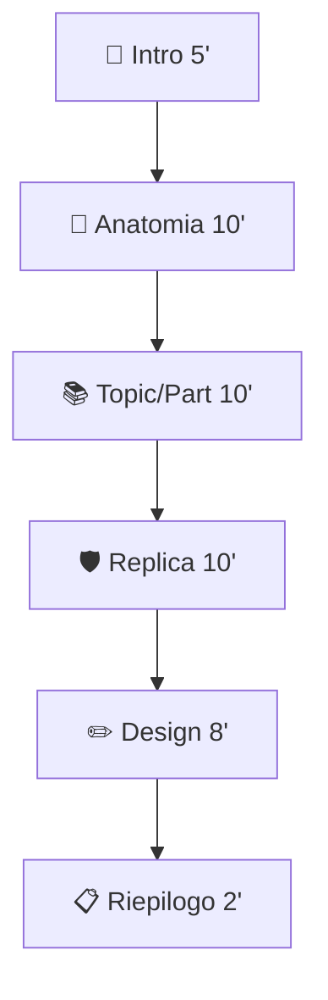
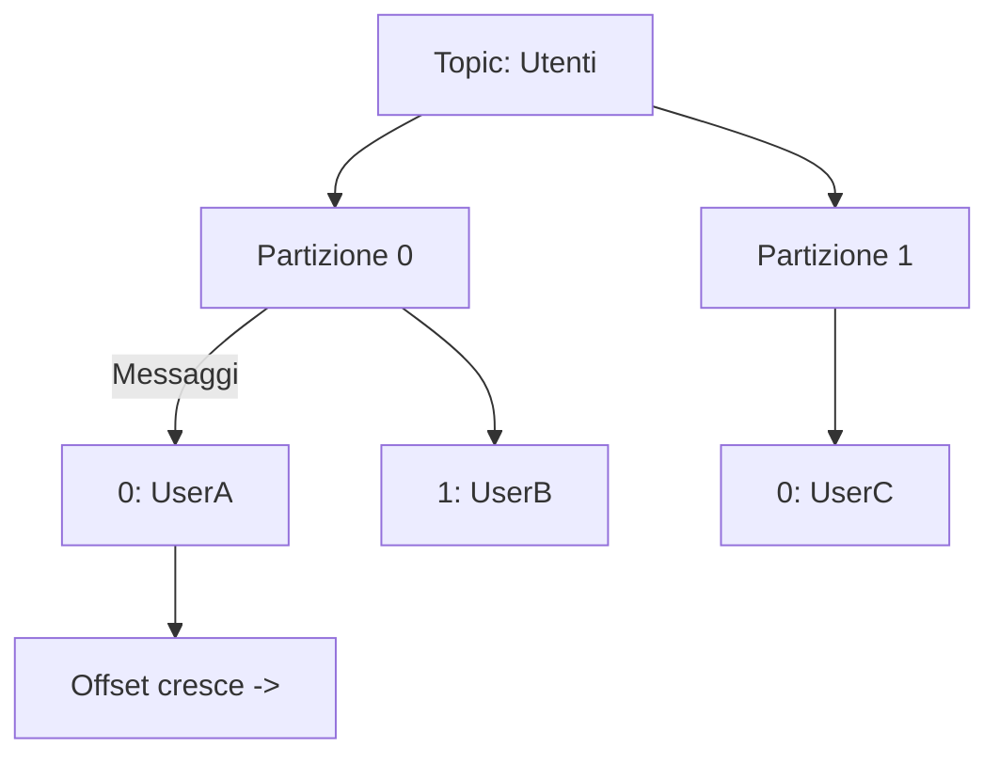

## Kafka Fondamenti: Architettura e Concetti Base — Lezione Completa

Apache Kafka è il sistema nervoso centrale delle aziende data-driven moderne come LinkedIn, Uber e Netflix. Non è solo una "coda di messaggi", è una piattaforma di streaming distribuita. In questa lezione, smonteremo Kafka pezzo per pezzo per capire come garantisce velocità, scalabilità e persistenza, concetti che ogni Data Engineer deve padroneggiare.

### Obiettivi di Apprendimento

Al termine di questa lezione, lo studente sarà in grado di:
1.  Spiegare la differenza tra un "Broker", un "Topic" e una "Partition".
2.  Comprendere il ruolo di ZooKeeper (o KRaft) nella gestione del cluster.
3.  Progettare una strategia di partizionamento per garantire l'ordine dei messaggi.
4.  Configurare il "Retention Policy" per gestire lo spazio su disco.
5.  Distinguere tra i pattern "Producer-Consumer" e "Publish-Subscribe".

### Timeline della Lezione

| Fase | Argomento | Durata |
|------|-----------|--------|
| 1 | Introduzione: Perché Kafka? | 5 min |
| 2 | Teoria: Anatomia di un Cluster Kafka | 10 min |
| 3 | Concetto: Topic, Partizioni e Offset | 10 min |
| 4 | Architettura: Replica e Fault Tolerance | 10 min |
| 5 | Esercizi: Design di un Topic | 8 min |
| 6 | Riepilogo e Domande | 2 min |
| **Totale** | | **45 min** |

### Fase 1 — Introduzione: Perché Kafka? (5 min)

Prima di Kafka, integrare sistemi era un incubo "spaghetti": il Database parlava con l'App, l'App con Hadoop, Hadoop con il Data Warehouse. Se un sistema cambiava, tutto si rompeva.
Kafka introduce un **Log centrale immutabile**. Tutti scrivono nel Log (Producers), tutti leggono dal Log (Consumers). I sistemi sono disaccoppiati. Se il Consumer è lento, Kafka tiene i dati finché non è pronto.

### Fase 2 — Teoria: Anatomia di un Cluster Kafka (10 min)

Un cluster Kafka è composto da:
1.  **Broker:** I server fisici che salvano i dati.
2.  **ZooKeeper (Legacy) / KRaft (Moderno):** Il cervello che gestisce i metadati (chi è il leader? chi è vivo?).
3.  **Producers:** Le app che inviano dati (es. Web Server).
4.  **Consumers:** Le app che leggono dati (es. Spark, ClickHouse).

Kafka è "Dumb Broker, Smart Consumer". Il Broker non sa chi ha letto cosa. È il Consumer che deve ricordarsi "sono arrivato al messaggio 100".

### Fase 3 — Concetto: Topic, Partizioni e Offset (10 min)

*   **Topic:** Una categoria logica (es. `ordini`).
*   **Partition:** Per scalare, il topic `ordini` è diviso in 3 file fisici (Partizioni 0, 1, 2) su server diversi.
*   **Offset:** L'ID univoco e sequenziale di un messaggio dentro una partizione.

**L'Ordine:** Kafka garantisce l'ordine *solo* dentro una partizione, non nel topic intero. Se l'ordine globale è vitale (raro), devi usare 1 sola partizione (ma perdi scalabilità).

### Fase 4 — Architettura: Replica e Fault Tolerance (10 min)

Se un Broker muore, perdi i dati? No, grazie al **Replication Factor** (di solito 3).
*   Ogni partizione ha un **Leader** (dove scriviamo/leggiamo) e 2 **Follower** (che copiano i dati passivamente).
*   Se il Leader muore, ZooKeeper elegge un Follower come nuovo Leader. Il servizio continua senza interruzione.

**Ack (Acknowledge):**
*   `acks=0`: Producer spara e dimentica (Veloce, insicuro).
*   `acks=1`: Leader conferma (Medio).
*   `acks=all`: Leader e tutti i Follower confermano (Lento, sicurissimo).

### Fase 5 — Esercizi: Design di un Topic (8 min)

**Scenario:** Topic `transazioni_bancarie`.
Traffico: 1000 eventi/sec.
Requisito: Le transazioni dello stesso utente devono essere ordinate.

**Soluzione:**
1.  **Partizioni:** Quante? Dipende dai Consumer. Diciamo 10.
2.  **Key:** Usiamo `user_id` come chiave di partizionamento.
    *   *Perché:* Kafka usa l'hash della chiave (`hash(user_id) % 10`) per scegliere la partizione. Così, tutte le transazioni di Mario finiranno sempre nella Partizione 3 e saranno ordinate.
3.  **Retention:** "Infinite" (Compact). Teniamo solo l'ultimo saldo per ogni utente.

### Fase 6 — Riepilogo e Domande (2 min)

1.  **Log, non Coda.** I messaggi restano dopo la lettura.
2.  **Partizioni = Scalabilità.** Più partizioni = più parallelismo.
3.  **Chiave = Ordine.** Usa la chiave giusta per raggruppare i dati correlati.
4.  **Offset.** La "posizione" di lettura.

### Domande di Verifica

1.  Qual è la differenza principale tra un "Topic" e una "Partition" in Kafka?
2.  Se hai un Topic con 3 partizioni, l'ordine dei messaggi è garantito globalmente? Perché?
3.  A cosa serve il "Replication Factor" e qual è il valore raccomandato per la produzione?
4.  Cosa succede se un Producer invia un messaggio senza specificare una "Key"?
5.  Spiega il ruolo dell'"Offset" per un Consumer Group.

### Riferimenti Bibliografici

-   Kafka Documentation, "Introduction".
-   Confluent, "Kafka: The Definitive Guide" (Capitoli 1-3).
-   Jay Kreps, "The Log: What every software engineer should know...".
