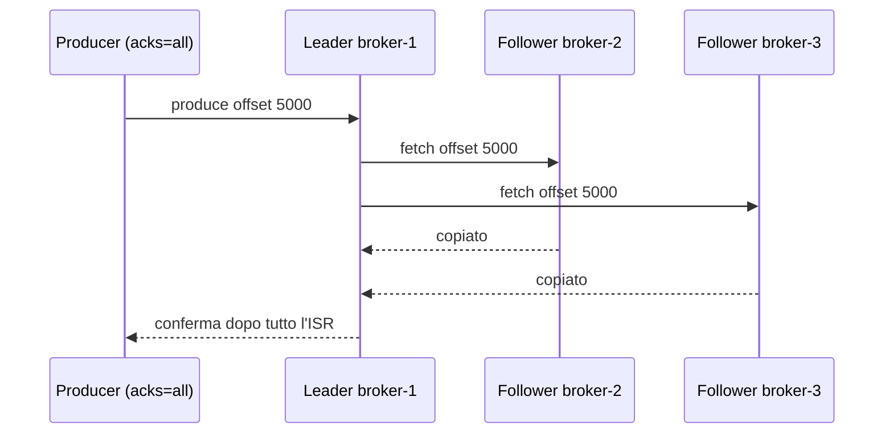

Un istituto di pagamento fa girare un cluster Kafka a tre broker con il topic dei pagamenti a fattore di replica 3. Il producer però usa `acks=1`, il topic ha `min.insync.replicas=1` e sul broker è attiva l'elezione di leader non sincronizzati. Alle 14:20 `broker-1`, leader della partizione 0, va in kernel panic proprio dopo aver confermato 1.400 transazioni che i follower non avevano ancora copiato. Un follower rimasto indietro diventa leader e le 1.400 transazioni, già dichiarate riuscite ai clienti, non esistono più. È uno scenario costruito con numeri di esempio, e mostra una verità poco intuitiva: avere tre repliche non protegge da nulla se le impostazioni che decidono quando un messaggio è "confermato" non sono allineate tra loro.

## Millequattrocento pagamenti confermati e poi spariti

L'istituto del caso elabora 700 transazioni al secondo su `broker-1`, `broker-2` e `broker-3`. L'architetto ha creato il topic con tre repliche e considera il problema chiuso. Tre parametri sono rimasti ai valori permissivi: il producer ha `acks=1`, il topic ha `min.insync.replicas=1` e `unclean.leader.election.enable=true`.

Durante i due secondi che precedono il crash, il producer invia 700 tx/s × 2 s = 1.400 transazioni a `broker-1`. Con `acks=1` il leader risponde `OK` appena ha scritto il messaggio nel proprio page cache, senza aspettare i follower. I follower, che copiano con un ciclo di fetch asincrono, hanno un ritardo di circa due secondi. Quando `broker-1` si spegne, il controller deve eleggere un nuovo leader, e con l'elezione non sincronizzata abilitata sceglie `broker-2`, anche se il suo log si ferma due secondi prima. Le 1.400 transazioni, per Kafka, non sono mai esistite.

> **Idea chiave:** Kafka non perde messaggi confermati solo se la conferma arriva dopo che il messaggio è stato scritto su più repliche, e solo se il nuovo leader può essere scelto esclusivamente tra le repliche che quel messaggio ce l'hanno.

Le tre impostazioni che governano questo comportamento stanno su livelli diversi (producer, topic, broker) e vanno decise insieme. Le sezioni seguenti spiegano il meccanismo, poi mostrano il dimensionamento e i comandi.

## Leader, follower e ISR: chi custodisce cosa

Ogni partizione di un topic con `replication.factor=3` ha un **leader** e due **follower**. Il leader riceve tutte le scritture e di norma serve anche tutte le letture. I follower copiano il log del leader con richieste di fetch continue, come se fossero consumatori molto veloci, e lo salvano sul proprio disco.

L'**ISR** (*In-Sync Replicas*) è l'insieme delle repliche, leader compreso, che sono allineate al leader entro `replica.lag.time.max.ms` (30 secondi di default nelle versioni recenti). Un follower che rallenta oltre la soglia viene espulso dall'ISR dal leader; quando recupera, rientra. L'ISR è quindi un insieme dinamico, e il suo contenuto è l'informazione su cui si basano durabilità e disponibilità.

L'**High Watermark** è l'offset più alto copiato su tutte le repliche dell'ISR. I consumatori vedono solo i messaggi fino all'High Watermark, così non leggono mai dati che potrebbero sparire con un cambio di leader. Il controller del cluster, basato su KRaft nelle installazioni moderne, tiene l'elenco dei leader e dell'ISR di ogni partizione e li aggiorna quando un broker cade.



Con `acks=all` la conferma parte solo dopo che tutte le repliche dell'ISR hanno copiato il messaggio. Con `acks=1` parte subito dopo la scrittura sul leader, ed è lì che nascono i 1.400 pagamenti persi.

## La triade di durabilità: RF, min.insync.replicas e acks

Per un topic di business servono quattro impostazioni coerenti: `replication.factor=3`, `min.insync.replicas=2`, `acks=all` sul producer e `unclean.leader.election.enable=false`. Ognuna chiude una falla diversa.

`acks=all` garantisce che il messaggio sia su tutte le repliche dell'ISR prima della conferma. Ma se l'ISR si è ridotto al solo leader, "tutte le repliche dell'ISR" vale una sola replica, e `acks=all` degrada in silenzio a `acks=1`. Per questo serve `min.insync.replicas=2`: il leader rifiuta la scrittura con `NotEnoughReplicasException` quando nell'ISR non ci sono almeno due repliche vive. Infine `unclean.leader.election.enable=false` impedisce al controller di promuovere una replica fuori dall'ISR, cioè una replica che potrebbe non avere dati già confermati.

Con la triade attiva, se il leader muore un millisecondo dopo la conferma, almeno un follower dell'ISR ha già quel messaggio e viene promosso. La perdita di un solo nodo non perde nessun dato confermato. Il prezzo è la disponibilità in caso di doppio guasto: con due broker giù su tre, l'ISR scende a uno, `min.insync.replicas=2` non è più soddisfatto e le scritture si fermano. È una scelta deliberata, perché per un pagamento è preferibile rifiutare una scrittura piuttosto che confermarla senza protezione.

| Configurazione (RF=3, acks=all) | Un broker giù | Due broker giù | Dati confermati persi se il leader cade |
|---|---|---|---|
| `min.insync.replicas=1` | Scritture ok | Scritture ok, solo leader | Possibili |
| `min.insync.replicas=2` | Scritture ok | Scritture rifiutate | No |
| `min.insync.replicas=3` | Scritture rifiutate | Scritture rifiutate | No |

La tabella spiega anche il secondo errore tipico della lezione: impostare `min.insync.replicas` uguale al fattore di replica protegge ma rende il cluster fragile. La regola pratica è $\text{min.insync.replicas} = \text{replication.factor} - 1$.

## Dimensionare partizioni e disco per il topic dei pagamenti

Il dimensionamento parte dal traffico. I numeri di esempio: 700 transazioni al secondo in media, picco a 2.100 tx/s (tre volte la media), messaggio medio di 1.000 byte, throughput sostenibile di una partizione in scrittura circa 10 MB/s, un consumatore che elabora 0,35 MB/s (350 tx/s), retention di 14 giorni.

Il numero minimo di partizioni segue la formula

$$P = \max\left(\left\lceil \frac{T_{\text{picco}}}{T_p} \right\rceil, \left\lceil \frac{T_{\text{picco}}}{T_c} \right\rceil\right)$$

dove $T_p$ è il limite di scrittura per partizione e $T_c$ il throughput di un consumatore. Calcolo passo passo:

1. Throughput di picco: 2.100 tx/s × 1.000 byte = 2,1 MB/s.
2. Vincolo di scrittura: 2,1 ÷ 10 = 0,21, quindi 1 partizione.
3. Vincolo di lettura: 2,1 ÷ 0,35 = 6 partizioni.
4. Minimo: max(1, 6) = 6. Con una crescita prevista del 100%, il picco diventa 4,2 MB/s e servono 4,2 ÷ 0,35 = 12 partizioni, che è il valore scelto.

Spazio disco a regime medio:

1. Volume al secondo: 700 tx/s × 1.000 byte = 0,7 MB/s.
2. Volume al giorno: 0,7 MB/s × 86.400 s = 60.480 MB, circa 60,5 GB.
3. Retention di 14 giorni: 60,5 GB × 14 = 846,7 GB per replica.
4. Con RF=3: 846,7 GB × 3 = 2.540 GB, cioè circa 2,5 TB sul cluster, pari a 847 GB per broker.
5. Con il 30% di margine: 847 GB × 1,3 = 1.101 GB per broker.

La compressione `compression.type=producer` mantiene il formato scelto dal producer (per esempio `zstd`), e su JSON può ridurre il volume di due o tre volte rispetto a questo calcolo senza compressione. Il valore calcolato è quindi un tetto prudente.

## Tre errori di configurazione che azzerano le garanzie

I blocchi seguenti raccolgono le combinazioni che si trovano più spesso nei cluster in produzione, tutte con lo stesso difetto: ciascun parametro sembra ragionevole preso da solo.

```bash
# ERRORE 1: conferma sul solo leader e promozione di repliche non sincronizzate
# producer: acks=1
kafka-configs.sh --bootstrap-server kafka-1:9092 --alter --entity-type topics \
  --entity-name payments.authorized.v1 \
  --add-config unclean.leader.election.enable=true

# ERRORE 2: min.insync.replicas = replication.factor (3 su 3)
kafka-configs.sh --bootstrap-server kafka-1:9092 --alter --entity-type topics \
  --entity-name payments.authorized.v1 --add-config min.insync.replicas=3
```

### acks=1 con elezione non sincronizzata

Il sintomo è la scomparsa di messaggi che l'applicazione aveva dichiarato scritti, scoperta ore dopo da una riconciliazione contabile. Succede perché `acks=1` risparmia pochi millisecondi di latenza, e il messaggio vive su un solo nodo nell'istante in cui il producer procede. La correzione è `acks=all`, `min.insync.replicas=2` e `unclean.leader.election.enable=false`, verificando con `--describe` che le impostazioni siano effettive sul topic e non solo sul producer.

### min.insync.replicas uguale al fattore di replica

Il sintomo è un blocco generale dei producer durante un normale aggiornamento: un solo broker riavviato per 30 secondi e tutte le applicazioni ricevono `NotEnoughReplicasException`. L'impostazione sembra la più sicura perché pretende tutti e tre i nodi. Si corregge con `min.insync.replicas=2`, che tollera un nodo fermo per manutenzione senza perdere garanzie.

### Centinaia di partizioni per un topic piccolo

Il sintomo è un failover lento: dopo il riavvio di un broker, ogni partizione richiede una nuova elezione e il cluster impiega minuti a stabilizzarsi. Un topic da 2 MB/s creato con 500 partizioni sembra "pronto a crescere", ma ogni partizione su ogni replica è una directory con file `.log`, `.index` e `.timeindex`, con file descriptor aperti e scritture sparse. Si evita con il calcolo della sezione precedente: nella maggior parte dei casi bastano da 6 a 24 partizioni.

## Creare e verificare il topic blindato

Il topic dei pagamenti si crea con la triade già impostata e si verifica subito che ogni partizione abbia tre repliche nell'ISR. Il producer Python completa il quadro dal lato client.

```bash
# 1. Creazione del topic: 12 partizioni, RF=3, min ISR 2, niente elezione non sincronizzata
kafka-topics.sh --bootstrap-server kafka-1:9092,kafka-2:9092,kafka-3:9092 --create \
  --topic payments.authorized.v1 --partitions 12 --replication-factor 3 \
  --config min.insync.replicas=2 \
  --config unclean.leader.election.enable=false \
  --config cleanup.policy=delete --config retention.ms=1209600000 \
  --config compression.type=producer

# 2. Verifica: Replicas e Isr devono elencare tre broker per ogni partizione
kafka-topics.sh --bootstrap-server kafka-1:9092 --describe --topic payments.authorized.v1

# 3. Partizioni sotto-replicate: in condizioni sane non deve stampare nulla
kafka-topics.sh --bootstrap-server kafka-1:9092 --describe --under-replicated-partitions
```

```python
# Producer di pagamenti allineato alla triade di durabilità del topic
from confluent_kafka import Producer

producer = Producer({
    "bootstrap.servers": "kafka-1:9092,kafka-2:9092,kafka-3:9092",
    "acks": "all",                    # attende tutto l'ISR
    "enable.idempotence": True,       # i retry non duplicano il messaggio
    "compression.type": "zstd",       # riduce rete e disco
    "linger.ms": 20,                  # raggruppa i messaggi in batch
})

def on_delivery(err, msg):
    # errore esplicito se non arriva la conferma dell'ISR
    if err is not None:
        raise RuntimeError(f"pagamento non confermato: {err}")

producer.produce("payments.authorized.v1", key="PAY-77310",
                 value='{"amount_eur": 129.90}', on_delivery=on_delivery)
producer.flush()
```

Con questa configurazione, se `broker-1` viene spento mentre il producer scrive 700 tx/s, l'ISR passa da `(1,2,3)` a `(2,3)`, il controller promuove `broker-2` e le 1.400 transazioni degli ultimi due secondi sono integre su `broker-2` e `broker-3`. Il producer non vede errori bloccanti, perché `min.insync.replicas=2` è ancora soddisfatto.

## Delete per tempo o compact per chiave

Ogni topic gestisce lo spazio con `cleanup.policy`. Con `delete` i segmenti più vecchi della soglia di tempo o di dimensione vengono eliminati. Con `compact` Kafka conserva almeno l'ultimo valore per ciascuna chiave, indefinitamente.

La regola di scelta è netta. I flussi di eventi immutabili (pagamenti, click, ordini, telemetria) usano `delete`, perché conta la serie storica entro la retention. I topic che rappresentano uno stato corrente, come anagrafica prodotti, profili clienti, tassi di cambio o Change Data Capture, usano `compact`, così un nuovo consumatore che parte da zero ricostruisce l'ultimo stato di ogni chiave anche se non è cambiata da sei mesi. Usare `delete` con retention di 7 giorni sul topic dell'anagrafica articoli fa sparire dal topic le scarpe il cui prezzo non cambia da otto giorni, e ogni nuovo servizio che fa replay non le trova più.

Nella compattazione per cancellare una chiave serve un *tombstone*: un messaggio con la stessa chiave e valore `null`. Il tombstone resta visibile per `delete.retention.ms` (24 ore di default) perché i consumatori lenti abbiano il tempo di leggerlo, poi viene rimosso. Questa lezione non copre il Tiered Storage di KIP-405 né il bilanciamento dei dischi con Cruise Control.

## Controllo prima di approvare la configurazione di un topic

1. Un topic ha RF=3, `min.insync.replicas=2`, `acks=all` e `unclean.leader.election.enable=false`. Quanti broker possono cadere senza perdere né dati confermati né disponibilità in scrittura?

<details>
<summary>Mostra risposta</summary>

Uno. Con due broker giù l'ISR scende a un solo nodo, `min.insync.replicas=2` non è soddisfatto e le scritture si fermano, ma i dati già confermati restano al sicuro sul broker superstite.

</details>

2. Il picco è 3.000 eventi/s da 800 byte, un consumer regge 0,4 MB/s e il limite di scrittura è 10 MB/s per partizione. Quante partizioni servono come minimo?

<details>
<summary>Mostra risposta</summary>

Picco = 3.000 × 800 byte = 2,4 MB/s. Scrittura: 2,4 ÷ 10 = 0,24, quindi 1. Lettura: 2,4 ÷ 0,4 = 6. Il massimo è 6 partizioni.

</details>

3. Con 1,5 MB/s di traffico medio, retention di 10 giorni e RF=3, quanto disco serve per broker su tre broker con il 30% di margine?

<details>
<summary>Mostra risposta</summary>

1,5 MB/s × 86.400 s = 129.600 MB al giorno, × 10 giorni = 1.296.000 MB (1,296 TB), × 3 = 3,888 TB sul cluster, ÷ 3 broker = 1,296 TB per broker, × 1,3 = circa 1,68 TB.

</details>

4. Quale politica di pulizia scegli per il topic dei tassi di cambio e perché?

<details>
<summary>Mostra risposta</summary>

`compact`, perché è uno stato per chiave (la coppia di valute). Un nuovo consumatore deve poter ricostruire l'ultimo tasso di ogni coppia anche se non cambia da mesi, cosa impossibile con una retention a tempo.

</details>

5. Quali due metriche indicano che la replica è sana?

<details>
<summary>Mostra risposta</summary>

`UnderReplicatedPartitions = 0` e `ActiveControllerCount = 1`. Con la prima tutte le repliche sono allineate, con la seconda il cluster ha un controller attivo che può gestire un failover.

</details>
