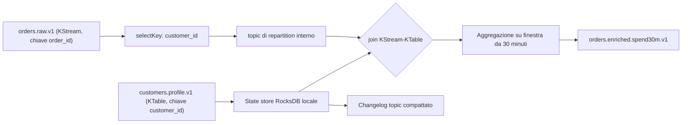

## Quattromila SELECT al secondo contro il database dei clienti

Considera uno scenario costruito con numeri di esempio. Un negozio online pubblica ogni ordine sul topic `orders.raw.v1`, a 12 partizioni, con una media di 4.000 ordini al secondo nei picchi. Un microservizio deve fare due cose: aggiungere a ogni ordine il segmento del cliente (`VIP`, `STANDARD`, `NEW`) e calcolare quanto ha speso quel cliente negli ultimi 30 minuti, per fermare i furti di account. Il team scrive un consumer che a ogni messaggio esegue una `SELECT` su PostgreSQL e tiene i totali in una `ConcurrentHashMap`.

Il primo guasto è aritmetico. Una chiamata al database costa 3 ms di sola rete, quindi un thread che lavora in modo sincrono smaltisce 1 / 0,003 s ≈ 333 messaggi al secondo. Per arrivare a 4.000 messaggi al secondo servono 4.000 / 333 ≈ 12 thread che tengono aperte altrettante connessioni permanenti verso il CRM, lo stesso database che serve il sito. Il pool si esaurisce e le pagine del negozio rallentano.

Il secondo guasto è la memoria volatile. I totali vivono nell'heap della JVM, e quando Kubernetes sposta il pod su un altro nodo la mappa sparisce: chi aveva già speso 2.500 euro cinque minuti prima riparte da zero. Il terzo è più subdolo e riguarda le chiavi. Gli ordini sono partizionati per `order_id`, i clienti per `customer_id`, e senza un re-keying il profilo che serve all'ordine non si trova sulla partizione che lo sta elaborando.

Tutti e tre i problemi derivano dal trattare l'arricchimento come una chiamata di rete anziché come un join tra due flussi di dati. Kafka Streams, descritto da Sax e colleghi nell'articolo di riferimento ([Sax et al., 2018](https://doi.org/10.1145/3183713.3190664)), è una libreria client che porta lo stato dentro il processo e lo protegge con topic Kafka interni.

## KStream e KTable: lo stesso dato letto come evento o come stato

Un `KStream` è una sequenza di fatti che non si sovrascrivono: ogni record di `orders.raw.v1` è un nuovo ordine e due ordini con la stessa chiave restano entrambi. Una `KTable` è la lettura opposta dello stesso tipo di topic: per ogni chiave conta solo l'ultimo valore, e un nuovo record con la stessa chiave sostituisce il precedente. Il topic `customers.profile.v1` è compattato, quindi la sua `KTable` contiene sempre il profilo corrente di ciascun cliente.

> **Idea chiave:** un join tra un flusso di eventi e una tabella di stato non chiama nessun servizio esterno, perché la tabella è una copia locale, aggiornata dal topic, che vive sul disco dello stesso processo che elabora l'evento.

Il motore che rende possibile questa copia è RocksDB, un database chiave-valore embedded che Kafka Streams usa come state store. Ogni scrittura nello store viene replicata su un topic changelog interno, compattato, chiamato `<application.id>-<store>-changelog`. Lo store è quindi una cache veloce e il changelog è la sua fonte di verità durevole.



Il diagramma mostra che il join avviene a valle del re-keying. Prima della riga `D` il flusso degli ordini deve avere la stessa chiave e lo stesso numero di partizioni della tabella, altrimenti il record dell'ordine e il profilo del cliente finiscono su task diversi.

## Co-partizionamento: perché il join cerca sul nodo giusto

Kafka Streams assegna le partizioni ai task in modo che il task `n` legga la partizione `n` di tutti i topic coinvolti nel join. Il profilo di un cliente è scritto dal partizionatore predefinito del producer, che calcola `murmur2(chiave) mod numero_partizioni`. Se la tabella dei clienti ha 12 partizioni e usa `customer_id` come chiave, il cliente `C-42` finisce sempre nella stessa partizione, per esempio la 5. Se gli ordini hanno chiave `order_id`, l'ordine di `C-42` finisce su una partizione qualunque.

Facciamo il calcolo con 12 partizioni. Con chiavi diverse, la probabilità che l'ordine capiti sulla partizione che contiene il profilo del suo cliente è 1 / 12 ≈ 8,3%, quindi il join fallisce nel 100% − 8,3% = 91,7% dei casi e il campo `segment` resta nullo. Con 8 partizioni sul topic degli ordini e 12 su quello dei clienti il problema è ancora peggiore, perché Kafka Streams rifiuta di costruire la topology e solleva una `TopologyException` all'avvio.

La soluzione ha due parti. La prima è eseguire `selectKey` sul flusso degli ordini per usare `customer_id`: la libreria crea da sola un topic di repartition interno, con lo stesso numero di partizioni del topic sorgente, e riscrive i record con la nuova chiave. La seconda è verificare che il topic dei clienti abbia davvero 12 partizioni. Prima di scrivere codice conviene controllare i due topic dalla riga di comando.

```bash
# Verifica del co-partizionamento: il numero di partizioni deve coincidere
for t in orders.raw.v1 customers.profile.v1; do
  kafka-topics.sh --bootstrap-server kafka-1:9092 --describe --topic "$t" \
    | head -1 | grep -o 'PartitionCount: [0-9]*'
done
# Atteso: PartitionCount: 12 per entrambi i topic.
# Controlla anche che il topic clienti sia compattato:
kafka-configs.sh --bootstrap-server kafka-1:9092 --describe \
  --entity-type topics --entity-name customers.profile.v1 | grep cleanup.policy
```

Quando l'anagrafica è piccola, per esempio qualche centinaio di megabyte, c'è un'alternativa al co-partizionamento: la `GlobalKTable`, che replica per intero la tabella su ogni istanza. Il join con una `GlobalKTable` accetta una chiave qualunque, calcolata con un `KeyValueMapper`, ma ogni istanza paga lo spazio disco e la banda dell'intera tabella.

## La topology completa in Java

Il codice seguente costruisce l'intera pipeline. Il `KStream` degli ordini viene ricodificato su `customer_id`, unito alla `KTable` dei profili, raggruppato per cliente e aggregato su una finestra di 30 minuti con un grace period di 2 minuti per accettare i ritardatari.

```java
// Topology Kafka Streams: arricchimento con segmento cliente e spesa su 30 minuti
StreamsBuilder builder = new StreamsBuilder();

KTable<String, Customer> customers = builder.table(
    "customers.profile.v1",
    Consumed.with(Serdes.String(), customerSerde),
    Materialized.as("customer-store"));

KStream<String, Order> orders = builder.stream(
    "orders.raw.v1", Consumed.with(Serdes.String(), orderSerde));

orders
    // Re-keying: crea il topic di repartition con chiave customer_id
    .selectKey((orderId, order) -> order.getCustomerId())
    // Join locale su RocksDB: nessuna chiamata di rete
    .join(customers, (order, customer) -> order.withSegment(customer.getSegment()),
          Joined.with(Serdes.String(), orderSerde, customerSerde))
    .groupByKey(Grouped.with(Serdes.String(), enrichedOrderSerde))
    .windowedBy(TimeWindows.ofSizeAndGrace(Duration.ofMinutes(30), Duration.ofMinutes(2)))
    .aggregate(SpendAccumulator::new,
               (customerId, order, acc) -> acc.add(order.getAmountEur()),
               Materialized.<String, SpendAccumulator, WindowStore<Bytes, byte[]>>as("spend-30m-store")
                   .withValueSerde(spendSerde))
    // Un solo risultato per finestra, emesso quando la finestra si chiude
    .suppress(Suppressed.untilWindowCloses(Suppressed.BufferConfig.unbounded()))
    .toStream((windowedKey, acc) -> windowedKey.key())
    .to("orders.spend30m.v1", Produced.with(Serdes.String(), spendSerde));
```

Il metodo `groupByKey` dopo il join non provoca un secondo repartition, perché la chiave è già `customer_id`. Se invece avessi chiamato `groupBy` con una funzione che cambia la chiave, la libreria avrebbe creato un altro topic interno e raddoppiato il traffico su Kafka.

## Stato locale, changelog e standby replica

Quando un pod muore, la nuova istanza trova la propria cartella `state.dir` vuota e deve ricostruire gli store leggendo i changelog dall'inizio. Il tempo di ripristino dipende dalla dimensione dello stato e dalla velocità di lettura. Prendiamo numeri di esempio per un servizio con 60 GB di stato complessivo e una lettura del changelog a 100 MB/s per istanza. Convertiamo 60 GB in 61.440 MB, poi dividiamo: 61.440 MB / 100 MB/s = 614 secondi, cioè poco più di 10 minuti durante i quali il servizio non elabora nulla.

Con `num.standby.replicas=1` un secondo processo mantiene una copia calda dello stesso store, leggendo il changelog in continuo. Al guasto del primario, il task passa allo standby che ha già quasi tutto lo stato: restano da leggere soltanto gli ultimi record non ancora applicati, per esempio 5 secondi di traffico, cioè pochi secondi di ripristino invece di 614. Il prezzo è un raddoppio dello spazio disco e della banda di lettura dei changelog, perché ogni store esiste in due copie.

Il secondo rimedio, complementare, è non perdere la cartella dello stato a ogni riavvio. In Kubernetes questo significa un `StatefulSet` con un volume persistente per ogni pod, in modo che dopo un rilascio la nuova versione trovi i file RocksDB già al loro posto e legga dal changelog solo la differenza.

```yaml
# StatefulSet: il volume persistente conserva state.dir tra un rilascio e l'altro
apiVersion: apps/v1
kind: StatefulSet
metadata:
  name: orders-enricher
spec:
  serviceName: orders-enricher
  replicas: 4
  template:
    spec:
      containers:
        - name: app
          image: registry.example.com/orders-enricher:1.8.0
          env:
            - name: APPLICATION_ID
              value: "orders-enricher"
            - name: NUM_STANDBY_REPLICAS
              value: "1"
            - name: STATE_DIR
              value: "/var/lib/kafka-streams"
            - name: PROCESSING_GUARANTEE
              value: "exactly_once_v2"
            - name: JAVA_TOOL_OPTIONS
              value: "-Xmx2g"
          resources:
            limits:
              memory: "5Gi"   # heap 2 GB + cache RocksDB 1 GB + write buffer 0,5 GB + margine
          volumeMounts:
            - name: state
              mountPath: /var/lib/kafka-streams
  volumeClaimTemplates:
    - metadata:
        name: state
      spec:
        accessModes: ["ReadWriteOnce"]
        resources:
          requests:
            storage: 50Gi
```

Il limite di memoria merita un calcolo esplicito, perché è la causa più frequente di `OOMKilled`. L heap Java vale 2 GB, ma RocksDB alloca in C++ fuori dall heap: una block cache da 1 GB, i buffer di scrittura per circa 0,5 GB e altri 0,5 GB tra metaspace, stack dei thread e buffer di rete. La somma è 2 + 1 + 0,5 + 0,5 = 4 GB, quindi un limite di 5 GB lascia 1 GB, cioè il 20% di margine. Con un limite pari al solo heap, il kernel uccide il container pur con l heap mezzo vuoto.

## Finestre, grace period e suppress

Un aggregato su finestra viene aggiornato a ogni evento. Un cliente che fa 15 acquisti in 30 minuti produce 15 aggiornamenti per la stessa coppia `(finestra, cliente)`, e per default la topology li emette tutti sul topic di output. Con 200.000 clienti attivi per finestra, il traffico sul topic è 200.000 × 15 = 3.000.000 di record contro i 200.000 che servirebbero. La riduzione ottenibile è 1 − 200.000 / 3.000.000 = 93,3%.

L'operatore `suppress(untilWindowCloses)` trattiene gli aggiornamenti in un buffer e ne emette soltanto uno, quando la finestra si chiude. Il momento di chiusura non coincide con la fine dei 30 minuti, perché il grace period di 2 minuti tiene la finestra aperta per i ritardatari: la chiusura avviene quando il tempo di flusso, cioè il timestamp massimo osservato, supera la fine della finestra più il grace. Questo ha una conseguenza che sorprende chi la scopre in produzione: se il traffico si ferma, il tempo di flusso non avanza e l'ultimo risultato non esce, perché Kafka Streams misura il tempo con gli eventi e non con l'orologio.

Un esempio numerico mostra il significato del dato emesso. Il cliente `C-42` fa quattro ordini nella finestra 10:00-10:30, da 80 euro, 450 euro, 1.200 euro e 900 euro. La somma è 80 + 450 + 1.200 + 900 = 2.630 euro. La soglia antifrode del servizio è 2.500 euro, quindi l'alert scatta con un margine di 130 euro. Senza `suppress`, l'alert scatterebbe già al quarto aggiornamento parziale, ma con un valore intermedio di 1.730 euro dopo il terzo ordine un consumatore a valle che prende decisioni sul primo valore ricevuto agirebbe su un dato incompleto.

Quando serve reagire subito e non a fine finestra, `suppress` è lo strumento sbagliato. Un controllo antifrode che deve bloccare un account entro pochi secondi lavora sugli aggiornamenti parziali, e si accetta di gestire i duplicati logici a valle con una chiave `(finestra, cliente)` e l'ultimo valore che vince.

## Exactly-once v2: quando costa e quando serve

Senza garanzie transazionali, un crash tra la scrittura sul topic di output e il commit dell'offset di input fa rileggere lo stesso record, e il totale di spesa viene sommato due volte. Con `processing.guarantee=exactly_once_v2`, Kafka Streams racchiude in una transazione Kafka l'avanzamento dell'offset sorgente, gli aggiornamenti dei changelog e i record scritti sul topic di destinazione. O si vedono tutti, o non si vede nessuno.

Il costo è reale. Le transazioni impongono un commit più frequente, e ogni `commit.interval.ms` diventa un confine di transazione: il valore predefinito scende a 100 ms. I consumatori a valle devono leggere con `isolation.level=read_committed`, quindi vedono i record solo dopo il commit e la latenza end-to-end cresce di circa l'intervallo di commit. Per un conteggio di visualizzazioni di pagina un duplicato ogni tanto non cambia nessuna decisione, mentre per una somma di pagamenti o un limite di spesa un duplicato ha un effetto economico diretto.

La regola operativa è attivare `exactly_once_v2` sulle topology il cui output cambia denaro, stato di un account o contatori di quota, e lasciare `at_least_once` su quelle che producono metriche approssimate. La versione 2 richiede broker dalla 2.5 in avanti e riduce il numero di producer transazionali a uno per thread invece di uno per task, quindi con 30 task per istanza il carico sul coordinatore delle transazioni cala sensibilmente rispetto alla prima versione.

## Kafka Streams o aggregazione diretta in un database analitico

Quando il risultato di un calcolo deve rientrare in Kafka per azionare altri servizi, Kafka Streams è la scelta naturale: un blocco carta in 20 ms, una notifica push, un instradamento dinamico. La stessa libreria è adatta a logica per singolo evento che non si esprime bene in una query, come una macchina a stati sul ciclo di vita di un ordine.

Quando invece i consumatori finali sono dashboard e report, scrivere e mantenere servizi Java che pre-aggregano al minuto raddoppia il codice da gestire, perché un motore colonnare come ClickHouse esegue la stessa aggregazione con una vista materializzata a una frazione del costo. Il confronto sintetico:

| Criterio | Kafka Streams | Aggregazione nel database analitico |
| --- | --- | --- |
| Destinazione del risultato | Un altro topic Kafka, per azionare servizi | Tabelle lette da dashboard e query ad hoc |
| Latenza tipica | Decine di millisecondi per evento | Secondi, a seconda del flusso di ingestione |
| Stato e ripristino | RocksDB, changelog, standby da gestire | Gestiti dal motore del database |
| Linguaggio da mantenere | Java o Kotlin, con test della topology | SQL del database di destinazione |
| Costo operativo | Un servizio da dimensionare e monitorare | Una vista materializzata |

Per monitorare un servizio Kafka Streams le metriche più utili sono `commit-latency-max`, `poll-latency-avg` e `alive-stream-threads`. Se i thread vivi scendono, o se il lag del topic di input cresce per più di un picco, serve scalare le istanze, tenendo presente che il parallelismo massimo è il numero di partizioni del topic di input: oltre le 12 istanze di questo esempio le altre restano in attesa senza lavorare.

## Tre errori che compaiono nelle topology stateful

### Join tra chiavi o partizioni diverse

Il sintomo è un campo di arricchimento nullo nella maggior parte dei record, senza alcuna eccezione nel log, oppure una `TopologyException` all'avvio quando il numero di partizioni non coincide. Succede perché sembra naturale unire due topic che parlano dello stesso cliente, senza ricordare che il join lavora per task e quindi per partizione. La correzione è `selectKey` prima del join, un controllo di `PartitionCount` sui due topic e, per anagrafiche piccole, una `GlobalKTable`.

### Stato su disco effimero e zero standby

Il sintomo è un servizio fermo per dieci minuti a ogni rilascio, con il lag in crescita. Succede perché in un container qualsiasi `state.dir` punta a `/tmp`, che a ogni riavvio è vuoto, e senza standby tutto lo stato deve tornare dal changelog. La correzione è un volume persistente per pod, `num.standby.replicas=1` e un tempo di ripristino calcolato in anticipo come dimensione dello stato diviso velocità di lettura.

### Consumare gli aggiornamenti intermedi come se fossero risultati finali

Il sintomo è un totale che a valle risulta gonfiato di un fattore pari al numero medio di eventi per finestra. Succede perché un aggregato su finestra emette un record a ogni evento e una tabella append-only li somma tutti. La correzione è usare `suppress` quando serve un risultato finale per finestra, oppure scrivere a valle con una chiave `(finestra, cliente)` e una regola di sostituzione, in modo che l'ultimo aggiornamento sovrascriva i precedenti.

## Controllo prima del rilascio di una topology

1. Il topic degli ordini ha 12 partizioni e la tabella dei clienti ne ha 8: cosa succede all'avvio e come si risolve?

<details>
<summary>Mostra risposta</summary>

La libreria rifiuta di costruire la topology perché i due lati del join non sono co-partizionati, e solleva una `TopologyException`. Si risolve portando il topic dei clienti a 12 partizioni, cosa possibile solo ricreandolo e ricopiando i dati perché le partizioni di un topic compattato non si possono ridurre né ridistribuire in modo trasparente, oppure usando una `GlobalKTable` se l'anagrafica è piccola.

</details>

2. Il servizio ha 60 GB di stato e legge il changelog a 100 MB/s. Quanto resta fermo dopo un rilascio senza volume persistente e senza standby?

<details>
<summary>Mostra risposta</summary>

60 GB equivalgono a 61.440 MB, e 61.440 MB / 100 MB/s = 614 secondi, cioè circa 10 minuti. Con `num.standby.replicas=1` il tempo scende a pochi secondi, perché lo standby ha già quasi tutto lo stato e deve leggere solo gli ultimi record del changelog.

</details>

3. Una finestra da 30 minuti con 200.000 clienti produce in media 15 aggiornamenti per cliente. Quanti record scrive sul topic di output senza `suppress`, e con `suppress`?

<details>
<summary>Mostra risposta</summary>

Senza `suppress` scrive 200.000 × 15 = 3.000.000 di record. Con `suppress(untilWindowCloses)` ne scrive 200.000, uno per cliente, con una riduzione del 93,3%. Il compromesso è che il risultato esce solo dopo la chiusura della finestra, grace period incluso.

</details>

4. Il pod ha un limite di memoria di 2 GB e `-Xmx2g`. Perché viene ucciso con `OOMKilled` anche se l heap è quasi vuoto?

<details>
<summary>Mostra risposta</summary>

RocksDB usa memoria nativa fuori dall heap, per block cache e buffer di scrittura, e anche la JVM ha un uso non-heap per metaspace e stack. Il consumo totale del processo supera il limite del container e il kernel lo termina. Il limite va calcolato come heap più cache RocksDB più buffer più margine, per esempio 2 + 1 + 0,5 + 0,5 = 4 GB, e arrotondato per eccesso a 5 GB.

</details>

5. Un servizio produce un conteggio di visualizzazioni di pagina per una dashboard, un altro calcola il saldo di crediti prepagati. Quale dei due richiede `exactly_once_v2`?

<details>
<summary>Mostra risposta</summary>

Il servizio dei crediti prepagati, perché un duplicato o una perdita cambia un importo reale. Il conteggio di visualizzazioni tollera qualche duplicato occasionale e non giustifica il costo in latenza e in commit transazionali.

</details>
