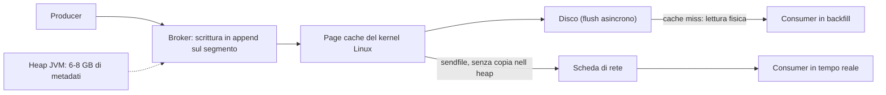

## Cinquantasei gigabyte di heap e un backfill alle 10:30

Considera uno scenario costruito con numeri di esempio. Un cluster Kafka ha tre broker con 64 GB di RAM ciascuno e riceve un flusso costante di 80 MB/s. Un amministratore convinto che a Java serva più memoria possibile imposta `-Xms56g -Xmx56g` e lascia 8 GB al sistema operativo. Per mesi nessuno nota niente, perché finché tutti i consumer leggono in tempo reale i dati appena scritti stanno ancora in memoria.

Alle 10:30 il team di analytics lancia un backfill che rilegge le ultime 48 ore del topic principale. I segmenti vecchi non sono più nel page cache, quindi ogni lettura va al disco fisico e l'utilizzo dell I/O sale al 100%. Le scritture dei producer, che condividono gli stessi dischi, rallentano. Sotto pressione la JVM da 56 GB avvia una pausa di garbage collection di 14 secondi: in quei 14 secondi il broker non risponde agli heartbeat, esce dall ISR di tutte le partizioni che guida e i leader rimbalzano da un nodo all'altro. Il cluster resta instabile per quaranta minuti.

L hardware era sufficiente e il guasto è nato da una scelta di configurazione. In questa lezione il punto di vista è quello di chi gestisce il cluster: la memoria dei broker, i segnali che avvisano prima di un incidente, il lag misurato nel tempo e le strategie per conservare e replicare i dati. La parte dedicata alle applicazioni di stream processing è nella lezione precedente su Kafka Streams.

## Perché Kafka vive nel page cache e non nell heap

Un broker Kafka non tiene i messaggi in strutture Java. Scrive ogni partizione come una sequenza di file di segmento, e lascia al kernel Linux il compito di mantenere in RAM i blocchi usati di recente, il page cache. Quando un consumer legge, il broker chiede al kernel di spostare i byte dal cache direttamente alla scheda di rete con la chiamata `sendfile()`, senza copiarli nello spazio utente e quindi senza passare dall heap.

> **Idea chiave:** la RAM di un broker Kafka rende di più al sistema operativo che alla JVM, perché ogni gigabyte lasciato al page cache permette a un consumer in ritardo di leggere dalla memoria invece che dal disco.

Il ragionamento operativo discende da questa architettura. L heap serve solo ai metadati, ai buffer delle richieste e agli oggetti di controllo, e 6-8 GB bastano anche su macchine da 128 GB. Un heap più grande non accelera nulla e allunga le pause del garbage collector, mentre ogni gigabyte sottratto al kernel accorcia la finestra di tempo che i consumer in ritardo possono leggere dalla RAM.



Il diagramma mostra due strade verso il consumer. Quella che passa dal cache costa pochi microsecondi per blocco, quella che scende al disco costa un accesso fisico e compete con le scritture dei producer.

## Quanta storia sta nel page cache: il calcolo

La domanda pratica è per quanti minuti un consumer può restare indietro e leggere ancora dalla RAM. La risposta si ottiene dividendo la memoria disponibile per il ritmo di scrittura. Prendiamo numeri di esempio: ogni broker riceve 80 MB/s di dati non compressi.

Nella configurazione sbagliata il kernel dispone di circa 6 GB effettivi di cache, perché degli 8 GB lasciati liberi una parte serve al sistema operativo stesso. Convertiamo 6 GB in 6.144 MB e dividiamo: 6.144 MB / 80 MB/s = 77 secondi. Un consumer che resta indietro di più di un minuto e mezzo legge dal disco.

Con heap a 6 GB restano 58 GB liberi per la cache, cioè 59.392 MB. Il calcolo diventa 59.392 MB / 80 MB/s = 742 secondi, circa 12 minuti. Se i producer comprimono con `zstd` e il topic usa `compression.type=producer`, il broker conserva i byte compressi senza ricomprimerli. Con un rapporto di compressione di 3 a 1, il flusso effettivo diventa 80 / 3 ≈ 26,7 MB/s e la finestra cresce a 59.392 / 26,7 ≈ 2.227 secondi, cioè circa 37 minuti.

Il passaggio da 77 secondi a 37 minuti è un fattore di circa 29, ottenuto senza comprare hardware. Il rapporto 3 a 1 è un ordine di grandezza plausibile per JSON ripetitivo, ma va misurato sul tuo traffico, perché dati già compressi come immagini o payload cifrati non guadagnano quasi nulla.

## Configurazione del broker e comandi di controllo

La prima configurazione riguarda memoria e sistema operativo. Con il blocco seguente imposti un heap fisso di 6 GB con il collector G1, abbassi la tendenza del kernel a usare lo swap e alzi i limiti di file e di aree mappate, che crescono con il numero di segmenti aperti.

```bash
# Avvio del broker: heap ridotto, il resto della RAM resta al page cache
export KAFKA_HEAP_OPTS="-Xms6g -Xmx6g"
export KAFKA_JVM_PERFORMANCE_OPTS="-XX:+UseG1GC -XX:MaxGCPauseMillis=20"

# Parametri del kernel Linux (da rendere persistenti in /etc/sysctl.d)
sudo sysctl -w vm.swappiness=1
sudo sysctl -w vm.max_map_count=262144
ulimit -n 100000   # file aperti: un descrittore per segmento e per connessione

# Codec del topic: conserva i batch del producer senza ricomprimerli
kafka-configs.sh --bootstrap-server kafka-1:9092 --alter \
  --entity-type topics --entity-name orders.created.v1 \
  --add-config compression.type=producer
```

Il secondo gruppo di comandi serve al controllo quotidiano. Le due opzioni di `kafka-topics.sh` restituiscono un elenco vuoto quando il cluster è sano, quindi si prestano a essere eseguite da uno script di verifica o da un job schedulato.

```bash
# Elenco vuoto = cluster sano. Qualunque riga è un problema da indagare.
kafka-topics.sh --bootstrap-server kafka-1:9092 --describe --under-replicated-partitions
kafka-topics.sh --bootstrap-server kafka-1:9092 --describe --unavailable-partitions

# Stato di un consumer group: LAG è in messaggi, non in tempo
kafka-consumer-groups.sh --bootstrap-server kafka-1:9092 \
  --describe --group cg-billing
```

Un topic con `compression.type=gzip` mentre i producer inviano `zstd` costringe invece il broker a decomprimere e ricomprimere ogni batch. La CPU sale, il percorso zero-copy si perde e il vantaggio di cache calcolato sopra sparisce.

## I segnali vitali del broker e le soglie di allarme

Il monitoraggio di un cluster si regge su pochi indicatori JMX, ciascuno con un valore atteso preciso. Ogni indicatore risponde a una domanda diversa sulla salute del cluster, e nessuno dei quattro si sostituisce agli altri.

| Metrica JMX | Valore sano | Significato se anomala | Azione |
| --- | --- | --- | --- |
| `OfflinePartitionsCount` | 0 | Una partizione non ha leader: non si legge né si scrive | Allarme immediato |
| `ActiveControllerCount` (somma sul cluster) | 1 | 0 = cluster senza controller, maggiore di 1 = controller duplicato | Allarme immediato |
| `UnderReplicatedPartitions` | 0 | Un follower non tiene il passo o un broker è caduto | Allarme dopo 3 minuti |
| `RequestHandlerAvgIdlePercent` | sopra 30% | Sotto il 30% i thread di richiesta sono saturi | Avviso, poi scalare |

Le soglie temporali contano quanto i valori. Una partizione può risultare sotto-replicata per pochi secondi durante un riavvio pianificato, quindi un allarme istantaneo produce rumore, mentre un tempo di tolleranza di 3 minuti separa i riavvii normali dai guasti. Per le partizioni offline e per il controller non c'è nessun motivo di attendere. Le regole seguenti sono scritte per Prometheus con il JMX exporter.

```yaml
# Regole di allarme Prometheus per i segnali vitali del cluster Kafka
groups:
  - name: kafka-broker-vitals
    rules:
      - alert: KafkaOfflinePartitions
        expr: sum(kafka_controller_kafkacontroller_offlinepartitionscount) > 0
        for: 0m
        labels: {severity: page}
      - alert: KafkaControllerCount
        expr: sum(kafka_controller_kafkacontroller_activecontrollercount) != 1
        for: 1m
        labels: {severity: page}
      - alert: KafkaUnderReplicated
        expr: sum(kafka_server_replicamanager_underreplicatedpartitions) > 0
        for: 3m
        labels: {severity: page}
      - alert: KafkaDiskAlmostFull
        expr: (1 - node_filesystem_avail_bytes{mountpoint="/data"} / node_filesystem_size_bytes{mountpoint="/data"}) > 0.75
        for: 10m
        labels: {severity: warn}
```

## Consumer lag in secondi, non in messaggi

Il lag riportato da `kafka-consumer-groups.sh` è un numero di messaggi, e un numero di messaggi senza il ritmo di produzione non dice quanto grave sia il ritardo. Prendi due topic. Il primo riceve 50.000 messaggi al secondo e ha un lag di 10.000 messaggi: 10.000 / 50.000 = 0,2 secondi, un ritardo irrilevante. Il secondo riceve 2 messaggi al secondo e ha lo stesso lag: 10.000 / 2 = 5.000 secondi, circa 1,4 ore di arretrato.

Il caso peggiore riguarda i topic a bassa frequenza. Il topic `invoices.issued.v1` produce 20 fatture al minuto e il consumer di fatturazione si blocca dopo un rilascio alle 09:00. Con una soglia statica di 100.000 messaggi, il lag la raggiunge dopo 100.000 / 20 = 5.000 minuti, cioè 83,3 ore, quasi tre giorni e mezzo. Per tutto quel tempo la fatturazione è ferma e il monitoraggio resta verde. Con una soglia espressa in tempo, per esempio 120 secondi, l'allarme scatta dopo 2 minuti, quando il lag è di appena 40 messaggi: 40 / 20 al minuto = 2 minuti = 120 secondi.

Il lag in secondi si calcola in due modi. Il primo divide il lag per il ritmo di produzione, ed è una stima. Il secondo, più affidabile, legge il timestamp dell'ultimo messaggio committato dal gruppo e lo sottrae all'ora corrente. Lo script Python seguente implementa il secondo metodo con la libreria `confluent-kafka`.

```python
# Time lag in secondi: ora corrente meno timestamp dell'ultimo messaggio committato
import time
from confluent_kafka import Consumer, TopicPartition

def time_lag_seconds(bootstrap: str, group: str, topic: str, partition: int) -> float:
    c = Consumer({"bootstrap.servers": bootstrap, "group.id": group,
                  "enable.auto.commit": False})
    tp = TopicPartition(topic, partition)
    committed = c.committed([tp], timeout=10)[0].offset
    low, high = c.get_watermark_offsets(tp, timeout=10)
    if committed < 0 or committed >= high:
        c.close()
        return 0.0          # nessun messaggio in attesa su questa partizione
    # Legge il messaggio appena prima dell'offset committato per ottenere il suo timestamp
    c.assign([TopicPartition(topic, partition, max(committed - 1, low))])
    msg = c.poll(5.0)
    c.close()
    if msg is None or msg.error():
        return float("nan")
    _, ts_ms = msg.timestamp()
    return time.time() - ts_ms / 1000.0
```

Lo script usa un consumer con `enable.auto.commit` disattivato e un gruppo con lo stesso nome di quello monitorato solo per leggere gli offset: non deve mai chiamare `commit()`, altrimenti altererebbe il gruppo che sta osservando.

## Retention, Tiered Storage e replica con MirrorMaker 2

La retention decide quanto storico resta nel cluster, e il costo dipende dal luogo in cui lo conservi. Riprendiamo il flusso compresso di 26,7 MB/s per broker. In un giorno scrive 26,7 MB/s × 86.400 s ≈ 2.307.000 MB, cioè circa 2,3 TB. Con 30 giorni di retention sui dischi locali servono circa 69 TB per broker, e la CPU resta usata al 10%: si pagano broker interi per ospitare dischi.

Il Tiered Storage, introdotto con la KIP-405, separa i due ruoli. I dischi locali tengono solo i segmenti caldi, per esempio le ultime 12 ore, cioè 26,7 MB/s × 43.200 s ≈ 1.153.000 MB, circa 1,15 TB. I segmenti più vecchi passano su un object storage come S3, e i consumer che fanno un replay lungo li leggono da lì, con latenza più alta ma costo per gigabyte molto più basso. Conviene quando lo storico serve per audit e riprocessamenti settimanali, mentre con retention breve di 3-7 giorni e pochi terabyte per nodo i dischi locali restano la scelta più semplice.

Per il disaster recovery tra regioni o data center si usa MirrorMaker 2, che replica topic e configurazioni e, con `emit.checkpoints.enabled=true`, scrive anche i checkpoint che traducono gli offset dei consumer group da un cluster all'altro. Il failover non parte quindi da zero: il gruppo riprende sul cluster secondario vicino al punto dove era arrivato. Vicino, perché la replica è asincrona e gli offset tradotti possono ritardare di qualche secondo, quindi i consumer a valle devono tollerare qualche messaggio riletto, e va provato almeno una volta per trimestre con un test reale.

## Tre errori che mettono in ginocchio un cluster

### Heap troppo grande che sottrae RAM al page cache

Il sintomo è un backfill che manda l I/O al 100% e pause di garbage collection di decine di secondi con broker espulsi dall ISR. Succede perché sembra logico dare più memoria al processo più importante della macchina. Si corregge con un heap di 6-8 GB, `vm.swappiness=1` e il resto della RAM libero per il kernel, verificando poi nella finestra di cache calcolata sopra che un backfill tipico resti in memoria.

### Codec del topic diverso da quello del producer

Il sintomo è una CPU dei broker alta senza un aumento di traffico, e un percorso zero-copy che scompare. Succede perché `compression.type=gzip` sul topic appare come una scelta conservativa e invece obbliga il broker a decomprimere ogni batch e a ricomprimerlo. Si corregge con `compression.type=producer` e un solo codec scelto nei client, come `zstd` o `lz4`.

### Allarme sul lag in messaggi

Il sintomo è un consumer fermo per ore o giorni su un topic a bassa frequenza senza alcun avviso. Succede perché una soglia unica in messaggi sembra uniforme, ma tratta allo stesso modo 20 messaggi al minuto e 50.000 al secondo. Si corregge con una soglia in secondi per ogni gruppo critico, calcolata con il timestamp dell'ultimo messaggio committato, come nello script Python sopra.

## Controllo operativo del cluster

1. Un broker da 64 GB riceve 80 MB/s e ha un heap da 6 GB. Per quanti minuti un consumer in ritardo legge ancora dal page cache?

<details>
<summary>Mostra risposta</summary>

Restano circa 58 GB per la cache, cioè 59.392 MB. Dividendo per 80 MB/s si ottengono 742 secondi, poco più di 12 minuti. Con compressione 3 a 1 il flusso scende a circa 26,7 MB/s e la finestra sale a circa 37 minuti.

</details>

2. Un topic riceve 2 messaggi al secondo e il lag è di 10.000 messaggi. Quanto è indietro il consumer in ore?

<details>
<summary>Mostra risposta</summary>

10.000 / 2 = 5.000 secondi, circa 1,4 ore. Lo stesso lag su un topic da 50.000 messaggi al secondo varrebbe 0,2 secondi, per questo l'allarme va espresso in tempo.

</details>

3. Quale valore deve avere la somma di `ActiveControllerCount` sul cluster, e cosa indicano 0 e 2?

<details>
<summary>Mostra risposta</summary>

Deve essere esattamente 1. Con 0 il cluster non ha un controller che gestisca leader e metadati, con 2 esistono due controller che si contendono le decisioni, una condizione di split-brain. In entrambi i casi l'allarme è immediato.

</details>

4. Perché `UnderReplicatedPartitions > 0` ha una tolleranza di 3 minuti mentre `OfflinePartitionsCount > 0` no?

<details>
<summary>Mostra risposta</summary>

Durante un riavvio pianificato una partizione può restare sotto-replicata per qualche secondo senza perdere disponibilità, quindi un allarme istantaneo produrrebbe solo rumore. Una partizione offline invece non ha leader, quindi in quel momento nessuno può leggerla né scriverla e l'impatto è già in corso.

</details>

5. Con 26,7 MB/s compressi per broker, quanto spazio serve per tenere 30 giorni sui dischi locali, e perché il Tiered Storage può convenire?

<details>
<summary>Mostra risposta</summary>

In un giorno si scrivono circa 2,3 TB, quindi 30 giorni richiedono circa 69 TB per broker. Con il Tiered Storage i dischi locali tengono solo le ultime 12 ore, circa 1,15 TB, e il resto va su un object storage meno costoso, senza aggiungere broker solo per lo spazio.

</details>
