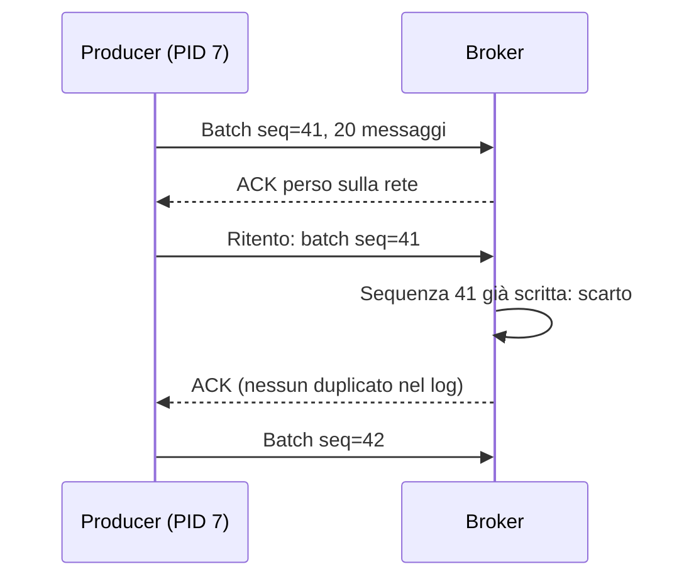

## Cinquecento ordini persi e undici worker fermi

Considera uno scenario costruito con numeri di esempio. Una pipeline legge il topic `orders.created.v1`, a 12 partizioni, e inserisce gli ordini in una tabella analitica. Il consumer usa `enable.auto.commit=true` con `auto.commit.interval.ms=5000`, il producer usa `country_code` come chiave del messaggio e l'Italia genera l'88% degli ordini.

Il primo guasto avviene in tre momenti. Al secondo 0 il consumer riceve 500 messaggi con una `poll()`. Al secondo 5 l'inserimento nel database è ancora bloccato per un rallentamento di rete, ma il timer interno del client scatta e registra su Kafka l'offset come completato. Al secondo 7 il processo va in crash per un timeout. Al riavvio riparte dall'offset successivo, e i 500 ordini non sono mai arrivati nel database né vengono riletti.

Il secondo guasto riguarda la distribuzione. La chiave `IT` viene trasformata in una partizione dall'hash `murmur2` e finisce sempre nello stesso posto: l'88% del traffico dell'intera azienda va su una partizione, mentre le altre undici restano quasi vuote e i loro worker aspettano. Il terzo è il formato: JSON non compresso, con gli stessi nomi di campo ripetuti in ogni messaggio.

Le tre cause sono indipendenti e hanno un'origine comune: lasciare i valori predefiniti delle librerie client in una pipeline che li tratta come una scelta già fatta. Ogni valore predefinito è un compromesso pensato per un caso generico, e qui va sostituito con un compromesso scelto sul traffico reale.

## Idempotenza: come il broker scarta i duplicati

Un producer ritenta l'invio quando non riceve la conferma entro il tempo previsto. Senza altre precauzioni un ritento ha due esiti: se il primo invio non era arrivato, il messaggio viene scritto una volta, se invece era arrivato e si è perso solo l'ACK, il messaggio viene scritto due volte. Il producer non può distinguere i due casi dal suo punto di vista.

> **Idea chiave:** con `enable.idempotence=true` il broker riconosce un batch già scritto grazie al numero di sequenza, e lo scarta in silenzio, quindi un ritento non può mai produrre un duplicato nella stessa partizione.

Il meccanismo funziona così. All'avvio il broker assegna al producer un identificativo, il Producer ID. Il client numera ogni batch con una sequenza crescente per ciascuna partizione. Se arriva un batch con una sequenza già vista, il broker risponde con successo senza riscriverlo. Se arriva un salto di sequenza, risponde con un errore e il client si ferma, perché un salto indica un messaggio perso.



L'idempotenza garantisce l'assenza di duplicati per sessione del producer e per partizione. Non protegge da un riavvio dell'applicazione che rispedisce gli stessi dati con un nuovo Producer ID, e non copre scritture su più topic: per quelle servono le transazioni, trattate più avanti nel modulo.

## Un producer configurato per il lavoro reale

Le impostazioni da combinare sono cinque. `acks=all` fa attendere la conferma da tutte le repliche in sincrono, `enable.idempotence=true` attiva la deduplicazione, `linger.ms` fa attendere il producer prima di inviare per riempire il batch, `batch.size` fissa la dimensione massima del batch e `compression.type=zstd` comprime ogni batch.

```python
# Producer idempotente con batching compresso per il topic degli ordini
import json
from confluent_kafka import Producer

producer = Producer({
    "bootstrap.servers": "kafka-1:9092,kafka-2:9092,kafka-3:9092",
    "acks": "all",                 # conferma da tutte le repliche in sync
    "enable.idempotence": True,    # sequenze per partizione, niente duplicati da ritento
    "linger.ms": 20,               # attende fino a 20 ms per riempire il batch
    "batch.size": 65536,           # 64 KB per batch
    "compression.type": "zstd",    # comprime l'intero batch, non il singolo messaggio
})

def on_delivery(err, msg):
    # Segnala ogni messaggio non consegnato dopo tutti i ritentativi
    if err is not None:
        print(f"consegna fallita su {msg.topic()}[{msg.partition()}]: {err}")

def publish_order(order: dict) -> None:
    # Chiave ad alta cardinalità: order_id spalma il carico su tutte le partizioni
    producer.produce("orders.created.v1",
                     key=str(order["order_id"]),
                     value=json.dumps(order).encode("utf-8"),
                     on_delivery=on_delivery)
    producer.poll(0)

# Prima di chiudere il processo svuota il buffer interno
producer.flush(10)
```

Un messaggio JSON di 400 byte con 12.000 messaggi al secondo produce 4.800.000 byte al secondo, circa 4,6 MB/s. Con `linger.ms=20` su 12 partizioni, ogni partizione riceve 1.000 messaggi al secondo e il producer ne accumula circa 20 per batch, cioè 8.000 byte non compressi. Con un rapporto di compressione di 4 a 1, tipico per JSON dai nomi di campo ripetuti, il batch pesa 2.000 byte e il traffico scende a circa 1,2 MB/s, una riduzione del 75%. Con `linger.ms=0` ogni batch conterrebbe un solo messaggio da 400 byte e la compressione resterebbe quasi inutile, perché lavora sull'insieme di righe e non sulla singola.

## La chiave di partizionamento e lo skew

Il partizionatore predefinito calcola `murmur2(chiave) mod numero_partizioni`. La chiave serve a due scopi: tenere sulla stessa partizione tutti i messaggi della stessa entità, per conservarne l'ordine, e distribuire il carico. Con una chiave a bassa cardinalità il secondo scopo fallisce. Se la chiave assume tre valori, al massimo tre partizioni su dodici ricevono dati e le altre nove restano a zero per sempre.

Una misura utile è lo skew, il rapporto tra il numero di messaggi della partizione più carica e la media. In un topic da 12 partizioni la media vale 1 / 12 = 8,3% del traffico. Con la chiave `country_code`, la partizione che ospita `IT` riceve circa l'88% del traffico, quindi lo skew è 88 / 8,3 ≈ 10,6. Con `order_id`, che ha milioni di valori distinti, ogni partizione riceve circa l'8,3% e lo skew resta vicino a 1,0, con una soglia pratica di 1,05.

Le conseguenze si calcolano sulla capacità dei worker. Supponi che ogni worker smaltisca al massimo 1.500 messaggi al secondo e che il traffico totale sia 12.000 messaggi al secondo. Con `order_id`, ogni partizione riceve 12.000 / 12 = 1.000 messaggi al secondo, sotto i 1.500 disponibili. Con `country_code`, la partizione dell'Italia riceve 12.000 × 0,88 = 10.560 messaggi al secondo contro i 1.500 che il worker smaltisce, quindi il lag cresce di 10.560 − 1.500 = 9.060 messaggi al secondo. In un'ora sono 9.060 × 3.600 ≈ 32,6 milioni di messaggi di arretrato, e aggiungere worker non aiuta, perché una partizione viene letta da un solo consumer del gruppo.

Per verificare lo skew su un topic reale basta confrontare l'offset finale di ciascuna partizione. Il comando seguente stampa una riga `topic:partizione:offset` che puoi rapportare alla media.

```bash
# Offset finale per partizione: più i valori sono uniformi, più la chiave è buona
kafka-get-offsets.sh --bootstrap-server kafka-1:9092 --topic orders.created.v1 --time -1 \
  | awk -F: '{ n[$2]=$3; s+=$3; if ($3>m) m=$3 }
             END { avg=s/length(n); printf "skew max/media = %.2f\n", m/avg }'
# Con una chiave sana il risultato deve restare sotto 1,05
```

## Commit dopo la scrittura nel consumer

Con `enable.auto.commit=true` il client segna come letti gli offset restituiti dall'ultima `poll()` a intervalli fissi, senza sapere che cosa ne ha fatto l'applicazione. Se la scrittura nel database fallisce dopo il commit, quei messaggi non vengono più riproposti. Con il commit manuale l'ordine diventa leggere, scrivere, attendere la conferma e solo allora committare. Se il processo muore prima del commit, riparte dall'ultimo offset confermato e rilegge il batch: è la semantica at-least-once, che può duplicare ma non perde.

```python
# Consumer con commit manuale dopo l'inserimento confermato
from confluent_kafka import Consumer
import clickhouse_connect, json

consumer = Consumer({
    "bootstrap.servers": "kafka-1:9092",
    "group.id": "cg-clickhouse-orders-prod",
    "enable.auto.commit": False,          # il commit lo decide l'applicazione
    "auto.offset.reset": "earliest",
    "max.poll.interval.ms": 300000,       # 5 minuti tra due poll
})
consumer.subscribe(["orders.created.v1"])
db = clickhouse_connect.get_client(host="clickhouse-1")

while True:
    batch = consumer.consume(num_messages=5000, timeout=1.0)
    rows = []
    for m in batch:
        if m.error():
            continue
        o = json.loads(m.value())
        # Partizione e offset restano nella riga: servono per audit e deduplica
        rows.append([o["order_id"], o["customer_id"], o["amount_eur"],
                     m.partition(), m.offset()])
    if rows:
        db.insert("orders_ingested", rows,
                  column_names=["order_id", "customer_id", "amount_eur",
                                "kafka_partition", "kafka_offset"])
        consumer.commit(asynchronous=False)   # solo dopo la conferma del database
```

Poiché un riavvio può rileggere un batch, la tabella di destinazione deve tollerare le righe ripetute. La coppia `(kafka_partition, kafka_offset)` identifica in modo univoco un messaggio, e una tabella con una regola di sostituzione su quella coppia, oppure un controllo di unicità a monte, rende la rilettura innocua.

Il tempo tra due chiamate al polling va governato con un calcolo. Il broker considera morto un consumer che non chiama `poll()` entro `max.poll.interval.ms`, per default 300 secondi, e riassegna le sue partizioni. Con 10.000 messaggi per batch e una chiamata a un'API esterna di 36 ms per messaggio, il batch richiede 10.000 × 0,036 s = 360 secondi, che superano i 300 secondi consentiti. Il gruppo avvia un ribilanciamento, un altro consumer inizia a rielaborare gli stessi messaggi e il primo, quando prova a committare, riceve un errore. Una regola prudente è che il tempo di elaborazione di un batch resti sotto un terzo del limite, cioè sotto 100 secondi: con 36 ms per messaggio, `max.poll.records` non dovrebbe superare circa 2.700.

## Serializzazione: JSON compresso o formati binari tipizzati

Kafka tratta i messaggi come sequenze di byte, e il formato lo scegli tu. Il JSON è leggibile e non richiede strumenti, ma ripete i nomi dei campi in ogni record e non impedisce di mandare una stringa dove ci si aspetta un numero. Avro e Protobuf codificano i dati in binario secondo uno schema, risparmiano spazio perché non ripetono i nomi e permettono di validare il contenuto alla fonte tramite uno Schema Registry. Un esempio dello stesso ordine in JSON, con nomi lunghi, mostra dove si perde spazio.

```json
{
  "transaction_timestamp_utc": "2026-11-17T09:30:00Z",
  "customer_identifier": 4281,
  "order_total_amount_eur": 129.90
}
```

Per questo record i nomi dei tre campi occupano circa 60 byte su 120 totali, cioè la metà. La compressione di batch con `zstd` recupera la gran parte di questo spreco, perché i nomi ripetuti si comprimono bene, e il confronto con il binario diventa meno netto di quanto sembri a prima vista.

| Criterio | JSON con zstd | Avro o Protobuf con Schema Registry |
| --- | --- | --- |
| Leggibilità del payload | Immediata, anche con un semplice consumer da riga di comando | Richiede il deserializzatore e lo schema |
| Validazione dei tipi | Solo a valle, se si implementa | Alla fonte, il producer non può registrare uno schema incompatibile |
| Dimensione a parità di dati | Buona con batch grandi, scarsa con `linger.ms=0` | Compatta già prima della compressione |
| Adatto a | Pipeline interne a un team, integrazioni con webhook | Più team indipendenti e oltre 5.000 eventi al secondo |

Il criterio pratico è l'organizzazione prima del volume. Quando più team pubblicano sullo stesso topic, un contratto verificabile evita di scoprire un tipo sbagliato in produzione. Quando un solo team possiede producer e consumer, JSON compresso con una validazione in ingresso è più semplice da gestire e da ispezionare.

## Tre errori che perdono dati o bloccano le partizioni

### Auto-commit attivo con scrittura su un database esterno

Il sintomo è un buco negli ordini dopo un crash, senza errori visibili. Succede perché il timer di commit non conosce l'esito dell'inserimento e segna come letti messaggi che il database non ha ancora accettato. Si corregge con `enable.auto.commit=false` e un commit sincrono dopo la conferma, accettando qualche rilettura.

### Una chiave categorica come chiave di partizionamento

Il sintomo è una partizione con lag in crescita mentre le altre sono vuote. Succede perché si confonde la chiave del messaggio con una clausola di partizionamento di un database, pensando che serva a raggruppare per paese o per canale. Si corregge usando una chiave ad alta cardinalità come `order_id` e controllando lo skew con gli offset finali per partizione.

### Elaborazione lunga tra due poll

Il sintomo è una tempesta di ribilanciamenti con errori di commit e messaggi elaborati due volte. Succede perché un batch grande con una chiamata esterna per messaggio supera `max.poll.interval.ms` e il broker espelle il consumer. Si corregge riducendo `max.poll.records`, sposta le chiamate lente fuori dal ciclo oppure alzando il limite solo dopo aver misurato il tempo reale per batch.

## Verifica di un producer e di un consumer prima del rilascio

1. Un producer invia un batch, l'ACK si perde e il client ritenta. Con `enable.idempotence=true` quante volte viene scritto il messaggio nel log?

<details>
<summary>Mostra risposta</summary>

Una sola volta. Il broker riconosce il numero di sequenza già visto per quel Producer ID e quella partizione, risponde con successo senza riscrivere il batch e il log non contiene duplicati.

</details>

2. Un topic ha 12 partizioni e 12.000 messaggi al secondo. La chiave concentra l'88% del traffico su una partizione e il worker ne smaltisce 1.500 al secondo. Di quanto cresce il lag ogni secondo?

<details>
<summary>Mostra risposta</summary>

La partizione riceve 12.000 × 0,88 = 10.560 messaggi al secondo e il worker ne smaltisce 1.500, quindi il lag cresce di 10.560 − 1.500 = 9.060 messaggi al secondo. Aggiungere consumer al gruppo non cambia nulla, perché una partizione è assegnata a un solo consumer.

</details>

3. Un consumer elabora 10.000 messaggi per batch a 36 ms ciascuno e `max.poll.interval.ms` vale 300.000. Cosa succede, e quale `max.poll.records` è prudente?

<details>
<summary>Mostra risposta</summary>

Il batch richiede 10.000 × 0,036 = 360 secondi, oltre i 300 consentiti: il broker considera il consumer morto e avvia un ribilanciamento. Per stare sotto un terzo del limite, cioè 100 secondi, servono al massimo circa 100 / 0,036 ≈ 2.700 record per batch.

</details>

4. Perché `linger.ms=0` riduce il vantaggio della compressione zstd?

<details>
<summary>Mostra risposta</summary>

La compressione lavora sull'intero batch. Con `linger.ms=0` il producer invia subito e ogni batch contiene spesso un solo messaggio, per esempio 400 byte, quindi non ci sono dati ripetuti da comprimere. Con `linger.ms=20` il batch raccoglie decine di messaggi simili e il rapporto di compressione cresce.

</details>
