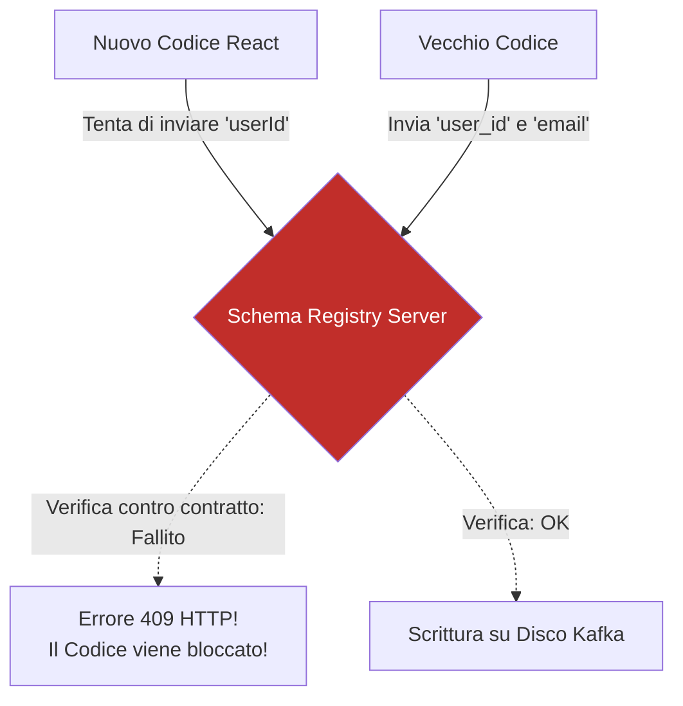

import { Aside, Steps, Tabs, TabItem, CardGrid, Card } from '@astrojs/starlight/components'

# Il Checkpoint di Sicurezza (Schema Registry)

Nella stragrande maggioranza delle aziende (anche multinazionali), l'acquisizione dei dati è selvaggia. 
Il Team Web Frontend crea un form di registrazione e invia a Kafka questo JSON:
`{"user_id": 99, "email": "luca@mail.com"}`

Sei mesi dopo, un nuovo sviluppatore Junior fa un refactoring del sito in React. Decide che "user_id" è brutto, e lo rinomina in `{"userId": 99}` (in camelCase). Pubblica il codice e va a dormire.

Alle 3 di notte, decine di pipeline dati Cloud, Cruscotti del CEO e script di Machine Learning iniziano a esplodere simultaneamente lanciando errori `KeyNotFound: user_id`. 
Questa è la piaga numero uno del Data Engineering moderno: **Il Mismatch dello Schema**. E Kafka, nativamente, essendo un tubo che accetta Bytes grezzi, *non ha difese contro questo*. Se gli butti spazzatura, lui la salva. (Garbage In, Garbage Out).

---

## 1. Confluent Schema Registry

Per risolvere questo tracollo cronico, l'azienda dei creatori di Kafka (Confluent) ha inventato lo **Schema Registry**.

Si tratta di un Server sentinella, piazzato matematicamente *davanti* a Kafka. Nessun Producer può inviare un evento a Kafka senza prima averne "dichiarata" la forma al Registry.



## 2. Abbandonare il JSON: Il Formato Apache Avro

Se usi il Registry, devi smettere di formattare i tuoi dati in JSON. Il JSON è "Auto-descrittivo" (Ogni volta invia le chiavi e poi i valori sprecando montagne di testo e larghezza di banda Cloud).

Il mondo Big Data lavora in **Apache Avro**. 
Avro è un linguaggio fortemente tipizzato. Definisci il tuo "Contratto" (Lo Schema) in anticipo, e poi invii solo i valori puramente Binari senza etichette!

<Tabs>
  <TabItem label="Il Modello Mentale (Avro Contract)" icon="document">
    ```json
    // Questo documento (.avsc) viene salvato una volta sola sul Registry. 
    // Tutti gli ingegneri devono rispettarlo religiosamente.
    {
      "type": "record",
      "name": "AcquistoUtente",
      "namespace": "com.marketing.events",
      "fields": [
        {"name": "user_id", "type": "int"},
        {"name": "email", "type": "string"},
        
        // Campo aggiuntivo collaudato: accetta Stringhe o Null
        {"name": "promo_code", "type": ["null", "string"], "default": null} 
      ]
    }
    ```
  </TabItem>
</Tabs>

### Il Vantaggio Termodinamico di Avro
Quando il sito invia la vendita, non manderà più il pallosissimo dizionario:
`{"user_id": 99, "email": "l@a.com", "promo_code": null}` (55 Bytes stringa).
Invierà semplicemente i tre elementi compattati nel metallo binario:
`|99|l@a.com|null|` (Meno di 15 Bytes).
Le dimensioni del disco scendono del **70%**. La velocità di lettura della RAM si quadruplica.

---

## 3. L'Evoluzione dello Schema e La Compatibilità

Un'azienda ovviamente evolve e ha bisogno di tracciare nuovi campi. 
Con lo Schema Registry, tu non cancellerai mai il vecchio schema in uso. Gli avvierai una *Evoluzione Versione*.

Il Registry ha un guardiano spietato che blocca le evoluzioni distruttive, chiamato **Compatibility Mode**.
Se l'architetto dati imposta il Cluster Kafka in modalità `BACKWARD COMPATIBLE` (La più diffusa al mondo):

<CardGrid>
  <Card title="Azione Lecita (OK)" icon="approve-check">
    Il tuo sviluppatore vuole aggiungere il campo `nazione_utente` all'evento. Il Registry lo permetterà, a patto che lui lo dichiari con un **Valore DEFAULT** (es: default Null).
    Così i vecchi programmi aziendali che leggono i nuovi pacchetti non crasheranno se non si aspettavano la colonna.
  </Card>
  <Card title="Azione Server-Breaking (KO)" icon="close">
    Lo sviluppatore tenta di rimuovere la colonna vitale `importo`, o cerca di aggiungere un campo obbligatorio `num_telefono` senza default. 
    **Il Registry gli farà esplodere il codice in faccia in fase di Compilazione CI/CD.** L'Ingegnere Data è salvo e torna a dormire.
  </Card>
</CardGrid>

---

## 4. Il "Data Contract" 

L'uso di Avro non è un semplice "trucco informatico". Introduce la più grande transizione organizzativa per un'azienda Moderna: l'adozione del **Data Contract**.

Nelle aziende tradizionali i Dati sono un sottoprodotto di scarico dei Software (Io sviluppo la Web App, e ti butto il database in pasto come viene viene).
Con i Data Contracts l'azienda si modella all'inverso. Dichiari in prima stanza i Contratti Avro vincolanti su un repository GitHub centrale visibile al Management.
I programmatori web *devono* sottostare e scrivere l'Applicativo che emette transazioni conformi al manifesto Architetturale esplicitato.

<Aside type="note">
Se riesci a combinare **Kafka Connect** (Per agganciarti all'E-commerce) passandolo per il setaccio brutale dello **Schema Registry Avro**, e facendolo approdare istantaneamente nel motore Aggregato di **ClickHouse Materialized Views**... Hai letteralmente appena costruito lo Stack Dati delle Top 10 Big-Tech Mondiali.
</Aside>

Siamo pronti per mettere alla prova l'intero ecosistema congiungendo definitivamente nel gran finale le tecnologie: **Il caso reale di Marketing Analytics su ClickHouse + Kafka.**
