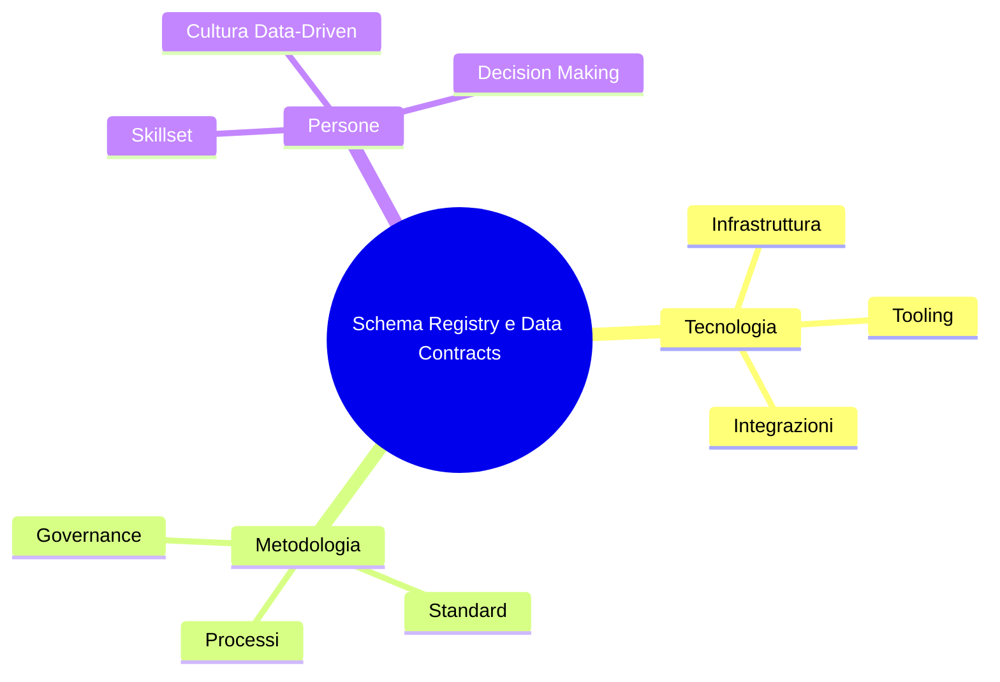
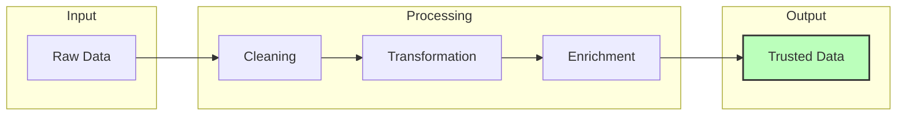

# Schema Registry e Data Contracts

> Abstract: Una guida completa e approfondita su **Schema Registry e Data Contracts**, che esplora le metodologie, gli strumenti e le strategie pratiche per un'implementazione di successo nel contesto aziendale moderno.

## Obiettivi di Apprendimento
- Comprendere i principi fondamentali di **Schema Registry e Data Contracts** e il suo ruolo nell'ecosistema MarTech.
- Analizzare le best practice per l'implementazione di **Schema Registry e Data Contracts** in contesti aziendali reali.
- Identificare gli errori comuni e le trappole da evitare quando si lavora con **Schema Registry e Data Contracts**.
- Sviluppare una metodologia critica per valutare l'efficacia di **Schema Registry e Data Contracts** nelle proprie strategie.
- Acquisire familiarità con gli strumenti e le tecnologie che supportano **Schema Registry e Data Contracts**.

## Timeline della Lezione

| Sezione | Durata | Argomento |
|---------|--------|-----------|
| Introduzione | 5 min | Contestualizzazione e importanza di Schema Registry e Data Contracts |
| Fondamenti | 12 min | Teoria, definizioni e concetti chiave |
| Implementazione | 12 min | Strategie pratiche, architetture e best practices |
| Casi Studio | 8 min | Esempi reali di successo e fallimento |
| Esercizi | 5 min | Verifica della comprensione e applicazione pratica |
| Riepilogo | 3 min | Sintesi dei punti salienti e prossimi passi |

## Introduzione (5 minuti)

Nel panorama odierno del marketing tecnologico, comprendere **Schema Registry e Data Contracts** è diventato fondamentale. Non si tratta solo di una competenza tecnica, ma di un vero e proprio vantaggio competitivo.

In un mondo dove il dato è il "nuovo petrolio" (cliché, ma vero), sapere come raffinare questo petrolio è ciò che distingue le aziende vincenti. **Schema Registry e Data Contracts** è proprio quella raffineria.

## I Pilastri di Schema Registry e Data Contracts

Quando parliamo di **Schema Registry e Data Contracts**, facciamo riferimento a tre pilastri fondamentali che sostengono l'intera struttura analitica.

### 1. La Componente Tecnologica

Non possiamo ignorare l'infrastruttura. **Schema Registry e Data Contracts** richiede una base solida. Che si tratti di cloud computing, di database colonnari o di script di tracking, la tecnologia è l'abilitatore.

### 2. La Componente Metodologica

Avere gli strumenti non basta. Serve un metodo. Come raccogliamo i dati? Come li normalizziamo? Qui entra in gioco il rigore procedurale.

### 3. La Componente Umana

Infine, chi interpreta i risultati? **Schema Registry e Data Contracts** non è un processo automatico al 100%. Richiede supervisione, manutenzione e, soprattutto, interpretazione critica.

Questo schema mentale ci aiuta a non focalizzarci solo sul "come" tecnico, ma anche sul "perché" strategico.

## Strategie Avanzate e Best Practices

Ora che abbiamo coperto le basi, alziamo l'asticella. Cosa distingue un'implementazione amatoriale di **Schema Registry e Data Contracts** da una professionale? I dettagli.

### Scalabilità e Resilienza

Quando i volumi aumentano, i sistemi fragili si rompono. **Schema Registry e Data Contracts** deve essere progettato per scalare.
- **Disaccoppiamento:** Usare code (es. Kafka) per separare produttori e consumatori.
- **Idempotenza:** Assicurarsi che processare lo stesso evento due volte non crei duplicati.

### Sicurezza e Compliance

In era GDPR, **Schema Registry e Data Contracts** deve essere "Privacy by Design". Non possiamo raccogliere tutto indiscriminatamente.

### Esempio di Architettura Logica

In questo flusso, la fase di "Enrichment" è spesso quella dove **Schema Registry e Data Contracts** porta il maggior valore aggiunto, collegando punti dati apparentemente disconnessi.

## Esempi Pratici

Vediamo due scenari reali per concretizzare i concetti.

### Scenario A: L'e-commerce in crescita

Un e-commerce di moda sta scalando rapidamente. Hanno bisogno di **Schema Registry e Data Contracts** per gestire i picchi di traffico durante il Black Friday.
**Soluzione:** Implementano un'architettura basata su eventi. Invece di scrivere direttamente sul database, usano una coda di messaggi.
**Risultato:** Zero downtime anche con 10x traffico.

### Scenario B: L'app B2B SaaS

Un'azienda SaaS deve garantire che i dati di utilizzo siano corretti per la fatturazione.
**Soluzione:** Usano **Schema Registry e Data Contracts** per creare un doppio livello di verifica sui log delle API.
**Risultato:** Riduzione del 90% delle contestazioni sulle fatture.

## Esercizi

Per consolidare quanto appreso, prova a svolgere questi esercizi:

1.  **Analisi dello Stato Attuale:** Prendi un progetto su cui stai lavorando. Disegna su carta come viene gestito attualmente **Schema Registry e Data Contracts**. C'è documentazione? È un processo robusto?
2.  **Progettazione:** Immagina di dover ricostruire tutto da zero con budget illimitato. Come cambierebbe l'architettura? Disegna il diagramma ideale.
3.  **Troubleshooting:** Pensa all'ultimo incidente legato ai dati che hai vissuto. Se avessi avuto un sistema di **Schema Registry e Data Contracts** perfetto, come sarebbe stato evitato o mitigato?

## Riepilogo

In questa lezione abbiamo attraversato il complesso mondo di **Schema Registry e Data Contracts**.

Ecco i punti chiave da portare a casa:
- **Centralità:** **Schema Registry e Data Contracts** non è un accessorio, è il cuore del sistema.
- **Rigore:** Senza metodo, la tecnologia è inutile.
- **Evoluzione:** Bisogna essere pronti a iterare e migliorare costantemente.
- **Impatto:** Un buon sistema di **Schema Registry e Data Contracts** impatta direttamente sui profitti aziendali riducendo errori e migliorando la velocità decisionale.

Ricorda: la tecnologia è un mezzo, non il fine. Il fine è sempre il valore di business.

## Approfondimenti
- *Designing Data-Intensive Applications*, Martin Kleppmann (O'Reilly, 2017)
- *The Data Warehouse Toolkit*, Ralph Kimball (Wiley, 2013)
- Documentazione ufficiale e whitepaper relativi a **Schema Registry e Data Contracts**
