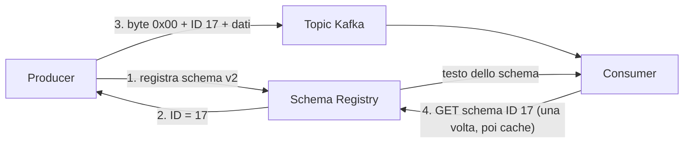

## Un campo diventa oggetto e la pipeline si ferma per il weekend

Considera uno scenario costruito con numeri di esempio. Un e-commerce ha otto microservizi che pubblicano su Kafka e quattro sistemi che consumano gli eventi: il data warehouse, il data lake su S3, il motore antifrode e il CRM. Il venerdì pomeriggio il team del checkout rilascia una modifica al messaggio `OrderCreated`. Il campo `total_amount` passa da un numero (`129.90`) a un oggetto (`{"value": 129.90, "currency": "EUR"}`), perché l'azienda sta aprendo il mercato estero.

Il broker accetta il messaggio senza protestare, perché per Kafka ogni messaggio è una sequenza di byte e il contenuto non viene mai interpretato. Pochi secondi dopo il connettore verso il data warehouse e il motore antifrode falliscono con un errore di deserializzazione. Il team corregge i consumer nel fine settimana, ma resta un secondo problema: il topic contiene ormai due forme dello stesso campo nella stessa partizione, e un replay dall'inizio della settimana incontra prima numeri e poi oggetti.

Una modifica di questo genere non si ripara a posteriori, perché un log Kafka è immutabile e i vecchi messaggi non possono essere riscritti. L'unica difesa sta prima della pubblicazione, in un registro che conosce gli schemi, li confronta e rifiuta le modifiche che romperebbero chi legge. Martin Kleppmann descrive questo problema di evoluzione dei formati nel capitolo sulla codifica dei dati di [Designing Data-Intensive Applications](https://dataintensive.net/), e i registri di schemi sono la sua applicazione pratica ai flussi di eventi.

## Il wire format: cinque byte al posto dello schema

Uno Schema Registry, come quello di Confluent o Apicurio, è un servizio che associa a ogni schema un identificativo numerico. Il producer registra lo schema una volta e riceve un ID intero di 4 byte. Ogni messaggio che pubblica inizia con un byte fisso a zero, il magic byte, seguito dai 4 byte dell'ID e dal contenuto codificato. Sono 5 byte di intestazione.

> **Idea chiave:** il messaggio porta con sé solo un riferimento di 5 byte allo schema, quindi il contratto è verificabile da chiunque legga senza pagare il costo di trasportare lo schema in ogni record.

Il consumer legge i primi 5 byte, chiede una volta sola il testo dello schema al registro, lo tiene in memoria e deserializza i record seguenti senza altre chiamate di rete. Il risparmio è consistente. Prendi un record Avro di 45 byte e uno schema di 900 byte. Con lo schema incorporato in ogni messaggio il record pesa 945 byte, 18,9 volte il record con riferimento, che pesa 45 + 5 = 50 byte. Su 10 milioni di record al giorno il calcolo è 945 byte × 10.000.000 record = 9,45 GB con lo schema incorporato, contro 50 byte × 10.000.000 record = 0,5 GB con il riferimento: il totale scende del 94,7%.



Il registro svolge anche una seconda funzione, più importante della compattezza: prima di assegnare un ID a una nuova versione, la confronta con quelle precedenti secondo la regola di compatibilità configurata. Se la verifica fallisce, la registrazione viene rifiutata e il producer non può pubblicare il nuovo formato.

## Il contratto in Avro: una versione 1 e una versione 2

Lo schema è un documento JSON che dichiara nome, campi e tipi. Per gli importi in denaro conviene un tipo decimale con precisione e scala dichiarate, perché un `double` accumula errori di arrotondamento nelle somme. Ecco la versione 1 di `OrderCreated`.

```json
{
  "type": "record",
  "name": "OrderCreated",
  "namespace": "com.example.orders",
  "doc": "Versione 1: ordine creato dal checkout",
  "fields": [
    {"name": "order_id", "type": "long"},
    {"name": "total_amount",
     "type": {"type": "bytes", "logicalType": "decimal", "precision": 12, "scale": 2}}
  ]
}
```

La modifica richiesta dal mercato estero si fa in modo additivo. Lasci `total_amount` com'è e aggiungi un campo nuovo, `currency`, con un valore predefinito. Il default è ciò che permette a un consumer aggiornato alla versione 2 di leggere un vecchio messaggio della versione 1 in cui il campo non esiste: la libreria riempie il vuoto con `EUR`.

```json
{
  "type": "record",
  "name": "OrderCreated",
  "namespace": "com.example.orders",
  "doc": "Versione 2: aggiunge la valuta con default EUR",
  "fields": [
    {"name": "order_id", "type": "long"},
    {"name": "total_amount",
     "type": {"type": "bytes", "logicalType": "decimal", "precision": 12, "scale": 2}},
    {"name": "currency", "type": "string", "default": "EUR"}
  ]
}
```

Per un campo opzionale in senso stretto, cioè che può mancare davvero, si usa un'unione con `null` al primo posto e `"default": null`. L'ordine conta in Avro, perché il valore predefinito deve corrispondere al primo tipo dell'unione.

## BACKWARD, FORWARD e FULL: chi legge cosa

La regola di compatibilità risponde a una domanda precisa su chi legge i dati di chi. Con `BACKWARD` un consumer che usa lo schema nuovo legge anche i messaggi scritti con lo schema precedente. Con `FORWARD` un consumer che usa lo schema vecchio legge anche i messaggi scritti con lo schema nuovo. Con `FULL` valgono entrambe. Le varianti `_TRANSITIVE` estendono il confronto a tutte le versioni registrate invece che alla sola ultima.

| Modalità | Chi può restare indietro | Aggiungere un campo | Rimuovere un campo |
| --- | --- | --- | --- |
| `BACKWARD` | Nessuno: si aggiornano prima i consumer | Ammesso solo con default | Ammesso |
| `FORWARD` | I consumer possono aggiornarsi dopo i producer | Ammesso | Ammesso solo se il campo aveva un default |
| `FULL` | Entrambi, rispetto alla versione precedente | Ammesso solo con default | Ammesso solo se il campo aveva un default |
| `BACKWARD_TRANSITIVE` | Come BACKWARD, su tutte le versioni storiche | Ammesso solo con default | Ammesso |

La scelta dipende da chi controlla l'ordine di rilascio. Se puoi aggiornare prima i consumer a valle e poi i producer, `BACKWARD_TRANSITIVE` è sufficiente e garantisce che un replay completo dell'intero topic funzioni. Se decine di consumer appartengono a team indipendenti e i producer possono uscire prima che tutti abbiano aggiornato, serve `FULL_TRANSITIVE`.

La variante non transitiva ha un limite che emerge solo dopo settimane. Una `v3` viene confrontata con la sola `v2`, quindi due passaggi ciascuno valido può produrre una `v3` che non legge più i messaggi della `v1` ancora presenti in un topic compattato o con retention lunga. Nei topic che si rileggono dall'inizio, la forma transitiva è la sola che offre la garanzia desiderata.

## Registrare e verificare dalla riga di comando

Il registro espone un'API REST. Il blocco seguente imposta la modalità transitiva sul subject del topic, poi verifica se la versione 2 è compatibile con le versioni registrate prima di registrarla. Il subject segue la strategia predefinita `<topic>-value`.

```bash
# Imposta la compatibilità del subject: ogni nuova versione si confronta con tutte le precedenti
curl -s -X PUT -H "Content-Type: application/vnd.schemaregistry.v1+json" \
  --data '{"compatibility": "BACKWARD_TRANSITIVE"}' \
  http://schema-registry:8081/config/orders.created.v1-value

# Controlla la compatibilità senza registrare: jq incapsula lo schema nel campo "schema"
jq -Rs '{schema: .}' order_created_v2.avsc \
  | curl -s -X POST -H "Content-Type: application/vnd.schemaregistry.v1+json" \
      --data @- \
      http://schema-registry:8081/compatibility/subjects/orders.created.v1-value/versions/latest
# Risposta attesa: {"is_compatible":true}

# Registra la versione 2 solo dopo il controllo, restituisce l'ID assegnato
jq -Rs '{schema: .}' order_created_v2.avsc \
  | curl -s -X POST -H "Content-Type: application/vnd.schemaregistry.v1+json" \
      --data @- http://schema-registry:8081/subjects/orders.created.v1-value/versions
```

Se provi lo stesso controllo con lo schema che trasforma `total_amount` in un record, la risposta è `{"is_compatible":false}`, perché un lettore con il tipo nuovo non sa interpretare i byte decimali della versione 1. L'errore emerge sul computer dello sviluppatore, prima di qualunque rilascio.

## Il controllo in CI blocca la modifica prima del merge

L'API di verifica diventa uno strumento di governo quando gira in automatico a ogni pull request. Il job seguente, scritto per GitHub Actions, estrae gli schemi modificati e li confronta con il registro di test. Se anche un solo schema è incompatibile, il job termina con errore e la pull request non può essere unita.

```yaml
# Controllo di compatibilità degli schemi Avro a ogni pull request
name: schema-compatibility
on:
  pull_request:
    paths: ["schemas/**/*.avsc"]
jobs:
  check:
    runs-on: ubuntu-latest
    steps:
      - uses: actions/checkout@v4
      - name: Verifica compatibilità contro il registro
        env:
          REGISTRY: http://schema-registry.staging:8081
        run: |
          for f in schemas/*.avsc; do
            subject="$(basename "$f" .avsc)-value"
            ok=$(jq -Rs '{schema: .}' "$f" \
              | curl -s -X POST -H "Content-Type: application/vnd.schemaregistry.v1+json" \
                  --data @- "$REGISTRY/compatibility/subjects/$subject/versions/latest" \
              | jq -r '.is_compatible')
            # Un subject non ancora registrato restituisce errore: lo trattiamo come nuovo
            if [ "$ok" = "false" ]; then echo "INCOMPATIBILE: $f"; exit 1; fi
          done
```

Il costo del controllo è di pochi secondi per pull request. Il costo evitato è il fine settimana di indagine del caso iniziale, con quattro sistemi fermi e un topic con due forme dello stesso campo.

## Messaggi non validi: una dead letter queue al posto dello scarto

Anche con un registro e una CI ben configurati, può arrivare un messaggio non conforme: un producer legacy, un errore di serializzazione, un messaggio inviato a mano. La reazione sbagliata è ignorarlo. Molti connettori offrono un'opzione per saltare i messaggi malformati fino a una soglia, per esempio 10.000, e farlo sembra un modo rapido per sbloccare la coda.

Un calcolo con numeri di esempio mostra il danno. Supponi che dopo un rilascio difettoso il 40% dei 500 messaggi al secondo non sia più deserializzabile. I messaggi invalidi sono 500 × 0,40 = 200 al secondo, quindi 200 × 3.600 = 720.000 in un'ora. Con lo scarto silenzioso la pipeline appare verde e perdi 720.000 eventi all'ora senza sapere quali siano. Con una dead letter queue li conservi tutti, con il payload originale e il motivo dell'errore, e puoi correggerli e reimmetterli in seguito.

```python
# Consumer con deserializzazione Avro e dead letter queue per i messaggi non validi
from confluent_kafka import Consumer, Producer
from confluent_kafka.schema_registry import SchemaRegistryClient
from confluent_kafka.schema_registry.avro import AvroDeserializer
from confluent_kafka.serialization import SerializationContext, MessageField

registry = SchemaRegistryClient({"url": "http://schema-registry:8081"})
deserialize = AvroDeserializer(registry)
dlq = Producer({"bootstrap.servers": "kafka-1:9092"})
consumer = Consumer({"bootstrap.servers": "kafka-1:9092",
                     "group.id": "cg-warehouse-orders",
                     "enable.auto.commit": False})
consumer.subscribe(["orders.created.v1"])

def process(order: dict) -> None:
    ...  # scrittura nel data warehouse, idempotente

while True:
    msg = consumer.poll(1.0)
    if msg is None or msg.error():
        continue
    try:
        order = deserialize(msg.value(), SerializationContext(msg.topic(), MessageField.VALUE))
        process(order)
    except Exception as exc:
        # Il messaggio originale resta intatto, con il motivo nell'header
        dlq.produce("orders.created.v1.dlq", value=msg.value(), key=msg.key(),
                    headers=[("error", str(exc).encode()),
                             ("source", f"{msg.topic()}[{msg.partition()}]@{msg.offset()}".encode())])
        dlq.poll(0)
    consumer.commit(message=msg, asynchronous=False)
```

La metrica da tenere sotto controllo è la lunghezza della dead letter queue, che in una pipeline sana resta a zero. Un valore diverso da zero non è un incidente di per sé, è la prova che il meccanismo di cattura funziona, ma deve generare un avviso e una revisione entro un tempo stabilito.

## Quando la modifica è davvero distruttiva

Esistono cambiamenti che nessuna regola additiva può esprimere, come cambiare la chiave primaria di un evento o ristrutturare l'intero dominio. In quel caso la strada corretta è un nuovo topic con la versione nel nome, per esempio `orders.created.v2`, e una fase di doppia pubblicazione. Il producer scrive per un periodo su entrambi i topic, i consumer migrano uno alla volta e il vecchio topic viene chiuso solo quando nessun gruppo lo legge più.

Anche la deprecazione di un campo segue un percorso graduale. Prima si smette di usarlo nei consumer, poi lo si dichiara con un default nello schema, solo alla fine lo si rimuove, e questo passaggio è ammesso solo se il campo aveva un valore predefinito. L'intervallo tra i passaggi deve coprire la retention del topic, altrimenti i messaggi vecchi con il campo restano nel log e un lettore nuovo li incontra comunque.

## Tre errori nella gestione degli schemi

### Aggiungere un campo obbligatorio senza default

Il sintomo è un consumer aggiornato che fallisce sui messaggi di ieri con un errore di campo mancante. Succede perché il nuovo producer scrive sempre il campo e sembra superfluo dichiarare un valore predefinito. Si corregge aggiungendo `"default": "EUR"` oppure un'unione `["null", "string"]` con `"default": null`, così il registro accetta la versione in modalità `BACKWARD`.

### Cambiare tipo o nome di un campo esistente

Il sintomo è un topic che nessuno schema riesce più a leggere dall'inizio alla fine. Succede perché rinominare `total_amount` in `gross_amount` o trasformarlo in record sembra un cambiamento locale, mentre nel log immutabile i vecchi messaggi restano con la vecchia forma. Si corregge lasciando il campo e aggiungendone uno nuovo, mantenendo entrambi valorizzati durante la deprecazione.

### Saltare i messaggi malformati con una soglia alta

Il sintomo è una pipeline sempre verde con un conteggio di righe inferiore a quello degli eventi prodotti. Succede perché saltare i messaggi sblocca subito la coda e il costo non è visibile. Si corregge instradando gli errori in una dead letter queue con payload e motivo, e confrontando il numero di eventi prodotti con quelli scritti a valle.

## Controllo prima di approvare una modifica allo schema

1. Un nuovo campo `currency` viene aggiunto senza default in modalità `BACKWARD`. Perché la registrazione viene rifiutata?

<details>
<summary>Mostra risposta</summary>

Con `BACKWARD` un consumer sulla nuova versione deve poter leggere i messaggi scritti con la precedente. In quei messaggi `currency` non esiste e, senza un valore predefinito, il lettore non sa cosa assegnare. Aggiungendo `"default": "EUR"` la libreria riempie il campo mancante e il registro accetta la versione.

</details>

2. Un record Avro pesa 45 byte e lo schema 900 byte. Quanto occupano 10 milioni di messaggi con lo schema incorporato e con il wire format di Schema Registry?

<details>
<summary>Mostra risposta</summary>

Con lo schema incorporato ogni messaggio pesa 945 byte, quindi 945 × 10.000.000 = 9,45 GB. Con il wire format pesa 45 + 5 = 50 byte, quindi 50 × 10.000.000 = 0,5 GB, circa un diciannovesimo.

</details>

3. Perché per un topic con retention di 30 giorni conviene `BACKWARD_TRANSITIVE` invece di `BACKWARD`?

<details>
<summary>Mostra risposta</summary>

`BACKWARD` confronta la nuova versione solo con l'ultima registrata. Dopo qualche passaggio una `v3` potrebbe non leggere più i messaggi della `v1` ancora presenti nel topic. La forma transitiva confronta con tutte le versioni, quindi un replay dell'intero storico funziona sempre.

</details>

4. Dopo un rilascio, il 40% di 500 messaggi al secondo non è deserializzabile. Quanti eventi perdi in un'ora se salti i malformati e quanti ne conservi con una dead letter queue?

<details>
<summary>Mostra risposta</summary>

I messaggi invalidi sono 500 × 0,40 = 200 al secondo, quindi 200 × 3.600 = 720.000 in un'ora. Saltandoli li perdi tutti senza saperlo, con la dead letter queue li conservi con payload e motivo dell'errore e puoi reimmetterli dopo la correzione.

</details>
