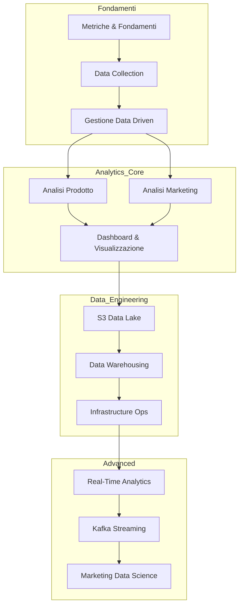
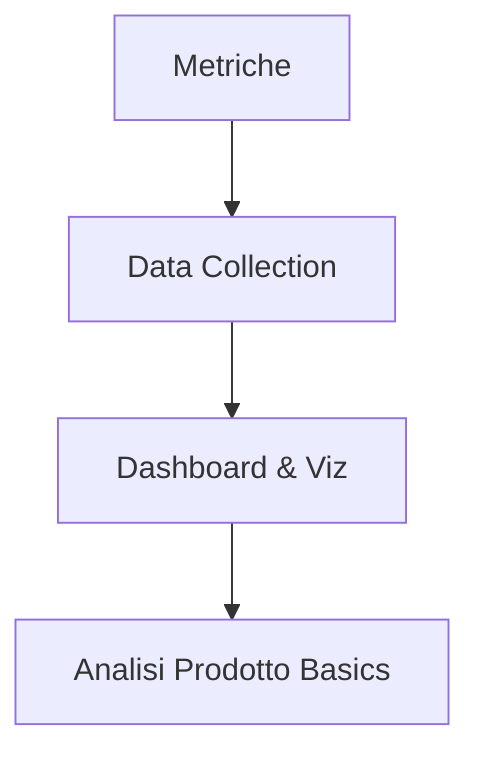
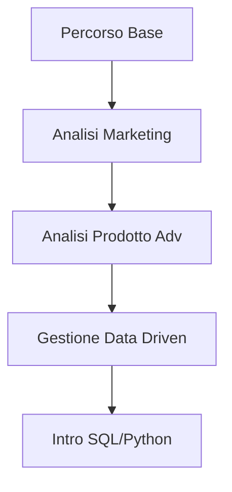
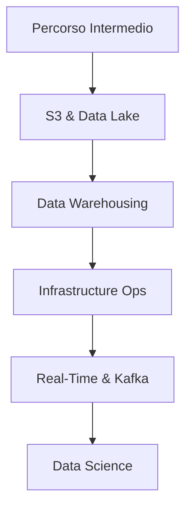

## PANORAMICA DEL CORSO

Benvenuto nel percorso formativo di **GinnyTech Academy**. Questo corso è progettato per trasformare professionisti in esperti di Data Engineering e Analytics, coprendo l'intero ciclo di vita del dato: dalla raccolta (Collection) all'archiviazione (Storage), dall'elaborazione (Processing) all'analisi (Analytics) e attivazione (Activation).

Il percorso è ideale per Data Analyst, Marketing Technologist e aspiranti Analytics Engineer. Si parte dalle basi della statistica e delle metriche di business, per arrivare a costruire infrastrutture complesse con Kafka, ClickHouse e Kubernetes. Non sono richiesti prerequisiti specifici per il livello base, mentre per i moduli avanzati è consigliata una conoscenza di base di SQL e Python.

## MAPPA DEI MODULI

## MODULI FORMATIVI

### 1. Metriche & Fondamenti
**Descrizione:** Il punto di partenza essenziale. Impara a pensare come un analista, comprendi le metriche che contano davvero per il business e padroneggia i concetti statistici di base.
**Prerequisiti:** Nessuno.
**Durata Stimata:** ~40 min
**Competenze:** Mentalità analitica, Statistica di base, Definizione KPI.

1. **Approccio Analitico** — Come sviluppare una mentalità orientata ai dati e alla soluzione di problemi.
2. **La Chiave per un Inizio di Successo** — Come impostare un progetto dati per massimizzare le probabilità di successo.
3. **Generazione di Idee Innovative** — Tecniche per stimolare la creatività e trovare nuove soluzioni ai problemi.
4. **Ricerca Desk (Desk Research)** — Come utilizzare fonti secondarie per raccogliere dati senza condurre nuove ricerche.
5. **Metriche Fondamentali per il Business** — Le metriche chiave che ogni azienda dovrebbe tracciare.
6. **Fondamenti di Statistica** — Concetti statistici essenziali per l'analisi dei dati.

---

### 2. Data Collection
**Descrizione:** Impara a raccogliere i dati in modo accurato, rispettando la privacy e strutturando tracking plan robusti. Senza dati di qualità, nessuna analisi è possibile.
**Prerequisiti:** Metriche & Fondamenti.
**Durata Stimata:** ~1 ora 5 min
**Competenze:** Event Tracking, Privacy (GDPR), Data Layers, Integrazioni.

1. **Event Tracking Design** — Designing a robust event tracking schema.
2. **Introduzione alla Data Collection** — Perché la raccolta dati è il fondamento di ogni strategia data-driven.
3. **Terminologia: Metriche, KPI e Driver** — Glossario tecnico fondamentale e differenze chiave.
4. **Il Framework dei 4 Pilastri** — Panoramica dei 4 pilastri fondamentali che sostengono ogni strategia di crescita.
5. **Quick Start: Costruisci il Tuo Tracker** — Guida pratica per costruire un tracker di eventi da zero in TypeScript.
6. **Privacy, GDPR e Consent Mode** — Come raccogliere dati nel rispetto della legge e Google Consent Mode v2.
7. **Integrazioni & ELT** — Come collegare le sorgenti dati alle destinazioni: architetture moderne.
8. **Il Framework Jobs to Be Done (JTBD)** — Comprendere le vere motivazioni dei consumatori.

---

### 3. Gestione Data Driven
**Descrizione:** Trasforma i dati in decisioni. Questo modulo copre la cultura aziendale, i framework decisionali e come validare le ipotesi con metodi quantitativi e qualitativi.
**Prerequisiti:** Data Collection.
**Durata Stimata:** ~1 ora 10 min
**Competenze:** OKR, Decision Making, Cultura Aziendale, Ricerca Quantitativa/Qualitativa.

1. **Framework JTBD (Jobs to be Done)** — Comprendere le vere motivazioni dei clienti.
2. **Ciclo di Deming, HADI e Micro-miglioramenti** — Metodologie per il miglioramento continuo.
3. **Interviste in Profondità** — Come condurre interviste qualitative per scoprire insight profondi.
4. **Ricerca Quantitativa** — Validare le ipotesi su larga scala con i dati numerici.
5. **OKR e KPI** — Definire obiettivi misurabili e indicatori di performance.
6. **Decision Making con i Dati** — Framework pratici per prendere decisioni basate su evidenze.
7. **Cultura Data-Driven in Azienda** — Costruire un'organizzazione che usa i dati quotidianamente.

---

### 4. Analisi Prodotto
**Descrizione:** Focus sul comportamento dell'utente all'interno del prodotto. Retention, A/B Testing e ottimizzazione dell'esperienza utente.
**Prerequisiti:** Gestione Data Driven.
**Durata Stimata:** ~1 ora 20 min
**Competenze:** Retention Analysis, A/B Testing, Cohort Analysis, Product Market Fit.

1. **Customer Development** — Validazione delle ipotesi di business attraverso il feedback dei clienti.
2. **Product Market Fit** — Quando il prodotto soddisfa una forte domanda di mercato.
3. **NPS (Net Promoter Score)** — Misurare la fedeltà e la soddisfazione dei clienti.
4. **Retention Framework** — Strategie per mantenere i clienti attivi nel tempo.
5. **UX Research (User Experience)** — Capire l'interazione utente per migliorare l'usabilità.
6. **A/B Testing: La Scienza di Prendere Decisioni** — Tutto quello che devi sapere sull'A/B testing.
7. **Analisi di Coorte** — Segmentare gli utenti nel tempo per capire cosa funziona davvero.
8. **Onboarding e Attivazione** — Guidare i nuovi utenti al primo momento di valore.
9. **Strumenti di Product Analytics** — Gli strumenti essenziali per tracciare il comportamento utenti.
10. **Prioritizzazione delle Feature** — Framework per decidere cosa costruire prima.

---

### 5. Analisi Marketing
**Descrizione:** Misura l'efficacia delle campagne, attribuisci le conversioni e ottimizza il budget marketing con un approccio scientifico.
**Prerequisiti:** Metriche & Fondamenti.
**Durata Stimata:** ~1 ora 15 min
**Competenze:** Attribution Modeling, Funnel Analysis, GA4, Marketing Mix.

1. **Performance Marketing e Brand** — Integrare campagne a risposta diretta con il branding.
2. **Costruire un Brand Forte** — Elementi essenziali per creare un marchio riconoscibile.
3. **Efficacia della Comunicazione del Brand** — Misurare se il messaggio arriva al pubblico.
4. **Funnel e Unit Economics** — Analizzare la redditività di ogni singola transazione.
5. **Modelli di Attribuzione** — Capire quale canale ha generato la conversione.
6. **Analisi End-to-End con UTM** — Tracciare tutto il percorso utente.
7. **CRM e Email Marketing Analytics** — Analizzare performance email e ciclo di vita cliente.
8. **Social Media Analytics** — Metriche e strategie per i canali social.
9. **SEO e Content Analytics** — Analisi del traffico organico e keyword ranking.
10. **Customer Journey Mapping** — Visualizzare il percorso completo del cliente.
11. **Google Analytics 4 Avanzato** — Padroneggiare GA4: eventi, conversioni, audience.
12. **Marketing Data Pipeline** — Costruire un flusso dati automatizzato da Ads al Data Warehouse.

---

### 6. Dashboard & Visualizzazione
**Descrizione:** L'arte di comunicare i dati. Impara a creare dashboard che non siano solo belle, ma utili e azionabili, usando SQL e Python quando serve.
**Prerequisiti:** Analisi Prodotto o Marketing.
**Durata Stimata:** ~30 min
**Competenze:** Data Storytelling, Dashboard Design, SQL Basics, Python Basics.

1. **Dashboard Strategiche** — Progettare dashboard che guidano le decisioni aziendali.
2. **Data Visualization Best Practices** — Principi per scegliere il grafico giusto.
3. **Storytelling con i Dati** — Trasformare i numeri in una storia che convince.
4. **SQL per Analisti** — Le query SQL essenziali per estrarre e analizzare dati.
5. **Python per Data Analysis** — Pandas, NumPy e matplotlib: le librerie essenziali.
6. **ETL e Data Pipeline** — Automatizzare estrazione, trasformazione e caricamento.

---

### 7. S3 Data Lake
**Descrizione:** Introduzione al moderno storage dei dati. Architetture basate su Object Storage (S3) per scalabilità infinita e costi ridotti.
**Prerequisiti:** Dashboard & Visualizzazione (concetti ETL).
**Durata Stimata:** ~55 min
**Competenze:** Object Storage, Data Lake Design, Formati Dati (Parquet/Avro).

1. **Introduzione all'Object Storage** — Cos'è e perché è lo standard per i dati analitici.
2. **Amazon S3: Fondamenti e Architettura** — Bucket, oggetti, storage classes e policy.
3. **Data Lake Design Patterns** — Architettura a zone, schema-on-read e governance.
4. **Formati Dati: Parquet, Avro, ORC e JSON** — Confronto approfondito tra formati dati.
5. **Partitioning e Bucketing Strategy** — Strategie di partizionamento Hive-style.
6. **S3 + ClickHouse: Tiered Storage** — Architettura ibrida per ottimizzazione costi/performance.
7. **Data Lifecycle e Cost Optimization** — Retention policies e lifecycle rules.

---

### 8. Data Warehousing
**Descrizione:** Il cuore dell'infrastruttura analitica. Modellazione dati, SQL avanzato e introduzione ai database colonnari come ClickHouse.
**Prerequisiti:** S3 Data Lake.
**Durata Stimata:** ~50 min
**Competenze:** Dimensional Modeling, SQL Optimization, ClickHouse Basics.

1. **OLAP: Strategia e Architettura** — Modellazione dimensionale e star schema.
2. **High-Performance SQL** — Ottimizzazione query per grandi volumi di dati.
3. **ClickHouse Mastery** — MergeTree Engines, compressione e partitioning.
4. **Data Modeling per Analytics** — Star schema, snowflake e modellazione per ClickHouse.
5. **Schema Evolution e Migrazioni** — Evolvere lo schema senza downtime.

---

### 9. Infrastructure Ops
**Descrizione:** Diventa un Analytics Engineer completo gestendo l'infrastruttura come codice (IaC) e garantendo la qualità dei dati.
**Prerequisiti:** Data Warehousing.
**Durata Stimata:** ~1 ora 10 min
**Competenze:** CI/CD, Terraform, Data Observability, FinOps.

1. **CI/CD for Data** — Git workflow, dbt, Docker e deployment automatico.
2. **Cost Management** — Ottimizzare i costi dell'infrastruttura dati (FinOps).
3. **Documentazione per i Dati** — Data Dictionary, Lineage e Data Catalog.
4. **Monitoring e Observability** — Prometheus, Grafana e alerting per pipeline dati.
5. **Infrastructure as Code con Terraform** — Provisioning di ClickHouse, Kafka e S3 via codice.

---

### 10. Real-Time Analytics
**Descrizione:** Analisi in tempo reale con ClickHouse. Materialized Views, motori di aggregazione e integrazione con dashboard live.
**Prerequisiti:** Data Warehousing.
**Durata Stimata:** ~45 min
**Competenze:** Real-time SQL, Materialized Views, CDC Patterns.

1. **Fondamenti di ClickHouse** — Introduzione all'architettura colonnare.
2. **ClickHouse: Materialized Views** — Aggregazioni in tempo reale.
3. **Streaming Ingestion con Kafka** — Architettura event-driven e ingestione dati.
4. **Dashboard Live e Alerting** — Connettere Grafana a ClickHouse.
5. **ClickHouse: Ottimizzazione** — Partitioning e best practices avanzate.
6. **Change Data Capture (CDC) Patterns** — Debezium e architetture CDC.
7. **Materialized Views Incrementali** — Pattern avanzati per pipeline real-time.

---

### 11. Kafka Streaming
**Descrizione:** Il sistema nervoso centrale dei dati. Architetture di streaming avanzate, Kafka Connect e integrazione profonda con ClickHouse.
**Prerequisiti:** Real-Time Analytics.
**Durata Stimata:** ~55 min
**Competenze:** Apache Kafka, Streaming Architecture, Schema Registry.

1. **Da Batch a Real-Time** — Introduzione allo streaming e architetture Lambda/Kappa.
2. **Apache Kafka: Architettura** — Broker, topic, partizioni e replicazione.
3. **Producers, Consumers e Consumer Groups** — API e gestione degli offset.
4. **Schema Registry e Data Contracts** — Governance dei dati in streaming.
5. **Kafka Connect** — Integrazioni senza codice.
6. **Kafka + ClickHouse** — Pipeline Real-Time per Marketing Analytics.
7. **Kafka in Produzione** — Monitoring, troubleshooting e ops.

---

### 12. Marketing Data Science
**Descrizione:** L'ultima frontiera. Modelli predittivi, analisi avanzate e l'uso di Python per risolvere problemi complessi di marketing.
**Prerequisiti:** Python Basics, Statistica.
**Durata Stimata:** ~2 ore 15 min
**Competenze:** Predictive Analytics, Clustering, Customer LTV, Python Advanced.

1. **HADI Cycles: Il segreto della crescita rapida** — Applicare il metodo scientifico al marketing.
2. **Strategy Frameworks** — Cicli PDCA e strategie di esecuzione.
3. **User-Centricity** — Approfondimento su JTBD e ricerca qualitativa.
4. **Le Trappole Analitiche più Comuni** — Correlazione vs Causalità e bias cognitivi.
5. **Unit Economics e LTV** — Analisi avanzata della sostenibilità economica.
6. **Product-Market Fit** — Framework quantitativi avanzati.
7. **Retention Deep-Dive** — Analisi avanzata per coorti.
8. **Analisi dei Cluster** — Segmentazione clienti con machine learning.
9. **Advanced Customer Analytics** — Predictive modeling per il comportamento clienti.
10. **Attribution Modeling** — Attribuzione multi-touch avanzata.
11. **Experimentation** — Design degli esperimenti e significatività.
12. **Trigger Analytics** — Sistemi di notifica basati su anomalie.
13. **Text Generation** — Generazione di testo con LLM (Intro).
14. **Embeddings** — Rappresentazione vettoriale dei dati.
15. **Brand Health** — Metriche avanzate di percezione.
16. **NPS: Analisi Critica** — Limiti e alternative al Net Promoter Score.
17. **Python for Data Engineering** — ETL custom e orchestrazione.

## PERCORSI CONSIGLIATI

### 🌱 Percorso Base (Analista Junior)
Ideale per chi inizia. Focus su mentalità, raccolta dati e visualizzazione.

### 🚀 Percorso Intermedio (Analytics Manager)
Per chi deve gestire team o prendere decisioni strategiche. Aggiunge analisi approfondite e gestione.

### 💎 Percorso Avanzato (Data Engineer / Scientist)
Il percorso completo per chi costruisce l'infrastruttura e i modelli.

## TABELLA RIEPILOGATIVA

| Modulo | N. Lezioni | Durata Totale | Livello | Prerequisiti |
| :--- | :---: | :---: | :--- | :--- |
| **Metriche & Fondamenti** | 6 | ~40 min | Base | Nessuno |
| **Data Collection** | 8 | ~1h 05m | Base | Metriche |
| **Gestione Data Driven** | 7 | ~1h 10m | Intermedio | Collection |
| **Analisi Prodotto** | 10 | ~1h 20m | Intermedio | Gestione DD |
| **Analisi Marketing** | 12 | ~1h 15m | Intermedio | Metriche |
| **Dashboard & Viz** | 6 | ~30 min | Base/Int | Analisi |
| **S3 Data Lake** | 7 | ~55 min | Avanzato | Viz / ETL |
| **Data Warehousing** | 5 | ~50 min | Avanzato | S3 Lake |
| **Infrastructure Ops** | 5 | ~1h 10m | Avanzato | DW |
| **Real-Time Analytics** | 7 | ~45 min | Avanzato | DW |
| **Kafka Streaming** | 7 | ~55 min | Avanzato | Real-Time |
| **Marketing Data Science** | 17 | ~2h 15m | Expert | Python/Stat |
