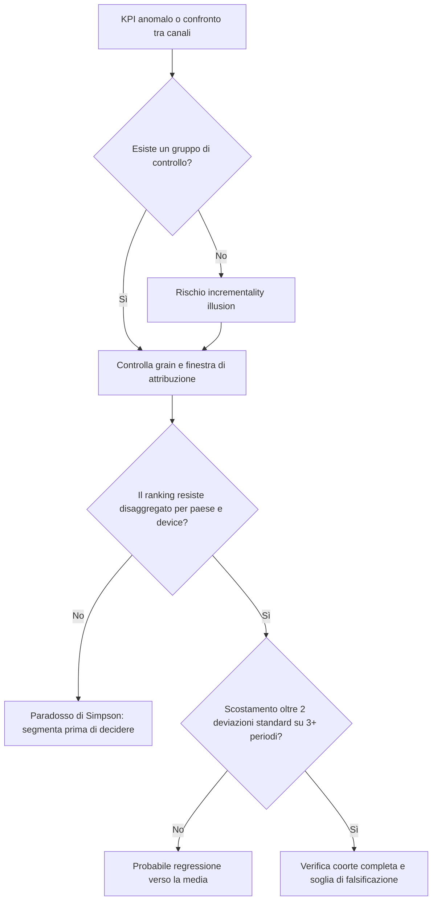

Un team growth di un marketplace europeo gestisce 240.000 € di spesa trimestrale tra Social Ads e Search non-brand (scenario costruito con numeri di esempio). La dashboard settimanale mostra un ROAS aggregato di `4,66x` per Social contro `3,76x` per Search: la proposta sul tavolo è spostare 60.000 € da Search a Social già lunedì mattina. Eppure, aprendo i numeri per singolo paese, Search supera Social in ogni singolo mercato in cui l'azienda opera. Spostare quel budget senza smontare il dato aggregato distruggerebbe margine reale pur seguendo una tabella formalmente "esatta" nei totali.

> **Idea chiave:** La maggior parte delle decisioni sbagliate nel marketing analytics non nasce da errori di aritmetica o bug di codice, ma da bias di selezione, finestre asimmetriche e variabili confondenti che trasformano la correlazione osservata in un falso segnale causale.

## Perché i numeri formalmente corretti producono decisioni sbagliate

Quando una query restituisce un `ROAS` o un `LTV` con due cifre decimali, il decisore tende a scambiare la precisione numerica per validità causale. Nel marketing digitale, però, i dati osservazionali riflettono simultaneamente le scelte dell'algoritmo di offerta delle piattaforme, le abitudini dei diversi mercati geografici, la stagionalità e la sopravvivenza dei clienti più fedeli.

Come documentato su larga scala dagli esperimenti di campo di Blake, Nosko e Tadelis (2015) e dall'analisi comparativa di Gordon, Zettelmeyer, Bhargava e Chapsky (2019), i modelli di attribuzione basati sui soli dati osservazionali sovrastimano sistematicamente l'efficacia dei canali rivolti a domanda già calda o concentrata su segmenti facili da convertire. Senza un protocollo diagnostico che metta sotto esame il processo generatore del dato prima di leggere il KPI, ogni dashboard diventa un amplificatore di distorsioni.



## Mappa delle sette trappole statistiche nel marketing

Prima di scrivere una nuova query, serve riconoscere le sette distorsioni che colpiscono quasi ogni dataset di acquisizione e retention. Ognuna agisce su un meccanismo diverso e richiede una contromisura specifica.

| Trappola analitica | Meccanismo di distorsione | Segnale d'allarme tipico | Correzione operativa |
|---|---|---|---|
| Attribution window bias | Finestra corta taglia le conversioni dei canali lenti | Un canale upper-funnel crolla passando da 30 a 7 giorni | Misurare curva di decadimento a 1, 3, 7, 14 e 30 giorni |
| Incrementality illusion | Credito assegnato a vendite che sarebbero avvenute comunque | ROAS elevato su brand keyword o retargeting ravvicinato | Holdout randomizzato su almeno il 5% del traffico |
| Survivorship bias | Media calcolata escludendo i clienti già usciti dalla coorte | LTV medio cresce mentre la retention a 90 giorni cala | Calcolare medie su tutta la coorte acquisita all'origine |
| Paradosso di Simpson | Composizione diversa tra segmenti inverte il totale | Un canale vince nel totale ma perde in ogni paese | Stratificare sempre per paese, device e fascia prezzo |
| Regression to the mean | Picco casuale estremo seguito da rientro verso la media | Mese record seguito da crollo senza modifiche di prodotto | Usare media mobile a 3 mesi e soglia di 2 deviazioni standard |
| Confirmation bias | Selezione a posteriori di metriche e periodi favorevoli | Analisi priva di criterio di smentita scritto prima | Dichiarare per iscritto cosa falsifica l'ipotesi |
| Sampling bias nei sondaggi | Rispondono solo utenti estremamente soddisfatti o arrabbiati | Pop-up in-app con tasso di risposta inferiore al 5% | Pesi post-stratificazione o campionamento stratificato attivo |

Questa tassonomia mostra un principio operativo chiaro: nessuna metrica di marketing si legge da sola. La finestra di attribuzione distorce il confronto temporale tra canali di scoperta e canali di chiusura; la regressione verso la media trasforma il rumore statistico di un mese eccezionale in panico operativo; il `sampling bias` nei sondaggi trasformati in `NPS` nasconde la maggioranza silenziosa dei clienti passivi.

## Derivazione numerica del paradosso di Simpson e del survivorship bias

Per vedere come un dato aggregato riesca a capovolgere la realtà senza contenere alcun errore di somma, esaminiamo la spesa trimestrale di 200.000 € divisa equamente tra Social Ads (100.000 €) e Search non-brand (100.000 €) su due mercati (numeri di esempio).

Nel **Paese A** (mercato maturo, CPC alto), la campagna Social Ads riceve `20.000 €` di spesa e genera `50.000 €` di ricavi, producendo $\text{ROAS}_{A,\text{Social}} = \frac{50.000}{20.000} = 2{,}50\text{x}$. Nello stesso mercato, Search riceve `70.000 €` e genera `224.000 €` di ricavi, raggiungendo $\text{ROAS}_{A,\text{Search}} = \frac{224.000}{70.000} = 3{,}20\text{x}$.

Nel **Paese B** (mercato emergente, CPC basso), Social Ads assorbe `80.000 €` e produce `416.000 €` di ricavi, con $\text{ROAS}_{B,\text{Social}} = \frac{416.000}{80.000} = 5{,}20\text{x}$. Search riceve invece `30.000 €` e genera `180.000 €` di ricavi, arrivando a $\text{ROAS}_{B,\text{Search}} = \frac{180.000}{30.000} = 6{,}00\text{x}$.

In entrambi i paesi Search batte Social (`3,20x > 2,50x` nel Paese A e `6,00x > 5,20x` nel Paese B). Calcoliamo ora i totali aggregati sommando ricavi e spese sui due mercati.

Per l'**aggregato Social Ads**, la spesa totale vale $20.000 + 80.000 = 100.000$ € e i ricavi totali salgono a $50.000 + 416.000 = 466.000$ €, portando il ritorno apparente a $\text{ROAS}_{\text{Social}} = \frac{466.000}{100.000} = 4{,}66\text{x}$. Per l'**aggregato Search**, la spesa totale ammonta a $70.000 + 30.000 = 100.000$ € e i ricavi totali raggiungono $224.000 + 180.000 = 404.000$ €, risultando in $\text{ROAS}_{\text{Search}} = \frac{404.000}{100.000} = 4{,}04\text{x}$.

Nel totale complessivo Social sembra superiore (`4,66x` contro `4,04x`), pur perdendo in ogni mercato singolo. Il meccanismo dell'inversione è il peso di allocazione: l'80% del budget Social è speso nel Paese B dove tutti i canali hanno un ROAS elevato, mentre il 70% del budget Search finisce nel Paese A dove la concorrenza alza i costi. Se il manager taglia Search per finanziare Social nello stesso Paese A, sposta denaro da un rendimento `3,20x` a un rendimento `2,50x`, peggiorando il ritorno complessivo.

Un meccanismo analogo colpisce il `survivorship bias` sul valore del cliente. Supponiamo una coorte di `1.000 clienti` acquisiti sei mesi fa: `350 clienti` risultano ancora attivi con un LTV medio di `320 €`, mentre `650 clienti` hanno abbandonato nei primi 45 giorni generando in media `45 €` ciascuno. Una query che filtra `WHERE status = 'active'` riporta un LTV di `320 €`; il calcolo sulla coorte completa invece è:

$$\text{LTV}_{\text{reale}} = \frac{(350 \times 320) + (650 \times 45)}{1.000} = \frac{112.000 + 29.250}{1.000} = \frac{141.250}{1.000} = 141{,}25\text{ €}$$

Ignorare i clienti usciti sovrastima il valore reale della coorte di oltre il 126%, portando il marketing ad accettare un costo di acquisizione (`CAC`) di `180 €` che sembra profittevole rispetto a `320 €` ma genera in realtà una perdita netta di `38,75 €` su ogni nuovo acquisito.

## Verificare paradosso di Simpson e bias di coorte in Python

Per rendere automatico il controllo prima che un report arrivi in riunione di budget, conviene integrare nelle pipeline analitiche uno script di audit che confronti sempre metrica aggregata, metrica disaggregata per fattore confondente e metrica sull'intera coorte storica. Il codice seguente replica esattamente l'esempio numerico precedente e verifica il cambio di segno del ranking tra aggregato e segmenti.

```python
import pandas as pd

# Dataset dei ricavi e costi per mercato e canale (esempio controllato)
df = pd.DataFrame([
    {"country": "Paese_A", "channel": "Social", "spend": 20_000, "revenue": 50_000},
    {"country": "Paese_A", "channel": "Search", "spend": 70_000, "revenue": 224_000},
    {"country": "Paese_B", "channel": "Social", "spend": 80_000, "revenue": 416_000},
    {"country": "Paese_B", "channel": "Search", "spend": 30_000, "revenue": 180_000},
])

# 1. Calcolo ROAS aggregato (a rischio paradosso di Simpson)
agg = df.groupby("channel", as_index=False)[["spend", "revenue"]].sum()
agg["roas_aggregato"] = agg["revenue"] / agg["spend"]

# 2. Calcolo ROAS disaggregato per paese
seg = df.copy()
seg["roas_segmento"] = seg["revenue"] / seg["spend"]

# 3. Controllo inversione del vincitore tra aggregato e singoli segmenti
agg_winner = agg.sort_values("roas_aggregato", ascending=False).iloc[0]["channel"]
seg_winners = seg.sort_values("roas_segmento", ascending=False).groupby("country").first()["channel"]

print("--- Vista Aggregata ---")
print(agg[["channel", "spend", "revenue", "roas_aggregato"]].to_string(index=False))
print("\n--- Vista Disaggregata per Paese ---")
print(seg[["country", "channel", "roas_segmento"]].to_string(index=False))

if not (seg_winners == agg_winner).all():
    print(f"\nALERT SIMPSON: '{agg_winner}' vince aggregato ma perde per segmento -> {seg_winners.to_dict()}")
```

Sul piano ingegneristico, controlli di questo tipo si affiancano ai test automatici in `dbt` (unicità della chiave primaria, controllo `not_null` e test di anomalia sul volume giornaliero rispetto alla media mobile a 7 giorni) e alla verifica di holdout reali come nel celebre caso Uber del 2017-2018: quando la società fermò parte delle campagne di app-install su 120 milioni di dollari di spesa annua, scoprì attraverso test geografici che circa il 65% delle installazioni attribuite era organico, tagliando oltre 100 milioni di spesa senza perdita netta di volume.

## Il protocollo delle tre domande prima di ogni decisione di budget

Per impedire che la velocità operativa porti a presentare grafici fragili, ogni analisi di marketing data science dovrebbe superare tre verifiche esplicite scritte nel documento di accompagnamento prima della riunione decisionale.

La prima domanda è **rispetto a cosa**. Un numero assoluto (`CAC = 42 €`, `ROAS = 3,8x`, `churn = 4,5%`) non contiene informazione finché non viene affiancato a una baseline comparabile: il gruppo di controllo non esposto, la stessa settimana dell'anno precedente corretta per festività, oppure il comportamento atteso della coorte di riferimento.

La seconda domanda è **che cosa manca dal perimetro**. Qui vanno elencati i dati esclusi per costruzione tecnica o temporale: utenti che bloccano i cookie di tracciamento, conversioni avvenute oltre la finestra di 7 giorni, clienti che hanno già abbandonato prima della data di estrazione, oppure canali offline non collegati al CRM.

La terza domanda è **quale evidenza ti farebbe cambiare idea**. È l'antidoto diretto al confirmation bias: prima di estrarre i dati dai log, si stabilisce la soglia di falsificazione (ad esempio "se l'holdout non mostra almeno un lift di +0,5 punti percentuali con p-value inferiore a 0,05 entro 21 giorni, disinvestiamo dal canale"). Senza una soglia scritta a priori, qualsiasi grafico può essere reinterpretato a posteriori per difendere la spesa esistente.

## Errori frequenti di lettura e prevenzione operativa

### Scambiare rumore statistico per cambio di trend (regressione alla media)

Il sintomo si manifesta quando un canale registra un mese straordinario (`ROAS 7,8x` grazie a una promozione o a pochi ordini B2B molto grandi) e il mese seguente rientra a `3,9x`, scatenando tagli immediati di budget o cambi creativi frettolosi. Accade perché valori estremi causati da bassa varianza campionaria tendono statisticamente a riavvicinarsi alla media storica nel periodo successivo senza che il canale si sia deteriorato. Si previene valutando la serie su media mobile a 3 mesi e bande a $\pm 2$ deviazioni standard: solo 3 o 4 periodi consecutivi fuori banda o una modifica verificata di prezzo/prodotto giustificano un cambio di strategia.

### Sbagliare il grain delle query SQL nelle tabelle di attribuzione

Un `ROAS` che raddoppia improvvisamente dopo una modifica alla pipeline spesso nasconde una duplicazione silenziosa di righe. Capita quando un analista esegue una `LEFT JOIN` tra la tabella ordini (una riga per ordine) e la tabella sessioni o touchpoint pubblicitari (più righe per utente), sommando poi `SUM(order_revenue)` senza deduplicare o senza ripartire il peso sul singolo ordine. Per evitarlo, verifica sempre il `grain` dopo ogni join confrontando il totale ricavi post-join con la tabella sorgente degli ordini prima di pubblicare qualsiasi dashboard.

### Confrontare periodi stagionali contigui senza controllo anno su anno

Confrontare le metriche di dicembre con quelle di novembre o i primi giorni di gennaio con la settimana del Black Friday induce a leggere come efficienza delle campagne ciò che è semplice elasticità della domanda festiva. Questo succede perché la propensione all'acquisto varia in modo non lineare durante l'anno e trascina verso l'alto i tassi di conversione di tutti i canali contemporaneamente. Si corregge affiancando al confronto sequenziale il delta anno su anno (`YoY`) e misurando il lift incrementale rispetto a un gruppo di controllo contemporaneo esposto alle stesse condizioni di calendario.

## Controllo critico prima di presentare un report

1. Una campagna video mostra conversioni in crescita del 40% quando estendi la finestra di attribuzione da 3 a 21 giorni, mentre una campagna Search resta ferma. Come stabilisci se si tratta di effetto reale del video o di semplice attribuzione post-impressione su clienti già intenzionati a comprare?

<details>
<summary>Mostra risposta</summary>

La curva di attribuzione da sola non basta a separare l'effetto ritardato dall'intercettazione di domanda già esistente. Serve tracciare la distribuzione dei giorni tra esposizione e acquisto per verificare il ritardo fisiologico del canale e poi validare il risultato con un holdout test (o geo-lift), confrontando il tasso di conversione totale degli utenti esposti al video rispetto a un gruppo di controllo statistico identico non esposto.

</details>

2. Nel worked example del paradosso di Simpson, quale informazione aggiunta alla tabella aggregata rende immediatamente visibile la distorsione al direttore marketing?

<details>
<summary>Mostra risposta</summary>

Bisogna affiancare al `ROAS` aggregato la quota di spesa allocata per ciascun mercato (il mix di composizione: 80% di Social nel Paese B ad alto rendimento contro il 70% di Search nel Paese A ad alto CPC) e il `ROAS` disaggregato per paese. In questo modo emerge subito che il vantaggio aggregato dipende dal peso geografico del budget e non dalla superiorità del canale.

</details>

3. Un sondaggio popup post-acquisto ottiene un NPS di `+64` ma con tasso di risposta del 3,5%. Perché usare questo numero come prova della soddisfazione media dei clienti è rischioso e come puoi correggerlo?

<details>
<summary>Mostra risposta</summary>

Un tasso di risposta così basso su un invito volontario soffre di forte `sampling bias` da auto-selezione: rispondono soprattutto gli acquirenti più entusiasti e quelli più scontenti, lasciando sottorappresentata la maggioranza silenziosa e i clienti che hanno abbandonato il carrello o reso il prodotto. Si corregge introducendo inviti campionati in modo stratificato per segmento di spesa, canale e anzianità, e applicando pesi di post-stratificazione rispetto alla popolazione reale degli ordini.

</details>

4. Qual è l'unico test preliminare su `grain` che devi eseguire su una query SQL prima di fidarti di un improvviso aumento del valore medio ordine (`AOV`)?

<details>
<summary>Mostra risposta</summary>

Devi verificare che il conteggio delle righe (`COUNT(*)`) sia uguale al numero di identificativi ordine distinti (`COUNT(DISTINCT order_id)`) e che la somma dei ricavi nella vista aggregata coincida esattamente con il totale registrato nella tabella transazionale canonica prima di qualsiasi join con sessioni o eventi pubblicitari.

</details>
