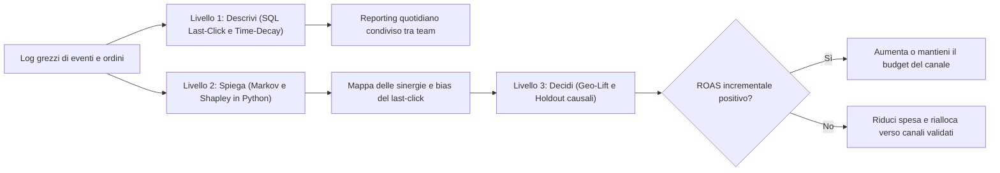

## Il paradosso della somma dei ROAS superiori al fatturato

Considera uno scenario costruito con numeri di esempio su un e-commerce italiano di arredamento che investe 180.000 euro al mese su quattro canali: Paid Search, Meta Ads, Email e Affiliate. A fine mese, ciascuna piattaforma presenta il proprio consuntivo in autonomia. Il team Paid Search rivendica 410.000 euro di vendite attribuite, Meta Ads dichiara 290.000 euro tra view-through e click, il sistema di Email Marketing ne rivendica 140.000 e la rete Affiliate aggiunge altri 80.000 euro. Sommando le quattro colonne si arriva a 920.000 euro di ricavi generati dal marketing, ma la contabilità aziendale registra un fatturato totale di soli 540.000 euro, inclusi gli acquisti diretti e organici.

Quello scarto di 380.000 euro non dipende da un errore aritmetico nei fogli di calcolo. Dipende dal fatto che le piattaforme contano più volte lo stesso ordine lungo il percorso dell'utente e, soprattutto, attribuiscono alle inserzioni vendite che sarebbero avvenute comunque. Un utente che vede una creatività social, apre una newsletter e poi cerca il nome del negozio su Google genera tre tocchi nello stesso journey: se ogni strumento rivendica l'intero carrello, il ritorno sulla spesa appare brillante sulla carta mentre il margine netto reale resta fermo.

> **Idea chiave:** L'attribuzione multi-touch ripartisce un credito osservato tra i touchpoint presenti nei percorsi di conversione, ma solo un test causale con gruppo di controllo misura le vendite incrementali che scomparirebbero spegnendo il canale.

Distinguere tra ripartizione del merito osservato e impatto causale netto è il primo requisito per governare il budget marketing. Senza questa separazione, l'azienda finisce per tagliare i canali che generano domanda nuova e premiare i canali che si limitano a intercettare utenti già decisi ad acquistare.

## La gerarchia decisionale: descrivere, spiegare e decidere

Nessun modello di attribuzione risponde contemporaneamente a tutte le esigenze di un team marketing. Un modello semplice e trasparente permette a finanza, vendite e media buyer di leggere i volumi giornalieri con lo stesso metro, ma distorce le decisioni strategiche sul valore dell'upper-funnel. Un modello basato su teoria dei giochi o catene probabilistiche coglie le sinergie tra canali, ma resta pur sempre ancorato a dati correlazionali: se gli acquirenti più convinti cliccano spesso sulle email prima di pagare, un modello puramente osservazionale sovrastimerà comunque il peso delle email.



Questa architettura a tre livelli ordina ogni strumento al posto giusto nella catena decisionale, evitando sia l'illusione di una formula universale sia la paralisi operativa.

| Famiglia di modello | Metodo tipico | Domanda a cui risponde | Limite strutturale | Uso corretto |
| --- | --- | --- | --- | --- |
| Rule-based | `Last-click`, lineare, `time-decay` | Quale canale chiude o precede l'ordine secondo una regola fissa | Ignora l'effetto controfattuale e le interazioni tra tocchi | Baseline operativa quotidiana e allineamento reporting |
| Data-driven MTA | Catena di Markov, valori di Shapley | Quale peso predittivo ha ciascun canale nelle combinazioni osservate | Correlazionale: soffre di bias di autoselezione dell'utente | Diagnosi delle sinergie e stima del bias del last-click |
| Causale sperimentale | `Geo-lift`, test `holdout`, `DiD` | Quanto fatturato sparisce se spengo questo canale in un gruppo di controllo | Richiede settimane, potenza statistica e costa mancati ricavi | Decisioni trimestrali di taglio o aumento budget |
| Causale osservazionale | `Marketing Mix Modeling` (`MMM`) | Come saturano i canali aggregati includendo stagionalità e offline | Granularità settimanale/mensile, non scende al singolo utente | Pianificazione macro del budget annuale cross-canale |

Adottare la gerarchia significa accettare una regola di igiene organizzativa: i modelli SQL rule-based alimentano i cruscotti quotidiani, i modelli Markov e Shapley spiegano perché due canali lavorano insieme, mentre nessun taglio o raddoppio di spesa sopra una soglia materiale avviene senza un esperimento di controllo.

## Calcolo passo-passo di last-click, time-decay e removal effect di Markov

Per toccare con mano quanto cambiano le allocazioni di budget al variare del modello matematico, risolviamo un esempio numerico completo su 1.000 percorsi utente osservati in una settimana (numeri di esempio), con tre canali (`Social`, `Search`, `Email`) e un valore medio d'ordine pari a 80 euro. I 1.000 percorsi si distribuiscono in quattro sequenze esatte, di cui 100 terminano con un acquisto (8.000 euro di ricavo totale) e 900 terminano senza conversione:

1. Percorso `Social -> Search -> Email -> Acquisto`: 20 conversioni.
2. Percorso `Social -> Search -> Acquisto`: 35 conversioni.
3. Percorso `Search -> Email -> Acquisto`: 15 conversioni.
4. Percorso `Search -> Acquisto`: 30 conversioni.
5. Percorsi non convertiti: 400 percorsi `Social -> Null`, 300 percorsi `Social -> Search -> Null`, 200 percorsi `Search -> Null`.

Sotto **last-click**, l'intero valore dell'acquisto va all'ultimo touchpoint prima della conversione:
- `Search` chiude i percorsi 2 e 4: $35 + 30 = 65$ conversioni (65% del credito), pari a $65 \times 80 = 5.200\text{ euro}$.
- `Email` chiude i percorsi 1 e 3: $20 + 15 = 35$ conversioni (35% del credito), pari a $35 \times 80 = 2.800\text{ euro}$.
- `Social` chiude zero percorsi: 0 conversioni (0% del credito), pari a 0 euro. Un manager che decidesse sul solo last-click spegnerebbe immediatamente `Social`.

Sotto **time-decay** discreto per passo con fattore di dimezzamento $0,5$ per ogni tocco indietro rispetto alla conversione (peso $1$ per l'ultimo tocco, $0,5$ per il penultimo, $0,25$ per il terzultimo):
- Nel percorso 1 (`Social -> Search -> Email`, 20 conversioni = 1.600 euro): pesi grezzi $0,25 + 0,50 + 1,00 = 1,75$. Quote normalizzate: `Social` $0,25 / 1,75 = 14,29\%$ (228,6 euro), `Search` $0,50 / 1,75 = 28,57\%$ (457,1 euro), `Email` $1,00 / 1,75 = 57,14\%$ (914,3 euro).
- Nel percorso 2 (`Social -> Search`, 35 conversioni = 2.800 euro): pesi grezzi $0,50 + 1,00 = 1,50$. Quote: `Social` $33,33\%$ (933,3 euro), `Search` $66,67\%$ (1.866,7 euro).
- Nel percorso 3 (`Search -> Email`, 15 conversioni = 1.200 euro): quote `Search` $33,33\%$ (400,0 euro), `Email` $66,67\%$ (800,0 euro).
- Nel percorso 4 (`Search`, 30 conversioni = 2.400 euro): `Search` 100% (2.400,0 euro).

Sommando i ricavi attribuiti nel `time-decay`, `Search` ottiene $457,1 + 1.866,7 + 400,0 + 2.400,0 = 5.123,8\text{ euro}$ (64,0%), `Email` ottiene $914,3 + 800,0 = 1.714,3\text{ euro}$ (21,4%) e `Social` risale da zero a $228,6 + 933,3 = 1.161,9\text{ euro}$ (14,5%).

Applichiamo ora il modello con **catena di Markov e removal effect**. La probabilità di conversione globale di base sui 1.000 percorsi è $P_{\text{base}} = 100 / 1000 = 10,0\%$. Per misurare l'effetto di rimozione ($R_i$) di ciascun canale, calcoliamo quale quota delle 100 conversioni scomparirebbe se quel canale venisse eliminato dalla rete di transizione (portando a `Null` ogni percorso che lo attraversa):
- Rimuovendo `Social` spariscono le 20 conversioni del percorso 1 e le 35 del percorso 2 (restano 45 conversioni su 1.000, quindi $P_{-\text{Social}} = 4,5\%$). L'effetto di rimozione è $R_{\text{Social}} = 1 - (4,5\% / 10,0\%) = 0,55$ (55%).
- Rimuovendo `Search` spariscono tutte le 100 conversioni dei percorsi 1, 2, 3 e 4 ($P_{-\text{Search}} = 0\%$). Effetto di rimozione $R_{\text{Search}} = 1 - (0\% / 10,0\%) = 1,00$ (100%).
- Rimuovendo `Email` spariscono le 20 conversioni del percorso 1 e le 15 del percorso 3 (restano 65 conversioni, $P_{-\text{Email}} = 6,5\%$). Effetto di rimozione $R_{\text{Email}} = 1 - (6,5\% / 10,0\%) = 0,35$ (35%).

La somma degli effetti di rimozione è $0,55 + 1,00 + 0,35 = 1,90$. Normalizzando ciascun canale su questo totale otteniamo le quote Markov:
- `Search` = $1,00 / 1,90 = 52,63\% \rightarrow 4.210,5\text{ euro}$.
- `Social` = $0,55 / 1,90 = 28,95\% \rightarrow 2.315,8\text{ euro}$.
- `Email` = $0,35 / 1,90 = 18,42\% \rightarrow 1.473,7\text{ euro}$.

Il confronto numerico mostra l'utilità pratica della derivazione: `Social` passa da 0 euro nel last-click a 1.161,9 euro nel time-decay e a 2.315,8 euro nella catena di Markov, perché il modello riconosce che più della metà dei percorsi convertiti nasce proprio dall'innesco social prima del passaggio su ricerca organica o a pagamento.

Nella pratica su dataset reali con migliaia di sequenze diverse, la catena di Markov non si calcola enumerando a mano i quattro percorsi, ma costruendo la matrice di transizione $T$ tra stati (`Start`, ciascun canale, `Conversion` e `Null`) e risolvendo il sistema lineare delle probabilità di assorbimento verso lo stato `Conversion`. Se il percorso di un utente contiene cicli ripetuti sullo stesso canale, come tre clic consecutivi su `Search`, la modellazione di ordine 1 può aggregare i nodi adiacenti oppure estendersi a catene di ordine 2 o 3 per catturare la memoria degli ultimi passi senza far esplodere il numero di stati stimati.

## Implementazione SQL del last-click e del time-decay basato sul tempo reale

Nelle implementazioni SQL in produzione è buona norma evitare il decadimento basato sul semplice numero d'ordine (`ROW_NUMBER()`). Se un utente clicca tre annunci nella stessa mattina e un quarto quattordici giorni dopo, contare i passi assegna lo stesso distacco tra dieci minuti e due settimane. L'approccio corretto usa il tempo effettivamente trascorso tra ogni tocco e l'istante dell'acquisto, applicando un `half-life` espresso in giorni reali. La query seguente calcola sullo stesso schema sia l'attribuzione `last-click` sia il `time-decay` temporale continuo con dimezzamento a 7 giorni.

```sql
-- Confronto in una sola query tra last-click e time-decay continuo (half-life = 7 giorni)
WITH valid_touches AS (
    -- Filtra solo i touchpoint avvenuti entro una finestra lookback di 30 giorni prima dell'ordine
    SELECT
        o.order_id,
        o.net_revenue_eur,
        t.channel,
        t.touch_time,
        o.order_time,
        EXTRACT(EPOCH FROM (o.order_time - t.touch_time)) / 86400.0 AS days_before_order,
        ROW_NUMBER() OVER (
            PARTITION BY o.order_id
            ORDER BY t.touch_time DESC, t.touch_id DESC
        ) AS recency_rank
    FROM orders AS o
    INNER JOIN touchpoints AS t
        ON o.user_id = t.user_id
       AND t.touch_time <= o.order_time
       AND t.touch_time >= o.order_time - INTERVAL '30 days'
),
weighted_touches AS (
    -- Calcola il peso esponenziale continuo: ogni 7 giorni indietro il peso si dimezza
    SELECT
        order_id,
        net_revenue_eur,
        channel,
        recency_rank,
        POWER(0.5, days_before_order / 7.0) AS raw_decay_weight
    FROM valid_touches
),
normalized_touches AS (
    -- Normalizza i pesi affinché la somma attribuita per ogni order_id eguagli esattamente 1
    SELECT
        order_id,
        channel,
        net_revenue_eur,
        recency_rank,
        raw_decay_weight / SUM(raw_decay_weight) OVER (PARTITION BY order_id) AS decay_share
    FROM weighted_touches
)
SELECT
    channel,
    ROUND(SUM(CASE WHEN recency_rank = 1 THEN net_revenue_eur ELSE 0 END), 2) AS last_click_revenue_eur,
    ROUND(SUM(net_revenue_eur * decay_share), 2) AS time_decay_revenue_eur,
    ROUND(
        SUM(net_revenue_eur * decay_share) - SUM(CASE WHEN recency_rank = 1 THEN net_revenue_eur ELSE 0 END),
        2
    ) AS delta_vs_last_click_eur
FROM normalized_touches
GROUP BY channel
ORDER BY time_decay_revenue_eur DESC;
```

Osserva due dettagli tecnici essenziali nella query. Il primo è il vincolo di ordinamento deterministico `ORDER BY t.touch_time DESC, t.touch_id DESC`, che impedisce risultati non riproducibili quando due eventi condividono lo stesso timestamp al secondo. Il secondo è l'invariante di conservazione del ricavo: normalizzando `raw_decay_weight` sulla partizione `order_id`, la somma di `time_decay_revenue_eur` su tutti i canali coincide sempre al centesimo con la somma di `last_click_revenue_eur` e con il fatturato reale degli ordini tracciati.

Altrettanto decisiva è la scelta della finestra temporale di `lookback` (30 giorni nella query precedente) e del parametro `half-life`. In un e-commerce a impulso con ciclo d'acquisto medio di due giorni, una finestra di trenta giorni rischia di attribuire l'ordine a clic ormai estranei alla decisione corrente, mentre un `half-life` di 24 o 48 ore isola meglio i tocchi davvero rilevanti. Al contrario, nel B2B o nell'arredamento con cicli di considerazione superiori al mese, un dimezzamento troppo rapido schiaccia i canali di scoperta iniziale verso zero e replica gli stessi limiti del modello `last-click`. Prima di fissare questi due iperparametri in produzione, conviene misurare la distribuzione empirica del tempo intercorso tra il primo touchpoint tracciato e l'ordine sull'ultimo trimestre di dati storici.

## Modello di Shapley e catena di Markov in Python

Quando il numero di canali core è contenuto (tra 3 e 10 canali aggregati), i valori di Shapley presi dalla teoria dei giochi cooperativi offrono un secondo punto di vista complementare alle catene di Markov. Ciascun canale viene trattato come un giocatore e il valore caratteristico $v(S)$ di ogni sottoinsieme $S$ è il tasso di conversione osservato tra gli utenti esposti esattamente a quella combinazione di canali. Il contributo marginale medio si calcola pesando ogni ingresso del canale $i$ lungo tutte le permutazioni possibili degli $N$ canali.

Dal punto di vista assiomatico, l'assegnazione di Shapley è l'unica ripartizione che soddisfa simultaneamente efficienza, simmetria, linearità e proprietà del giocatore nullo: un canale che non altera mai il tasso di conversione di alcuna coalizione riceve esattamente zero, mentre due canali con apporto identico in ogni combinazione ricevono lo stesso valore. Questa proprietà rende il metodo particolarmente adatto ai comitati tra team media, perché evita le dispute legate all'ordine arbitrario con cui un utente clicca due annunci nella stessa settimana.

```python
import itertools
import math


def shapley_channel_attribution(
    channels: list[str],
    conversion_rates: dict[tuple[str, ...], float],
) -> dict[str, float]:
    """
    Calcola i valori di Shapley per ogni canale dato il tasso di conversione
    osservato per ciascun sottoinsieme ordinato di canali.
    """
    n = len(channels)
    shapley_values = {ch: 0.0 for ch in channels}

    for ch in channels:
        others = [c for c in channels if c != ch]
        for r in range(len(others) + 1):
            for subset in itertools.combinations(others, r):
                subset_without = tuple(sorted(subset))
                subset_with = tuple(sorted(list(subset) + [ch]))
                marginal_gain = (
                    conversion_rates.get(subset_with, 0.0)
                    - conversion_rates.get(subset_without, 0.0)
                )
                # Peso combinatorio esatto della coalizione di dimensione r su n giocatori
                weight = (math.factorial(r) * math.factorial(n - r - 1)) / math.factorial(n)
                shapley_values[ch] += weight * marginal_gain

    return shapley_values


# Tassi di conversione di esempio per combinazione di canali esposti (baseline organica = 2%)
observed_rates = {
    (): 0.020,
    ("email",): 0.040,
    ("social",): 0.035,
    ("search",): 0.055,
    ("email", "social"): 0.075,
    ("email", "search"): 0.095,
    ("social", "search"): 0.090,
    ("email", "social", "search"): 0.130,
}

scores = shapley_channel_attribution(["email", "social", "search"], observed_rates)
total_lift = sum(scores.values())
for channel, val in sorted(scores.items(), key=lambda x: x[1], reverse=True):
    share = (val / total_lift) * 100
    print(f"{channel:8s} -> contributo marginale: {val:.4f} ({share:.1f}% del lift)")
```

Nota l'importanza della chiave vuota `()` impostata a `0.020`: rappresenta il tasso di conversione di base degli utenti non raggiunti da alcun touchpoint a pagamento. Sottrarre implicitamente la baseline attraverso le differenze marginali $v(S \cup \{i\}) - v(S)$ evita di regalare ai canali il 2% di domanda naturale. Quando i canali superano la dozzina, il calcolo esatto su $2^N$ sottoinsiemi diventa costoso e si sostituisce il ciclo completo con un campionamento Monte Carlo su qualche migliaio di permutazioni casuali.

## Evidenza industriale: Booking.com, HelloFresh e la prova causale

L'adozione industriale conferma quanto la gerarchia a tre livelli produca valore concreto. Nel 2019 il team di marketing science di Booking.com presentò al workshop NIPS sull'e-commerce un modello di attribuzione basato sui valori di Shapley approssimati via Monte Carlo su scala globale, dove ogni scostamento dell'1% su oltre quattro miliardi di dollari di spesa valeva decine di milioni. Il passaggio da regole statiche a Shapley ridistribuì circa il 18% del budget tra i canali, aumentando il credito riconosciuto a Display e Paid Social nel ruolo di innesco del journey e migliorando il ritorno globale sulla spesa senza aumentare gli investimenti.

Allo stesso tempo, la letteratura sperimentale mette in guardia contro l'illusione che la sola modellazione osservazionale basti a misurare la causalità. Nel celebre studio condotto su eBay da Blake, Nosko e Tadelis nel 2015 (*Econometrica*), lo spegnimento sperimentale delle inserzioni di brand search in aree geografiche selezionate mostrò che quasi tutto il traffico intercettato dalle campagne sul nome del marchio si riversava sui risultati organici sottostanti, con un ritorno incrementale reale vicino a zero o negativo. Analogamente, nel 2018 un audit di Uber sulle spese per installazioni app evidenziò come gran parte delle installazioni rivendicate dalle reti pubblicitarie fossero in realtà organiche. Per questo aziende come HelloFresh hanno istituito cadenze trimestrali di esperimenti `geo-lift`, spegnendo o variando la pressione pubblicitaria in gruppi bilanciati di regioni per misurare l'effetto netto prima di confermare i budget proposti dai modelli multi-touch.

## Tre errori comuni nelle pipeline di attribuzione

Anche un team tecnicamente attrezzato può produrre tabelle di attribuzione fuorvianti se trascura la struttura del dato sottostante o l'interpretazione statistica del risultato.

### Confondere il rank del touchpoint con il tempo trascorso nel time-decay

Assegnare il decadimento usando `ROW_NUMBER()` invece della differenza temporale reale falsa completamente il peso dei canali nei cicli di acquisto lunghi. Un utente che visita il sito tre volte nell'ultima ora tramite retargeting spinge il primo clic di scoperta, avvenuto dieci giorni prima, alla quarta posizione, riducendone il peso a $0,5^3 = 12,5\%$ pur avendo aperto la finestra di considerazione. Usando la distanza temporale effettiva in giorni (`days_before_order`), i tre clic della stessa mattina pesano quasi in modo identico e non schiacciano il tocco originario.

### Fan-out dei JOIN tra impression, clic e righe d'ordine

La causa più frequente di ricavi attribuiti superiori al reale nelle query SQL è l'unione diretta tra una tabella degli ordini con granularità per articolo (`order_items`) e la tabella dei touchpoint, senza prima aggregare i carrelli a livello di `order_id`. Un ordine con 4 prodotti unito a 3 touchpoint genera 12 righe, quadruplicando il fatturato apparente se l'analista applica la somma senza verificare il vincolo di unicità. La regola operativa è calcolare sempre il `SUM(net_revenue_eur)` della query finale e accertarsi che coincida esattamente con il totale nella tabella `orders`.

### Usare modelli correlazionali per tagliare canali di awareness o premiare il retargeting

I modelli Markov e Shapley rispondono a ciò che è accaduto nei dati storici sotto le politiche di offerta correnti. Un annuncio di retargeting dinamico mostrato esattamente quando l'utente sta già tornando al checkout mostra una correlazione altissima con la conversione e guadagna peso sia nel time-decay sia nello Shapley. Se però quel canale non crea nuovi acquirenti ma cattura intenti già formati, solo un test `holdout` (mantenendo un 10–15% di utenti non esposti al retargeting) rivelerà l'assenza di incremento netto.

## Controllo prima di riallocare il budget

Verifica la solidità del tuo impianto di attribuzione rispondendo a queste quattro domande operative.

1. In una tabella di attribuzione SQL hai 500.000 euro di ordini reali in un mese, ma la somma di `time_decay_revenue_eur` su tutti i canali restituisce 640.000 euro: quale bug di implementazione spiega quasi certamente questa discrepanza?

<details>
<summary>Mostra risposta</summary>

Il bug è un errore di granularità (`fan-out` del `JOIN`) oppure una mancata normalizzazione dei pesi per `order_id`. Se un ordine è stato unito a livello di singola riga articolo (`order_items`) prima di sommare `net_revenue_eur`, oppure se l'espressione `SUM(raw_decay_weight) OVER (PARTITION BY order_id)` è stata omessa o partizionata sull'utente invece che sul singolo ordine, il fatturato viene contato più volte. La somma dei ricavi attribuiti deve sempre conservare esattamente il totale degli ordini elegibili.

</details>

2. Perché un modello con catena di Markov assegna spesso un peso molto più alto al canale `Paid Social` rispetto al modello `last-click`, e in quale caso quel maggior credito potrebbe comunque essere illusorio?

<details>
<summary>Mostra risposta</summary>

La catena di Markov assegna più peso a `Paid Social` perché misura il removal effect: se molti percorsi convertiti passano per i social nelle fasi iniziali e pochi utenti convertono senza averli attraversati, la rimozione del nodo riduce fortemente la probabilità di conversione della rete. Tuttavia questo peso potrebbe risultare illusorio se i social fossero stati indirizzati algoritmicamente verso utenti già in-market tramite lookalike basati su visitatori recenti: in quel caso gli utenti avrebbero cercato comunque il brand su Search anche senza l'annuncio social, e solo un test geo-lift o holdout può sciogliere il dubbio.

</details>

3. Nel calcolo dei valori di Shapley su canali pubblicitari, quale ruolo svolge la chiave vuota `()` associata al tasso di conversione della popolazione non esposta?

<details>
<summary>Mostra risposta</summary>

La chiave vuota rappresenta il tasso di conversione di base (`baseline`) che l'azienda ottiene in assenza di qualsiasi touchpoint dei canali modellati, ad esempio per traffico diretto o domanda organica pregressa. Includerla assicura che i valori di Shapley ripartiscano soltanto il guadagno incrementale sopra la baseline e non distribuiscano tra i canali a pagamento le vendite che sarebbero avvenute spontaneamente.

</details>

4. Un esperimento `geo-lift` su 20 regioni trattate e 20 di controllo mostra un aumento di fatturato del 6% sul canale Display con costo aggiuntivo tale da rendere il ROAS incrementale pari a 1,1x, mentre il modello MTA interno gli attribuiva un ROAS di 4,2x. Quale numero guida la decisione di budget per il trimestre successivo?

<details>
<summary>Mostra risposta</summary>

Guida l'1,1x del test `geo-lift`. Il 4,2x dell'MTA è una stima correlazionale distorta dall'esposizione ad utenti già propensi all'acquisto; l'1,1x misura invece quanti euro reali entrano in cassa per ogni euro speso sul canale. Se il margine lordo aziendale è inferiore al 90% (cosa vera quasi sempre, dato un margine tipico del 40–60%), un ROAS incrementale di 1,1x distrugge margine di contribuzione e impone di ridurre la spesa Display o rivederne completamente targeting e creatività.

</details>
