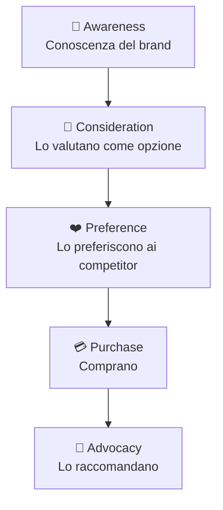

# Brand Health: Misurare la Salute del Marchio

> **Obiettivo:** Definire e tracciare le metriche chiave per valutare la percezione, il valore e la forza di un brand nel tempo.

## 1. Perché Misurare il Brand

Il brand è l'asset più prezioso ma più difficile da misurare. A differenza delle metriche di performance (CTR, CPA), le metriche di brand misurano il **valore percepito** nel lungo termine.

## 2. Le Metriche di Brand Health

| Metrica | Cosa Misura | Come Raccoglierla |
|:---|:---|:---|
| **Brand Awareness** | % pubblico che riconosce il brand | Survey, Google Trends |
| **Brand Recall** | % che lo nomina spontaneamente | Survey unaided |
| **Brand Sentiment** | Positivo/Negativo/Neutro | NLP su social e recensioni |
| **Brand Equity** | Valore economico del brand | Modelli finanziari |
| **Share of Voice** | % menzioni vs competitor | Social listening |

```python
# Analisi del Brand Sentiment con NLP
from collections import Counter

def analyze_brand_sentiment(mentions: list[dict]) -> dict:
    """Analizza il sentiment delle menzioni del brand."""
    sentiments = Counter(m['sentiment'] for m in mentions)
    total = len(mentions)
    return {
        "positive_pct": round(sentiments['positive'] / total * 100, 1),
        "negative_pct": round(sentiments['negative'] / total * 100, 1),
        "neutral_pct": round(sentiments['neutral'] / total * 100, 1),
        "net_sentiment": round(
            (sentiments['positive'] - sentiments['negative']) / total * 100, 1
        ),
        "total_mentions": total,
        "top_positive_topics": _extract_topics(mentions, 'positive'),
        "top_negative_topics": _extract_topics(mentions, 'negative')
    }
```

## 3. Brand Tracking Dashboard

```sql
-- Brand health score settimanale
SELECT
    DATE_TRUNC('week', mention_date) AS week,
    COUNT(*) AS total_mentions,
    ROUND(AVG(CASE WHEN sentiment = 'positive' THEN 1
                    WHEN sentiment = 'negative' THEN -1 ELSE 0 END), 3) AS avg_sentiment,
    COUNT(DISTINCT source) AS channels_present,
    SUM(CASE WHEN is_competitor_comparison THEN 1 ELSE 0 END) AS competitive_mentions
FROM brand_mentions
WHERE brand = 'our_brand'
GROUP BY 1 ORDER BY 1 DESC;
```

## 4. Brand Funnel



| Stage | KPI | Benchmark |
|:---|:---|:---|
| Awareness | Aided recall | >60% nel target |
| Consideration | Consideration set inclusion | >30% |
| Preference | First choice rate | >15% |
| Purchase | Conversion rate | Varia per settore |
| Advocacy | NPS, referral rate | NPS >50 |

## 5. Share of Search come Proxy di Brand Health

```python
# Google Trends come proxy gratuito di brand awareness
import pandas as pd

def share_of_search(brands: dict[str, list[int]]) -> pd.DataFrame:
    """Calcola Share of Search dai dati Google Trends."""
    df = pd.DataFrame(brands)
    df['total'] = df.sum(axis=1)
    for brand in brands:
        df[f'{brand}_share'] = (df[brand] / df['total'] * 100).round(1)
    return df

# Esempio
data = {
    'Nike': [85, 88, 92, 90, 87],
    'Adidas': [65, 70, 68, 72, 69],
    'Puma': [30, 28, 35, 32, 31]
}
result = share_of_search(data)
```

## Risorse
- **Tool:** Brandwatch, Meltwater per social listening
- **Framework:** Keller Brand Equity Model
- **Libro:** *Building Strong Brands* — David Aaker
