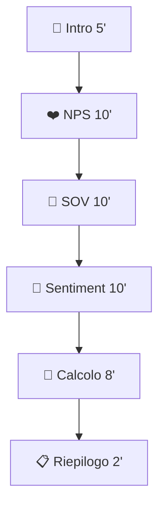
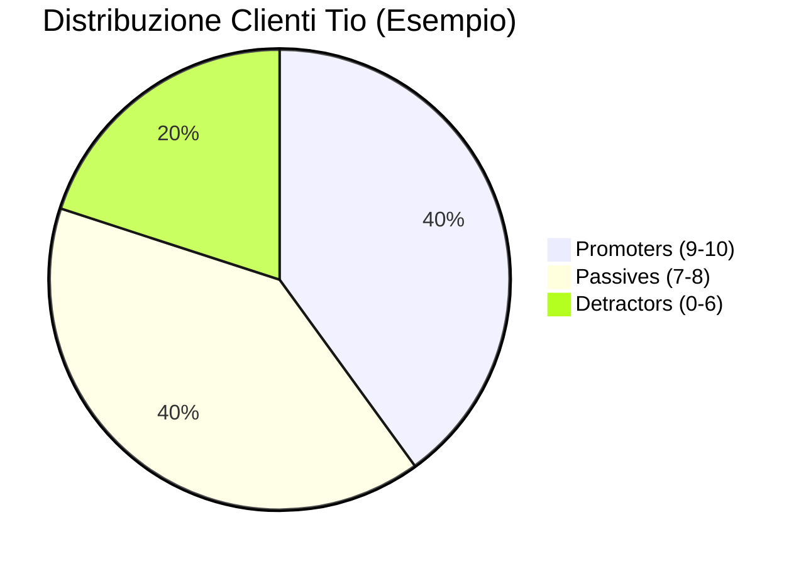

## Brand Health e Metriche di Percezione — Lezione Completa

Il brand è l'asset immateriale più prezioso di un'azienda. Warren Buffett lo chiama "il fossato economico" (Moat). Ma come si misura qualcosa di così intangibile come la "reputazione" o la "fedeltà"? In questa lezione, trasformeremo il concetto astratto di Brand in numeri concreti che puoi portare al tavolo del CEO, andando oltre il semplice "Mi piace".

### Obiettivi di Apprendimento

Al termine di questa lezione, lo studente sarà in grado di:
1.  Calcolare e interpretare correttamente il Net Promoter Score (NPS).
2.  Misurare la "Share of Voice" (SOV) rispetto ai competitor.
3.  Utilizzare il "Sentiment Analysis" per quantificare le emozioni nei commenti social.
4.  Distinguere tra Brand Awareness (Ricordo Spontaneo vs Sollecitato) e Brand Equity.
5.  Costruire una dashboard di Brand Health che correla la percezione con le vendite.

### Timeline della Lezione

| Fase | Argomento | Durata |
|------|-----------|--------|
| 1 | Introduzione: Perché misurare l'invisibile? | 5 min |
| 2 | Metrica Regina: Il Net Promoter Score (NPS) | 10 min |
| 3 | Awareness: Share of Search e Share of Voice | 10 min |
| 4 | Reputation: Sentiment Analysis e NLP | 10 min |
| 5 | Esercizi: Calcolo NPS e Analisi SOV | 8 min |
| 6 | Riepilogo e Domande | 2 min |
| **Totale** | | **45 min** |

### Fase 1 — Introduzione: Perché misurare l'invisibile? (5 min)

Molti CFO considerano il branding una "spesa discrezionale". Sbagliano.
Un brand forte riduce il Costo di Acquisizione (CAC) perché la gente ti cerca direttamente su Google ("Nike" invece di "scarpe da corsa").
Aumenta la Retention perché i clienti si fidano.
Permette di alzare i prezzi (Pricing Power) senza perdere volumi.

Senza metriche, il brand è solo arte. Con le metriche, è scienza economica.

### Fase 2 — Metrica Regina: Il Net Promoter Score (NPS) (10 min)

Inventato da Fred Reichheld nel 2003, l'NPS è diventato lo standard globale. Si basa su una sola domanda (The Ultimate Question):

> *"Con quale probabilità consiglieresti [Azienda X] a un amico o collega?"* (Scala 0-10)

**I 3 Gruppi:**
1.  **Promoters (9-10):** Fan entusiasti. Comprano di più, restano più a lungo, portano amici. Sono il tuo motore di crescita.
2.  **Passives (7-8):** Soddisfatti ma indifferenti. Se un concorrente fa uno sconto, ti lasciano. Non contano nel calcolo.
3.  **Detractors (0-6):** Clienti infelici. Parlano male di te, intasano il supporto clienti, distruggono valore.

**La Formula:**
`NPS = % Promoters - % Detractors`

*   *Range:* Da -100 (tutti odiano) a +100 (tutti amano).
*   *Benchmark:* >0 è ok. >50 è eccellente (Apple, Tesla). >70 è world-class.

**Limiti dell'NPS:**
*   È una metrica di *relazione*, non di *transazione*.
*   Non ti dice *perché*. Devi sempre aggiungere una domanda aperta: "Qual è il motivo principale del tuo voto?".

*NPS = 40% - 20% = +20.*

### Fase 3 — Awareness: Share of Search e Share of Voice (10 min)

Se nessuno ti conosce, nessuno ti compra.

**1. Share of Voice (SOV)**
È la tua quota di "rumore" nel mercato rispetto ai concorrenti.
*   *Canali:* Menzioni Social, PR, Pubblicità TV.
*   *Formula:* (Tue Menzioni / Menzioni Totali del Settore) * 100.
*   *Teoria di Binet & Field:* Se SOV > Market Share (Quota di Mercato), il tuo brand crescerà (Excess Share of Voice - ESOV).

**2. Share of Search (SOS)**
È il "nuovo SOV". Si basa sui volumi di ricerca su Google. È un indicatore predittivo della quota di mercato futura (spesso con 6 mesi di anticipo).
*   *Strumento:* Google Trends.
*   *Analisi:* Confronta "Brand Tuo" vs "Brand Competitor 1" vs "Brand Competitor 2".
*   *Formula:* (Ricerche del tuo Brand / Totale Ricerche Brand Categoria) * 100.

**Brand Awareness Pyramid:**
1.  **Top of Mind:** Il primo brand che viene in mente ("Bibita gassata" -> Coca-Cola).
2.  **Spontaneous Recall:** Altri brand citati senza aiuto ("Pepsi, Fanta").
3.  **Prompted Recall:** Riconoscimento su lista ("Ah sì, conosco la Cedrata Tassoni").

### Fase 4 — Reputation: Sentiment Analysis e NLP (10 min)

Non basta che parlino di te (Volume), devono parlarne bene (Sentiment).
Grazie al Natural Language Processing (NLP), possiamo analizzare migliaia di tweet, recensioni Amazon e ticket di supporto in automatico.

**Sentiment Score:**
*   Assegna un valore a ogni testo: -1 (Molto Negativo) a +1 (Molto Positivo).
*   *Esempio:* "Il servizio è lento ma il cibo è ottimo" -> Sentiment Misto (Neutral).

**Topic Modeling (LDA):**
Di *cosa* stanno parlando? L'algoritmo raggruppa le parole chiave.
*   *Topic 1:* "Spedizione", "Ritardo", "Corriere" (Logistica - Negativo).
*   *Topic 2:* "Design", "Colore", "Bello" (Prodotto - Positivo).

Se il Sentiment globale scende, fai drill-down sui Topic per capire dove sta il problema.

### Fase 5 — Esercizi: Calcolo NPS e Analisi SOV (8 min)

**Esercizio 1: Calcola l'NPS**
Hai ricevuto 100 risposte al sondaggio:
*   50 persone hanno votato 9 o 10.
*   30 persone hanno votato 7 o 8.
*   20 persone hanno votato da 0 a 6.

*Calcolo:*
*   % Promoters = 50%
*   % Detractors = 20%
*   **NPS = 50 - 20 = +30.** (Un risultato buono!).

**Esercizio 2: Share of Search**
Su Google Trends (ultimi 12 mesi):
*   Tuo Brand: Indice medio 20.
*   Competitor A: Indice medio 50.
*   Competitor B: Indice medio 30.
*   Totale = 100.

*Tua SOS = 20 / 100 = 20%.* Se la tua quota di mercato reale è solo il 10%, hai un "Excess SOS" positivo -> Probabilmente crescerai.

### Fase 6 — Riepilogo e Domande (2 min)

1.  **NPS** per la fedeltà (Loyalty).
2.  **Share of Search** per la notorietà (Awareness).
3.  **Sentiment** per la reputazione (Percezione).
4.  **Correlazione.** Guarda sempre se l'aumento del brand metrics porta un aumento delle vendite nel lungo periodo.

### Domande di Verifica

1.  Perché i "Passives" (voti 7-8) non vengono contati nel calcolo dell'NPS?
2.  Qual è la differenza tra "Share of Voice" (SOV) e "Share of Search" (SOS)?
3.  Cosa indica un "Excess Share of Voice" positivo secondo la teoria di Binet & Field?
4.  Come può il "Topic Modeling" aiutare a capire un calo improvviso del Sentiment?
5.  Perché l'NPS da solo può essere fuorviante se non accompagnato da domande qualitative ("Perché?")?

### Riferimenti Bibliografici

-   Fred Reichheld, "The Ultimate Question 2.0", Harvard Business Review Press, 2011.
-   Les Binet & Peter Field, "The Long and the Short of It", IPA, 2013.
-   Byron Sharp, "How Brands Grow", Oxford University Press, 2010.
