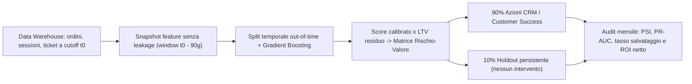

Un rivenditore e-commerce multibrand di abbigliamento e accessori con `72.000` clienti attivi su base annua registra un tasso di abbandono trimestrale del `19%` nella fascia dei clienti con almeno due ordini storici (scenario costruito con numeri di esempio).

La direzione commerciale vuole attivare un piano di retention proattiva con contatto telefonico dedicato e incentivi mirati, ma fissa due vincoli rigidi prima di sbloccare il budget annuo massimo di `180.000 €`: zero utilizzo di segnali successivi alla data di previsione e dimostrazione aritmetica che l'intervento guidato dal modello produca un ritorno netto superiore sia al contatto casuale sia a una regola semplice basata sui soli giorni dall'ultimo acquisto.

> **Idea chiave:** Un modello di churn crea valore economico solo quando rispetta rigorosamente la linea del tempo nelle feature, incrocia la probabilità di abbandono con il margine residuo del cliente e verifica il proprio guadagno netto contro un gruppo di controllo permanente.

## Architettura della consegna end-to-end dal warehouse al CRM

Un progetto reale di data science applicata al marketing non termina dentro un notebook con un valore elevato di `ROC-AUC`. Finisce quando le probabilità ordinate attivano azioni selettive nel CRM, preservano un campione non trattato per misurare il guadagno causale e alimentano un ciclo di sorveglianza mensile capace di segnalare il degrado prima che il budget vada in perdita.



L'architettura separa in modo netto tre responsabilità: il calcolo storico riproducibile (`snapshot` congelati a date di osservazione precise), il motore decisionale economico (`Matrice Rischio × Valore`, dove un cliente ad alto rischio ma basso margine riceve solo un'automazione a costo quasi zero mentre un cliente ad alto rischio e alto valore riceve attenzione umana) e la misura dell'effetto reale tramite il gruppo `holdout` permanente del `10%`.

## Ingegneria delle feature su snapshot temporali senza leakage

L'errore più grave e frequente nei progetti di churn consiste nell'aggregare le tabelle transazionali usando l'intero storico fino a oggi per poi etichettare chi ha già cancellato l'account o smesso di comprare. Se includi nel calcolo variabili costruite dopo l'inizio del silenzio o durante la finestra stessa che vuoi prevedere, il modello ottiene punteggi quasi perfetti in laboratorio ma crolla appena arriva sui dati di produzione.

Per evitare qualsiasi contaminazione temporale (`data leakage`), ogni riga del dataset di addestramento deve essere ancorata a una precisa `data_osservazione` ($t_0$). Tutte le variabili esplicative ($X$) vanno calcolate esclusivamente con eventi compresi fino a $t_0$ incluso, per esempio negli ultimi `30`, `60` o `90` giorni precedenti la data di taglio.

La variabile obiettivo ($y = 1$ se il cliente non effettua alcun ordine, $0$ se resta attivo) va invece osservata esclusivamente nella finestra futura disgiunta $(t_0, t_0 + 90\text{ giorni}]$. Questa separazione netta garantisce che al momento dello scoring in produzione esistano esattamente gli stessi segnali usati in fase di addestramento.

Costruiamo le quattro famiglie di segnali su snapshot coerenti con questo vincolo, proteggendo ogni rapporto numerico da divisioni per zero:

```python
import numpy as np
import pandas as pd

def costruisci_feature_snapshot(
    clienti: pd.DataFrame,
    ordini: pd.DataFrame,
    sessioni: pd.DataFrame,
    ticket: pd.DataFrame,
    cutoff_date: pd.Timestamp,
) -> pd.DataFrame:
    # Filtra rigorosamente tutti gli eventi prima o alla data di cutoff t0
    ord_past = ordini[ordini["data_ordine"] <= cutoff_date].copy()
    ses_past = sessioni[sessioni["data_sessione"] <= cutoff_date].copy()
    tkt_past = ticket[ticket["data_apertura"] <= cutoff_date].copy()

    t_30 = cutoff_date - pd.Timedelta(days=30)
    t_60 = cutoff_date - pd.Timedelta(days=60)
    t_90 = cutoff_date - pd.Timedelta(days=90)
    t_180 = cutoff_date - pd.Timedelta(days=180)

    # 1. Famiglia RFM storica fino a t0
    rfm = (
        ord_past.groupby("customer_id")
        .agg(
            ultimo_ordine=("data_ordine", "max"),
            ordini_90g=("order_id", lambda s: (ord_past.loc[s.index, "data_ordine"] >= t_90).sum()),
            margine_180g=("margine_lordo", lambda s: s[ord_past.loc[s.index, "data_ordine"] >= t_180].sum()),
        )
        .reset_index()
    )
    rfm["recency_giorni"] = (cutoff_date - rfm["ultimo_ordine"]).dt.days

    # 2. Famiglia Trend di utilizzo (ultimi 30 giorni vs 30 giorni precedenti)
    ses_30 = ses_past[ses_past["data_sessione"] >= t_30].groupby("customer_id").size().rename("ses_0_30")
    ses_30_60 = (
        ses_past[(ses_past["data_sessione"] >= t_60) & (ses_past["data_sessione"] < t_30)]
        .groupby("customer_id")
        .size()
        .rename("ses_30_60")
    )

    # 3. Famiglia Segnali di attrito (ticket aperti o resi recenti)
    tkt_60 = (
        tkt_past[tkt_past["data_apertura"] >= t_60]
        .groupby("customer_id")
        .agg(ticket_60g=("ticket_id", "count"), ritardi_consegna=("flag_ritardo", "sum"))
        .reset_index()
    )

    # 4. Unione e calcolo rapporti con denominatore protetto
    df = clienti[["customer_id", "data_primo_ordine", "ltv_residuo_stimato"]].copy()
    df["tenure_giorni"] = (cutoff_date - df["data_primo_ordine"]).dt.days.clip(lower=1)

    df = df.merge(rfm, on="customer_id", how="left")
    df = df.merge(ses_30, on="customer_id", how="left")
    df = df.merge(ses_30_60, on="customer_id", how="left")
    df = df.merge(tkt_60, on="customer_id", how="left")

    for col in ["ordini_90g", "margine_180g", "ses_0_30", "ses_30_60", "ticket_60g", "ritardi_consegna"]:
        df[col] = df[col].fillna(0)
    df["recency_giorni"] = df["recency_giorni"].fillna(df["tenure_giorni"])

    # Rapporto di accelerazione o rallentamento delle visite senza divisione per zero
    df["trend_visite_ratio"] = df["ses_0_30"] / df["ses_30_60"].clip(lower=1)
    df["cutoff_date"] = cutoff_date
    return df
```

## Addestramento, split temporale e metriche orientate all'azione

Una volta generati più snapshot mensili (per esempio `31 marzo`, `30 aprile`, `31 maggio`, `30 giugno`), non si mescolano mai le righe in un `train_test_split` casuale. Lo split casuale mette lo stesso cliente o la stessa stagione promozionale sia nel training sia nel test, gonfiando artificialmente le metriche. Devi invece adottare uno **split out-of-time**: addestri sugli snapshot più vecchi (esempio marzo–maggio) e valuti sullo snapshot più recente con etichette già maturate (esempio giugno).

Anche la scelta della metrica segue la realtà operativa. Su un tasso di abbandono del `19%`, la sola accuratezza globale non distingue i veri casi urgenti dalla maggioranza stabile. Le metriche che governano la decisione sono tre: `PR-AUC` (sensibile ai falsi positivi nella classe minoritaria), `ROC-AUC` (ordinamento complessivo delle probabilità) e soprattutto la **Precision@TopK**, cioè la percentuale di veri churner dentro il sottoinsieme preciso che il team commerciale è in grado di gestire ogni anno.

```python
from sklearn.ensemble import HistGradientBoostingClassifier
from sklearn.metrics import average_precision_score, roc_auc_score
import pandas as pd

FEATURES = [
    "recency_giorni",
    "ordini_90g",
    "margine_180g",
    "tenure_giorni",
    "ses_0_30",
    "trend_visite_ratio",
    "ticket_60g",
    "ritardi_consegna",
]

def addestra_e_valuta_out_of_time(
    df_panel: pd.DataFrame,
    train_end: pd.Timestamp,
    test_cutoff: pd.Timestamp,
    capacita_top_k: int = 1800,
) -> tuple[HistGradientBoostingClassifier, dict[str, float]]:
    train_df = df_panel[df_panel["cutoff_date"] <= train_end]
    test_df = df_panel[df_panel["cutoff_date"] == test_cutoff].copy()

    model = HistGradientBoostingClassifier(
        max_depth=4,
        learning_rate=0.05,
        max_iter=200,
        min_samples_leaf=40,
        random_state=42,
    )
    model.fit(train_df[FEATURES], train_df["churn_90g"])

    test_df["churn_prob"] = model.predict_proba(test_df[FEATURES])[:, 1]
    top_k = test_df.sort_values("churn_prob", ascending=False).head(capacita_top_k)

    metriche = {
        "roc_auc": round(float(roc_auc_score(test_df["churn_90g"], test_df["churn_prob"])), 4),
        "pr_auc": round(float(average_precision_score(test_df["churn_90g"], test_df["churn_prob"])), 4),
        "precision_top_k": round(float(top_k["churn_90g"].mean()), 4),
    }
    return model, metriche
```

## Matrice rischio per valore e allocazione dei canali

Ordinare tutti i `72.000` clienti solo per probabilità di churn rischia di sprecare il tempo limitato del Customer Success chiamando clienti che spendono `25 €` all'anno mentre trascura clienti da `2.400 €` di margine residuo che mostrano un rischio del `65%`.

L'uscita del modello va quindi incrociata con il **valore residuo atteso** (`LTV` netto nei successivi 24 mesi) in una matrice operativa a cinque zone chiare:

| Quadrante Rischio × Valore | Soglia di probabilità e valore | Playbook operativo | Costo indicativo per cliente |
|---|---|---|---|
| `Critical × VIP` (Priorità 1) | Rischio `>= 0,60` e `LTV` top quartile | Chiamata Customer Success entro 24 ore + offerta su misura | `40 €` variabili (+ quota fissa team) |
| `High × Medium` (Auto-save) | Rischio `>= 0,60` e `LTV` medio | Flusso automatico email + push con contenuto d'uso o piccolo bonus | `2 €–5 €` |
| `Medium × VIP` (Proactive care) | Rischio `0,35–0,59` e `LTV` top quartile | Check-in di account o anteprima collezione senza sconti sul margine | `8 €` |
| `Low × VIP` (Loyalty reward) | Rischio `< 0,35` e `LTV` top quartile | Riconoscimento VIP e accesso anticipato, nessuno sconto non richiesto | `0 €–3 €` |
| `Low × Low` (Standard) | Rischio `< 0,60` e `LTV` basso | Comunicazione ordinaria di newsletter, nessuna azione extra | `0 €` |

## Derivazione economica completa del caso: dal decile di rischio al ROI netto

Verifichiamo ora con precisione aritmetica se il quadrante prioritario `Critical × VIP` rispetta il vincolo di budget di `180.000 €` imposto dalla direzione commerciale sullo scenario iniziale (`72.000` clienti attivi) (numeri di esempio).

Supponiamo che la matrice isoli **`1.800` clienti l'anno** nel quadrante `Critical × VIP`, ciascuno con un `LTV` netto residuo atteso di **`2.400 €`** su ventiquattro mesi. Sul gruppo di test out-of-time, la precisione reale del modello in questa selezione è del **`71%`**.

Il programma prevede un costo fisso annuo di **`108.000 €`** per il team dedicato e il tooling di integrazione, più un costo variabile operativo e promozionale di **`40 €`** per ogni cliente contattato. Un esperimento pilota su gruppo di controllo ha misurato che l'intervento recupera in modo incrementale il **`35%`** dei veri potenziali churner contattati.

Il primo passaggio consiste nel separare i veri potenziali churner dai falsi allarmi presenti nella lista dei `1.800` segnalati. Applicando la precisione del `71%`, i veri potenziali churner sono $1.800 \times 0{,}71 = 1.278$ clienti, mentre i restanti $1.800 - 1.278 = 522$ clienti sono falsi positivi che sarebbero rimasti comunque attivi anche senza nessuna telefonata. Un'analisi ingenua che trattasse tutti i `1.800` clienti come clienti certi di abbandono sovrastimerebbe la platea salvabile del `40,8%`.

Nel secondo passaggio calcoliamo quanti clienti vengono effettivamente salvati grazie al lavoro del team. Applicando il tasso incrementale di salvataggio del `35%` misurato sul pilota ai soli `1.278` veri potenziali churner otteniamo $1.278 \times 0{,}35 = 447{,}3$, che arrotondiamo prudentemente a **`447` clienti salvati** in un anno.

Nel terzo passaggio confrontiamo il valore economico preservato con i costi totali sostenuti sull'intera selezione. Il margine `LTV` preservato dai `447` clienti trattenuti ammonta a $447 \times 2.400 = 1.072.800$ €. Sul lato dei costi, invece, il costo variabile di `40 €` viene pagato su tutti i `1.800` clienti chiamati — compresi i `522` falsi positivi — per una spesa variabile di $1.800 \times 40 = 72.000$ €. Sommando il costo fisso di `108.000 €`, l'investimento totale annuo è $108.000 + 72.000 = 180.000$ €, esattamente dentro il tetto massimo approvato dalla direzione.

Nel quarto passaggio ricaviamo il guadagno netto e il ritorno sull'investimento (`ROI`). Sottraendo l'investimento totale dal margine preservato otteniamo un beneficio netto annuo di $1.072.800 - 180.000 = +892.800$ €, equivalente a un `ROI` netto di $892.800 / 180.000 = 4{,}96\text{x}$, cioè **`+496%`**.

Concludiamo con un controllo di robustezza sotto drift severo per fissare la soglia di arresto automatico. Se un cambio di canali di traffico facesse scendere la precisione dal `71%` al `40%`, i veri churner intercettati scenderebbero a `720`, i clienti salvati a `252` e il margine salvato a `604.800 €` (`+424.800 €` netti). Scendendo invece sotto l'`11,9%` di precisione (`214` veri churner, `75` salvati, `180.000 €` di margine salvato), il programma andrebbe in pareggio zero e poi in perdita: questo numero diventa il pavimento operativo scritto nel monitoraggio mensile.

## Attivazione giornaliera, Reverse ETL, holdout e monitoring in produzione

Il passaggio finale collega il modello al CRM quotidiano assicurandosi che il gruppo di controllo non venga mai perso. Ogni giorno il job di scoring genera la tabella analitica `mrt_activation__customer_health`, assegna in modo deterministico il `10%` di ogni quadrante al gruppo `holdout` tramite hash stabile sull'identificativo cliente e scrive solo il restante `90%` nelle liste attive del CRM.

```python
import hashlib

def assegna_gruppo_e_azione(customer_id: str, churn_prob: float, ltv_residuo: float, soglia_vip: float = 1500.0) -> dict[str, str]:
    # Assegnazione deterministica e permanente al 10% holdout
    digest = hashlib.sha256(customer_id.encode("utf-8")).hexdigest()
    bucket = int(digest[:8], 16) % 100
    is_holdout = bucket < 10

    if churn_prob >= 0.60 and ltv_residuo >= soglia_vip:
        quadrante = "CRITICAL_VIP"
        azione_base = "CS_CALL_24H"
    elif churn_prob >= 0.60:
        quadrante = "HIGH_MEDIUM"
        azione_base = "AUTO_EMAIL_BONUS"
    elif churn_prob >= 0.35 and ltv_residuo >= soglia_vip:
        quadrante = "MEDIUM_VIP"
        azione_base = "ACCOUNT_CHECKIN"
    elif ltv_residuo >= soglia_vip:
        quadrante = "LOW_VIP"
        azione_base = "LOYALTY_REWARD"
    else:
        quadrante = "LOW_STANDARD"
        azione_base = "NESSUNA"

    return {
        "customer_id": customer_id,
        "quadrante": quadrante,
        "canale_attivato": "HOLDOUT_CONTROLLO" if is_holdout else azione_base,
    }

print(assegna_gruppo_e_azione("cust_90421", churn_prob=0.74, ltv_residuo=2400.0))
```

La disciplina dell'intervento selettivo sulla base installata ha avuto un riscontro noto su scala globale nel caso Netflix del primo trimestre 2022: dopo anni di crescita continua, l'azienda riportò la prima perdita netta di `200.000` abbonati nel trimestre, spingendo il management a riorientare le priorità verso misure dirette di tenuta degli utenti esistenti (come il contrasto alla condivisione non pagata delle password e l'introduzione di un piano più economico supportato da pubblicità).

Sul piano analitico, il principio resta identico a qualsiasi scala: quando la crescita per acquisizione rallenta o il tasso di uscita sale, trattenere i segmenti ad alto valore recuperabile diventa la leva con il ritorno marginale più elevato dell'intero bilancio marketing.

## Errori critici nei progetti end-to-end di churn

### Split casuale invece dello split temporale out-of-time

Usare `train_test_split` casuale su snapshot mensili mescola lo stesso mese commerciale tra addestramento e verifica. Se a maggio c'è stata una promozione straordinaria o un disservizio logistico che ha alterato tutti gli ordini, il modello memorizza la firma di quel periodo nei dati di test e sovrastima `PR-AUC` e `Precision@TopK` di 10–15 punti percentuali rispetto a ciò che accade poi in produzione su giugno o luglio.

Esegui sempre la validazione su un periodo successivo separato temporalmente dal training.

### Confondere la probabilità di churn con il valore economico dell'intervento

Chiamare o offrire sconti ai clienti con la probabilità più alta in assoluto porta spesso a concentrare le risorse su utenti già quasi persi da mesi oppure su clienti a margine bassissimo che non ripagano il costo della telefonata.

Ordina l'intervento incrociando probabilità, valore `LTV` residuo e suscettibilità stimata all'azione: alcuni clienti ad alto rischio vanno lasciati uscire con eleganza anziché sussidiati in perdita.

### Spegnere il gruppo di holdout dopo la prima settimana di produzione

Spesso il team commerciale chiede di togliere il gruppo di controllo del `10%` "per non perdere vendite su quei clienti". Così facendo, dopo due mesi nessuno sa più se il calo di churn dipenda dalle telefonate del Customer Success o da un cambio di stagionalità, e il dataset futuro viene contaminato dagli interventi stessi rendendo impossibile riaddestrare il modello in modo affidabile.

Mantieni sempre un `holdout` stabile e mostra il bilancio economico trimestrale calcolato direttamente sulla differenza rispetto a quel controllo.

## Revisione finale prima della consegna al decisore

1. Nella funzione `costruisci_feature_snapshot`, perché filtriamo ordini, sessioni e ticket imponendo `data <= cutoff_date` prima di qualsiasi aggregazione invece di filtrare solo alla fine sulla tabella già unita?

<details>
<summary>Mostra risposta</summary>

Perché aggregare prima del taglio includerebbe dentro medie, conteggi e date massime anche eventi avvenuti dopo `cutoff_date` (nella finestra futura target). Quel `data leakage` farebbe sembrare il modello molto più preciso in fase di test di quanto sia realmente il giorno del lancio in produzione, quando gli eventi futuri non esistono ancora.

</details>

2. Nel nostro conto economico, il costo variabile di `40 €` è stato moltiplicato per tutti i `1.800` clienti segnalati, mentre il salvataggio di `2.400 €` si è applicato solo a `447` clienti. Perché questa asimmetria è corretta?

<details>
<summary>Mostra risposta</summary>

Perché al momento del contatto il team non conosce in anticipo chi tra i `1.800` clienti è un vero churner (`1.278`) né chi accetterà davvero di restare (`447`): sostiene quindi il costo operativo di `40 €` su tutta la lista selezionata (`72.000 €`). Al contrario, il beneficio economico incrementale nasce soltanto dai `447` clienti che sarebbero usciti senza intervento e che invece rimangono attivi generando i `2.400 €` di `LTV` residuo.

</details>

3. Che cosa accade al progetto se per errore il programma di retention inizia a telefonare anche ai clienti nel quadrante `Low × Low` oltre a `Critical × VIP` senza aumentare il budget fisso?

<details>
<summary>Mostra risposta</summary>

La precisione reale e l'`LTV` medio della popolazione trattata crollano rapidamente, mentre i costi variabili di `40 €` continuano a crescere linearmente per ogni cliente contattato. In molti casi, su clienti con `LTV` basso e bassa probabilità di uscita, il costo operativo più l'eventuale incentivo superano il margine salvabile e distruggono parte del `ROI` positivo generato sul segmento `Critical × VIP`.

</details>

4. Qual è la soglia minima di `Precision@1800` sotto la quale l'intero programma da `180.000 €` del caso studio smette di generare profitto netto, assumendo invariati `LTV = 2.400 €` e salvataggio del `35%`?

<details>
<summary>Mostra risposta</summary>

Serve che il margine salvato copra esattamente i `180.000 €` di investimento totale. Dividendo `180.000 €` per `2.400 €` occorrono almeno `75` clienti salvati; poiché si salva il `35%` dei veri churner, servono $75 / 0{,}35 \approx 214{,}3$ veri churner sui `1.800` contattati, cioè una precisione minima di $214{,}3 / 1.800 \approx 11{,}9\%$. Questo valore rappresenta il pavimento di sicurezza da monitorare mensilmente per scattare il blocco automatico.

</details>
