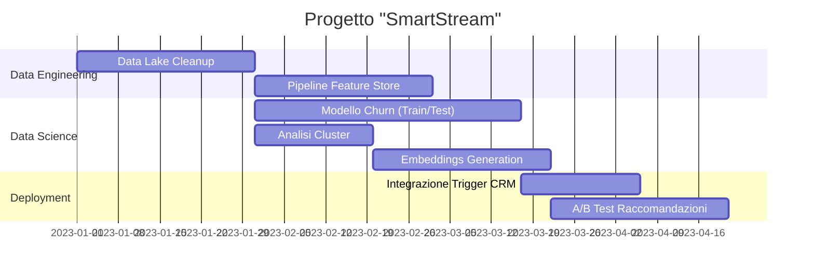
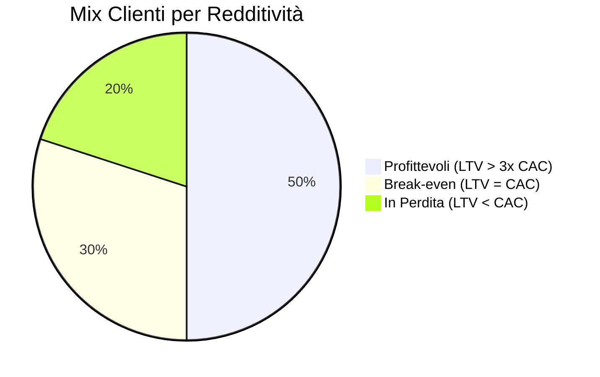

## Contesto Aziendale

**Azienda:** *StreamFlix* (nome fittizio)
**Settore:** Streaming Video on Demand (SVOD)
**Modello:** Abbonamento Mensile (€9.99)
**Utenti:** 2 Milioni

StreamFlix ha un catalogo enorme ma un problema di *Discovery*. Gli utenti passano 20 minuti a cercare cosa guardare e spesso chiudono l'app frustrati. Il tasso di abbandono (Churn) sta salendo pericolosamente.
Il team marketing invia email generiche "Guarda le novità!" a tutti, ottenendo open rate bassissimi.
Inoltre, stanno spendendo molto in acquisizione (CAC) senza sapere se questi nuovi utenti saranno redditizi (LTV).

### Dati Iniziali

| Metrica | Situazione Attuale | Obiettivo | Note |
| :--- | :--- | :--- | :--- |
| **Churn Mensile** | 8% | 5% | Molto alto per il settore |
| **LTV / CAC** | 1.2x | > 3.0x | Spendiamo troppo per acquisire utenti che lasciano subito |
| **Tempo di Ricerca** | 18 minuti | < 5 minuti | "Analysis Paralysis" |
| **Personalizzazione** | Basata su Regole | Basata su AI | "Hai visto X, guarda Y" non funziona |
| **Analisi Dati** | Piena di Bias | Rigorosa | Rischio Simpson's Paradox nei test attuali |

**Problema Principale:** StreamFlix tratta tutti gli utenti allo stesso modo. Manca una segmentazione comportamentale avanzata e un sistema predittivo per intervenire *prima* che l'utente cancelli l'abbonamento.

## Obiettivi del Progetto

Il progetto "SmartStream" si pone i seguenti obiettivi:

1.  **Ridurre il Churn del 30%** implementando un modello di *Churn Prediction* che attivi campagne di retention mirate.
2.  **Aumentare il Watch Time del 20%** grazie a un sistema di raccomandazione basato su *Embeddings* e *Vector Search*.
3.  **Ottimizzare la Unit Economics** portando il rapporto LTV/CAC sopra il 3x, tagliando i canali non performanti analizzati per coorte.
4.  **Evitare Trappole Analitiche** istituzionalizzando checklist anti-bias per ogni A/B test.

## Analisi e Strategia

### 1. Advanced Customer Analytics: Clustering
Non useremo segmenti demografici ("Donne 25-34"). Useremo **K-Means Clustering** sui dati comportamentali (orari di visione, device, generi, completezza visione).
*   *Cluster A (The Bingers):* Guardano serie intere nel weekend.
*   *Cluster B (The Snackers):* Guardano 20 min su mobile in pausa pranzo.
*   *Cluster C (The Drifters):* Guardano poco e a caso -> A rischio Churn.

### 2. Predictive Modeling: Churn Prediction
Addestreremo un modello (XGBoost) per calcolare la probabilità di churn (0-100%) per ogni utente.
*   **Feature:** Giorni dall'ultimo login, % buffer video (qualità tecnica), numero ticket assistenza, calo del watch time.
*   **Azione (Trigger Analytics):** Se Prob > 75%, invia offerta sconto automatica o notifica push personalizzata.

### 3. AI & Embeddings
Sostituiremo i tag manuali ("Azione", "Romantico") con **Embeddings**. Trasformeremo le trame dei film in vettori numerici.
*   Se un utente ama "Matrix", il sistema cercherà film vettorialmente vicini nello spazio semantico (es. "Inception", "Ghost in the Shell"), anche se i tag non coincidono perfettamente.

### Diagramma della Pipeline Data Science

```mermaid
flowchart TD
    subgraph Data_Sources
        A[Log Visione]
        B[Metadati Film]
        C[Interazioni App]
    end

    subgraph Processing
        A & C --> D[Feature Engineering]
        B --> E[Text Embeddings (OpenAI/BERT)]
    end

    subgraph Models
        D --> F[Churn Prediction (XGBoost)]
        D --> G[Clustering (K-Means)]
        E --> H[Vector DB (Pinecone/Milvus)]
    end

    subgraph Action
        F --> I[Retention Campaign]
        G --> L[Personalized UI]
        H --> M[Recommendation Engine]
    end
```

**Decisioni Chiave:**
*   **Precision vs Recall:** Per il modello di Churn, privilegeremo la *Precision*. Non vogliamo regalare sconti a chi non se ne andrebbe comunque (spreco di soldi), anche a costo di perdere qualche utente (Recall più bassa).
*   **Evitare il Survivorship Bias:** Nel calcolare l'efficacia delle email, includeremo anche chi non le apre, non solo chi clicca.

## Implementazione

### Timeline (6 Mesi)



### Dati Intermedi: Matrice di Confusione (Churn Model)

Validazione del modello su dati storici:

| | Predetto: Resterà | Predetto: Lascerà (Churn) |
| :--- | :--- | :--- |
| **Reale: Resterà** | 850 (TN) | 50 (FP - Sconto sprecato) |
| **Reale: Lascerà** | 40 (FN - Utente perso) | 60 (TP - Utente salvabile) |

*   **Precision:** 60 / (60+50) = 54% (Su 100 utenti targettizzati, 54 stavano davvero per lasciare).
*   **Recall:** 60 / (60+40) = 60% (Abbiamo individuato il 60% dei churner totali).

**Problema Incontrato (Simpson's Paradox):** Un A/B test sulla nuova UI sembrava peggiorativo (-5% conversioni).
**Analisi:** Segmentando per device, la nuova UI vinceva sia su Mobile (+10%) che su Desktop (+10%). Ma poiché la nuova UI aveva attirato molto più traffico Mobile (che converte meno del Desktop in generale), la media globale era scesa.
**Soluzione:** Analizzare sempre i test per segmenti, mai solo aggregati.

## Risultati

### KPI Prima vs Dopo

| KPI | Prima (T0) | Dopo (T6) | Variazione |
| :--- | :--- | :--- | :--- |
| **Churn Mensile** | 8.0% | 5.5% | -31% |
| **LTV (Lifetime Value)** | €45 | €68 | +51% |
| **CAC (Acquisition Cost)** | €38 | €22 | -42% (Migliore targeting) |
| **LTV / CAC** | 1.18x | 3.09x | Obiettivo Raggiunto |

### Analisi ROI

Costo Team Data Science + Infrastruttura: €200.000/anno.
Valore Utenti Salvati (Churn Reduction): 2.000 utenti/mese * €10 * 12 mesi = €240.000.
Valore Nuovi Utenti (Marketing Optimization): Risparmio di €16 per acquisizione su 50.000 utenti = €800.000.
**Totale Beneficio:** > €1M.

### Visualizzazione Unit Economics per Coorte



## Lezioni Apprese

1.  **I modelli invecchiano:** Un modello di Churn addestrato a Natale non funziona a Ferragosto. Serve ri-addestramento continuo (CI/CD for ML).
2.  **Embeddings > Keywords:** L'AI capisce che "Film cupo e distopico" è simile a "Blade Runner" meglio di qualsiasi tag.
3.  **Attenzione alla "Leaky Bucket":** Prima di spendere in acquisizione, tappa i buchi del churn. Aumentare il budget marketing con un churn dell'8% è bruciare soldi.
4.  **Causalità vs Correlazione:** Abbiamo scoperto che chi guarda "Friends" ha un churn basso. Ma obbligare la gente a guardare Friends non riduce il churn. È una correlazione, non una causa.
5.  **Trigger Analytics:** L'intervento deve essere tempestivo. Un'email inviata 24 ore dopo l'evento critico (es. errore di pagamento) è spesso troppo tardi.

## Domande di Discussione

1.  Come useresti la "Text Generation" (LLM) per personalizzare non solo il contenuto raccomandato, ma anche il copy della notifica push?
2.  Quali rischi etici vedi nell'usare modelli predittivi per discriminare i prezzi o le offerte (es. offrire sconti solo a chi sta per lasciare)?
3.  Se il modello di clustering identificasse un segmento "Non redditizio", l'azienda dovrebbe attivamente cercare di allontanarli (firing customers)?
4.  In che modo il framework HADI potrebbe essere applicato per iterare velocemente sui parametri dell'algoritmo di raccomandazione?
5.  Come spiegheresti a un CEO non tecnico che un modello con accuratezza del 99% può essere inutile se il fenomeno (churn) è molto raro (es. 1%)? (Paradosso dell'accuratezza).

**Cosa faresti diversamente?**
*   *Se non avessimo GPU:* Userei algoritmi di raccomandazione più semplici (Matrix Factorization) invece di Deep Learning con Embeddings, per risparmiare costi di inferenza.
*   *Se fossimo una B2B:* Il modello di Churn si baserebbe non sui click del singolo, ma sull'attività dell'intero account aziendale (es. calo uso licenze).
