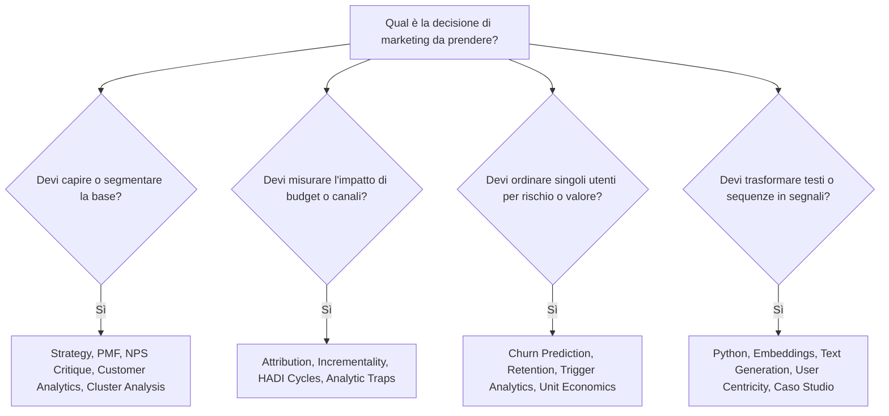

Un team marketing e analytics di un retailer omnicanale con `85.000` clienti attivi deve decidere come allocare il budget promozionale del quarto trimestre (scenario costruito con numeri di esempio). Intorno al tavolo arrivano quattro proposte diverse per lo stesso problema di riattivazione: un algoritmo di clustering non supervisionato, una regressione logistica sul churn, un test incrementale con gruppo di controllo e una ricalibrazione dell'attribuzione multi-touch.

Prima di scrivere una riga di codice o lanciare campagne a sconto, il responsabile analitico deve stabilire quale domanda richiede una misura causale, quale richiede una previsione individuale e quale soglia economica giustifica l'invio dell'incentivo. Senza questo filtro iniziale, modelli formalmente corretti possono spingere il budget verso utenti che avrebbero acquistato comunque a prezzo pieno.

> **Idea chiave:** Una cheat sheet di marketing data science non serve a memorizzare formule, ma a collegare ogni decisione commerciale alla famiglia di modelli corretta, alla baseline controfattuale e al punto di pareggio economico prima del rilascio.

## Mappa del modulo e criteri di orientamento rapido

Le diciannove tappe del modulo si organizzano lungo quattro fasi operative consecutive: inquadrare il problema e la crescita sostenibile, segmentare e misurare l'effetto reale dei canali, costruire modelli predittivi su testo e comportamento, governare il rilascio economico in produzione.

Per orientarti senza esitazioni tra i contenuti del percorso, usa questa mappa sintetica per risalire subito alla lezione pertinente quando incontri un blocco analitico o di business:

| Area operativa | Lezioni del modulo | Problema tipico risolto | Verifica minima richiesta |
|---|---|---|---|
| Fondazione strategica e unità economiche | `strategy`, `pmf`, `unit-economics`, `nps-critique` | Sostenibilità di CAC, LTV, payback e segnali reali di adozione | Rapporto LTV/CAC su margine lordo e curva retention |
| Segmentazione e comportamento cliente | `customer-analytics`, `cluster-analysis`, `retention`, `trigger-analytics` | Raggruppare acquirenti per frequenza, valore e momenti di attivazione | Denominatore fisso sulle coorti e stabilità dei cluster |
| Causalità, attribuzione e trappole | `attribution`, `incrementality`, `hadi-cycles`, `analytic-traps` | Distinguere correlazione storica da guadagno incrementale netto | Gruppo di controllo o holdout e test di ipotesi pre-registrata |
| Modellazione tabellare, testo e produzione | `python`, `embeddings`, `text-generation`, `churn-prediction`, `user-centricity`, `caso-studio` | Feature temporali senza leakage, ranking top-decile e monitoraggio drift | Split out-of-time, `PR-AUC`, `PSI` e controllo ROI |

Leggi la tabella dall'alto verso il basso prima di aprire un nuovo progetto analitico. Se non hai ancora verificato i margini unitari (`unit-economics`) o la definizione corretta delle coorti (`retention`), costruire un classificatore complesso su quei dati produce punteggi precisi rispetto a un obiettivo economico sbagliato.

Quando la base economica è chiara, l'ordine operativo naturale separa prima i problemi descrittivi dai problemi causali, e solo dopo introduce il punteggio individuale per ordinare gli interventi commerciali.

## Quando scegliere ogni tecnica: matrice decisionale

Sbagliare famiglia di modello all'inizio fa perdere settimane di lavoro anche quando il codice gira senza errori.

La matrice seguente confronta gli strumenti principali del modulo in base al tipo di decisione richiesta, al dato necessario in ingresso e al segnale che li rende inutilizzabili.

| Domanda di business | Tecnica consigliata | Alternativa da evitare | Condizione che invalida il modello |
|---|---|---|---|
| Chi sono i clienti simili per comportamento d'acquisto? | Tabella `RFM` + `K-Means` su variabili standardizzate | Rete neurale complessa o regole fisse di sola spesa | Variabili non normalizzate o assenza di stabilità tra mesi |
| Quanto incasso extra genera davvero questa campagna ads? | Esperimento `holdout` / geo-lift di `incrementality` | Modello `last-click` usato come verità causale | Assenza di gruppo di controllo non esposto all'annuncio |
| Quali clienti stanno per abbandonare nei prossimi 30 giorni? | `Gradient Boosting` o logistica con split temporale | Split casuale rimescolato tra passato e futuro | `Data leakage` da feature costruite dopo la finestra target |
| Quale canale ripaga il costo di acquisizione entro sei mesi? | Matrice di coorte con margine cumulato per canale | Media aggregata di fatturato mensile lordo | Denominatore variabile o ricavi lordi al posto del margine |
| Come usare recensioni o ricerche libere nel ranking? | `Embeddings` + riduzioni dimensionali in feature tabellari | Conteggio rigido di parole chiave esatte | Mancata validazione out-of-time sullo stesso orizzonte |
| Il modello in produzione è ancora affidabile dopo un cambio campagne? | `Population Stability Index (PSI)` + precisione per segmento | Sola `accuracy` globale aggregata su tutto il database | Feedback loop non filtrato o campo di tracciamento azzerato |

La distinzione più critica in questa matrice passa tra **stima causale** e **classificazione individuale**. Un modello di propensione ti dice chi è più probabile che compri domani; un esperimento con gruppo `holdout` ti dice se l'annuncio o lo sconto cambia davvero quella probabilità rispetto a non fare nulla.

Mescolare i due livelli porta al paradosso più costoso del marketing digitale: concentrare i coupon proprio sui clienti già intenzionati all'acquisto, ottenendo conversioni apparenti molto alte ma margine incrementale negativo.

## Verifica numerica pre-lancio su una campagna di riattivazione

Prima di autorizzare una campagna guidata da uno score di propensione o di churn, il criterio decisivo non è il punteggio di accuratezza in validazione, ma il bilancio incrementale netto in euro rispetto al comportamento spontaneo dei clienti.

Consideriamo una verifica concreta sullo scenario del retailer omnicanale (numeri di esempio): il segmento selezionato dal modello per la campagna di riattivazione contiene `12.000` clienti dormienti. L'azienda valuta di inviare un incentivo economico di `15 €` spendibile sull'ordine successivo, sostenendo un costo operativo di contatto (email e SMS personalizzato) di `0,50 €` per ogni cliente raggiunto.

Il margine lordo medio su un ordine standard prima dello sconto è `55 €`. Dai test precedenti su un campione pilota, il tasso di acquisto entro trenta giorni senza alcun intervento (**baseline naturale**) è dell'`11%`, mentre nel gruppo che riceve l'offerta sale al `18%` (**lift incrementale** di `+7` punti percentuali).

Partiamo dal conteggio degli ordini effettivamente generati dall'intervento. Nel gruppo contattato ci aspettiamo $12.000 \times 0{,}18 = 2.160$ ordini complessivi, ma la baseline naturale ci dice che $12.000 \times 0{,}11 = 1.320$ clienti avrebbero acquistato lo stesso a prezzo pieno senza ricevere il buono. Gli ordini davvero incrementali generati dalla campagna sono quindi $2.160 - 1.320 = 840$ ordini (`7%` su `12.000`).

Passiamo ora al margine lordo prodotto e ai costi reali sostenuti sull'intera platea. Solo gli `840` ordini aggiuntivi generano nuovo margine rispetto allo stato di partenza: $840 \times 55 = 46.200$ €. Sul fronte delle uscite, però, l'azienda paga il contatto su tutti i destinatari ($12.000 \times 0{,}50 = 6.000$ €) e cede lo sconto da `15 €` a tutti i `2.160` clienti che completano l'ordine — compresi i `1.320` clienti che avrebbero comprato a prezzo pieno — per un costo promozionale di $2.160 \times 15 = 32.400$ €.

Sommando le due voci di uscita, la spesa totale della campagna ammonta a $6.000 + 32.400 = 38.400$ € e il risultato netto incrementale vale $46.200 - 38.400 = +7.800$ €, con un ritorno netto del $+20{,}3\%$ sulla spesa sostenuta.

Conviene verificare anche la sensibilità del margine: se il lift incrementale scendesse da `+7` a `+5` punti percentuali (`16%` di conversione totale, pari a `600` ordini incrementali su `1.920` ordini totali), il margine lordo extra scenderebbe a $600 \times 55 = 33.000$ € mentre i costi ammonterebbero a $6.000 + (1.920 \times 15) = 34.800$ €, trasformando l'iniziativa in una perdita secca di `-1.800 €`.

Questa logica ricalca il principio operativo reso famoso da Billy Beane con gli Oakland Athletics nella stagione 2002 della Major League Baseball: con un monte ingaggi intorno ai `40` milioni di dollari contro oltre `125` milioni delle squadre più ricche, la dirigenza smise di pagare parametri appariscenti ma inefficienti e concentrò ogni risorsa sulla metrica statisticamente legata alle vittorie reali (l'on-base percentage), arrivando a `20` vittorie consecutive.

Nel marketing predittivo accade la stessa cosa: pagare l'incentivo sulla probabilità grezza di acquisto premia chi comprerebbe comunque; concentrare il budget sull'incremento marginale protegge il capitale.

## Protocollo di attivazione: decisione, baseline, guardrail e rollback

Nessun modello o regola analitica del modulo dovrebbe passare in produzione senza aver compilato in anticipo questi cinque campi operativi in un documento condiviso tra team dati e direzione commerciale:

| Elemento del protocollo | Cosa definire per iscritto | Errore che previene |
|---|---|---|
| Unità di analisi e finestra | Entità target (utente, account, sessione), data di taglio $t_0$ e finestra di osservazione $W$ | Mescolare segnali di periodi futuri dentro le feature di addestramento |
| Baseline di riferimento | Regola semplice esistente (es. sola recency) o gruppo `holdout` non trattato | Attribuire al modello vendite che sarebbero avvenute spontaneamente |
| Metrica primaria di decisione | Indicatore legato al vincolo reale (`Precision@TopK`, `PR-AUC`, margine netto incrementale) | Ottimizzare `accuracy` o `ROC-AUC` su classi fortemente sbilanciate |
| Soglia e costo dell'errore | Costo contatto, costo incentivo, margine unitario e soglia minima di attivazione | Contattare decili dove il costo dell'azione supera il valore atteso |
| Guardrail e rollback | Soglia `PSI`, soglia di margine negativo, frequenza controlli e versione `N-1` pronta | Lasciare in giro campagne in perdita dopo un cambio di canali o un bug ETL |

Compila questa scheda prima di scrivere le query finali di esportazione verso il CRM, non dopo il lancio. Definire in anticipo chi ha l'autorità di spegnere l'automazione e quale soglia di margine attiva il `rollback` evita discussioni lente quando una campagna inizia a bruciare budget.

Nel momento in cui ogni elemento del protocollo ha un valore numerico verificabile e un responsabile assegnato, la verifica mensile richiede meno di trenta minuti e protegge sia l'affidabilità del modello sia la credibilità del team analitico davanti alla direzione.

## Trappole ricorrenti tra analisi e produzione

### Usare il tasso di risposta lordo al posto del lift incrementale

È lo sbaglio più diffuso nella lettura delle campagne automatiche: vedere che il `18%` dei destinatari ha comprato e moltiplicare tutti quei `2.160` ordini per il margine unitario. Come mostra il conto svolto sopra, oltre il `60%` di quelle vendite proviene spesso da clienti che avrebbero acquistato lo stesso, sui quali lo sconto riduce direttamente il profitto.

Separa sempre la quota esposta dal gruppo di controllo non esposto prima di dichiarare profittevole un modello.

### Portare un punteggio di modello nel CRM senza soglia economica

Calcolare una probabilità compresa tra `0` e `1` risolve solo metà del lavoro: la seconda metà consiste nello stabilire sopra quale probabilità conviene agire con un telefono commerciale, sotto quale soglia inviare solo un'email automatizzata a costo quasi zero e chi escludere del tutto.

Senza tradurre le probabilità in fasce di valore e costo, il modello resta una colonna decorativa nel CRM che nessuno utilizza davvero.

### Dimenticare l'allineamento tra coorti storiche e regole attuali

Modelli addestrati su dati vecchi di sei o dodici mesi incorporano prezzi, canali di acquisizione e promozioni di un periodo che potrebbe non esistere più.

Prima di rilasciare uno score in produzione, confronta la distribuzione recente delle variabili con la baseline congelata tramite `PSI` e verifica la precisione reale sui primi decili almeno una volta al mese.

## Controllo rapido prima del rilascio

1. Un modello di churn raggiunge una `ROC-AUC` di `0,86` sui dati di validazione, ma solo l'`8%` dei clienti abbandona ogni mese e il call center riesce a contattare appena `500` account alla settimana. Quale metrica devi controllare al posto della sola `ROC-AUC`?

Mostra risposta

Devi verificare la `Precision@500` (o nel top-decile operativo corrispondente alla capacità del call center) insieme alla `PR-AUC` e alla calibrazione delle probabilità. Su eventi rari, la `ROC-AUC` può apparire elevata grazie ai molti veri negativi facili da identificare, mentre tra i primi `500` clienti ordinati dal modello la precisione reale può essere troppo bassa per ripagare il costo delle chiamate.

2. Nel calcolo pre-lancio su `12.000` clienti, perché l'incentivo da `15 €` viene moltiplicato per tutti i `2.160` ordini totali del gruppo contattato e non solo per gli `840` ordini incrementali?

Mostra risposta

Perché il sistema di checkout applica lo sconto a chiunque riceva e utilizzi il codice promozionale, compresi i `1.320` clienti della baseline che avrebbero comprato comunque a prezzo pieno. Quel margine ceduto agli acquirenti organici rappresenta un costo reale della campagna che va sottratto al margine generato dai soli `840` ordini incrementali.

3. Quando una campagna social raddoppia di colpo il traffico di utenti con sessioni brevissime e il `PSI` dello score sale da `0,06` a `0,33`, quale azione immediata precede il riaddestramento del modello?

Mostra risposta

Prima del retraining devi verificare l'impatto per singolo canale e attivare un `rollback` o congelamento delle azioni costose automatiche sul nuovo traffico, per fermare subito eventuali invii impropri di sconti o chiamate fuori target. Solo dopo aver isolato il segmento alterato e verificato l'integrità dei campi di tracciamento puoi pianificare il retraining su dati recenti.

4. In quale caso concreto preferiresti un test `holdout` di incrementalità a un modello di attribuzione `multi-touch` basato su catene di Markov o Shapley?

Mostra risposta

Quando devi decidere se tagliare o raddoppiare la spesa su un canale che potrebbe catturare domanda già esistente (come le campagne brand search o il retargeting aggressivo su utenti già vicini all'acquisto). L'attribuzione multi-touch ridistribuisce il merito solo tra clic osservati, mentre il gruppo `holdout` misura direttamente quanti ordini spariscono quando il canale viene spento.

