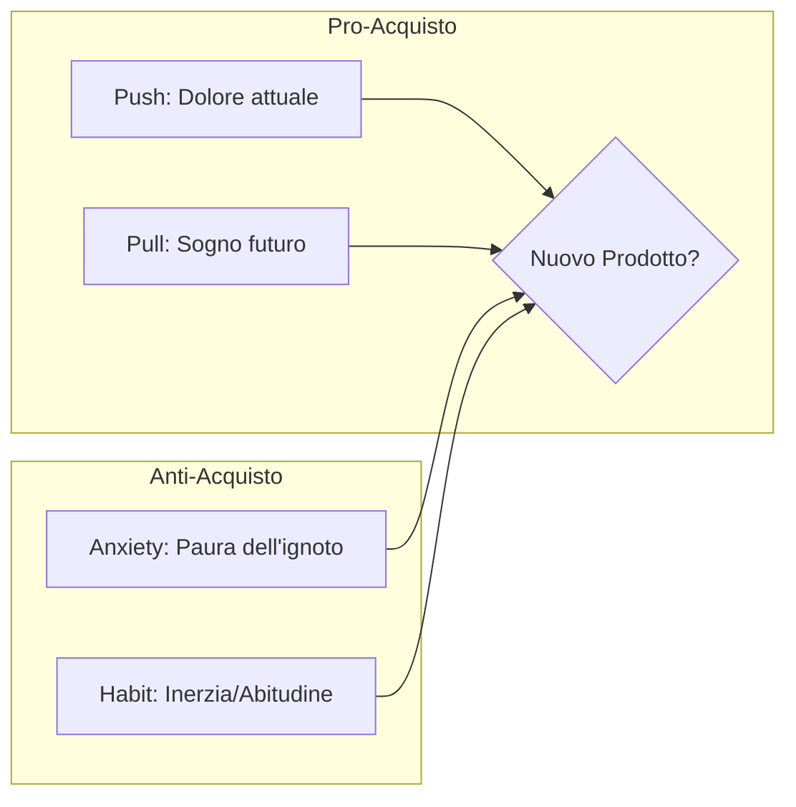
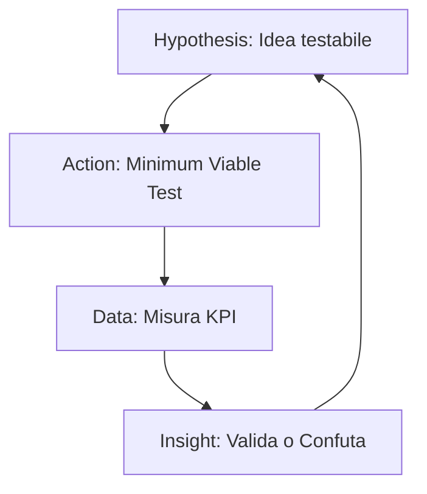
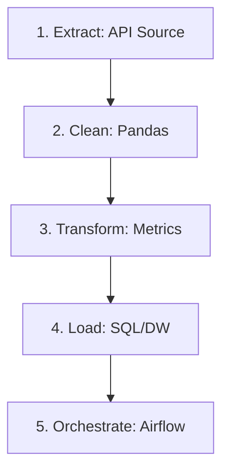

## Concetti Chiave

- **Unit Economics**: Le metriche fondamentali di profitto per singolo cliente (LTV, CAC). Se non funzionano a livello unitario, non scaleranno.
- **Jobs To Be Done (JTBD)**: Framework per capire *perché* le persone comprano. "Non voglio un trapano, voglio un buco nel muro".
- **Clustering (K-Means)**: Algoritmo ML non supervisionato per raggruppare i clienti in segmenti comportamentali (es. RFM) senza regole predefinite.
- **Negative Churn**: Il Santo Graal del SaaS. Quando l'espansione dei ricavi (Upsell) supera il fatturato perso (Churn). L'azienda cresce anche senza nuovi clienti.
- **Cohort Analysis**: Analizzare la retention dividendo gli utenti per data di iscrizione (Coorti) invece che guardare la media aggregata.
- **HADI Cycle**: Ciclo iterativo per la sperimentazione rapida: Hypothesis, Action, Data, Insight.
- **Share of Search**: La quota di ricerche su Google per il tuo brand rispetto ai competitor. È un "Leading Indicator" della quota di mercato futura.
- **High Tempo Testing**: L'obiettivo di lanciare 3+ esperimenti a settimana per massimizzare l'apprendimento.

## Formule e Metriche

| Metrica | Formula | Target Ideale |
|---------|---------|---------------|
| **LTV** | `(ARPU × Gross Margin) / Churn Rate` | > 3x CAC |
| **Payback Period** | `CAC / (ARPU × Gross Margin)` | < 12 mesi (SaaS) |
| **Net MRR Churn** | `(Churned MRR + Downgrade - Expansion) / Start MRR` | Negativo (es. -5%) |
| **NPS** | `% Promoters (9-10) - % Detractors (0-6)` | > 30 (Buono), > 50 (Eccellente) |
| **Share of Search** | `Tue Ricerche / Ricerche Totali Categoria` | > Tua Quota di Mercato |
| **ICE Score** | `Impact + Confidence + Ease` (Scala 1-10) | Usato per prioritizzare i test |

## Framework e Modelli

### Le 4 Forze del Cambiamento (JTBD)
Cosa spinge o frena un acquisto.

### Ciclo HADI
Il motore della crescita.

### Analisi di Coorte (Heatmap)
Come leggere la retention nel tempo.

| Coorte | Mese 1 | Mese 2 | Mese 3 |
| :--- | :--- | :--- | :--- |
| **Gennaio** | 40% | 35% | 30% |
| **Febbraio** | 35% | 30% | 25% |
| **Trend** | 📉 Calo | 📉 Calo | 📉 Calo |

*Analisi:* La qualità dell'acquisizione sta peggiorando (da 40% a 35% nel Mese 1).

## Processo Step-by-Step: ETL Pipeline in Python

1.  **Extract**: Scarica i dati grezzi dalle API (es. Facebook Ads) usando `requests`.
2.  **Clean**: Carica in `Pandas`. Rimuovi duplicati, gestisci i null (`fillna`), correggi i tipi di dato.
3.  **Transform**: Calcola le metriche derivate (es. ROAS = Rev/Spend). Aggrega per giorno/campagna.
4.  **Load**: Salva il DataFrame pulito nel Data Warehouse (SQL) usando `SQLAlchemy`.
5.  **Orchestrate**: Schedula lo script con `Airflow` o `Cron` per girare ogni notte.

## Errori da Evitare

-   ❌ **Guardare la Retention Media** → ✅ La media nasconde i problemi. Usa sempre le coorti.
-   ❌ **Segmentare per Demografia** → ✅ "Donne 25-34" non è un segmento utile. Segmenta per comportamento (RFM: "Spende molto, compra poco").
-   ❌ **Peeking (A/B Test)** → ✅ Fermare un test appena "vince" senza raggiungere la significatività statistica. È un falso positivo.
-   ❌ **Ignorare l'Expansion Revenue** → ✅ Focalizzarsi solo sull'acquisizione e ignorare l'Upsell. L'Upsell è ciò che crea il Negative Churn.
-   ❌ **Feature Factory** → ✅ Costruire feature a caso senza aver validato il "Job To Be Done" con interviste qualitative.

## Quick Reference

| Strumento | A cosa serve | Quando usarlo |
|-----------|--------------|---------------|
| **Pandas (Python)** | Data Manipulation | Pulizia e analisi avanzata dei dati tabular. |
| **Scikit-learn** | Machine Learning | Clustering (K-Means), Regressione, Predizione Churn. |
| **Airflow** | Orchestration | Gestire pipeline complesse e dipendenze tra task. |
| **Google Trends** | Market Intelligence | Analizzare la Share of Search e i trend stagionali. |
| **Evan Miller Calc** | A/B Statistics | Calcolare la sample size corretta prima di un test. |
