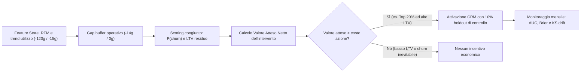

Una piattaforma digitale in abbonamento mensile gestisce 20.000 clienti attivi con un tasso di abbandono del 5% al mese: ogni 30 giorni escono 1.000 abbonati (scenario costruito con numeri di esempio). Per arginare le disdette, il team marketing propone di inviare uno sconto fedeltà del 25% a tutta la base clienti, ma i calcoli finanziari mostrano subito che scontare il rinnovo a chi sarebbe rimasto comunque brucia decine di migliaia di euro di margine al mese. D'altra parte, un modello predittivo che ottiene `95% di accuracy` semplicemente prevedendo "nessun abbandono" per ogni cliente è tecnicamente accurato ma commercialmente cieco.

> **Idea chiave:** Un modello per churn e `LTV` crea valore solo quando stima contemporaneamente chi sta per uscire, quanto margine futuro vale quel cliente e se l'azione di retention modifica davvero la sua probabilità di restare.

## Due mondi diversi: churn contrattuale vs non contrattuale

Prima di scegliere l'algoritmo, devi classificare la struttura della relazione commerciale con il cliente, perché il significato stesso di "abbandono" cambia radicalmente tra un abbonamento e un negozio al dettaglio.

Nel contesto **contrattuale** (SaaS, telecomunicazioni, palestra, streaming), il churn è un evento esplicito e osservabile con una data precisa di disdetta o mancato rinnovo. Qui il problema si modella efficacemente tramite classificazione supervisionata binaria su finestra futura fissa (ad esempio probabilità di disdetta nei prossimi 30 o 60 giorni) oppure con l'analisi di sopravvivenza (`Kaplan-Meier` e modelli `Cox Proportional Hazards`) che stima la funzione di rischio lungo il ciclo di vita gestendo correttamente i clienti ancora attivi alla data di osservazione (`right-censoring`).

Nel contesto **non contrattuale** (e-commerce moda, marketplace, ristorazione, grande distribuzione), nessun cliente invia una email per comunicare che non comprerà più: semplicemente smette di tornare. Qui un acquisto isolato tre mesi fa può appartenere sia a un cliente occasionale ancora vivo sia a un cliente perso per sempre. Per stimare valore e probabilità di vita attiva in questo scenario si usano i modelli probabilistici della famiglia **BTYD** (`Buy Till You Die`), in particolare l'accoppiata **BG/NBD** (per frequenza attesa e probabilità che il cliente sia ancora attivo) e **Gamma-Gamma** (per il valore monetario atteso per transazione), descritti da Fader, Hardie e Lee.

| Contesto di business | Evento di uscita | Famiglia di modelli consigliata | Output operativo principale | Metrica chiave di validazione |
|---|---|---|---|---|
| Contrattuale (SaaS, telco) | Esplicito (disdetta o mancato rinnovo) | Gradient Boosting (`XGBoost`/`LightGBM`) o Survival (`Cox`) | Probabilità churn a 30/60 giorni e tempo atteso al churn | `PR-AUC`, `Precision@K`, `Brier score` |
| Non contrattuale (Retail, e-com) | Latente (silenzio prolungato) | `BG/NBD` + `Gamma-Gamma` su variabili RFM | Probabilità di essere vivo $P(\text{alive})$ e LTV residuo a 12 mesi | Correlazione per decili reali su holdout temporale |

## Ingegneria delle feature senza target leakage

L'errore più insidioso nello sviluppo di modelli di churn nasce dal tempo. Se addestri il modello usando dati fino a oggi per prevedere chi ha disdetto oggi, rischi di includere segnali che si verificano *dopo* la decisione psicologica o amministrativa di chiusura: un ticket di supporto intitolato "rimborso chiusura account", la rimozione del metodo di pagamento o l'azzeramento degli accessi il giorno successivo alla richiesta di cancellazione.

Per costruire un dataset pulito, devi imporre rigorosamente un'architettura a tre finestre temporali disgiunte tra loro.

La **Observation window** (ad esempio dai giorni $-120$ a $-15$) serve a calcolare esclusivamente le variabili storiche, come `Recency`, `Frequency`, `Monetary`, il trend di utilizzo tra gli ultimi 30 giorni e i 30 precedenti, il numero di errori di pagamento o i ticket aperti. Subito dopo si inserisce una **Buffer / Gap window** (giorni $-14$ a $0$), una zona cuscinetto che impedisce alle code di elaborazione o alle azioni avviate a ridosso della disdetta di contaminare le feature, lasciando al CRM il tempo realistico per intervenire. Infine la **Prediction / Target window** (giorni $+1$ a $+30$) osserva l'etichetta binaria $y = 1$ se il cliente attiva la disdetta o non rinnova.



Oltre ai livelli assoluti, le variabili più predittive nel comportamento d'uso sono quasi sempre i **rapporti di variazione** (`delta` o `ratio`): un utente che passa da 20 sessioni mensili a 4 sessioni nell'ultimo mese mostra un deterioramento molto più informativo rispetto a chi ha sempre avuto 4 sessioni stabili fin dal primo giorno.

## Derivazione numerica: Precision@K, Lift e profitto netto di una campagna retention

Consideriamo una coorte di validazione temporale composta da `10.000 clienti` attivi con tasso base di abbandono mensile del `5%` ($500$ churn reali e $9.500$ clienti fedeli). Il team valuta due strategie a confronto: inviare una campagna di contatto proattivo e incentivo mirato (costo totale `15 €` per cliente contattato) a tutta la base oppure solo al top `20%` ordinato dal modello predittivo (numeri di esempio).

Fissiamo i parametri economici e prestazionali del caso: su $N = 10.000$ clienti in validazione abbiamo `500` churn reali (`5,0%` base rate), un valore residuo medio (`LTV` netto futuro) di `600 €` per cliente salvato e un tasso di salvataggio del `25%` (`0,25`) misurato da un precedente test holdout sui veri churner contattati. Nei primi due decili di rischio (Top 20%, pari a $K = 2.000$ clienti), il modello intercetta `360` dei `500` churn reali.

Iniziamo calcolando le metriche di ranking al Top 20% ($K = 2.000$). La copertura dei casi positivi vale $\text{Recall@20\%} = \frac{360}{500} = 0{,}72$ ($72{,}0\%$ di tutti gli abbandoni futuri catturati contattando solo un quinto della base). La concentrazione nel segmento selezionato è $\text{Precision@20\%} = \frac{360}{2.000} = 0{,}18$ ($18{,}0\%$ dei contattati sono veri churner), il che corrisponde a un guadagno rispetto al caso pari a $\text{Lift@20\%} = \frac{\text{Precision@20\%}}{\text{Base Rate}} = \frac{0{,}18}{0{,}05} = 3{,}60\text{x}$.

Valutiamo ora il bilancio economico del targeting selettivo sul Top 20% del modello. Il costo della campagna ammonta a $2.000 \times 15 = 30.000$ €. I clienti effettivamente salvati risultano $360 \times 0{,}25 = 90$ unità, generando un valore economico preservato pari a $90 \times 600 = 54.000$ €. Sottraendo il costo, otteniamo un **profitto netto di $+24.000$ €**, ovvero un ROI dell'intervento pari a $\frac{24.000}{30.000} = +80\%$.

Confrontiamo infine questo risultato con un invio indiscriminato a tutti i `10.000` clienti. La spesa complessiva sale a $10.000 \times 15 = 150.000$ €, mentre i clienti salvati arrivano a $500 \times 0{,}25 = 125$ unità per un valore preservato di $125 \times 600 = 75.000$ €. Il bilancio finale produce una **perdita netta di $-75.000$ €**, senza nemmeno contare l'ulteriore erosione da sconti concessi a chi sarebbe rimasto.

La scelta della soglia operativa deriva direttamente dalla formula del valore atteso individuale: conviene attivare un'azione di costo $C$ e tasso di successo $u$ su un cliente con probabilità di churn calibrata $p_{\text{churn}}$ e valore residuo $\text{LTV}$ solo quando:

$$p_{\text{churn}} \cdot u \cdot \text{LTV} - C > 0 \iff p_{\text{churn}} > \frac{C}{u \cdot \text{LTV}}$$

Con i nostri parametri ($C = 15$ €, $u = 0{,}25$, $\text{LTV} = 600$ €), la soglia minima di probabilità di abbandono sopra la quale l'intervento genera profitto atteso positivo vale $\frac{15}{0{,}25 \times 600} = \frac{15}{150} = 0{,}10$ ($10\%$).

## Pipeline Python: training leak-free, metriche Top-K e monitoraggio drift

Lo script seguente simula una coorte tabellare temporale, addestra un classificatore gradient boosting calibrando la valutazione con `PR-AUC`, `Precision@20%`, `Lift@20%` e `Brier score`, applica la regola del valore atteso per selezionare i clienti da attivare e verifica la stabilità delle feature nel mese corrente tramite test di Kolmogorov-Smirnov (`KS`).

```python
import numpy as np
import pandas as pd
from scipy.stats import ks_2samp
from sklearn.ensemble import HistGradientBoostingClassifier
from sklearn.metrics import average_precision_score, brier_score_loss, roc_auc_score

rng = np.random.default_rng(42)
n_clients = 10_000

# Feature comportamentali calcolate in finestra storica chiusa prima del gap
usage_ratio = rng.lognormal(mean=0.0, sigma=0.45, size=n_clients)
days_since_login = rng.exponential(scale=12.0, size=n_clients)
payment_failures = rng.poisson(lam=0.18, size=n_clients)
ltv_residuo = rng.uniform(250.0, 950.0, size=n_clients)

# Generazione probabilita latente di churn (base rate intorno al 5-7%)
logit = -3.4 + 0.06 * days_since_login - 1.2 * usage_ratio + 1.1 * payment_failures
prob_true = 1 / (1 + np.exp(-logit))
y = rng.binomial(1, prob_true)

df = pd.DataFrame({
    "usage_ratio": usage_ratio,
    "days_since_login": days_since_login,
    "payment_failures": payment_failures,
    "ltv_residuo": ltv_residuo,
    "churn": y,
})

# Split temporale simulato (primi 70% training, ultimi 30% validazione futura)
split = int(0.7 * n_clients)
features = ["usage_ratio", "days_since_login", "payment_failures"]
X_train, y_train = df.iloc[:split][features], df.iloc[:split]["churn"]
X_val, y_val = df.iloc[split:][features], df.iloc[split:]["churn"]

model = HistGradientBoostingClassifier(max_depth=4, learning_rate=0.05, random_state=42)
model.fit(X_train, y_train)
p_hat = model.predict_proba(X_val)[:, 1]

# Metriche orientate a ranking, calibrazione e decisione
roc_auc = roc_auc_score(y_val, p_hat)
pr_auc = average_precision_score(y_val, p_hat)
brier = brier_score_loss(y_val, p_hat)

top_n = int(0.20 * len(y_val))
top_idx = np.argsort(p_hat)[::-1][:top_n]
precision_20 = y_val.iloc[top_idx].mean()
lift_20 = precision_20 / y_val.mean()

# Regola di profitto atteso individuale (costo azione 15 euro, successo stimato 25%)
expected_net = (p_hat * 0.25 * df.iloc[split:]["ltv_residuo"].values) - 15.0
targeted_count = int((expected_net > 0).sum())

# Controllo drift tra periodo di training e produzione corrente
ks_stat, ks_p = ks_2samp(X_train["days_since_login"], X_val["days_since_login"])

print(f"ROC-AUC: {roc_auc:.3f} | PR-AUC: {pr_auc:.3f} | Brier: {brier:.4f}")
print(f"Precision@20%: {precision_20:.2%} | Lift@20%: {lift_20:.2f}x")
print(f"Clienti con valore atteso positivo (>0 euro): {targeted_count} su {len(y_val)}")
print(f"Drift KS su days_since_login: stat={ks_stat:.4f}, p={ks_p:.4f}")
```

In esercizio, quando il test `KS` su una feature ad alto peso supera la soglia di attenzione (ad esempio `stat > 0,10` con `p < 0,01`) oppure quando il `Brier score` degrada per tre settimane consecutive sull'holdout non trattato, la pipeline segnala la necessità di ricalibrazione o riaddestramento del modello.

## Governance in produzione: segmentazione matrice e controllo uplift

Un punteggio di probabilità di abbandono da solo non detta l'azione di marketing. Incrociando la probabilità di churn prevista con il valore futuro stimato (`LTV residuo`), si ottiene una matrice operativa a quattro quadranti che separa gli investimenti difendibili dalle azioni in perdita.

Nel quadrante **Alto LTV + Alto rischio churn** rientrano i clienti ad alta priorità per interventi ad alto contatto (chiamata account manager, revisione piano personalizzata o supporto prioritario), verificati tramite un 10% di holdout per misurare l'effettivo tasso di salvataggio incrementale. Nel quadrante **Alto LTV + Basso rischio churn** convengono invece programmi di fedeltà o upsell di valore senza sconti difensivi non richiesti, preservando il margine pieno.

Nel quadrante **Basso LTV + Alto rischio churn** hanno senso solo automazioni digitali a costo prossimo allo zero (email automatiche di riattivazione o guide d'uso), evitando coupon o interventi umani che superano il valore recuperabile. Infine nel quadrante **Basso LTV + Basso rischio churn** non conviene attivare alcuna azione promozionale dedicata, mantenendo solo comunicazioni standard di servizio.

La lezione storica sul prezzo e sul churn resta visibile nel caso Netflix del terzo trimestre 2011: dopo la separazione dei piani DVD e streaming con un aumento effettivo fino al 60% per chi voleva entrambi i servizi, l'azienda perse circa 800.000 abbonati negli Stati Uniti in un solo trimestre. Il churn non dipende soltanto da variabili comportamentali silenti nel log di utilizzo: shock di prezzo, modifiche contrattuali e variazioni percepite di valore agiscono come eventi esogeni capaci di spostare di colpo la probabilità di uscita di intere coorti, richiedendo l'integrazione di variabili di contratto e sensibilità al prezzo nel modello.

## Errori comuni nei modelli di churn e LTV

### Includere target leakage temporale nella finestra delle feature

Il modello mostra un `ROC-AUC` di `0,98` nei test di sviluppo, ma crolla in produzione perché quasi tutti gli utenti segnalati hanno già disdetto. Accade quando variabili come "numero giorni dalla fine contratto", "ultimo ticket con oggetto cancellazione" o "stato pagamento disattivato" vengono incluse nel training senza imporre una finestra di `buffer` prima della data di taglio. Si evita verificando l'andamento delle feature su finestra rigorosamente antecedente di 14-30 giorni rispetto alla finestra target e controllando l'importanza delle variabili alla ricerca di proxy dell'evento finale.

### Ottimizzare per accuracy o ignorare la calibrazione delle probabilità

Con il 5% di churn mensile, valutare o addestrare soglie rigide basate sull'`accuracy` rende cieco il modello, mentre usare probabilità non calibrate (frequenti dopo oversampling `SMOTE` o pesatura estrema delle classi) sballa la formula del valore atteso $p_{\text{churn}} \cdot u \cdot \text{LTV} - C$. Se $p_{\text{churn}}$ sovrastima il rischio reale di tre volte per effetto del bilanciamento artificiale, il marketing contatterà clienti con margine atteso negativo. Per correggere, usa metriche di ranking (`PR-AUC`, `Precision@K`) e ricalibra le probabilità sulle proporzioni reali tramite `CalibratedClassifierCV` (Platt scaling o regressione isotonica), verificando il `Brier score`.

### Confondere alto rischio di churn con alta recuperabilità (sleeping dogs)

Spingere campagne su clienti che hanno già deciso di uscire per trasferimento, chiusura attività o insoddisfazione irreparabile spreca budget; all'opposto, contattare alcuni clienti dormienti ("sleeping dogs") con comunicazioni invasive ricorda loro di avere un abbonamento attivo inutilizzato e accelera la disdetta. Per evitarlo, misura sempre l'efficacia reale (`u`) tramite un holdout randomizzato su ogni fascia di rischio ed evolvi verso modelli di `uplift modeling` che stimano l'incremento di permanenza causato dall'intervento anziché la sola probabilità grezza di uscita.

## Verifica pratica su modello e decisioni

1. Un modello di churn in abbonamento ottiene `ROC-AUC = 0,88` e `Precision@10% = 0,24` su una base con tasso naturale di uscita del `6%`. Quanto vale il `Lift@10%` e cosa indica al team CRM?

<details>
<summary>Mostra risposta</summary>

Il `Lift@10%` è il rapporto tra la precisione nel primo decile (`0,24`) e il tasso base della popolazione (`0,06`), quindi $\frac{0{,}24}{0{,}06} = 4{,}0\text{x}$. Indica al team CRM che selezionando il 10% dei clienti in cima alla classifica del modello intercetta una concentrazione di futuri abbandoni quattro volte superiore rispetto a un invio casuale sulla base attiva.

</details>

2. Perché in un modello per e-commerce non contrattuale come la vendita di abbigliamento online non puoi applicare la stessa definizione di etichetta `churn = 1` usata per un abbonamento mensile?

<details>
<summary>Mostra risposta</summary>

Nell'e-commerce non contrattuale non esiste una data formale di disdetta: un cliente che non acquista da 90 giorni può essere definitivamente perso oppure avere semplicemente un ciclo naturale di riacquisto semestrale. Servono quindi modelli probabilistici `BG/NBD` che stimano la probabilità continua $P(\text{alive})$ in funzione della cadenza personale di ciascun cliente rispetto al suo storico individuale di frequenza e recenza.

</details>

3. Nel worked example della lezione, se il costo dell'intervento di retention sale da `15 €` a `30 €` (ad esempio passando da un'email con piccolo bonus a una chiamata outbound più incentivo), come cambia la soglia minima di probabilità `p_churn` per attivare il cliente (a parità di `u = 25%` e `LTV = 600 €`)?

<details>
<summary>Mostra risposta</summary>

Applicando la condizione di valore atteso positivo $p_{\text{churn}} > \frac{C}{u \cdot \text{LTV}}$, la soglia minima raddoppia passando da $\frac{15}{0{,}25 \times 600} = 10\%$ a $\frac{30}{0{,}25 \times 600} = \frac{30}{150} = 20\%$. Ogni cliente con probabilità di abbandono compresa tra il 10% e il 20% non va più contattato con l'azione costosa da 30 €, ma dirottato su interventi automatizzati a basso costo.

</details>

4. Durante la validazione applicata in produzione, scopri che la media di `days_since_login` del mese corrente si è spostata bruscamente rispetto al set di addestramento (`KS stat = 0,21`, `p < 0,001`) dopo un cambio all'app mobile. Che cosa rischi se mantieni le stesse soglie di attivazione CRM senza intervenire?

<details>
<summary>Mostra risposta</summary>

Un forte `data drift` su una variabile ad alto peso sposta l'intera distribuzione dei punteggi previsti, rendendo inaffidabili le probabilità calibrate in precedenza. Senza correzione rischi di attivare campagne costose su falsi allarmi causati solo dal nuovo comportamento di login dell'app (o al contrario di perdere clienti a rischio reale), distruggendo la precisione del targeting e il ROI della retention finché il modello non viene riaddestrato sui log post-aggiornamento.

</details>
