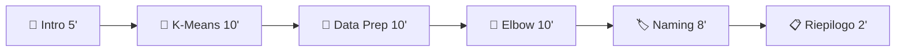
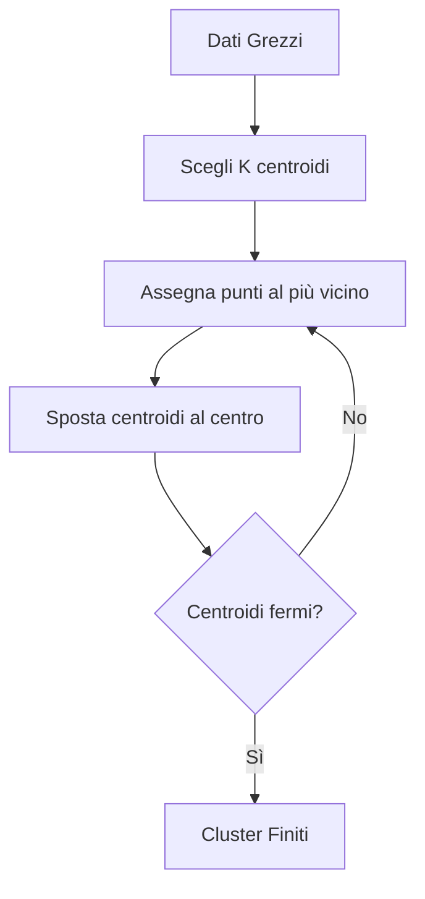

## Analisi dei Cluster per la Segmentazione Clienti — Lezione Completa

Il "cliente medio" non esiste. Esistono solo gruppi di persone con comportamenti, bisogni e valori simili. Se invii la stessa email promozionale a tutti, stai parlando a nessuno. La Cluster Analysis (o Clustering) è la tecnica di Machine Learning non supervisionato che ci permette di scoprire questi gruppi nascosti nei dati, senza dover definire regole a priori. In questa lezione, impareremo a segmentare la base utenti in modo scientifico per personalizzare le campagne e massimizzare il ROI.

### Obiettivi di Apprendimento

Al termine di questa lezione, lo studente sarà in grado di:
1.  Comprendere la logica geometrica dietro l'algoritmo K-Means.
2.  Preparare un dataset per il clustering (standardizzazione e feature engineering).
3.  Determinare il numero ottimale di cluster (k) usando il metodo "Elbow" e il "Silhouette Score".
4.  Interpretare i risultati del clustering per creare "Personas" data-driven.
5.  Applicare la segmentazione RFM (Recency, Frequency, Monetary) come base per il clustering.

### Timeline della Lezione

| Fase | Argomento | Durata |
|------|-----------|--------|
| 1 | Introduzione: Segmentazione Statica vs Dinamica | 5 min |
| 2 | Teoria: Come funziona K-Means | 10 min |
| 3 | Pratica: Preparazione dei Dati (RFM) | 10 min |
| 4 | Pratica: Trovare il K ottimale (Elbow Method) | 10 min |
| 5 | Interpretazione: Dare un nome ai Cluster | 8 min |
| 6 | Riepilogo e Domande | 2 min |
| **Totale** | | **45 min** |

### Fase 1 — Introduzione: Segmentazione Statica vs Dinamica (5 min)

La vecchia scuola del marketing segmentava per demografia: "Donne, 25-34 anni, Milano".
Ma due donne di 30 anni a Milano possono essere diametralmente opposte: una spende 500€ al mese in scarpe, l'altra compra solo in saldo una volta l'anno.

La **Segmentazione Comportamentale (Clustering)** raggruppa le persone in base a *cosa fanno*, non a chi sono.
*   *Statica (Regole):* "Chi ha speso > 100€". (Rigido, arbitrario).
*   *Dinamica (ML):* L'algoritmo trova che esiste un gruppo di persone che compra prodotti per bambini di notte e prodotti di lusso di giorno. (Flessibile, scopre pattern inattesi).

### Fase 2 — Teoria: Come funziona K-Means (10 min)

K-Means è l'algoritmo più popolare per il clustering. È semplice, veloce ed efficace.
Immagina di avere un grafico a dispersione (scatter plot) con due assi: Spesa Totale (Y) e Numero Acquisti (X). Ogni punto è un cliente.

**L'algoritmo in 4 passi:**
1.  **Inizializzazione:** Scegli a caso `k` punti nel grafico come centri provvisori (Centroidi).
2.  **Assegnazione:** Ogni cliente viene assegnato al centroide più vicino (distanza euclidea). Si formano così `k` gruppi.
3.  **Aggiornamento:** Si ricalcola il centro geometrico (media) di ogni gruppo. I centroidi si spostano lì.
4.  **Iterazione:** Ripeti i passi 2 e 3 finché i centroidi smettono di muoversi (convergenza).

L'obiettivo matematico è minimizzare la somma dei quadrati delle distanze tra ogni punto e il suo centroide (Inerzia).

### Fase 3 — Pratica: Preparazione dei Dati (RFM) (10 min)

Gli algoritmi di clustering odiano due cose: le scale diverse e gli outlier.
Se hai una colonna "Spesa" (0-10.000€) e una "Età" (18-99), la Spesa dominerà il calcolo della distanza perché i numeri sono più grandi.

**Feature Engineering: RFM**
Per l'e-commerce, le feature migliori sono:
*   **Recency:** Giorni dall'ultimo acquisto (minore è meglio).
*   **Frequency:** Numero totale di ordini (maggiore è meglio).
*   **Monetary:** Spesa totale lifetime (maggiore è meglio).

**Standardizzazione (Scaling)**
Devi portare tutte le variabili sulla stessa scala (es. media 0, deviazione standard 1) usando `StandardScaler` o trasformazione logaritmica (`log(x+1)`) per gestire le distribuzioni asimmetriche (coda lunga della spesa).

### Fase 4 — Pratica: Trovare il K ottimale (Elbow Method) (10 min)

Quanti cluster ci sono nei tuoi dati? 3? 5? 10? K-Means non lo sa, devi dirglielo tu.
Il metodo del gomito (**Elbow Method**) aiuta a decidere.

1.  Esegui K-Means con k=1, k=2, ..., k=10.
2.  Per ogni k, calcola l'Inerzia (somma errori quadratici).
3.  Metti i valori in un grafico.
4.  Cerca il punto dove la curva "fa il gomito" (la discesa rallenta bruscamente). Quello è il k ottimale. Aggiungere altri cluster non riduce significativamente l'errore, ma complica solo il modello.

*Alternativa:* **Silhouette Score**. Misura quanto un punto è simile al suo cluster rispetto agli altri cluster (-1 a +1). Più alto è, meglio è.

### Fase 5 — Interpretazione: Dare un nome ai Cluster (8 min)

Una volta ottenuti i cluster (es. 0, 1, 2, 3), il lavoro del Data Scientist finisce e inizia quello del Marketer. Devi guardare le medie delle feature per ogni cluster e dargli un nome "umano".

*Esempio Reale:*
*   **Cluster 0 (Campioni):** Recency bassa (7gg), Frequenza alta (50 ordini), Monetary alto (5.000€).
    *   *Azione:* Programma VIP, accesso anticipato, niente sconti (pagano già).
*   **Cluster 1 (Fedeli a basso budget):** Recency bassa, Frequenza alta, Monetary basso.
    *   *Azione:* Cross-sell, bundle per alzare lo scontrino medio.
*   **Cluster 2 (A rischio / Dormienti):** Recency alta (180gg), Frequenza media, Monetary alto.
    *   *Azione:* Campagna Win-back aggressiva ("Ci manchi, ecco 20€").
*   **Cluster 3 (Nuovi curiosi):** Recency bassa, Frequenza 1, Monetary basso.
    *   *Azione:* Onboarding, serie di benvenuto.

### Fase 6 — Riepilogo e Domande (2 min)

1.  **Dati puliti.** Se entra spazzatura (outlier, scale diverse), esce spazzatura.
2.  **Iterazione.** Prova diverse combinazioni di feature. Forse "Reso %" è importante?
3.  **Azione.** Un cluster senza una strategia di marketing associata è inutile.
4.  **Monitoraggio.** I clienti si spostano tra i cluster nel tempo. Rifai l'analisi ogni mese.

### Domande di Verifica

1.  Perché è fondamentale standardizzare i dati (Scaling) prima di applicare K-Means?
2.  Come si interpreta un grafico "Elbow" per scegliere il numero di cluster?
3.  Qual è la differenza tra un cluster "A rischio" e un cluster "Perso" in un'analisi RFM?
4.  Cosa misura il "Silhouette Score"?
5.  Perché K-Means potrebbe non funzionare bene se i cluster hanno forme non sferiche o dimensioni molto diverse?

### Riferimenti Bibliografici

-   Gareth James et al., "An Introduction to Statistical Learning", Springer, 2013.
-   Provost & Fawcett, "Data Science for Business", O'Reilly, 2013.
-   Scikit-Learn Documentation (Clustering User Guide).
