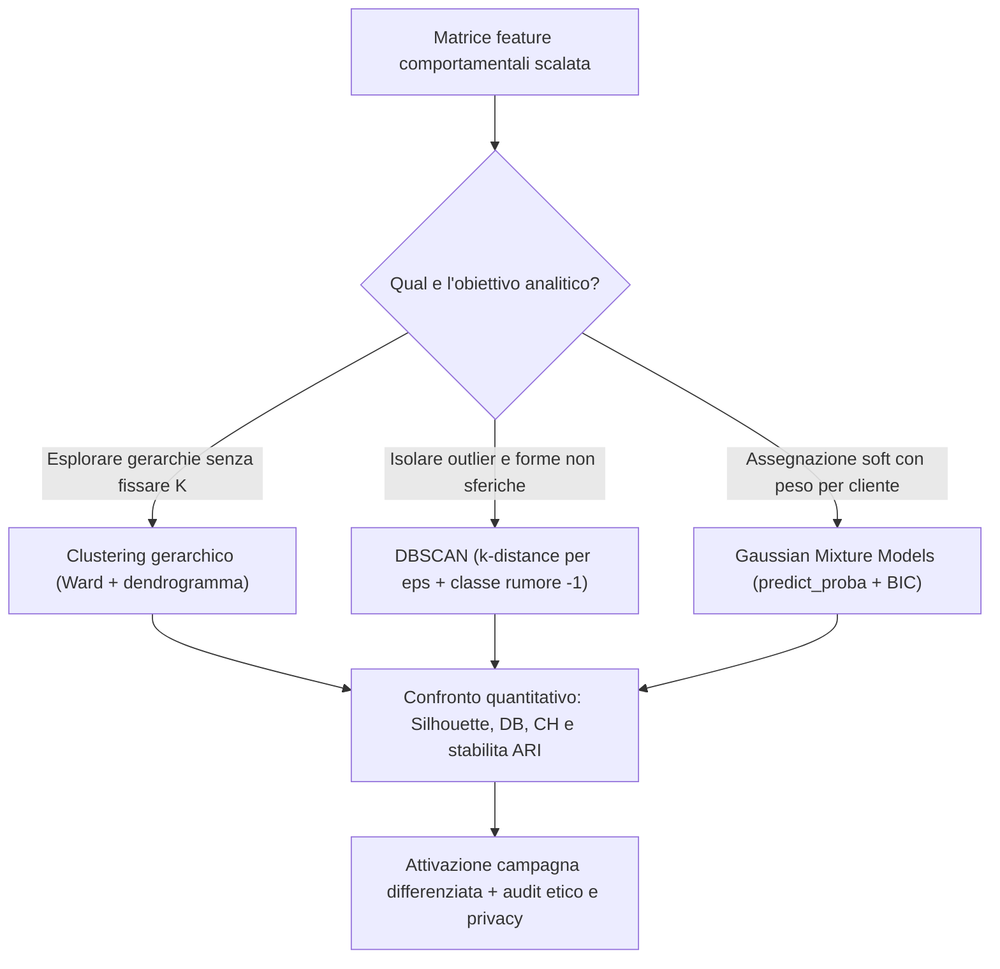

Considera questo scenario costruito su numeri di esempio realistici per una piattaforma e-commerce di ferramenta e ricambi tecnici che serve sia privati sia officine artigiane su **28.000 account attivi**. Dopo aver eseguito `K-means` con `K = 4` sulle feature RFM normalizzate, il team scopre che due interi cluster sono occupati da **420 rivenditori all'ingrosso** che ordinano oltre **18.000 euro al mese**, mentre i restanti **27.580 clienti** finiscono schiacciati in due macro-gruppi troppo generici. Inoltre, molti clienti ibridi che alternano acquisti a margine pieno per lavori urgenti e acquisti in saldo stagionale vengono forzati in una sola etichetta rigida. Qui `K-means` mostra i suoi limiti geometrici: assume cluster sferici, soffre la presenza di anomalie dense e impone appartenenze esclusive `0` o `1`.

> **Idea chiave:** La scelta tra gerarchico, DBSCAN e Gaussian Mixture Models non dipende dalla raffinatezza matematica dell'algoritmo, ma dalla geometria reale della base clienti e dalla necessità di isolare outlier o attivare appartenenze probabilistiche.

## Perché un solo algoritmo di clustering non basta

Ogni famiglia di clustering impone un'assunzione strutturale sui dati. Quando quell'assunzione è violata dalla distribuzione reale dei comportamenti d'acquisto, le metriche e i segmenti risultanti diventano artefatti della geometria dell'algoritmo anziché gruppi naturali di clienti. Nel marketing tabellare i dati raramente formano sfere isolate di uguale dimensione: presentano code lunghissime di utenti occasionali, piccole isole molto dense di rivenditori B2B e zone di sovrapposizione tra profili in transizione.



Confrontare tre approcci diversi sullo stesso set di feature normalizzate evita di rimanere prigionieri della prima partizione prodotta da `K-means`. Il **clustering gerarchico agglomerativo** con legame di Ward costruisce un albero di fusioni progressive (dendrogramma) utile per vedere a quale livello di distanza i sotto-segmenti si uniscono. **`DBSCAN`** (*Density-Based Spatial Clustering of Applications with Noise*) esplora invece la densità locale e separa automaticamente le anomalie in un cluster dedicato `-1`, senza costringerti a scegliere `K` in anticipo. Infine i **`Gaussian Mixture Models` (`GMM`)** modellano i dati come combinazione di distribuzioni gaussiane multivariate e restituiscono per ogni utente un vettore di probabilità che somma a `1`.

| Metodo | Assunzione geometrica | Scelta di `K` | Gestione outlier | Output verso il CRM |
|---|---|---|---|---|
| **Gerarchico (Ward)** | Tende a gruppi compatti di varianza minima | Taglio a posteriori sul dendrogramma | Sensibile agli outlier estremi se non filtrati prima | Etichetta rigida a più livelli di granularità |
| **`DBSCAN`** | Regioni dense continue di forma arbitraria | Automatico in base a `eps` e `min_samples` | Eccellente: isola le anomalie nel cluster `-1` | Etichetta rigida più lista outlier da trattare a parte |
| **`Gaussian Mixture (GMM)`** | Ellissi gaussiane anche con orientamenti diversi | Criteri informativi (`BIC`/`AIC`) + indici geometrici | Sensibile se `covariance_type='full'` su pochi punti | Vettore di probabilità soft `predict_proba` per utente |

## Come funzionano sotto il cofano e quando falliscono

Il **clustering gerarchico agglomerativo** parte considerando ogni cliente un cluster individuale (`N` cluster) e unisce a ogni passo la coppia di gruppi che produce il minimo incremento della somma dei quadrati intra-cluster (criterio di Ward). Il costo computazionale cresce rapidamente con il numero di righe (scala circa quadraticamente in memoria per la matrice delle distanze), quindi su basi superiori a 30.000 clienti conviene campionare 5.000–10.000 utenti stratificati per costruire il dendrogramma esplorativo. Il suo valore principale risiede nella visibilità dei "salti" verticali: un salto lungo prima di unire due rami segnala una separazione reale tra comportamenti diversi.

**`DBSCAN`** ribalta il paradigma: definisce un raggio `eps` e un numero minimo di vicini `min_samples`. Un punto è un *core point* se dentro la sfera di raggio `eps` raccoglie almeno `min_samples` punti; i cluster crescono collegando core point raggiungibili per densità. I punti isolati in regioni rade ricevono etichetta `-1`. Il punto critico è scegliere `eps`: se `eps` è troppo piccolo quasi tutti i clienti finiscono nel rumore `-1`; se è troppo grande l'algoritmo fonde cluster distinti in un unico blocco gigante. Il metodo pratico per trovare `eps` consiste nel tracciare la curva delle distanze ordinate al `k`-esimo vicino (`k = min_samples`) e individuare il punto di curvatura ("gomito") in cui la densità crolla bruscamente. Resta però fragile quando i cluster hanno densità molto diverse tra loro (ad esempio 20.000 acquirenti occasionali molto vicini contro 400 VIP sparsi).

I **`Gaussian Mixture Models`** rappresentano ciascun segmento tramite una media multivariata e una matrice di covarianza propria, permettendo ai gruppi di assumere forma ellittica allungata anziché strettamente sferica. Stima i parametri massimizzando la verosimiglianza con l'algoritmo EM (*Expectation-Maximization*) e restituisce la probabilità a posteriori che il cliente $i$ appartenga al segmento $k$. Questa proprietà risolve il problema dei clienti di confine: invece di classificare un utente al 100% come "cacciatore di sconti", riconosci che appartiene al 65% a quel profilo e al 35% al profilo "premium".

## Validazione geometrica, stabilità e worked example numerico

Una trappola tipica consiste nell'affidarsi a una sola metrica interna per proclamare ottimo un numero di cluster `K`. Per fare una scelta difendibile occorre incrociare tre indici geometrici più un test di stabilità su sottocampioni:

| Metrica | Range e direzione | Che cosa misura esattamente | Limite principale da ricordare |
|---|---|---|---|
| **Silhouette Score** | `[-1, +1]`, più alto è meglio (target `> 0,45–0,50`) | Confronto tra coesione interna $a(i)$ e separazione dal vicino $b(i)$ | Favorisce cluster sferici e penalizza forme allungate o dense irregolari |
| **Davies-Bouldin (`DB`)** | `[0, +infinito)`, più basso è meglio | Rapporto medio tra dispersione interna e distanza tra centroidi | Può scendere artificialmente isolando piccoli gruppi outlier |
| **Calinski-Harabasz (`CH`)** | `[0, +infinito)`, più alto è meglio | Rapporto tra varianza tra cluster e varianza entro cluster | Tende a preferire cluster convessi e può crescere solo per effetto di `K` |
| **Stabilità bootstrap (`ARI`)** | `[0, 1]`, target `> 0,80` | `Adjusted Rand Index` tra assegnazioni su campioni ricampionati | Non garantisce che i cluster abbiano utilità commerciale |

Per rendere concreti i calcoli, svolgiamo un **worked example numerico completo** diviso in due parti: il calcolo del punteggio **Silhouette** individuale e la regola economica di attivazione con le **probabilità soft di un GMM**.

Nella prima parte, consideriamo due clienti sullo spazio standardizzato con `K = 3`. Il **Cliente A** è un membro netto del cluster Premium con distanza media interna $a(A) = 0,40$ e distanza media dal cluster più vicino $b(A) = 1,60$. Applicando la formula $s(i) = (b(i) - a(i)) / \max(a(i), b(i))$ otteniamo $s(A) = (1,60 - 0,40) / 1,60 = \mathbf{+0,75}$, segnale di assegnazione coesa.

Il **Cliente B** si trova invece sulla frontiera con distanza media interna $a(B) = 1,10$ e distanza media dal cluster Sconti più vicino $b(B) = 1,20$. Il calcolo restituisce $s(B) = (1,20 - 1,10) / 1,20 = \mathbf{+0,083}$. Un modello rigido come `K-means` ignora che `s(B)` è prossimo a zero e forza `B` in un solo cassetto.

Nella seconda parte, vediamo come un **GMM** sfrutta quell'incertezza su **1.000 clienti ibridi** di frontiera simili a `B`. Il modello soft stima una probabilità di appartenenza del **60%** al profilo `Promo-sensibile` (margine atteso con coupon `24 euro`, margine senza coupon `4 euro`) e del **40%** al profilo `Premium a prezzo pieno` (margine atteso con coupon `18 euro` per cannibalizzazione dello sconto, margine senza coupon `45 euro`). Assumiamo un costo fisso di invio del buono pari a **1,00 euro per cliente** contro **0,10 euro** per una comunicazione editoriale senza sconto.

Con una **regola rigida (`argmax`)** tutti i `1.000 clienti` vengono classificati `Promo-sensibile` al 100% perché `0,60 > 0,40` e ricevono il coupon. Il margine atteso ponderato per cliente diventa `(0,60 * 24 euro) + (0,40 * 18 euro) - 1,00 euro = 14,40 + 7,20 - 1,00 = 20,60 euro/cliente`, pari a **`20.600 euro`** sui mille utenti. Senza inviare coupon, la comunicazione editoriale rende `(0,60 * 4 euro) + (0,40 * 45 euro) - 0,10 euro = 20,30 euro/cliente` (`20.300 euro`).

Osserva però cosa accade su un sotto-gruppo di frontiera dove la probabilità `Premium` sale dal `40%` al `50%` e `Promo` scende al `50%`. Con coupon il rendimento scende a `(0,50 * 24) + (0,50 * 18) - 1,00 = 20,00 euro/cliente` (**`20.000 euro`**), mentre la comunicazione editoriale senza coupon sale a `(0,50 * 4) + (0,50 * 45) - 0,10 = 24,40 euro/cliente` (**`24.400 euro`**). Usare le probabilità `predict_proba` invece della classe binaria cambia la decisione e salva **4.400 euro netti** su appena mille clienti.

## Confronto pratico in Python: Ward, DBSCAN, GMM e stabilità

Il blocco Python seguente confronta tutti e tre gli algoritmi sulla stessa matrice normalizzata, valuta `BIC`, `Silhouette`, `Davies-Bouldin` e `Calinski-Harabasz`, isola la quota di outlier con `DBSCAN` e controlla la stabilità delle assegnazioni `GMM` tramite ricampionamento bootstrap (`adjusted_rand_score`).

```python
import numpy as np
import pandas as pd
from scipy.cluster.hierarchy import linkage, fcluster
from sklearn.cluster import DBSCAN
from sklearn.datasets import make_blobs
from sklearn.metrics import (
    adjusted_rand_score,
    calinski_harabasz_score,
    davies_bouldin_score,
    silhouette_score,
)
from sklearn.mixture import GaussianMixture
from sklearn.neighbors import NearestNeighbors
from sklearn.preprocessing import StandardScaler

# 1. Dataset simulato: 3 cluster comportamentali + 5% outlier B2B ad alto valore
rng = np.random.default_rng(21)
X_core, _ = make_blobs(
    n_samples=1900,
    centers=[[-1.4, -1.0, 0.2], [0.2, 1.5, -0.5], [1.6, -0.6, 1.4]],
    cluster_std=[0.55, 0.65, 0.50],
    random_state=21,
)
outliers = rng.uniform(low=3.2, high=5.5, size=(100, 3))
X_raw = np.vstack([X_core, outliers])
X_scaled = StandardScaler().fit_transform(X_raw)

# 2. Gerarchico di Ward (esplorazione a K=3)
Z = linkage(X_scaled, method="ward")
labels_ward = fcluster(Z, t=3, criterion="maxclust")

# 3. DBSCAN con ispezione automatica del quantile k-distance per stimare eps
nbrs = NearestNeighbors(n_neighbors=12).fit(X_scaled)
distanze, _ = nbrs.kneighbors(X_scaled)
k_dist = np.sort(distanze[:, -1])
eps_suggerito = float(np.quantile(k_dist, 0.94))  # soglia prima della coda outlier
labels_db = DBSCAN(eps=eps_suggerito, min_samples=12).fit_predict(X_scaled)
n_rumore = int(np.sum(labels_db == -1))

# 4. Gaussian Mixture Model su K da 2 a 6: confronto BIC e metriche geometriche
risultati = []
for k in range(2, 7):
    gmm = GaussianMixture(n_components=k, covariance_type="full", n_init=5, random_state=21)
    lbl = gmm.fit_predict(X_scaled)
    risultati.append({
        "K": k,
        "BIC": round(gmm.bic(X_scaled), 1),
        "Silhouette": round(silhouette_score(X_scaled, lbl), 3),
        "Davies_Bouldin": round(davies_bouldin_score(X_scaled, lbl), 3),
        "Calinski_Harabasz": round(calinski_harabasz_score(X_scaled, lbl), 1),
    })

print("Confronto GMM al variare di K:")
print(pd.DataFrame(risultati).to_string(index=False))
print(f"\nDBSCAN eps={eps_suggerito:.3f} -> Outlier isolati (-1): {n_rumore} su {len(X_scaled)}")

# 5. Verifica stabilita bootstrap (ARI) del GMM scelto con K=3
gmm_ref = GaussianMixture(n_components=3, covariance_type="full", random_state=21).fit(X_scaled)
lbl_ref = gmm_ref.predict(X_scaled)
ari_scores = []
for seed in range(5):
    idx_sub = rng.choice(len(X_scaled), size=int(0.8 * len(X_scaled)), replace=False)
    gmm_sub = GaussianMixture(n_components=3, covariance_type="full", random_state=seed).fit(X_scaled[idx_sub])
    # Confronto delle assegnazioni sui medesimi punti del sottocampione
    ari_scores.append(adjusted_rand_score(lbl_ref[idx_sub], gmm_sub.predict(X_scaled[idx_sub])))

print(f"Stabilita media bootstrap (ARI) per GMM K=3: {np.mean(ari_scores):.3f}")
```

Se l'`ARI` medio scende sotto `0,75–0,80`, il modello sta adattando il rumore campionario e non una struttura reale di clientela: in quel caso conviene ridurre `K`, passare da `covariance_type="full"` a `"diag"` oppure rimuovere le feature instabili.

## Governance etica e controllo sui segmenti sensibili

Un modello di clustering ben tarato individua pattern comportamentali che possono rivelare informazioni private molto prima che il cliente le dichiari esplicitamente. Il caso di riferimento documentato dal [New York Times](https://www.nytimes.com/2012/02/19/magazine/shopping-habits.html) nel 2012 da Charles Duhigg riguarda la catena retail Target: analizzando la variazione congiunta di circa 25 categorie di prodotto (lozioni inodori, integratori specifici, cotone), il team analytics stimò con elevata accuratezza quali clienti fossero in gravidanza e in quale trimestre, inviando coupon mirati per articoli da neonato prima che i familiari ne fossero a conoscenza.

La lezione tecnica e operativa per chi progetta sistemi di segmentazione non è evitare di modellare i bisogni, ma introdurre due controlli di governance prima del rilascio: in primo luogo verificare che le combinazioni di attributi non inferiscano condizioni mediche, personali o protette senza consenso esplicito, e in secondo luogo mitigare l'invadenza dell'attivazione (ad esempio inserendo promozioni di categoria all'interno di comunicazioni multi-prodotto invece di isolare pubblicamente una deduzione privata). La precisione statistica senza revisione etica espone l'azienda a danni reputazionali e violazioni normative (`GDPR`).

## Trappole pratiche nell'uso di gerarchico, DBSCAN e GMM

### Leggere il Silhouette score su DBSCAN includendo il rumore come cluster

Un errore ricorrente consiste nel passare direttamente le etichette di `DBSCAN` a `silhouette_score(X, labels)` quando il vettore contiene la classe `-1`. L'indice di Silhouette tratta `-1` come se fosse un gruppo coerente di clienti simili tra loro, mentre in realtà raccoglie punti sparsi agli antipodi dello spazio delle feature. Questo errore abbassa artificialmente il punteggio e porta a scartare una buona soluzione `DBSCAN`. Le metriche di coesione su `DBSCAN` vanno calcolate escludendo il rumore e riportando separatamente la quota di clienti finiti in `-1`.

### Usare `covariance_type="full"` in GMM con troppe dimensioni e pochi dati

In un `Gaussian Mixture Model` con `d` feature e `K` componenti, ciascuna matrice di covarianza piena stima `d * (d + 1) / 2` parametri indipendenti. Con 15 feature comportamentali e un cluster piccolo da 120 clienti, la stima della covarianza diventa numericamente instabile o collassa su varianze nulle. In alta dimensionalità o con cluster minoritari conviene testare `"tied"` o `"diag"`, oppure ridurre prima le feature ai 4–6 segnali comportamentali chiave.

### Fermarsi al punteggio interno ignorando la stabilità su sottocampioni

Un algoritmo può ottenere un ottimo `Calinski-Harabasz` o `BIC` su un dataset singolo ma invertire o fondere i cluster se cambi l'inizializzazione casuale o togli il 15% delle righe. Senza un test di stabilità bootstrap (`ARI`), il marketing rischia di costruire automazioni CRM su gruppi che scompaiono al mese successivo quando cambiano lievemente i volumi d'ordine.

## Verifica su clustering avanzato e mixture model

1. Quando lavori su un dataset e-commerce che contiene un piccolo gruppo di rivenditori B2B con ordini dieci volte superiori alla media, perché `DBSCAN` o un filtraggio esplicito pre-clustering è preferibile a lanciare `K-means` sui dati grezzi?

<details>
<summary>Mostra risposta</summary>

K-means minimizza la somma dei quadrati delle distanze euclidee dai centroidi, quindi pochi outlier estremi esercitano una forza di attrazione quadratica enorme, costringendo l'algoritmo a dedicare interi cluster alle anomalie e a comprimere il resto della clientela in gruppi poco granulari. DBSCAN isola invece i punti in regioni a bassa densità dentro il cluster `-1` senza deformare la geometria dei segmenti principali, permettendo di trattare i rivenditori B2B con regole commerciali separate.

</details>

2. Nel calcolo della Silhouette individuale visto nel worked example, cosa indica un valore `s(B) = +0,083` e perché un GMM gestisce questo cliente meglio di una partizione rigida?

<details>
<summary>Mostra risposta</summary>

Un punteggio vicino a zero indica che la distanza media del cliente B dal proprio cluster (1,10) è quasi identica alla distanza media dal cluster più vicino (1,20), quindi il cliente giace esattamente sulla frontiera tra due profili. Un metodo a etichetta rigida lo assegna al 100% a un solo segmento ignorando l'incertezza; un Gaussian Mixture Model restituisce invece le probabilità continue di appartenenza (ad esempio 55% e 45%), consentendo di decidere la campagna massimizzando il margine atteso ponderato tra i due scenari.

</details>

3. Quali informazioni aggiuntive fornisce l'indice `Adjusted Rand Index` (`ARI`) su ricampionamenti bootstrap rispetto a Silhouette, Davies-Bouldin e Calinski-Harabasz?

<details>
<summary>Mostra risposta</summary>

Silhouette, Davies-Bouldin e Calinski-Harabasz valutano la qualità geometrica (compattezza e separazione) di una singola partizione su un campione fisso, ma non dicono se quella struttura resista a piccole perturbazioni dei dati. L'ARI confronta le assegnazioni prodotte sul dataset intero con quelle ottenute ricampionando l'80% dei clienti: un valore medio basso (sotto 0,75–0,80) rivela che i cluster dipendono dal rumore del campione e non sono abbastanza stabili per supportare regole CRM mensili.

</details>

4. Perché nei controlli su `DBSCAN` devi riportare sempre sia il numero di cluster trovati sia la percentuale di punti nel cluster `-1` prima di valutare i profili?

<details>
<summary>Mostra risposta</summary>

Perché impostare un raggio `eps` leggermente troppo stretto può far salire la quota di rumore al 40% o 60% della base clienti, lasciando pochi cluster minuscoli apparentemente compatti ma escludendo metà del fatturato dalla segmentazione. Dichiarare insieme numero di cluster e quota nel cluster `-1` evita di celebrare segmenti puliti solo perché gran parte dei clienti reali è stata scartata come rumore.

</details>
