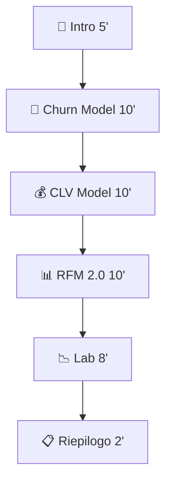

## Advanced Customer Analytics: Prevedere il Futuro — Lezione Completa

Sapere cosa ha fatto il cliente ieri è utile (Analisi Descrittiva). Sapere cosa farà domani è magico (Analisi Predittiva). Grazie al Machine Learning, possiamo stimare il valore futuro di ogni utente e intervenire prima che sia troppo tardi. In questa lezione, costruiremo i modelli fondamentali per qualsiasi business ricorrente: Churn Prediction e CLV Prediction.

### Obiettivi di Apprendimento

Al termine di questa lezione, lo studente sarà in grado di:
1.  Implementare un modello di Churn Prediction (es. Logistic Regression o Random Forest).
2.  Calcolare il Customer Lifetime Value (CLV) usando modelli probabilistici (BG/NBD).
3.  Utilizzare la segmentazione RFM dinamica per personalizzare le offerte.
4.  Identificare le feature comportamentali più predittive (es. calo logins, ticket support).
5.  Evitare il "Bias di Sopravvivenza" nell'addestramento dei modelli.

### Timeline della Lezione

| Fase | Argomento | Durata |
|------|-----------|--------|
| 1 | Introduzione: Dal Passato al Futuro | 5 min |
| 2 | Modello 1: Churn Prediction (Classificazione) | 10 min |
| 3 | Modello 2: CLV Prediction (Regressione) | 10 min |
| 4 | Tecnica: RFM vs Machine Learning | 10 min |
| 5 | Esercizi: Interpretare la Matrice di Confusione | 8 min |
| 6 | Riepilogo e Domande | 2 min |
| **Totale** | | **45 min** |



### Fase 1 — Introduzione: Dal Passato al Futuro (5 min)

La Business Intelligence classica guarda nello specchietto retrovisore ("Ieri abbiamo perso 10 clienti").
L'Advanced Analytics guarda attraverso il parabrezza ("Domani Mario Rossi ha il 92% di probabilità di andarsene").

Perché è cruciale? Perché una volta che il cliente ha disdetto, è troppo tardi. Le offerte "Win-back" hanno tassi di successo bassissimi (5-10%). Le offerte di "Retention Preventiva" possono salvare il 30-40% dei clienti a rischio.

### Fase 2 — Modello 1: Churn Prediction (Classificazione) (10 min)

È un problema di classificazione binaria:
*   **0:** Rimane.
*   **1:** Abbandona (Churn).

**Le Feature (Input):**
*   *Comportamentali:* Giorni dall'ultimo login, calo utilizzo feature chiave, visite alla pagina "Pricing" o "Cancel".
*   *Supporto:* Numero ticket aperti, Sentiment negativo nelle chat.
*   *Demografiche:* Piano sottoscritto, Metodo di pagamento (es. scadenza carta).

**L'Algoritmo:**
*   **Logistic Regression:** Semplice, interpretabile. Ti dice quali coefficienti (feature) pesano di più.
*   **Random Forest / XGBoost:** Più potenti, gestiscono relazioni non lineari, ma sono "Black Box".
*   *Output:* Una probabilità (Score) tra 0 e 1 per ogni utente.

**Azione:**
Se Prob(Churn) > 0.8 -> Chiama il cliente (Human Touch).
Se Prob(Churn) > 0.5 -> Invia sconto automatico.

### Fase 3 — Modello 2: CLV Prediction (Regressione) (10 min)

Quanto vale questo nuovo cliente nei prossimi 12 mesi?
È un problema di regressione (predire un numero continuo).

**Modelli Probabilistici (Buy 'Til You Die - BTYD):**
Non usiamo ML classico qui, ma statistica bayesiana.
*   **Pareto/NBD o BG/NBD:** Modellano due processi:
    1.  *Transaction Rate:* Quanto spesso compra finché è vivo?
    2.  *Dropout Rate:* Quando "muore" (smette di essere cliente)?
*   *Gamma-Gamma Model:* Stima il valore monetario medio di ogni transazione.

**Risultato:**
Per ogni cliente, hai una stima: "Valore residuo atteso = 450€".
Se CAC (Costo Acquisizione) è 100€ e CLV atteso è 50€, fermi le campagne su quel segmento *subito*.

```mermaid
flowchart TD
    Transazioni[Storico Transazioni] --> RFM[Calcola Recency, Freq]
    RFM --> BG_NBD[Modello BG/NBD (Frequenza Futura)]
    Transazioni --> Gamma[Modello Gamma-Gamma (Valore Medio)]
    BG_NBD --> CLV[Calcolo CLV Atteso]
    Gamma --> CLV
```

### Fase 4 — Tecnica: RFM vs Machine Learning (10 min)

RFM (Recency, Frequency, Monetary) è l'antenato del ML. È ottimo per iniziare.
Divide i clienti in blocchi fissi (es. "Campioni", "A Rischio").

Il Machine Learning è un RFM continuo e multidimensionale.
*   RFM usa 3 variabili. Il ML ne può usare 300 (es. "ha cliccato sulla newsletter di Natale", "usa l'app da Android").
*   RFM è descrittivo ("È un cliente fedele").
*   ML è predittivo ("Diventerà un cliente fedele tra 3 mesi").

**Quando usare cosa?**
*   Usa RFM per segmentazione rapida e campagne email semplici.
*   Usa ML (Churn/CLV) per allocazione budget e automazione personalizzata 1-to-1.

### Fase 5 — Esercizi: Interpretare la Matrice di Confusione (8 min)

**Scenario:** Hai creato un modello Churn. Lo testi su 100 clienti.
*   Reali Persi: 10. Reali Rimasti: 90.

Il modello dice:
*   Prevede Perso: 8 (di cui 5 veri persi, 3 falsi allarmi).
*   Prevede Rimasto: 92 (di cui 5 veri persi che ci sono sfuggiti).

**Analisi:**
*   **Recall (Sensibilità):** 5 / 10 = 50%. (Abbiamo beccato solo metà dei clienti che se ne andavano). *Male!* Vogliamo alta Recall per non perdere nessuno.
*   **Precision:** 5 / 8 = 62%. (Quando diciamo che uno se ne va, ci azzecchiamo abbastanza).
*   **Trade-off:** Se abbassiamo la soglia (diciamo che è a rischio chiunque ha > 20% probabilità), aumentiamo la Recall (ne becchiamo 9 su 10) ma crolla la Precision (chiamiamo un sacco di gente felice disturbandola).

### Fase 6 — Riepilogo e Domande (2 min)

1.  **Dati Puliti.** I modelli predittivi amplificano gli errori nei dati storici.
2.  **Azione.** Un modello accurato al 99% che nessuno usa è inutile. Integra lo score nel CRM.
3.  **Etica.** Non usare i modelli per discriminare (es. prezzi più alti a chi ha Mac).

### Domande di Verifica

1.  Qual è la differenza fondamentale tra un modello di "Classificazione" (Churn) e uno di "Regressione" (CLV)?
2.  Perché i modelli probabilistici come BG/NBD sono preferiti alle reti neurali per il calcolo del CLV in contesti non contrattuali (es. e-commerce)?
3.  Cosa si intende per "False Positive" in un modello di Churn Prediction e qual è il costo aziendale associato?
4.  Come gestiresti un dataset sbilanciato (dove solo l'1% dei clienti abbandona) durante l'addestramento del modello?
5.  Quali sono le feature comportamentali ("Behavioral Features") tipicamente più predittive dell'abbandono in un servizio SaaS?

### Riferimenti Bibliografici

-   Fader & Hardie, "Probability Models for Customer-Base Analysis", 2005.
-   Provost & Fawcett, "Data Science for Business", 2013.
-   Lifetimes (Libreria Python per CLV).
