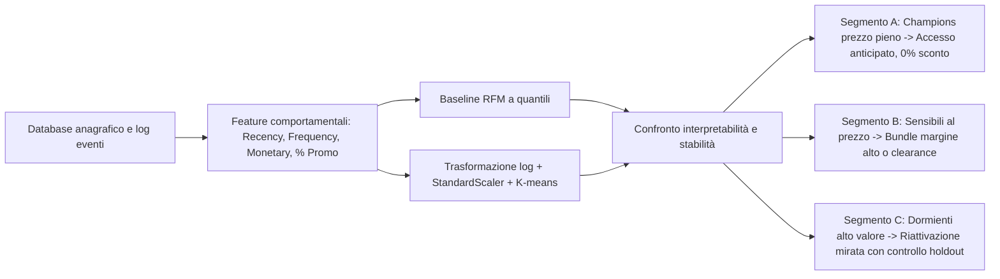

Considera uno scenario costruito su numeri di esempio realistici per un retailer italiano di attrezzatura outdoor e trail running con base a Milano. Il team CRM deve rilanciare le vendite autunnali e decide di inviare lo stesso coupon con **sconto del 20%** a tutto il proprio segmento demografico storico "donne 25-40 anni residenti nelle grandi città" (**20.000 clienti attive**). A fine mese il tasso di apertura sembra ottimo, ma il margine commerciale crolla rispetto alla stessa settimana dell'anno precedente: circa il 40% di quel gruppo demografico era composto da acquirenti ricorrenti a prezzo pieno che avrebbero comprato lo stesso senza sconto, mentre un altro 35% era composto da cacciatrici di offerte che comprano solo con ribassi dal 30% in su. La demografia aveva messo nello stesso contenitore persone con elasticità economica opposta.

> **Idea chiave:** La segmentazione utile non descrive chi è il cliente sull'anagrafica, ma separa comportamenti osservati che richiedono messaggi, incentivi e costi di contatto diversi per generare margine incrementale.

## Perché la demografia fallisce nel guidare il budget

Per decenni il marketing si è appoggiato sull'ipotesi intuitiva che caratteristiche anagrafiche simili producano decisioni d'acquisto simili. Età, genere, fascia di reddito stimata e codice postale restano informazioni utili nelle fasi di pianificazione media alta quando non disponi ancora di cronologia interna. Tuttavia, non appena un cliente entra nel tuo database transazionale, l'anagrafica diventa un segnale debole rispetto a ciò che il cliente fa davvero sul catalogo.

Due trentacinquenni residenti nello stesso quartiere di Milano possono avere pattern incompatibili: la prima visita la sezione scarpe tecniche ogni dieci giorni, legge le recensioni sulle mescole delle suole e acquista il giorno stesso in cui esce il nuovo modello a **165 euro** pieni; la seconda apre soltanto le email con oggetto "ultimi saldi", compra una volta ogni nove mesi a **55 euro** e restituisce metà degli ordini. Raggrupparle sotto l'etichetta comune "Milano 35 anni" spinge a offrire uno sconto a chi non ne ha bisogno e un catalogo a prezzo pieno a chi reagisce solo al prezzo.

La **customer analytics** sposta quindi la segmentazione dalle etichette statiche alle tracce comportamentali osservabili: intervallo temporale dall'ultimo ordine, frequenza di acquisto, ampiezza dello scontrino, quota di ordini acquistati in promozione, tasso di reso e intensità di navigazione recente. Come evidenziato nelle analisi pubblicate da [McKinsey & Company](https://www.mckinsey.com/industries/retail/our-insights/how-retailers-can-keep-up-with-consumers) sulla personalizzazione nel retail digitale, la quota prevalente delle conversioni generate dai motori di raccomandazione moderni deriva dallo storico di navigazione e transazioni recenti, non da regole demografiche rigide.



Il diagramma mostra un principio architetturale fondamentale: la segmentazione non termina con l'assegnazione dell'etichetta di cluster. L'etichetta serve solo se determina un ramo operativo distinto in termini di offerta economica, canale di contatto e metrica di successo rispetto a un gruppo di controllo non esposto.

## Dalla baseline RFM al clustering comportamentale

Prima di lanciare un algoritmo di clustering non supervisionato conviene costruire sempre la **baseline RFM** divisa in terzili o quintili sulle tre dimensioni fondamentali: `Recency` (giorni dall'ultimo ordine), `Frequency` (numero di ordini nel periodo) e `Monetary` (margine o spesa netta nel periodo). La griglia RFM è immediatamente spiegabile al management, non richiede taratura di parametri e permette di individuare subito se due variabili sono troppo correlate tra loro.

Il passaggio al clustering vero e proprio, come **K-means**, diventa giustificato quando vuoi introdurre una quarta o quinta dimensione comportamentale (ad esempio quota di acquisti in saldo, percentuale di resi, numero di categorie esplorate) che renderebbe una griglia a quintili impossibile da leggere (`5^5 = 3.125` celle). Prima di eseguire K-means su metriche monetarie e di conteggio, però, occorre correggere due distorsioni matematiche tipiche dei dati di marketing.

La prima distorsione è la **forte asimmetria a destra (`right skewness`)**: variabili come `Monetary` e `Frequency` hanno pochi clienti altospendenti che distorcono media e varianza euclidea, quindi applicare `np.log1p` prima della standardizzazione riduce l'effetto leva degli outlier. La seconda distorsione deriva dalle **scale incompatibili**: `Recency` varia da `1` a `365` giorni mentre `Frequency` varia da `1` a `12` ordini e la quota promo sta tra `0` e `1`, perciò senza `StandardScaler` (media zero, deviazione standard uno) K-means raggruppa quasi esclusivamente lungo la dimensione con varianza numerica maggiore.

| Criterio decisionale | Griglia RFM deterministica | Clustering `K-means` su feature scalate |
|---|---|---|
| **Numero massimo di dimensioni leggibili** | 3 variabili (`R`, `F`, `M`) | 4–8 variabili comportamentali continue |
| **Stabilità temporale delle soglie** | Alta se usi soglie assolute di business | Media: i centroidi possono spostarsi al riaddestramento |
| **Gestione di relazioni non ortogonali** | Bassa: tratta le tre assi con tagli rettangolari rigidi | Buona su gruppi compatti sferici nello spazio normalizzato |
| **Spiegabilità al team CRM** | Immediata: regole esplicite su giorni, ordini ed euro | Richiede tabella dei centroidi riportati nelle unità originali |

## Calcolo economico della segmentazione: margine uniforme contro attivazione mirata

Vediamo con un **worked example numerico completo** perché segmentare per comportamento cambia direttamente il conto economico della stessa base di **10.000 clienti**. Supponiamo che l'e-commerce venda con un **margine lordo medio a prezzo pieno del 50%** su un carrello medio di **100 euro** (quindi `50 euro` di margine prima degli sconti e dei costi di contatto).

Nella **Strategia 1 (baseline uniforme)** inviamo a tutti i `10.000 clienti` un codice sconto del `20%` via email ed SMS con costo operativo totale pari a **0,50 euro per cliente contattato**. Con uno sconto del `20%` su `100 euro`, il prezzo pagato diventa `80 euro`, il costo del venduto resta `50 euro` e il margine lordo unitario scende da `50 euro` a **`30 euro`**.

Nella **Strategia 2 (segmentazione comportamentale in 3 cluster)** dividiamo invece i `10.000 clienti` secondo lo storico di acquisto stimato su un gruppo pilota precedente. Il **Cluster 1 dei Champions (`2.500 clienti`)** compra regolarmente senza sconti: senza coupon converte il **20%** a margine pieno (`50 euro`), mentre con il coupon sale appena al **22%** perdendo `20 euro` per ordine, perciò riceve soltanto una email editoriale senza sconto al costo di **0,10 euro**.

Il **Cluster 2 dei Cacciatori di sconti (`4.500 clienti`)** converte appena al **2%** senza stimolo, ma raggiunge il **10%** con il coupon del `20%` via email ed SMS al costo di **0,50 euro** e margine unitario di `30 euro`. Infine, il **Cluster 3 dei Dormienti alto valore (`3.000 clienti`)** è fermo da oltre 120 giorni e converte dal **3%** naturale al **9%** con il coupon mirato del `20%` (`0,50 euro` di costo e `30 euro` di margine unitario).

Calcoliamo prima i conti della **Strategia 1 uniforme**. Il costo totale di contatto è `10.000 * 0,50 euro = 5.000 euro`. Gli ordini diventano `550` nel Cluster 1 (`2.500 * 0,22`), `450` nel Cluster 2 (`4.500 * 0,10`) e `270` nel Cluster 3 (`3.000 * 0,09`), per un totale di `1.270 ordini` che a `30 euro` di margine generano `38.100 euro` lordi. Sottraendo i `5.000 euro` di contatto, il **margine netto della Strategia 1 scende a `33.100 euro`**.

Confrontiamo questo risultato con l'inazione totale (gruppo di controllo senza sconto): i Champions generano `2.500 * 0,20 = 500 ordini * 50 euro = 25.000 euro`, i Cacciatori `4.500 * 0,02 = 90 ordini * 50 euro = 4.500 euro` e i Dormienti `3.000 * 0,03 = 90 ordini * 50 euro = 4.500 euro`, per un totale naturale di **`34.000 euro`**. La campagna uniforme (`33.100 euro`) distrugge dunque **900 euro netti** rispetto al non fare nulla perché brucia `10.000 euro` di sconto sui `500` ordini Champions che sarebbero arrivati comunque a prezzo pieno.

Calcoliamo infine la **Strategia 2 segmentata**. Sul Cluster 1 spendiamo `2.500 * 0,10 = 250 euro` e otteniamo `500 ordini * 50 euro = 25.000 euro` lordi (`24.750 euro` netti). Sul Cluster 2 spendiamo `4.500 * 0,50 = 2.250 euro` su `450 ordini * 30 euro = 13.500 euro` (`11.250 euro` netti, cioè `+6.750 euro` incrementali). Sul Cluster 3 spendiamo `3.000 * 0,50 = 1.500 euro` su `270 ordini * 30 euro = 8.100 euro` (`6.600 euro` netti, cioè `+2.100 euro` incrementali). Il **margine netto totale della Strategia 2 sale a `42.600 euro`** (`24.750 + 11.250 + 6.600`).

| Strategia applicata su 10.000 clienti | Ordini generati | Costo contatto | Margine lordo ordini | Margine netto finale | Delta rispetto al non agire |
|---|---:|---:|---:|---:|---:|
| **Controllo (nessuno sconto)** | 680 | 0 euro | 34.000 euro | 34.000 euro | 0 euro |
| **Strategia 1 (20% uniforme a tutti)** | 1.270 | 5.000 euro | 38.100 euro | 33.100 euro | -900 euro |
| **Strategia 2 (segmentata 3 cluster)** | 1.220 | 4.000 euro | 46.600 euro | 42.600 euro | +8.600 euro |

La segmentazione corretta genera **+9.500 euro** in più della campagna uniforme (`42.600` contro `33.100 euro`) e **+8.600 euro** rispetto all'inazione, semplicemente smettendo di scontare il cluster sbagliato.

## Implementazione Python: K-means su RFM con lettura dei centroidi

Il codice seguente costruisce i segmenti su una tabella cliente con trasformazione logaritmica delle variabili asimmetriche, standardizzazione, scelta di `K` con `silhouette_score` e stampa delle medie nelle unità originali (`giorni`, `ordini`, `euro`, `quota_promo`) insieme all'assegnazione della politica commerciale.

```python
import numpy as np
import pandas as pd
from sklearn.cluster import KMeans
from sklearn.metrics import silhouette_score
from sklearn.preprocessing import StandardScaler

# 1. Simulazione di una tabella cliente comportamentale (5.000 utenti)
rng = np.random.default_rng(108)
n = 5_000
tipo_latente = rng.choice([0, 1, 2], size=n, p=[0.25, 0.45, 0.30])

recency = np.where(tipo_latente == 0, rng.integers(3, 35, n),
          np.where(tipo_latente == 1, rng.integers(25, 95, n), rng.integers(120, 260, n)))
frequency = np.where(tipo_latente == 0, rng.poisson(5.5, n) + 1,
            np.where(tipo_latente == 1, rng.poisson(2.2, n) + 1, rng.poisson(1.5, n) + 1))
monetary = np.where(tipo_latente == 0, rng.lognormal(5.8, 0.35, n),
           np.where(tipo_latente == 1, rng.lognormal(4.8, 0.40, n), rng.lognormal(5.5, 0.40, n)))
quota_promo = np.clip(
    np.where(tipo_latente == 0, rng.normal(0.08, 0.06, n),
    np.where(tipo_latente == 1, rng.normal(0.75, 0.12, n), rng.normal(0.30, 0.15, n))),
    0.0, 1.0
)

clienti = pd.DataFrame({
    "recency": recency,
    "frequency": frequency,
    "monetary": np.round(monetary, 2),
    "quota_promo": np.round(quota_promo, 3),
})

# 2. Trasformazione log1p sulle variabili asimmetriche e standardizzazione
X_proc = clienti.copy()
X_proc["frequency_log"] = np.log1p(X_proc["frequency"])
X_proc["monetary_log"] = np.log1p(X_proc["monetary"])
cols_modello = ["recency", "frequency_log", "monetary_log", "quota_promo"]

scaler = StandardScaler()
X_scaled = scaler.fit_transform(X_proc[cols_modello])

# 3. Valutazione Silhouette su K da 2 a 6 prima di fissare K=3
for k in range(2, 7):
    km = KMeans(n_clusters=k, n_init=20, random_state=108)
    etichette = km.fit_predict(X_scaled)
    sil = silhouette_score(X_scaled, etichette)
    print(f"K={k} -> Silhouette={sil:.3f}")

# 4. Fit finale a K=3 e lettura dei centroidi nelle unita originali (giorni, ordini, euro)
kmeans_finale = KMeans(n_clusters=3, n_init=20, random_state=108)
clienti["cluster"] = kmeans_finale.fit_predict(X_scaled)

riepilogo = clienti.groupby("cluster").agg(
    n_clienti=("recency", "count"),
    recency_mediana=("recency", "median"),
    frequency_media=("frequency", "mean"),
    monetary_mediana=("monetary", "median"),
    quota_promo_media=("quota_promo", "mean"),
).round(2)

print("\nProfilo centroidi nelle unita di business:")
print(riepilogo)
```

Nota un dettaglio cruciale nel blocco finale: il modello si addestra sulle colonne trasformate (`log1p` + `StandardScaler`), ma il riepilogo destinato al marketing stampa mediane e medie **nelle unità originali** (`giorni`, `ordini`, `euro`, `quota_promo`). Nessun responsabile commerciale sa cosa significhi "cluster con `monetary_log_z = +1,14`": sa invece decidere subito su un gruppo con recency mediana di 19 giorni, 6,5 ordini e quota promo all'8%.

## Come governare i segmenti tra attivazione e controllo

Una segmentazione comportamentale produce valore continuo solo se l'organizzazione fissa tre regole di governance prima della messa in produzione. La prima regola è l'assegnazione scritta del **contratto di segmento**: per ogni gruppo devono esistere una sola proposta di valore, un tetto massimo di costo per contatto e un gruppo di controllo casuale (holdout) che non riceve lo stimolo. La seconda regola è la **frequenza di aggiornamento**: ricalcolare i cluster ogni giorno fa oscillare i clienti di confine tra un gruppo e l'altro confondendo la sequenza delle email automatiche; conviene riaddestrare o riassegnare su finestra mensile o settimanale stabile, mantenendo traccia dei passaggi di stato (`migration matrix`) tra Champions, Attivi e Dormienti.

La terza regola riguarda la leggibilità delle assunzioni. Ogni scheda segmento deve dichiarare quale unità di analisi sta misurando (utente contro account familiare o aziendale), quale finestra storica usa (`180` o `365` giorni) e quale metrica dimostra che il segmento merita ancora budget dopo 30 giorni. Se due segmenti diversi ricevono la stessa email, lo stesso sconto e lo stesso canale per tre mesi consecutivi, la segmentazione è diventata pura decorazione analitica e uno dei due rami va eliminato.

## Errori comuni nella segmentazione dei clienti

### Segmentare sulle variabili sbagliate o senza scala uniforme

Inserire in K-means decine di variabili non standardizzate o fortemente collineari (ad esempio `monetary_totale`, `monetary_netto`, `spesa_ultimi_90_giorni` e `ticket_medio` insieme) assegna un peso implicito triplo alla spesa monetaria rispetto alla frequenza o alla sensibilità agli sconti. Inoltre, lasciare outlier estremi da rivenditori B2B dentro un cluster B2C costringe K-means a dedicare un intero cluster a cinque clienti anomali schiacciando tutti gli altri in due macro-gruppi indistinti.

### Ottimizzare per il tasso di conversione lordo invece che per il margine incrementale

Come dimostrato nel worked example numerico, la campagna uniforme otteneva `1.270` ordini contro `1.220` della campagna segmentata, eppure perdeva `9.500 euro` netti. Valutare i segmenti in base ai clic o al volume lordo di ordini incentiva il CRM a spedire sconti proprio ai clienti migliori che avrebbero comprato a prezzo pieno. L'unica misura che protegge la cassa è il margine incrementale netto rispetto al gruppo di controllo del medesimo segmento.

### Cambiare le definizioni dei cluster a ogni campagna

Se ogni mese un analista modifica le colonne in ingresso o cambia il numero `K` per inseguire il Silhouette score più alto della settimana, i confronti storici sulle coorti diventano impossibili. Il team CRM non può misurare se i "Dormienti alto valore" stiano migliorando nel tempo se metà di essi viene riclassificata arbitrariamente ogni trenta giorni. Prima si congela il dizionario delle feature, poi si monitora lo spostamento dei clienti tra stati stabili nel tempo.

## Verifica sulla customer analytics e segmentazione

1. Perché due clienti con la stessa età, residenza e reddito stimato possono rispondere in modo opposto a un coupon del 20%?

<details>
<summary>Mostra risposta</summary>

La segmentazione demografica cattura attributi statici ma non rileva la sensibilità al prezzo né il ritmo naturale di riacquisto. Uno dei due clienti può essere un acquirente abituale a prezzo pieno che apprezza l'accesso anticipato ai nuovi arrivi (per il quale lo sconto erode solo il margine), mentre l'altro può essere un cliente orientato alle promozioni che attende i ribassi per acquistare. Solo i dati comportamentali come la quota di ordini in saldo, la recency e la frequenza separano questi due meccanismi decisionali.

</details>

2. Nel worked example sui 10.000 clienti, perché la campagna con sconto del 20% estesa a tutti distruggeva 900 euro rispetto al non fare alcuna campagna?

<details>
<summary>Mostra risposta</summary>

Nel Cluster 1 dei Champions (2.500 clienti), il 20% avrebbe comunque acquistato a prezzo pieno generando 500 ordini con 50 euro di margine l'uno (25.000 euro). Con il coupon uniforme il tasso di conversione saliva solo al 22% (550 ordini), ma il margine unitario crollava da 50 euro a 30 euro per colpa dello sconto, riducendo il margine lordo del gruppo a 16.500 euro a fronte di 1.250 euro di costi di contatto. La perdita di 9.750 euro sui soli Champions superava il guadagno incrementale ottenuto sugli altri due segmenti.

</details>

3. Quale trasformazione matematica va applicata a `Frequency` e `Monetary` prima di eseguire K-means, e perché non devi interpretare direttamente i centroidi trasformati con gli stakeholder?

<details>
<summary>Mostra risposta</summary>

Occorre applicare una trasformazione concava come il logaritmo (`np.log1p`) per comprimere la coda destra generata dai clienti altospendenti e poi normalizzare tutte le colonne con `StandardScaler` affinché la distanza euclidea non sia dominata dalla variabile con scala numerica più ampia. Dopo l'assegnazione dei cluster, però, occorre ricalcolare medie e mediane delle feature nelle unità originali (giorni, ordini, euro, percentuale di ordini scontati) perché i valori log-standardizzati non sono azionabili in una riunione commerciale.

</details>

4. Quale segnale operativo ti avvisa che hai creato troppi cluster rispetto alla capacità reale del tuo team marketing?

<details>
<summary>Mostra risposta</summary>

Se dopo il clustering ti ritrovi con più segmenti che ricevono esattamente la stessa email, la stessa percentuale di sconto e lo stesso canale di contatto perché il team non ha risorse editoriali o budget per differenziare il trattamento, i cluster in eccesso sono inutili. Un segmento giustifica la propria esistenza solo quando modifica in modo misurabile almeno una leva tra offerta economica, messaggio, canale o cadenza di invio.

</details>
