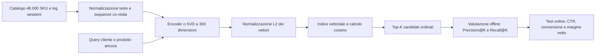

Un catalogo e-commerce sportivo da 48.000 SKU registra 65.000 ricerche interne al mese, ma il 24% delle query restituisce zero risultati oppure prodotti fuori contesto (scenario costruito con numeri di esempio). Un cliente cerca "scarpe ammortizzate per maratona su asfalto", mentre la scheda tecnica del prodotto migliore usa l'espressione "calzatura running lunga distanza con intersuola reattiva": la ricerca per parole chiave esatte fallisce perché i due testi non condividono nemmeno un termine identico. Su 15.600 ricerche mensili a vuoto, un recupero parziale anche solo di 3 punti percentuali di conversione vale decine di migliaia di euro di margine perso ogni trimestre.

> **Idea chiave:** Gli embeddings traducono testi, prodotti e comportamenti in vettori numerici densi dove la vicinanza geometrica approssima la somiglianza d'uso o di significato, trasformando un problema di corrispondenza lessicale rigida in un ordinamento continuo nello spazio vettoriale.

## Perché la codifica one-hot fallisce sul catalogo

Per capire cosa risolve uno spazio vettoriale denso, conviene partire dal limite strutturale della codifica classica. Con il `one-hot encoding`, un catalogo con $V = 48.000$ prodotti assegna a ciascun articolo un vettore lungo 48.000 posizioni, composto da 47.999 zeri e un singolo `1` in corrispondenza dell'identificativo del prodotto. Lo stesso accade su una borsa di parole (`bag-of-words`) costruita su un vocabolario di 30.000 termini distinti.

Questa rappresentazione produce due difetti operativi immediati. Il primo è l'esplosione dimensionale: memorizzare e moltiplicare vettori quasi vuoti in decine di migliaia di dimensioni spreca memoria e rende fragili i modelli a valle quando un termine appare raramente nei dati storici. Il secondo difetto è geometricamente ancora più grave: in uno spazio `one-hot`, due vettori distinti sono sempre ortogonali tra loro. Il prodotto scalare tra la scarpa Nike Air Zoom e la scarpa Adidas Ultraboost vale zero esattamente come il prodotto scalare tra la stessa scarpa e un frullatore a immersione.

| Rappresentazione | Dimensione tipica | Struttura semantica | Costo di aggiornamento | Uso consigliato nel marketing |
|---|---:|---|---|---|
| One-hot encoding | Pari al catalogo o vocabolario | Nulla (vettori ortogonali) | Immediato su nuove chiavi | Chiavi esatte, conteggi, ID univoci |
| TF-IDF sparso | 10.000 – 100.000 | Solo sovrapposizione lessicale | Basso (ricalcolo frequenze) | Match su codici SKU, sigle, brand esatti |
| Word2Vec / Co-occorrenza SVD | 50 – 300 | Relazioni di contesto locale | Medio (riaddestramento periodico) | Sequenze di click, carrelli, tag prodotto |
| Embedding neurali pre-addestrati | 384 – 1.536 | Semantica e sinonimi multilingue | Basso su nuovi SKU (inferenza) | Ricerca semantica, cold-start schede testo |

La scelta non oppone un metodo "moderno" a uno "vecchio": il `one-hot` resta la rappresentazione corretta quando ti servono conteggi esatti per codice articolo o categoria fiscale, mentre lo spazio denso diventa indispensabile appena la decisione richiede di misurare quanto due entità si somiglino senza condividere le stesse etichette.

## Geometria degli spazi densi e apprendimento per co-occorrenza

Un embedding comprime l'informazione in un vettore continuo a bassa dimensionalità, tipicamente compreso tra 50 e 1.024 coordinate reali. In marketing data science non serve pensare solo al testo: lo stesso principio vale per sequenze di sessioni e-commerce, co-acquisti nello stesso carrello o descrizioni di campagne pubblicitarie. Quando Tomas Mikolov e colleghi pubblicarono `Word2Vec` nel 2013 su un corpus di circa 100 miliardi di parole di Google News con vettori a 300 dimensioni, mostrarono che addestrare un modello a prevedere i termini vicini nel contesto genera automaticamente assi latenti interpretabili, rendendo operative relazioni lineari come `vettore('Re') - vettore('Uomo') + vettore('Donna')` vicino a `vettore('Regina')`.

Trasportato sul retail e sul CRM, il "contesto" di un prodotto è l'insieme degli altri prodotti visualizzati nella stessa sessione di navigazione o acquistati dal medesimo segmento di clienti, oltre alle parole presenti in titolo, attributi tecnici e recensioni. Due scarpe da corsa su strada condividono sia termini descrittivi simili ("ammortizzazione", "suola", "10 km") sia utenti che le confrontano nella stessa finestra di navigazione di 15 minuti; per questo motivo l'ottimizzazione spinge i loro vettori nella stessa direzione dello spazio, mentre un elettrodomestico da cucina occupa una regione distante.



La normalizzazione `L2` prima dell'indicizzazione è il passaggio che separa un sistema stabile da uno distorto: dividendo ogni vettore per la sua norma euclidea, tutti gli articoli giacciono sulla superficie di una sfera unitaria, in modo che conti soltanto l'orientamento relativo e non la lunghezza del testo o la frequenza grezza dell'articolo.

## Derivazione passo-passo della similarità coseno su un catalogo di esempio

Per verificare come l'algebra vettoriale guidi l'ordinamento dei risultati, considera un micro-catalogo con 3 prodotti e una query di ricerca, proiettati in uno spazio didattico a 3 dimensioni latenti che rappresentano rispettivamente `[ammortizzazione_corsa, uso_sportivo_outdoor, elettrodomestico_cucina]` (numeri di esempio).

In questo spazio assegniamo alla query cliente il vettore $q = (0{,}90,\; 0{,}80,\; 0{,}00)$. I tre candidati a catalogo sono il Prodotto A (Scarpa running strada) con $v_A = (0{,}85,\; 0{,}75,\; 0{,}00)$, il Prodotto B (Zaino trail leggero) con $v_B = (0{,}10,\; 0{,}90,\; 0{,}00)$ e il Prodotto C (Frullatore cucina) con $v_C = (0{,}00,\; 0{,}05,\; 0{,}95)$.

La formula della similarità coseno tra due vettori $u$ e $v$ è:

$$\cos(\theta) = \frac{u \cdot v}{\|u\| \, \|v\|} = \frac{\sum_{i=1}^{d} u_i v_i}{\sqrt{\sum_{i=1}^{d} u_i^2} \, \sqrt{\sum_{i=1}^{d} v_i^2}}$$

Calcoliamo anzitutto le norme euclidee di ciascun vettore per riportare tutte le lunghezze su scala unitaria.

Per la query otteniamo $\|q\| = \sqrt{0{,}90^2 + 0{,}80^2 + 0{,}00^2} = \sqrt{0{,}81 + 0{,}64} = \sqrt{1{,}45} \approx 1{,}204$. Per il Prodotto A la norma vale $\|v_A\| = \sqrt{0{,}85^2 + 0{,}75^2 + 0{,}00^2} = \sqrt{0{,}7225 + 0{,}5625} = \sqrt{1{,}285} \approx 1{,}134$.

Per il Prodotto B la norma diventa $\|v_B\| = \sqrt{0{,}10^2 + 0{,}90^2 + 0{,}00^2} = \sqrt{0{,}01 + 0{,}81} = \sqrt{0{,}82} \approx 0{,}906$, mentre per il Prodotto C otteniamo $\|v_C\| = \sqrt{0{,}00^2 + 0{,}05^2 + 0{,}95^2} = \sqrt{0{,}0025 + 0{,}9025} = \sqrt{0{,}905} \approx 0{,}951$.

Ora calcoliamo i prodotti scalari $q \cdot v$ e dividiamo per il prodotto delle rispettive norme per ciascuno dei tre candidati.

Per il Prodotto A, il prodotto scalare vale $q \cdot v_A = (0{,}90 \times 0{,}85) + (0{,}80 \times 0{,}75) + 0 = 0{,}765 + 0{,}600 = 1{,}365$; dividendo per il prodotto delle norme otteniamo $\cos(q, v_A) = \frac{1{,}365}{1{,}204 \times 1{,}134} = \frac{1{,}365}{1{,}3653} \approx 0{,}9998$.

Per il Prodotto B, il prodotto scalare vale $q \cdot v_B = (0{,}90 \times 0{,}10) + (0{,}80 \times 0{,}90) + 0 = 0{,}090 + 0{,}720 = 0{,}810$, quindi $\cos(q, v_B) = \frac{0{,}810}{1{,}204 \times 0{,}906} = \frac{0{,}810}{1{,}0908} \approx 0{,}7426$.

Per il Prodotto C, il prodotto scalare si riduce a $q \cdot v_C = (0{,}90 \times 0) + (0{,}80 \times 0{,}05) + (0 \times 0{,}95) = 0{,}040$, portando la similarità coseno a $\cos(q, v_C) = \frac{0{,}040}{1{,}204 \times 0{,}951} = \frac{0{,}040}{1{,}1450} \approx 0{,}0349$.

L'ordinamento semantico assegna punteggio `0,9998` alla scarpa da corsa, `0,7426` allo zaino sportivo correlato e `0,0349` al frullatore. Se applichiamo questa logica alle 15.600 ricerche mensili prima a vuoto, e un test controllato su 10.000 query porta il CTR della pagina risultati dal 12% al 19% (+7 punti percentuali) con tasso di acquisto post-click dell'8% e margine unitario di 28 € per ordine, l'incremento di ordini su quel campione è $10.000 \times 0{,}07 \times 0{,}08 = 56$ ordini aggiuntivi, pari a $56 \times 28 = 1.568$ € di margine netto solo sul blocco testato.

## Costruire e validare un indice vettoriale in Python

Nella pratica aziendale il calcolo della similarità coseno su migliaia di prodotti va accompagnato subito dalle metriche di valutazione offline (`Precision@K` e `Recall@K`) su un set di query etichettate da merchandiser o estratte da click storici ad alta conversione. Lo script seguente normalizza una matrice prodotto per norma L2, ordina i candidati rispetto a una query e misura `Precision@3` rispetto ai prodotti effettivamente acquistati per quella ricerca.

```python
import numpy as np

# Catalogo semplificato: vettori latenti su 4 assi
# [ammortizzazione, outdoor_sport, elettronica_casa, accessori_corsa]
catalog_ids = ["SKU_SCARPA_A", "SKU_SCARPA_B", "SKU_ZAINO_TRAIL", "SKU_FRULLATORE", "SKU_CALZE_RUN"]
V = np.array([
    [0.85, 0.75, 0.00, 0.25],  # Scarpa maratona A
    [0.80, 0.70, 0.00, 0.20],  # Scarpa maratona B
    [0.10, 0.90, 0.00, 0.15],  # Zaino trail
    [0.00, 0.05, 0.95, 0.00],  # Frullatore
    [0.35, 0.65, 0.00, 0.85],  # Calze tecniche corsa
], dtype=float)

# Vettore query: "scarpe ammortizzate lunga distanza"
query = np.array([0.90, 0.80, 0.00, 0.10], dtype=float)

# Normalizzazione L2 per trasformare la cosine similarity in semplice prodotto scalare
V_norm = V / np.linalg.norm(V, axis=1, keepdims=True)
q_norm = query / np.linalg.norm(query)

# Calcolo dei punteggi e ordinamento decrescente
scores = V_norm @ q_norm
ranked_idx = np.argsort(scores)[::-1]

top_k = 3
recommended = [catalog_ids[i] for i in ranked_idx[:top_k]]
relevant_set = {"SKU_SCARPA_A", "SKU_SCARPA_B"}  # Ground truth da log acquisti

hits = len(set(recommended) & relevant_set)
precision_at_3 = hits / top_k
recall_at_3 = hits / len(relevant_set)

for idx in ranked_idx:
    print(f"{catalog_ids[idx]:<16} cosine={scores[idx]:.4f}")
print(f"Top-3: {recommended} | Precision@3={precision_at_3:.2f} | Recall@3={recall_at_3:.2f}")
```

In produzione, prima di sostituire la ricerca esistente, questo controllo offline viene confrontato contro la baseline lessicale (`BM25` o `TF-IDF`) sullo stesso set stratificato di query: sia sulle query lunghe e sinonimiche (dove gli embeddings vincono nettamente) sia sulle query per codice SKU esatto o modello numerico (dove la ricerca lessicale o ibrida rimane superiore).

## Dalla similarità offline al valore di business

Un errore ricorrente nei team dati è fermarsi alla valutazione geometrica o alla sola `Precision@K` senza collegare il modello alle metriche economiche e operative. Una rappresentazione semantica che recupera sempre i tre prodotti più venduti della categoria può ottenere un buon CTR apparente pur riducendo la scoperta dei margini più alti o saturando le scorte di un singolo articolo.

Per governare il rilascio, conviene costruire una tabella di soglie decisionali prima dell'esperimento online:

| Fase di verifica | Metrica primaria | Baseline minima | Soglia di blocco (guardrail) |
|---|---|---|---|
| Validazione offline | `Recall@10` su query sinonime | Ricerca `BM25` attuale | Perdita su query SKU esatte oltre 2 pp |
| Test shadow / latenza | Tempo risposta p95 | 45 ms per ricerca | Latenza p95 superiore a 120 ms |
| Esperimento A/B online | Conversion rate da ricerca | Controllo 50% traffico attuale | Calo margine lordo per sessione o aumento resi |

Inoltre, i vettori vanno integrati nei filtri rigidi di business: disponibilità di magazzino, taglia richiesta e fascia di prezzo ammissibile non si affidano alla geometria morbida dell'embedding, ma si applicano come maschere booleane prima o dopo la ricerca approssimata dei vicini (`ANN`). Un modello semanticamente perfetto che consiglia una scarpa esaurita o fuori budget distrugge comunque la conversione.

## Errori comuni nella messa in produzione degli embeddings

### Usare la distanza euclidea su vettori non normalizzati

Il sintomo è che la ricerca e i caroselli "prodotti simili" restituiscono sistematicamente gli articoli con le schede descrittive più lunghe o con il maggior numero di recensioni, ignorando prodotti pertinenti ma descritti in modo sintetico. Succede perché, senza normalizzazione `L2`, l'ampiezza del vettore cresce con la frequenza o la densità di segnali accumulati in addestramento: la distanza euclidea e il prodotto scalare puro premiano quindi la lunghezza della norma oltre alla direzione semantica. Si evita normalizzando ogni vettore a norma unitaria prima di inserirlo nell'indice, oppure usando la ricerca ibrida con ponderazione esplicita della popolarità separata dalla componente semantica.

### Confondere similarità semantica con complementarità di acquisto

Un modello addestrato sulle descrizioni testuali vede un "frullatore a immersione Bosch 600W" quasi identico a un "frullatore a immersione Braun 650W". In una pagina di ricerca questo è desiderabile, perché aiuta il cliente a confrontare alternative dirette; nel box "completa l'ordine" dentro il carrello, invece, proporre un secondo frullatore quasi uguale riduce l'attacco al cross-sell. Questo accade quando il team usa lo stesso spazio di embeddings testuali per due decisioni opposte (sostituzione vs integrazione). Per correggere, separa gli embeddings per obiettivo: embeddings di contenuto per ricerca e sostituti, embeddings addestrati su sequenze co-acquisto di carrelli distinti (filtrando i prodotti della stessa sottocategoria) per il cross-sell.

### Trascurare la deriva del catalogo e del vocabolario stagionale

A distanza di sei mesi dal lancio, il CTR delle raccomandazioni cala lentamente anche se nessuna riga di codice è cambiata. Il motivo è che i nuovi modelli stagionali, i trend emergenti nei termini di ricerca degli utenti e le modifiche alle categorie merceologiche alterano la distribuzione dei testi e dei comportamenti rispetto al training originale. In uno spazio addestrato solo su co-visite storiche, i nuovi arrivi non hanno ancora co-occorrenze e restano isolati (cold-start). Si previene monitorando settimanalmente la quota di query senza vicini sopra una soglia minima di coseno (ad esempio `cos < 0,45`), combinando encoder testuali per i nuovi ingressi con riaddestramento programmato sui log recenti.

## Verifica operativa prima del rilascio

1. Perché due prodotti della stessa categoria risultano comunque completamente equidistanti da un elettrodomestico quando vengono rappresentati tramite codifica one-hot?

<details>
<summary>Mostra risposta</summary>

Nel `one-hot encoding` ogni prodotto occupa una dimensione dedicata ed esclusiva con valore `1`, mentre tutte le altre coordinate sono `0`. Qualsiasi coppia di prodotti distinti presenta prodotto scalare uguale a zero e distanza euclidea identica ($\sqrt{2}$), quindi lo spazio non possiede alcuna geometria capace di distinguere prodotti simili da prodotti completamente estranei.

</details>

2. Nel worked example della lezione, se normalizzi già in anticipo i vettori $q$ e $v_A$ a norma unitaria `1,0`, quale operazione matematica coincide esattamente con la similarità coseno e perché conviene nei motori di ricerca?

<details>
<summary>Mostra risposta</summary>

Quando $\|q\| = 1$ e $\|v_A\| = 1$, il denominatore della formula del coseno vale `1`, quindi la similarità coseno coincide esattamente con il prodotto scalare semplice $q \cdot v_A$. In produzione questo evita di ricalcolare le radici quadrate a runtime per migliaia di candidati, riducendo drasticamente latenza e costo computazionale.

</details>

3. Una ricerca basata su embeddings aumenta `Recall@5` sulle query descrittive lunghe, ma peggiora la precisione quando gli utenti cercano codici modello esatti come `GTX-4500`. Quale architettura risolve entrambi i casi?

<details>
<summary>Mostra risposta</summary>

Conviene adottare una ricerca ibrida che combina un indice lessicale (`BM25` o `TF-IDF`) per i match esatti su sigle, codici SKU e nomi di marca con un indice vettoriale denso per la semantica e i sinonimi, unendo le graduatorie tramite fusione pesata (ad esempio Reciprocal Rank Fusion) validata su un set misto di query.

</details>

4. Quale segnale di monitoraggio continuo indica che gli embeddings addestrati sulle co-visite storiche stanno degradando e richiedono un riaddestramento o un fallback testuale?

<details>
<summary>Mostra risposta</summary>

Due segnali combinati indicano deriva operativa: l'aumento della quota di query o SKU con similarità coseno massima sotto la soglia minima di pertinenza (e la crescita dei nuovi prodotti privi di vicini affidabili) insieme al calo del CTR e del tasso di aggiunta al carrello per singolo segmento di query.

</details>
