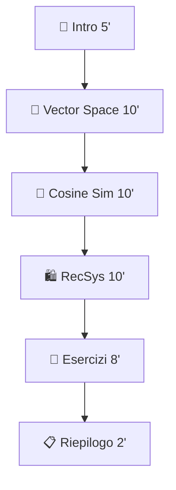
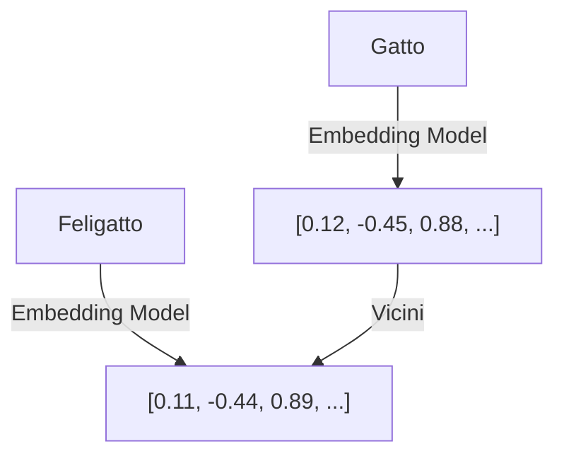

## Embeddings e Vettori: Il linguaggio segreto dell'AI — Lezione Completa

Come fa Netflix a sapere che se ti piace "Interstellar" ti piacerà "Inception"? Non usa keyword o tag manuali. Usa gli **Embeddings**. In questa lezione, sveleremo il concetto fondamentale che sta alla base di tutta l'AI moderna: trasformare le parole (e le immagini, e gli utenti) in numeri, per calcolare matematicamente il significato.

### Obiettivi di Apprendimento

Al termine di questa lezione, lo studente sarà in grado di:
1.  Spiegare intuitivamente cosa sono i vettori e lo spazio vettoriale (Vector Space).
2.  Utilizzare la "Coseno Similarità" per misurare quanto due concetti sono vicini semanticamente.
3.  Applicare gli embeddings per costruire motori di raccomandazione ("Chi ha comprato questo ha comprato anche...").
4.  Implementare una ricerca semantica che capisce l'intento, non solo le parole chiave.
5.  Visualizzare dati ad alta dimensionalità usando t-SNE o UMAP.

### Timeline della Lezione

| Fase | Argomento | Durata |
|------|-----------|--------|
| 1 | Introduzione: Parole come Numeri | 5 min |
| 2 | Teoria: Lo Spazio Semantico | 10 min |
| 3 | Matematica: Coseno Similarità | 10 min |
| 4 | Applicazione: Raccomandazioni e Search | 10 min |
| 5 | Esercizi: Calcolo della Distanza | 8 min |
| 6 | Riepilogo e Domande | 2 min |
| **Totale** | | **45 min** |

### Fase 1 — Introduzione: Parole come Numeri (5 min)

I computer non capiscono l'italiano. Capiscono solo i numeri.
Il modo vecchio per rappresentare il testo era il **One-Hot Encoding**:
*   Gatto = [1, 0, 0, ...]
*   Cane = [0, 1, 0, ...]
*   Automobile = [0, 0, 1, ...]

Il problema? Questi vettori sono tutti equidistanti. Per il computer, "Gatto" è diverso da "Cane" tanto quanto lo è da "Automobile". Ma noi sappiamo che Gatto e Cane sono simili (animali domestici).

Gli **Embeddings** risolvono questo problema creando vettori "densi" in uno spazio multidimensionale dove *parole simili sono vicine*.

### Fase 2 — Teoria: Lo Spazio Semantico (10 min)

Immagina uno spazio 2D con due assi: "Domestico vs Selvatico" e "Felino vs Canino".
*   **Gatto:** [0.9, 0.9] (Molto domestico, Molto felino).
*   **Tigre:** [0.1, 0.9] (Molto selvatico, Molto felino).
*   **Cane:** [0.9, 0.1] (Molto domestico, Molto canino).
*   **Lupo:** [0.1, 0.1] (Molto selvatico, Molto canino).

In questo spazio:
*   La distanza tra Gatto e Tigre è piccola (sono entrambi felini).
*   La distanza tra Gatto e Cane è media (sono entrambi domestici).
*   La distanza tra Gatto e Lupo è grande.

Gli LLM moderni (come GPT) usano spazi con **1.536 dimensioni** (non solo 2!), catturando sfumature incredibili come tono, genere, contesto, ironia.

### Fase 3 — Matematica: Coseno Similarità (10 min)

Come calcoliamo se due vettori sono vicini? Non usiamo il righello (distanza Euclidea) perché in alta dimensione non funziona bene. Usiamo l'angolo tra i vettori.

La **Cosine Similarity** varia da -1 a 1:
*   **1:** I vettori puntano nella stessa identica direzione (Sinonimi perfetti).
*   **0:** I vettori sono ortogonali (Non c'entrano nulla, es. "Gatto" e "Tavolo").
*   **-1:** I vettori sono opposti (Contrari, es. "Caldo" e "Freddo", anche se in linguistica spesso i contrari sono vicini perché usati negli stessi contesti).

Formula:
$$
\text{similarity} = \cos(\theta) = \frac{A \cdot B}{\|A\| \|B\|}
$$
(Non preoccuparti, lo fa Python per te).

### Fase 4 — Applicazione: Raccomandazioni e Search (10 min)

**1. Motore di Ricerca Semantico (Semantic Search)**
*   *Utente cerca:* "Scarpe per correre veloci".
*   *Database classico (Keyword):* Cerca la parola "veloci". Trova "Come pulire scarpe veloci". (Risultato scadente).
*   *Database Vettoriale:* Trasforma la query in vettore. Cerca i vettori vicini. Trova "Scarpe da Running Performance". (Risultato perfetto, anche se la parola "veloci" non c'è).

**2. Recommendation System (Content-Based)**
*   Utente legge articolo su "SEO per E-commerce".
*   Calcoli il vettore dell'articolo.
*   Trovi gli articoli nel database con Cosine Similarity > 0.8.
*   Raccomandi: "Ottimizzazione Schede Prodotto" e "Link Building per Shop".

**3. Clustering di Utenti**
*   Ogni utente è un vettore basato sulla sua storia di acquisti.
*   Usa K-Means sui vettori utenti per trovare segmenti comportamentali complessi.

### Fase 5 — Esercizi: Calcolo della Distanza (8 min)

**Esercizio Concettuale (Algebra Vettoriale)**
Una delle scoperte più famose di Word2Vec è l'aritmetica delle parole:

$$
\text{Vettore(Re)} - \text{Vettore(Uomo)} + \text{Vettore(Donna)} \approx \text{?}
$$

*Risposta:* **Regina.**
Se togli il concetto di "maschile" da "Re" e aggiungi "femminile", ti sposti nello spazio vettoriale esattamente nel punto dove si trova "Regina".

**Esercizio Pratico:**
Immagina 3 prodotti con i seguenti tag trasformati in vettori semplificati (Sport, Eleganza):
*   A: Scarpa Running [0.9, 0.1]
*   B: Scarpa Mocassino [0.1, 0.9]
*   C: Sneaker Fashion [0.6, 0.5]

Un utente cerca "Scarpa comoda per ufficio" (Vettore Query: [0.2, 0.8]).
Quale prodotto raccomandi?
*   Calcola la similarità (visiva): La Query è molto vicina a B (Mocassino), un po' a C, lontana da A. Raccomanda B.

### Fase 6 — Riepilogo e Domande (2 min)

1.  **Embeddings = Significato.** Trasformano concetti vaghi in coordinate precise.
2.  **Coseno.** L'angolo è la misura della somiglianza.
3.  **Search.** Cerca per *intento*, non per *keyword*.
4.  **Aritmetica.** Puoi sommare e sottrarre concetti (Utente + Prodotto = Match).

### Domande di Verifica

1.  Perché il "One-Hot Encoding" è inefficiente per rappresentare il linguaggio naturale?
2.  Cosa indica una "Cosine Similarity" di 0 tra due vettori di parole?
3.  Spiega l'analogia "Re - Uomo + Donna = Regina" nel contesto degli embeddings.
4.  Qual è la differenza principale tra un motore di ricerca "Lexical" (basato su keyword) e uno "Semantic" (basato su vettori)?
5.  Come useresti gli embeddings per rilevare recensioni false o anomale (Anomaly Detection)?

### Riferimenti Bibliografici

-   Tomas Mikolov et al., "Efficient Estimation of Word Representations in Vector Space" (Word2Vec Paper), Google, 2013.
-   Jay Alammar, "The Illustrated Word2Vec", Blog Post.
-   Pinecone Learning Center (Ottima risorsa per Vector Databases).
