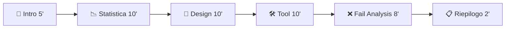
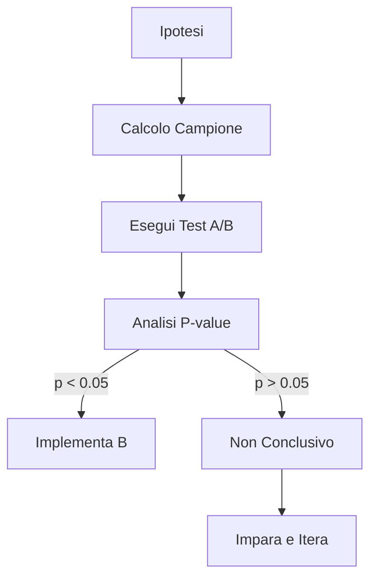

## Experimentation: La Scienza dell'A/B Testing — Lezione Completa

"Credo che il pulsante rosso convertirà meglio".
Nel marketing data-driven, la parola "credo" è vietata. La sostituiamo con "ipotesi". E l'unico modo per validare un'ipotesi è l'esperimento controllato. Le aziende come Booking.com, Amazon e Netflix eseguono migliaia di test all'anno perché sanno che l'intuizione umana fallisce l'80% delle volte. In questa lezione, impareremo a progettare, eseguire e analizzare esperimenti scientifici che portano crescita reale, non casuale.

### Obiettivi di Apprendimento

Al termine di questa lezione, lo studente sarà in grado di:
1.  Formulare un'ipotesi falsificabile secondo il modello "Se... Allora... Perché...".
2.  Calcolare la dimensione del campione necessaria (Sample Size) prima di partire.
3.  Evitare gli errori statistici comuni come il "Peeking" (sbirciare) e i "False Positives".
4.  Distinguere tra A/B Test, Multivariate Test (MVT) e Bandit Algorithms.
5.  Interpretare i risultati con intervalli di confidenza al 95%.

### Timeline della Lezione

| Fase | Argomento | Durata |
|------|-----------|--------|
| 1 | Introduzione: Correlation is not Causation | 5 min |
| 2 | Teoria: Statistica per Marketer (P-value) | 10 min |
| 3 | Metodologia: Il Design dell'Esperimento | 10 min |
| 4 | Strumenti: Calcolatori e Piattaforme | 10 min |
| 5 | Esercizi: Analisi di un Test Fallito | 8 min |
| 6 | Riepilogo e Domande | 2 min |
| **Totale** | | **45 min** |

### Fase 1 — Introduzione: Correlation is not Causation (5 min)

Il grafico delle vendite di gelati correla perfettamente con quello degli attacchi di squali.
Significa che mangiare il gelato attira gli squali? No. C'è una variabile nascosta (confounding variable): l'Estate. Fa caldo, quindi la gente mangia gelati E va a nuotare.

L'**A/B Testing** (o Randomized Controlled Trial - RCT) è l'unico strumento che ci permette di stabilire **Causalità**.
Randomizzando chi vede la versione A (Controllo) e la versione B (Variante), eliminiamo tutte le variabili esterne (tempo, device, tipo di utente). L'unica differenza è la modifica che abbiamo fatto. Se B performa meglio, è *causa* della modifica.

### Fase 2 — Teoria: Statistica per Marketer (P-value) (10 min)

Non serve una laurea in statistica, ma devi capire 3 concetti chiave per non farti ingannare dal caso.

1.  **Ipotesi Nulla ($H_0$):** "Non c'è differenza tra A e B". Il test serve a *smentire* questa ipotesi.
2.  **Significatività Statistica (Confidence Level):** Di solito 95%. Significa: "Siamo sicuri al 95% che il risultato non sia dovuto alla fortuna". C'è un 5% di rischio di errore (Falso Positivo - Type I Error).
3.  **Potenza Statistica (Power):** Di solito 80%. La probabilità di trovare una differenza se esiste davvero. Se il campione è troppo piccolo, il test ha "bassa potenza" (rischi un Falso Negativo - Type II Error).

**Il P-value:**
È la probabilità di osservare un risultato così estremo se $H_0$ fosse vera.
*   *p < 0.05:* Rifiuto $H_0$ -> La differenza è statisticamente significativa. (Vittoria!).
*   *p >= 0.05:* Non posso rifiutare $H_0$ -> Risultato non conclusivo. (Non hai vinto, ma non hai nemmeno perso. Hai imparato).

### Fase 3 — Metodologia: Il Design dell'Esperimento (10 min)

Un test fallisce prima di iniziare se il design è sbagliato.

**La Formula dell'Ipotesi:**
> *"Poiché osserviamo [Dato/Insight], crediamo che [Modifica X] causerà [Impatto Y] per [Segmento Z] perché [Ragione Psicologica]."*

*Esempio:*
"Poiché osserviamo un alto tasso di abbandono nel carrello (70%), crediamo che **aggiungere i loghi di sicurezza (PayPal, Visa)** aumenterà il **tasso di conversione** per i **nuovi utenti** perché **riduce l'ansia di frode (Trust).**"

**Regole Ferree:**
1.  **Una variabile alla volta:** Se cambi titolo, colore e foto insieme, non saprai mai cosa ha funzionato. (A meno che non fai un Multivariate Test, che richiede traffico enorme).
2.  **Durata Fissa:** Decidi *prima* quanto dura (es. 2 settimane). Non fermarti appena vedi il verde ("Peeking"). È come guardare il risultato di una partita al 10° minuto e dichiarare il vincitore.
3.  **Cicli Completi:** Includi sempre week-end e giorni feriali. Il traffico del lunedì è diverso da quello della domenica.

### Fase 4 — Strumenti: Calcolatori e Piattaforme (10 min)

**Pre-Test: Sample Size Calculator (Evan Miller / Optimizely)**
Devi sapere quanti utenti ti servono *prima*.
*   *Baseline Conversion Rate:* Quanto converti oggi? (es. 2%).
*   *Minimum Detectable Effect (MDE):* Quanto vuoi migliorare? (es. +10% relativo, quindi arrivare a 2.2%).
*   *Risultato:* "Ti servono 50.000 utenti per variante".
    *   Se hai 10.000 utenti al mese, il test durerà 5 mesi. -> **Non farlo.** Cerca un MDE più alto o testa su una micro-conversione (clic invece di acquisto).

**Piattaforme:**
*   **Google Optimize (RIP) / GA4:** Gratis, base.
*   **VWO / Optimizely:** Enterprise, costosi.
*   **GrowthBook / PostHog:** Open Source, feature flags, moderni.

### Fase 5 — Esercizi: Analisi di un Test Fallito (8 min)

**Scenario:**
Hai testato un pulsante "Compra Ora" verde (Controllo) vs rosso (Variante).
Dopo 3 giorni:
*   Verde: 100 visite, 2 vendite (2%).
*   Rosso: 100 visite, 4 vendite (4%).
*   *Il boss dice:* "Il rosso ha fatto il doppio! Implementiamo subito!"

**Analisi:**
*   Campione troppo piccolo (200 visite).
*   4 vendite vs 2 è rumore statistico. Potrebbe essere che 2 persone a caso hanno cliccato rosso.
*   *Verdetto:* Fermare il boss. Continuare il test fino alla dimensione campionaria calcolata (es. 2.000 visite).

**SRM Check (Sample Ratio Mismatch):**
Se avevi impostato 50/50 ma alla fine hai 10.000 utenti in A e 8.000 in B, c'è un bug tecnico. Il test è invalido. (Spesso causato da redirect lenti).

### Fase 6 — Riepilogo e Domande (2 min)

1.  **Testa per imparare.** Anche un test perdente è un successo se ti insegna cosa *non* piace agli utenti.
2.  **Statistica > Opinione.** I numeri non hanno ego.
3.  **Non sbirciare.** Aspetta la fine del test.
4.  **Prioritizza.** Testa dove hai traffico e dove l'impatto potenziale è alto (pagine di checkout, landing page).

### Domande di Verifica

1.  Cosa indica un P-value di 0.03? È statisticamente significativo?
2.  Perché è importante calcolare la "Sample Size" prima di lanciare un test?
3.  Qual è il rischio di fermare un test troppo presto ("Peeking")?
4.  Che cos'è un "Sample Ratio Mismatch" (SRM) e perché invalida un esperimento?
5.  In che situazione useresti un "Multivariate Test" (MVT) invece di un semplice A/B?

### Riferimenti Bibliografici

-   Ron Kohavi et al., "Trustworthy Online Controlled Experiments", Cambridge University Press, 2020 (La bibbia dell'A/B testing).
-   Stefan Thomke, "Experimentation Works", HBR Press, 2020.
-   Evan Miller, "Sample Size Calculator" (Tool online essenziale).
