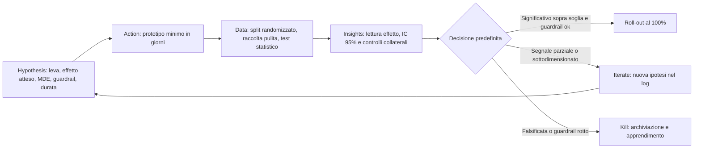

Un team prodotto e marketing di un software B2B in abbonamento da 49 € al mese riceve 14.000 nuovi iscritti in prova gratuita ogni mese, ma solo il 3,2% converte al piano a pagamento entro 14 giorni (scenario costruito con numeri di esempio). Per alzare la conversione, la roadmap propone di sviluppare per quattro mesi un motore di raccomandazione basato su machine learning prima ancora di sapere se i nuovi utenti leggano le email di attivazione. Un ciclo rapido di sperimentazione permette di verificare l'ipotesi in due settimane su 20.000 utenti reali con costo di sviluppo prossimo allo zero.

> **Idea chiave:** La crescita guidata dai dati non si pianifica in blocco su ipotesi non verificate, ma si costruisce tramite cicli rapidi `Hypothesis-Action-Data-Insights` dove ogni intervento nasce per falsificare un'assunzione precisa prima di impegnare ingegneria su larga scala.

## Perché i modelli perfetti restano inutili senza sperimentazione

Nelle organizzazioni orientate ai dati abbondano progetti tecnicamente brillanti ma commercialmente sterili: modelli di propensity con `AUC` superiore a 0,92 che non attivano alcuna campagna, oppure dashboard dettagliate che nessuno traduce in una modifica di prodotto. Il motivo è l'inversione dell'ordine tra ingegneria e validazione: si investono mesi per rendere scalabile un sistema prima di aver misurato se la leva sottostante cambi davvero il comportamento del cliente.

Il framework **HADI** (`Hypothesis`, `Action`, `Data`, `Insights`) ribalta questa sequenza. L'obiettivo non è confermare che l'idea iniziale sia valida, bensì ridurre al minimo il tempo e il costo necessari per scoprire se è falsa. Un'ipotesi smentita in sette giorni con uno script leggero risparmia quattro mesi di sviluppo su una direzione sbagliata e libera risorse per esperimenti a impatto più alto.



## Anatomia delle quattro fasi: Hypothesis, Action, Data, Insights

La forza del ciclo risiede nel vincolo reciproco tra le quattro fasi: nessuna fase successiva compensa una fase precedente progettata male.

La fase **Hypothesis** trasforma un desiderio generico ("migliorare le email di onboarding") in una proposizione verificabile composta da quattro elementi: leva specifica, risultato quantificato rispetto alla baseline, orizzonte temporale fisso e metrica di guardrail. Nel caso del software B2B citato in apertura, un'ipotesi rigorosa recita: "Se sostituiamo l'email generica del secondo giorno con un promemoria dinamico legato all'ultima funzione lasciata incompleta dall'utente, la conversione a pagamento a 14 giorni salirà di almeno 0,6 punti percentuali (dal 3,2% al 3,8%) su 20.000 utenti trial in 21 giorni, senza aumentare il tasso di disiscrizione (`Unsubscribe Rate`) oltre lo 0,6%."

La fase **Action** applica il principio del minimo intervento che genera dati puliti. Invece di costruire un microservizio in tempo reale, un analista estrae per due settimane gli utenti idonei con una query SQL giornaliera dal data warehouse e carica l'elenco su uno strumento CRM come `Braze` o `Customer.io`. L'azione non deve scalare per i prossimi cinque anni: deve solo eseguire la variazione in modo affidabile per tutta la durata del test.

La fase **Data** si progetta prima di lanciare l'azione, mai dopo. Significa fissare in anticipo la dimensione campionaria tramite analisi di potenza per il minimo effetto rilevabile (`MDE`), assegnare in modo randomizzato gli utenti a controllo e trattamento evitando interferenze tra sessioni dello stesso account, e congelare le metriche di guardrail (`Unsubscribe Rate`, ticket di supporto, tasso di reso o carico di latenza) che possono bloccare un risultato apparentemente vincente.

La fase **Insights** sintetizza numeri e contesto qualitativo. Come documentato da Kohavi, Tang e Xu (2020) nella pratica di sperimentazione su larga scala, un test non produce soltanto un `p-value`: chiarisce se l'effetto è economicamente sufficiente a giustificare il costo di mantenimento del codice e se il miglioramento in un segmento non stia danneggiando un altro segmento chiave.

## Derivazione completa di un test Z per proporzioni su numeri reali

Supponiamo che il ciclo HADI sul software B2B abbia completato la raccolta dati dopo 21 giorni su due gruppi randomizzati al 50%, fissando in anticipo il livello di significatività $\alpha = 0{,}05$ per un test a due code con confidenza al $95\%$ (numeri di esempio).

Nel gruppo di controllo che riceve l'email generica osserviamo $n_c = 10.150$ utenti e $x_c = 325$ conversioni a pagamento, mentre nel gruppo di trattamento esposto al promemoria sull'azione incompleta registriamo $n_t = 10.210$ utenti e $x_t = 388$ conversioni.

Nel primo passaggio calcoliamo i tassi di conversione osservati e il guadagno assoluto tra i due bracci. La conversione del controllo risulta $p_c = \frac{325}{10.150} \approx 0{,}03202$ ($3{,}20\%$), mentre quella del trattamento sale a $p_t = \frac{388}{10.210} \approx 0{,}03800$ ($3{,}80\%$). La differenza assoluta (lift) vale pertanto $\Delta = p_t - p_c = 0{,}03800 - 0{,}03202 = +0{,}00598$ ($+0{,}60$ punti percentuali, pari a un incremento relativo di $\frac{0{,}00598}{0{,}03202} \approx +18{,}7\%$).

Nel secondo passaggio calcoliamo la proporzione aggregata (`pooled`) e l'errore standard sotto l'ipotesi nulla $H_0: p_t = p_c$. Il tasso complessivo dei due gruppi uniti è $\hat{p} = \frac{325 + 388}{10.150 + 10.210} = \frac{713}{20.360} \approx 0{,}03502$. Inserendo questo valore nella formula dell'errore standard aggregato otteniamo $\text{SE}_{\text{pooled}} = \sqrt{\hat{p}(1 - \hat{p}) (\frac{1}{n_c} + \frac{1}{n_t})}$. Poiché $\frac{1}{10.150} + \frac{1}{10.210} \approx 0{,}00009852 + 0{,}00009794 = 0{,}00019646$, l'errore standard diventa $\text{SE}_{\text{pooled}} = \sqrt{0{,}03502 \times 0{,}96498 \times 0{,}00019646} = \sqrt{0{,}000006639} \approx 0{,}002577$.

Nel terzo passaggio deriviamo la statistica $Z$, il `p-value` e l'intervallo di confidenza al 95%. Il rapporto tra il lift e l'errore standard aggregato produce $Z = \frac{0{,}00598}{0{,}002577} \approx 2{,}321$, a cui corrisponde una probabilità bilaterale $\text{p-value} = 2 \times (1 - \Phi(2{,}321)) \approx 0{,}0203$, inferiore alla soglia $\alpha = 0{,}05$.

Per costruire l'intervallo di confidenza attorno a $\Delta$ utilizziamo le varianze separate dei due gruppi: $\text{SE}_{\text{diff}} = \sqrt{\frac{0{,}03202 \times 0{,}96798}{10.150} + \frac{0{,}03800 \times 0{,}96200}{10.210}} \approx 0{,}002576$. Moltiplicando per il quantile $Z_{0{,}975} = 1{,}96$, l'intervallo al 95% risulta $0{,}00598 \pm (1{,}96 \times 0{,}002576) = [+0{,}00093,\; +0{,}01103]$, ossia compreso tra $+0{,}09$ pp e $+1{,}10$ pp.

Nel quarto passaggio traduciamo la statistica in impatto economico e verifichiamo i guardrail. Su un flusso di `14.000 trial` al mese con ricavo netto di `49 €` al primo rinnovo e `LTV` medio di `240 €` per cliente pagante, un guadagno di $+0{,}60$ punti percentuali genera $14.000 \times 0{,}0060 = 84$ nuovi clienti al mese, equivalenti a $84 \times 240 = 20.160$ € di LTV incrementale mensile. Poiché il guardrail `Unsubscribe Rate` è passato solo da `0,42%` a `0,45%` (differenza non significativa e ben sotto lo `0,60%`), la decisione prevista dal log è il **roll-out al 100%**.

## Automazione del calcolo e della regola decisionale in Python

Uno script standardizzato elimina l'ambiguità interpretativa nella fase Insights: oltre al test Z e all'intervallo di confidenza, integra esplicitamente la soglia minima di rilevanza economica (`MDE`) e la verifica sulla metrica di guardrail prima di stampare l'esito operativo.

```python
from scipy.stats import norm

def valuta_ciclo_hadi(
    ctrl_users: int,
    ctrl_conv: int,
    treat_users: int,
    treat_conv: int,
    guardrail_ctrl_rate: float,
    guardrail_treat_rate: float,
    guardrail_max_delta: float = 0.002,
    mde_target: float = 0.004,
    alpha: float = 0.05,
) -> str:
    # Calcolo proporzioni osservate
    p_c = ctrl_conv / ctrl_users
    p_t = treat_conv / treat_users
    diff = p_t - p_c

    # Statistica Z con varianza pooled sotto ipotesi nulla
    p_pool = (ctrl_conv + treat_conv) / (ctrl_users + treat_users)
    se_pool = (p_pool * (1 - p_pool) * (1 / ctrl_users + 1 / treat_users)) ** 0.5
    z_score = diff / se_pool
    p_value = 2 * (1 - norm.cdf(abs(z_score)))

    # Intervallo di confidenza al (1 - alpha) con varianze separate
    se_diff = ((p_c * (1 - p_c) / ctrl_users) + (p_t * (1 - p_t) / treat_users)) ** 0.5
    z_crit = norm.ppf(1 - alpha / 2)
    ci_low, ci_high = diff - z_crit * se_diff, diff + z_crit * se_diff

    guardrail_delta = guardrail_treat_rate - guardrail_ctrl_rate
    guardrail_ok = guardrail_delta <= guardrail_max_delta

    # Regola decisionale predefinita prima del test
    if not guardrail_ok:
        decision = "KILL (guardrail violato)"
    elif p_value < alpha and diff >= mde_target:
        decision = "ROLL-OUT al 100%"
    elif p_value < alpha and diff > 0:
        decision = "ITERATE (effetto significativo ma sotto MDE)"
    else:
        decision = "KILL (nessun lift statisticamente affidabile)"

    print(f"Controllo: {p_c:.4%} | Trattamento: {p_t:.4%}")
    print(f"Lift assoluto: {diff:+.4%} (IC 95%: [{ci_low:+.4%}, {ci_high:+.4%}])")
    print(f"Z = {z_score:.3f}, p-value = {p_value:.4f}, delta guardrail = {guardrail_delta:+.4%}")
    print(f"Decisione HADI: {decision}")
    return decision

valuta_ciclo_hadi(
    ctrl_users=10_150, ctrl_conv=325,
    treat_users=10_210, treat_conv=388,
    guardrail_ctrl_rate=0.0042, guardrail_treat_rate=0.0045,
)
```

## Memoria istituzionale: il log HADI e i casi storici

Senza un registro condiviso, i team dimenticano gli esperimenti falliti e ripetono a distanza di dodici mesi gli stessi test con nomi diversi. La memoria operativa del motore di sperimentazione è il **log HADI**, un registro strutturato (su database o repository interno) in cui ogni test viene chiuso obbligatoriamente con il proprio apprendimento.

| Campo del log HADI | Contenuto minimo richiesto | Esempio operativo |
|---|---|---|
| ID ed owner | Codice univoco e responsabile analitico | `MKTG-2026-014` — Team Lifecycle |
| Ipotesi e MDE | Leva, lift atteso, soglia minima rilevante | Email step incompleto: `+0,6 pp` (`MDE 0,4 pp`) |
| Disegno campionario | Unità di randomizzazione, durata, potenza 80% | Split utente 50/50, 21 giorni, `N = 20.000` |
| Esito statistico | Lift osservato, IC 95%, `p-value`, guardrail | `+0,60 pp` `[+0,09; +1,10]`, `p = 0,0203`, guardrail ok |
| Decisione e nota | `Roll-out`, `Iterate` o `Kill` + lezione appresa | `Roll-out`: automatizzare query su dbt prima della V2 |

Questo approccio caratterizza le aziende a più alta velocità di apprendimento. Nel celebre caso Airbnb del 2009 a New York, i fondatori notarono che gli annunci con foto scadenti faticavano a generare prenotazioni: invece di costruire una piattaforma fotografica globale, affittarono una fotocamera da 5.000 dollari e fotografarono personalmente circa 20 appartamenti. Nelle quattro settimane successive quegli annunci raddoppiarono i ricavi settimanali medi da circa 200 a 400 dollari, giustificando poi l'investimento nell'Airbnb Photography Program. Analogamente, Netflix applicò cicli HADI mirati sulle immagini di anteprima (`artwork`) su una decina di titoli ad alto traffico prima di estendere la personalizzazione dinamica all'intero catalogo di oltre 200 milioni di utenti.

## Errori comuni nella conduzione di cicli HADI

### Fermare l'esperimento appena il p-value scende sotto 0,05 (peeking)

Il sintomo è una lunga serie di test dichiarati "vincenti" durante la prima settimana che poi non producono alcun aumento reale dei ricavi trimestrali dopo il roll-out. Succede perché controllare ogni giorno la significatività statistica e fermare il test appena appare `p < 0,05` gonfia drasticamente il tasso di falsi positivi: la variabilità iniziale di pochi giorni crea oscillazioni casuali che sembrano segnali stabili. La prevenzione richiede di fissare a priori la dimensione campionaria minima (ad esempio per un intero ciclo settimanale o di acquisto) e leggere l'esito finale solo al raggiungimento del campione pianificato, oppure usare metodi esplicitamente sequenziali.

### Avviare azioni senza soglia minima economica né metriche di guardrail

Un test con `N = 400.000` sessioni può rilevare come statisticamente significativo (`p = 0,008`) un aumento di click dello `0,08%` che vale meno del costo di manutenzione del codice o che ottiene clic aggiuntivi tramite titoli fuorvianti che aumentano poi i resi. Questo errore nasce dalla confusione tra significatività statistica e rilevanza aziendale. Per evitarlo, definisci sempre nell'ipotesi l'effetto minimo rilevante (`MDE` economico) e almeno una metrica di controllo a valle del funnel (reso, cancellazione, reclamo o margine netto) capace di imporre un veto al roll-out.

### Sovra-ingegnerizzare la fase Action prima della validazione

Capita spesso che la fase Action venga bloccata per due mesi in attesa di microservizi, pipeline streaming o modelli predittivi complessi per testare un'idea che può essere simulata in 48 ore tramite esportazione CSV o regole euristiche semplici. L'errore trasforma la sperimentazione in sviluppo software tradizionale. La contromisura consiste nell'imporre un tetto temporale di pochi giorni alla prima versione del trattamento: la scalabilità ingegneristica si costruisce solo dopo il segnale positivo, mai prima.

## Controllo decisionale prima di lanciare il test

1. Nel worked example sul software B2B, l'intervallo di confidenza al 95% per il lift si estende da `+0,09` pp a `+1,10` pp. Perché guardare l'estremo inferiore dell'intervallo (`+0,09` pp) è utile anche quando il `p-value` vale `0,0203`?

<details>
<summary>Mostra risposta</summary>

Il `p-value` conferma che l'effetto è probabilmente diverso da zero, ma l'estremo inferiore dell'intervallo di confidenza mostra lo scenario prudenziale compatibile con i dati raccolti (`+0,09 pp`). Se anche un guadagno di soli `0,09` punti percentuali coprisse ampiamente i costi di esercizio e sviluppo della modifica, il roll-out avrebbe un profilo di rischio molto solido; in caso contrario, potrebbe convenire prolungare la raccolta dati per stringere l'incertezza.

</details>

2. Quale parte dell'ipotesi HADI manca nella frase "Personalizziamo i banner della home page per far crescere il fatturato nell'ultimo trimestre"?

<details>
<summary>Mostra risposta</summary>

Mancano tre componenti essenziali: la natura esatta della variazione sui banner (leva operativa), la quantificazione numerica dell'effetto minimo atteso rispetto alla baseline insieme alla durata esatta del test, e almeno una metrica di guardrail (come tempo di caricamento della pagina, bounce rate o margine lordo) per bloccare effetti collaterali.

</details>

3. Dopo 4 giorni su 21 pianificati il trattamento mostra un lift del `+22%` con `p = 0,031`. Qual è l'unica ragione valida per interrompere subito il test e quale comportamento va invece evitato?

<details>
<summary>Mostra risposta</summary>

L'unica ragione valida per interrompere anticipatamente è la violazione grave di una metrica di guardrail o un guasto tecnico di tracciamento che danneggia l'esperienza utente (regola di sicurezza). Va invece evitato lo stop anticipato per dichiarare vittoria (`peeking`), perché i primi giorni sovrastimano gli effetti a causa degli utenti più attivi (effetto novità) e moltiplicano i falsi positivi.

</details>

4. Un esperimento ottiene `p = 0,04` e nessun degrado nei guardrail, ma il lift osservato è `+0,15 pp` rispetto a un target minimo economico di `+0,40 pp` fissato prima del lancio. Quale esito del log HADI devi registrare?

<details>
<summary>Mostra risposta</summary>

L'esito corretto è `Iterate` oppure `Kill` a seconda del costo di mantenimento: l'ipotesi di ottenere un impatto di almeno `+0,40 pp` non è stata confermata anche se il segnale positivo esiste. Non si procede al roll-out automatico su una variazione che non ripaga la complessità introdotta, ma si usa il segnale parziale per progettare un trattamento più incisivo nel ciclo successivo oppure archiviare la pista.

</details>
