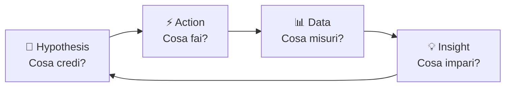

# HADI Cycles: Il Segreto della Crescita Rapida

> **Obiettivo:** Padroneggiare il ciclo Hypothesis-Action-Data-Insight per iterare rapidamente e scalare la crescita.

## 1. Il Framework HADI

Le aziende che crescono più velocemente non sono quelle con più budget, ma quelle che **iterano più rapidamente**. Il ciclo HADI struttura questo processo.



## 2. Come Scrivere Ipotesi Efficaci

Una buona ipotesi ha 3 componenti:

```python
hypothesis_template = {
    "if_we": "Aggiungiamo testimonianze sulla landing page",
    "then": "il conversion rate aumenterà del 15%",
    "because": "la social proof riduce l'ansia decisionale",
    "metric": "landing_page_conversion_rate",
    "target": 0.15,  # 15% lift relativo
    "timeline": "2 settimane",
    "confidence": 7,  # 1-10
}
```

### Template di Documentazione

| Campo | Esempio |
|:---|:---|
| **ID** | HADI-042 |
| **Ipotesi** | Se aggiungiamo un countdown al checkout, le conversioni aumenteranno del 10% |
| **Azione** | A/B test: checkout con/senza countdown |
| **Metrica primaria** | checkout_completion_rate |
| **Metrica guardrail** | refund_rate (non deve aumentare) |
| **Durata** | 14 giorni |
| **Sample size** | 5.000 utenti/gruppo |
| **Risultato** | +8.2% (p=0.03) ✅ |
| **Insight** | L'urgenza funziona, ma solo per ordini sotto 100 euro |
| **Next step** | Testare urgenza personalizzata per fascia di prezzo |

## 3. La Velocità di Iterazione

La metrica più importante per un growth team è il **numero di esperimenti a settimana**:

| Livello | Esperimenti/Settimana | Aziende |
|:---|:---:|:---|
| Beginner | 1-2 | Startup early-stage |
| Intermediate | 3-5 | Scale-up |
| Advanced | 10-20 | Booking.com, Netflix |
| Expert | 50+ | Google, Amazon |

```python
# Tracker degli esperimenti HADI
import json
from datetime import datetime

class HADITracker:
    def __init__(self):
        self.experiments = []
    
    def add(self, hypothesis: str, action: str, metric: str, target: float):
        self.experiments.append({
            "id": f"HADI-{len(self.experiments)+1:03d}",
            "created": datetime.now().isoformat(),
            "hypothesis": hypothesis,
            "action": action,
            "metric": metric,
            "target": target,
            "status": "backlog",
            "result": None,
            "insight": None
        })
    
    def close(self, exp_id: str, result: float, insight: str):
        for exp in self.experiments:
            if exp["id"] == exp_id:
                exp["status"] = "completed"
                exp["result"] = result
                exp["insight"] = insight
                exp["won"] = result >= exp["target"]
    
    def win_rate(self) -> float:
        completed = [e for e in self.experiments if e["status"] == "completed"]
        won = [e for e in completed if e.get("won")]
        return len(won) / len(completed) if completed else 0
```

## 4. Metriche del Growth Team

| Metrica | Descrizione | Target |
|:---|:---|:---|
| Velocity | Esperimenti lanciati/settimana | oltre 3 |
| Win Rate | % esperimenti con risultato positivo | 20-30% |
| Impact | Lift medio degli esperimenti vinti | oltre 5% |
| Learning Rate | Insight documentati/settimana | oltre 5 |

> **Nota:** Un win rate del 20-30% è normale e sano. Se vinci il 90% degli esperimenti, stai testando cose troppo ovvie.

## Risorse
- **Libro:** *Hacking Growth* — Sean Ellis
- **Tool:** GrowthHackers Northstar, Notion template HADI
