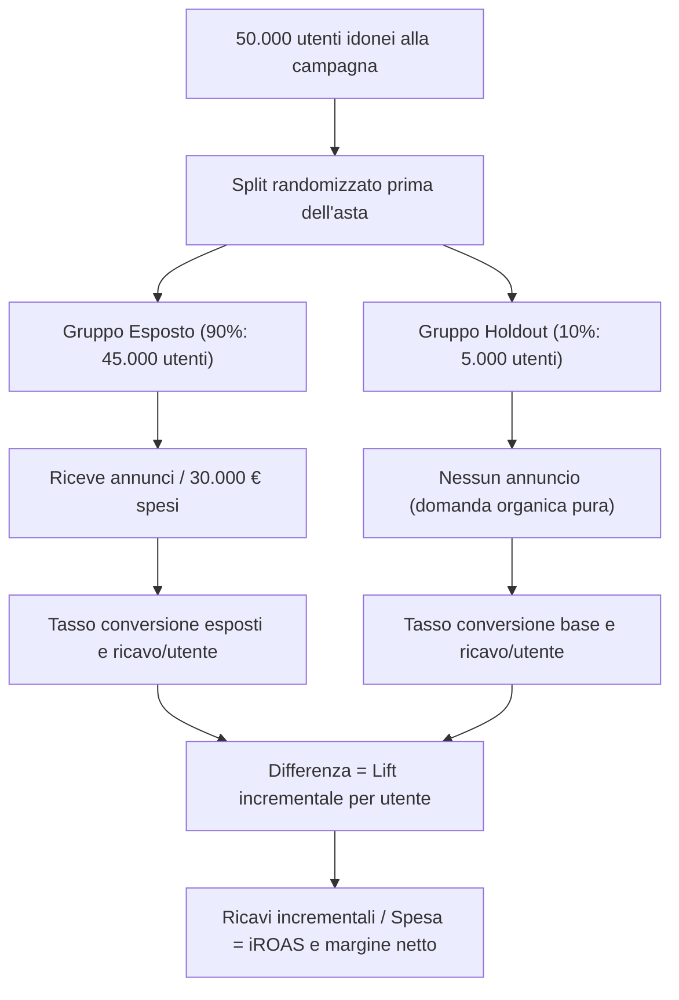

Un retailer omnicanale spende 30.000 € al mese in campagne search su parole chiave di brand e retargeting dinamico sui visitatori delle ultime 48 ore (scenario costruito con numeri di esempio). La piattaforma pubblicitaria attribuisce 180.000 € di vendite e riporta un `ROAS` apparente di `6,0x`, il più alto dell'intero media mix. Eppure, quando il controllo di gestione confronta i ricavi aziendali complessivi nei trimestri con spesa alta rispetto a quelli con spesa ridotta, il fatturato netto non si sposta. Il motivo è strutturale: gran parte di quelle vendite appartiene a clienti che avrebbero completato l'ordine comunque attraverso ricerca organica o accesso diretto.

> **Idea chiave:** L'attribuzione osservazionale misura quali canali hanno toccato il cliente prima dell'acquisto, mentre un test di incrementalità con holdout misura quante vendite sarebbero scomparse se quella campagna non fosse mai esistita.

## Il confine tra attribuzione e causalità reale

Un modello di attribuzione — sia esso `last-click`, lineare o data-driven — ripartisce una torta di conversioni già avvenute tra i punti di contatto registrati. Non risponde alla domanda finanziaria centrale per chi alloca budget: quanti ordini aggiuntivi ho generato rispetto al mondo controfattuale in cui non spendo quel denaro?

Senza un gruppo di controllo non esposto (`holdout`), gli algoritmi di bidding automatico ottimizzano verso la massima facilità di conversione. Questo spinge la spesa su utenti già pronti a comprare: visitatori ricorrenti, iscritti alla newsletter che aprono le promozioni e utenti che digitano il nome esatto dell'azienda sul motore di ricerca. Nel celebre studio su eBay pubblicato da Blake, Nosko e Tadelis nel 2015 su *Econometrica*, lo spegnimento sperimentale del `brand search` in regioni selezionate dimostrò che quasi tutto il traffico pagato su parole chiave di marca veniva immediatamente sostituito dai clic organici sottostanti, rendendo il ritorno marginale reale vicino allo zero o negativo.



## Disegni sperimentali per misurare l'incrementalità

Non tutte le campagne consentono la randomizzazione diretta del singolo utente. Quando i cookie si perdono tra dispositivi, quando la piattaforma pubblicitaria non espone il controllo `ghost ads` o quando l'effetto di rete coinvolge intere città, bisogna adattare il disegno sperimentale al vincolo tecnico.

| Disegno sperimentale | Unità di randomizzazione | Vantaggio principale | Rischio operativo tipico | Caso d'uso tipico |
|---|---|---|---|---|
| User-level holdout | Singolo utente o account CRM | Massimo potere statistico e granularità | Cross-device leakage e perdita cookie | Email, push, in-app, CRM, retargeting con ID |
| Ghost ads / PSA | Asta pubblicitaria della piattaforma | Stesso bias di selezione d'asta senza sprecare budget in annunci falsi | Dipendenza dai tool interni del vendor (Meta/Google) | Paid social e programmatic display su larga scala |
| Geo-lift (mercati abbinati) | CAP, province o DMA geografiche | Immune alla cancellazione dei cookie e cross-device | Bassa numerosità di aree e shock locali (meteo, eventi) | TV, radio, YouTube, Search, out-of-home |
| Switchback temporale | Finestre orarie o giornaliere | Riduce l'interferenza geografica su reti locali | Effetto carryover tra una finestra e la successiva | Food delivery, ride-hailing, promozioni flash |

La scelta tra `user-level holdout` e `geo-lift` dipende principalmente dall'identificabilità dell'utente. Nel CRM (email o notifiche) disponi dell'identificativo univoco e puoi isolare facilmente un 10% di controllo persistente; nei canali a pagamento ad asta chiusa dove il tracciamento individuale si frammenta, dividere la nazione in regioni trattate e regioni sintetiche di controllo (`synthetic control` alla Abadie) evita il problema dei cookie ma richiede serie storiche settimanali pulite per almeno 8-12 settimane pre-test.

## Derivazione completa di lift, iROAS e punto di pareggio sul margine

Riprendiamo la campagna da `30.000 €` citata all'inizio ed eseguiamo l'analisi causale completa su un esperimento holdout al 10% condotto per 28 giorni su `50.000 utenti` idonei (numeri di esempio).

Nel gruppo esposto (90% del campione) assegniamo $n_E = 45.000$ utenti, che producono `1.800` ordini con valore medio ordine ($\text{AOV}$) pari a `100 €` a fronte di una spesa pubblicitaria di `30.000 €`. Nel gruppo di holdout (10% del campione) isoliamo $n_H = 5.000$ utenti con zero spesa pubblicitaria, che generano comunque `155` ordini con lo stesso $\text{AOV} = 100$ €. Assumiamo infine un margine lordo aziendale medio sui prodotti venduti pari a $m = 45\%$ ($0{,}45$).

In primo luogo calcoliamo le metriche apparenti mostrate dalla dashboard pubblicitaria tradizionale. Il tasso di conversione del gruppo esposto vale $p_E = \frac{1.800}{45.000} = 0{,}0400$ ($4{,}00\%$), mentre i ricavi osservati raggiungono $R_E = 1.800 \times 100 = 180.000$ €, equivalenti a un ricavo per utente esposto di $r_E = \frac{180.000}{45.000} = 4{,}00$ €. Dividendo i ricavi attribuiti per la spesa otteniamo un $\text{ROAS}_{\text{apparente}} = \frac{180.000}{30.000} = 6{,}00\text{x}$.

In secondo luogo misuriamo la baseline organica grazie al gruppo di holdout. Senza alcun annuncio, i `5.000` utenti del controllo convertono al tasso $p_H = \frac{155}{5.000} = 0{,}0310$ ($3{,}10\%$), generando un ricavo medio per utente di $r_H = \frac{155 \times 100}{5.000} = 3{,}10$ €. Questo confronto rivela subito che il `77,5%` delle vendite registrate nel gruppo esposto ($\frac{3{,}10}{4{,}00}$) sarebbe accaduto comunque in forma organica.

In terzo luogo ricaviamo il lift causale, i ricavi incrementali e l'iROAS effettivo. La differenza assoluta sul tasso di conversione vale $\Delta p = p_E - p_H = 4{,}00\% - 3{,}10\% = +0{,}90$ punti percentuali (lift relativo del $\frac{0{,}90}{3{,}10} \approx +29{,}0\%$), che si traduce in un ricavo incrementale per utente trattato pari a $\Delta r = r_E - r_H = 4{,}00 - 3{,}10 = +0{,}90$ €/utente. Moltiplicando per i `45.000` utenti esposti otteniamo i ricavi realmente causati dalla campagna:

$$R_{\text{inc}} = \Delta r \times n_E = 0{,}90 \times 45.000 = 40.500\text{ €}$$

Rapportando questi ricavi aggiuntivi al budget speso di `30.000 €` si ricava l'incremental ROAS reale:

$$\text{iROAS} = \frac{R_{\text{inc}}}{\text{Spesa}} = \frac{40.500}{30.000} = 1{,}35\text{x}$$

Infine verifichiamo la profittabilità sul margine lordo aziendale. Con un margine $m = 45\%$, il punto di pareggio richiede $\text{iROAS}_{\text{break-even}} = \frac{1}{0{,}45} \approx 2{,}22\text{x}$. Il margine lordo generato dai ricavi incrementali ammonta a $40.500 \times 0{,}45 = 18.225$ €, e sottraendo i `30.000 €` di investimento pubblicitario il bilancio operativo netto risulta negativo:

$$\text{Profitto netto incrementale} = 18.225 - 30.000 = -11.775\text{ €}$$

Questa derivazione spiega perché un direttore finanziario e un media buyer possano leggere gli stessi dati e giungere a conclusioni opposte: la piattaforma segna `ROAS 6,00x` perché incamera `139.500 €` di vendite organiche attribuite al clic pubblicitario, ma l'azienda perde `11.775 €` netti ogni mese su quel segmento di spesa.

## Verifica dell'iROAS e dell'intervallo di confidenza in Python

Un esperimento di incrementalità deve sempre riportare l'intervallo di confidenza attorno al lift e all'`iROAS`: un risultato puntuale di `1,35x` con margine di errore $\pm 0{,}80\text{x}$ non permette decisioni nette, mentre un intervallo interamente sotto la soglia di pareggio giustifica il taglio immediato del budget. Lo script seguente calcola il lift sui ricavi, l'intervallo al 95% tramite distribuzione normale asintotica e il profitto netto rispetto al margine aziendale.

```python
import numpy as np
from scipy.stats import norm

def analisi_holdout(
    n_exp: int,
    conv_exp: int,
    n_hold: int,
    conv_hold: int,
    aov: float,
    spend: float,
    gross_margin: float,
    alpha: float = 0.05,
) -> dict:
    # Tassi osservati e differenza assoluta (lift in punti di conversione)
    p_exp = conv_exp / n_exp
    p_hold = conv_hold / n_hold
    lift_p = p_exp - p_hold

    # Errore standard e intervallo di confidenza sul lift di conversione
    se_p = np.sqrt((p_exp * (1 - p_exp) / n_exp) + (p_hold * (1 - p_hold) / n_hold))
    z_crit = norm.ppf(1 - alpha / 2)
    ci_low_p = lift_p - z_crit * se_p
    ci_high_p = lift_p + z_crit * se_p

    # Traduzione in ricavi, iROAS e margine netto incrementale
    inc_orders = lift_p * n_exp
    inc_revenue = inc_orders * aov
    apparent_roas = (conv_exp * aov) / spend
    iroas = inc_revenue / spend
    iroas_low = (ci_low_p * n_exp * aov) / spend
    iroas_high = (ci_high_p * n_exp * aov) / spend

    break_even_iroas = 1.0 / gross_margin
    net_profit = (inc_revenue * gross_margin) - spend

    risultati = {
        "apparent_roas": round(apparent_roas, 2),
        "lift_pp": round(lift_p * 100, 3),
        "inc_revenue": round(inc_revenue, 2),
        "iroas": round(iroas, 2),
        "iroas_ci95": (round(iroas_low, 2), round(iroas_high, 2)),
        "break_even_iroas": round(break_even_iroas, 2),
        "net_profit": round(net_profit, 2),
    }
    return risultati

res = analisi_holdout(
    n_exp=45_000, conv_exp=1_800,
    n_hold=5_000, conv_hold=155,
    aov=100.0, spend=30_000.0, gross_margin=0.45,
)
for chiave, valore in res.items():
    print(f"{chiave:<18}: {valore}")
```

Eseguendo la funzione sui numeri dell'esempio si verifica immediatamente che l'intervallo di confidenza al 95% dell'iROAS è `[0,58x; 2,12x]`: persino l'estremo superiore dell'intervallo resta al di sotto del break-even aziendale di `2,22x`. Questa prova statistica chiude ogni discussione qualitativa e rende oggettiva la decisione di ridurre drasticamente la spesa sul segmento testato.

## Calibrare i modelli MMM e pianificare la cadenza dei test

Un test di incrementalità non va visto come un evento isolato, ma come lo strumento di calibrazione periodica dell'intero sistema di allocazione. I modelli econometrici aggregati (`Marketing Mix Modeling`, MMM) catturano i trend macro e la saturazione di lungo periodo ma soffrono di collinearità tra canali che crescono insieme nello stesso periodo festivo. Inserire i risultati degli esperimenti di holdout e geo-lift come `prior` informativi bayesiani dentro il modello MMM ancora le curve di risposta alla verità causale osservata sul campo.

In pratica, conviene mantenere una cadenza trimestrale sui canali ad alta spesa: un test su una leva di acquisizione fredda (prospecting), una verifica periodica su retargeting e brand search dove il rischio di cannibalizzazione è massimo, e un gruppo di holdout permanente del 5%-10% sulle automazioni CRM di lifecycle per controllare che l'invio intensivo di promozioni non anticipi semplicemente ordini che sarebbero comunque arrivati a prezzo pieno la settimana successiva.

## Errori comuni nei test di incrementalità

### Contaminazione del gruppo di holdout (cross-device e overlapping audience)

Il sintomo è un lift artificialmente schiacciato verso zero anche su campagne chiaramente visibili, accompagnato da ordini registrati sul gruppo di controllo con codici promo riservati alla campagna. Succede quando lo split viene fatto sul cookie del browser ma l'utente riceve lo stesso annuncio su smartphone o tramite una campagna gemella non esclusa dalle regole di targeting. Per evitarlo, usa come chiave di randomizzazione l'identificativo cliente hashato (`user_id` o email normalizzata) sincronizzato con i sistemi di esclusione della piattaforma, oppure passa direttamente a un esperimento `geo-lift` basato su CAP o province fisicamente separate.

### Finestra di misurazione troppo corta rispetto al ciclo d'acquisto

Fermare un test dopo 7 giorni per un prodotto ad alta considerazione (arredamento, elettronica costosa, software B2B) dove il ciclo medio tra prima impressione e acquisto dura 25 giorni distorce il risultato. Il trattamento genera interesse che matura dopo la chiusura della finestra di osservazione o viene catturato in parte durante un eventuale periodo di raffreddamento. La regola operativa impone di mantenere il test attivo almeno per 2 cicli medi di acquisto e includere una finestra di osservazione post-esposizione (`cooldown window`) prima di estrarre il dato definitivo.

### Confondere iROAS medio del canale con iROAS marginale del prossimo euro

Un canale può mostrare un `iROAS` medio ottimo (`3,5x`) sui primi 20.000 € mensili spesi sulle parole chiave più pertinenti, ma scendere a `0,9x` sui successivi 20.000 € che comprano traffico generico ad alta concorrenza. Usare l'iROAS medio storico per approvare un raddoppio di budget porta dritto alla perdita di margine. Conviene eseguire esperimenti di incremento graduale (`step-up` o `step-down` test del $\pm 30\%$ di spesa in aree abbinate) per misurare l'efficienza dell'ultimo blocco di budget anziché del primo.

## Verifica applicativa sul campo

1. Un test holdout su una campagna di retargeting mostra un `ROAS apparente` di `8,0x` ma un `iROAS` di `1,6x`. Se il margine lordo aziendale sui prodotti venduti è del `50%`, la campagna sta generando profitto o perdita netta e perché?

<details>
<summary>Mostra risposta</summary>

Sta generando una perdita netta. Con margine lordo al `50%`, il punto di pareggio richiede un `iROAS` pari a $\frac{1}{0{,}50} = 2{,}0\text{x}$. Un `iROAS` di `1,6x` significa che per ogni `1,00 €` di spesa pubblicitaria entrano `1,60 €` di ricavi realmente incrementali, che producono solo `0,80 €` di margine lordo contro `1,00 €` speso in media, generando `-0,20 €` di perdita netta per ogni euro investito.

</details>

2. Nel worked example della lezione, l'azienda decide di mantenere comunque la campagna nonostante la perdita netta sul primo acquisto. Quale unica condizione finanziaria giustificherebbe razionalmente questa scelta?

<details>
<summary>Mostra risposta</summary>

Sarebbe razionale soltanto se i clienti acquisiti grazie a quell'incremento avessero un valore ricorrente futuro (`LTV` incrementale netto da riacquisti organici senza ulteriori costi pubblicitari) tale da colmare la perdita iniziale di `11.775 €` entro la finestra di payback accettata dall'azienda, condizione anch'essa da verificare seguendo le due coorti (esposti vs holdout) nei 6-12 mesi successivi.

</details>

3. Quando devi valutare l'impatto causale di una campagna YouTube regionale su un prodotto acquistabile sia online sia nei punti vendita fisici, perché il geo-lift supera lo split per utente?

<details>
<summary>Mostra risposta</summary>

Lo split per utente perde traccia di chi vede lo spot su una Smart TV condivisa in salotto e poi acquista sullo smartphone o in un negozio fisico senza login immediato. Il `geo-lift` confronta l'intero volume di vendite omnicanale (online più scontrini fisici) nelle città esposte rispetto a un gruppo di città gemelle non esposte, catturando l'effetto totale senza dipendere dai cookie o dal tracciamento individuale.

</details>

4. Che differenza operativa esiste tra un controllo classico basato su annunci di pubblica utilità (`PSA`) e i `ghost ads` usati nelle piattaforme pubblicitarie moderne?

<details>
<summary>Mostra risposta</summary>

Con i `PSA` paghi comunque impression reali per mostrare un annuncio neutro al gruppo di controllo, sostenendo un costo vivo e rischiando una leggera distorsione nei profili raggiunti perché la creatività neutra interagisce diversamente con l'algoritmo d'asta. I `ghost ads`, invece, simulano la partecipazione del tuo annuncio all'asta registrando quali utenti del controllo lo avrebbero vinto senza erogarlo né addebitare il costo dell'impression, riducendo spesa sprecata e bias di selezione algoritmica.

</details>
