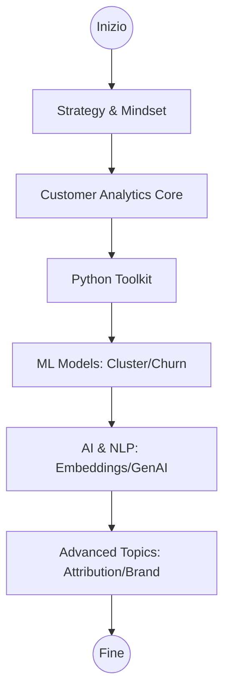

## Panoramica del Modulo

Il **Marketing Data Science** è la disciplina che trasforma i marketer in "scienziati della crescita". Non ci limitiamo a guardare cosa è successo (Analytics Descrittiva), ma usiamo algoritmi per capire cosa succederà (Predittiva) e cosa dovremmo fare (Prescrittiva).
In questo modulo avanzato, useremo Python e tecniche di Machine Learning per segmentare gli utenti (Clustering), prevedere il churn (Retention Modeling) e persino generare contenuti con l'AI (LLM/Text Generation).

## Obiettivi di Apprendimento

Al termine di questo modulo sarai in grado di:

- **Segmentare** la customer base in modo scientifico usando algoritmi di Clustering (K-Means).
- **Prevedere** il valore futuro di un cliente (LTV) e la probabilità di abbandono (Churn).
- **Utilizzare** Python per automatizzare analisi complesse impossibili con Excel.
- **Applicare** tecniche di NLP (Natural Language Processing) e Embeddings per analizzare testi e feedback.
- **Progettare** esperimenti rigorosi che vanno oltre il semplice A/B test.
- **Comprendere** i limiti delle metriche tradizionali (come l'NPS) e proporre alternative migliori.

## Prerequisiti

- Conoscenza base di Python (o forte volontà di impararlo).
- Basi di statistica (correlazione, significatività).
- Aver completato i moduli "Analisi Marketing" e "Metriche Fondamentali".

## Percorso delle Lezioni

| N° | Lezione | Argomento Principale | Durata | Difficoltà |
| :-- | :--- | :--- | :--- | :--- |
| 1 | **Strategy & Mindset** | Il ruolo del Data Scientist nel marketing | 30 min | ⭐⭐ |
| 2 | **User Centricity** | Mettere il cliente al centro dei dati | 35 min | ⭐ |
| 3 | **Analytic Traps** | Trappole logiche nell'interpretazione dati | 40 min | ⭐⭐ |
| 4 | **HADI Cycles** | Cicli di sperimentazione rapida (Hypothesis-Action-Data-Insight) | 45 min | ⭐⭐ |
| 5 | **Customer Analytics** | Analisi comportamentale avanzata | 50 min | ⭐⭐⭐ |
| 6 | **Retention Modeling** | Curve di ritenzione e analisi di sopravvivenza | 55 min | ⭐⭐⭐ |
| 7 | **Unit Economics** | CAC, LTV e sostenibilità del modello di business | 50 min | ⭐⭐⭐ |
| 8 | **Product Market Fit** | Misurare l'adesione del prodotto al mercato | 45 min | ⭐⭐ |
| 9 | **Trigger Analytics** | Identificare gli eventi che scatenano l'azione | 40 min | ⭐⭐⭐ |
| 10 | **Python for Marketing** | Librerie essenziali (Pandas, Scikit-learn) | 60 min | ⭐⭐⭐ |
| 11 | **Cluster Analysis** | Segmentazione non supervisionata (K-Means) | 60 min | ⭐⭐⭐ |
| 12 | **Embeddings & NLP** | Rappresentazione vettoriale del testo | 55 min | ⭐⭐⭐ |
| 13 | **Text Generation (GenAI)** | Usare gli LLM per creare copy e contenuti | 50 min | ⭐⭐⭐ |
| 14 | **Experimentation** | Design of Experiments (DoE) e inferenza causale | 60 min | ⭐⭐⭐ |
| 15 | **Attribution Modeling** | Modelli algoritmici (Markov, Shapley) | 55 min | ⭐⭐⭐ |
| 16 | **Brand Measurement** | Quantificare l'intangibile (Brand Equity) | 45 min | ⭐⭐ |
| 17 | **NPS Critique** | Perché il Net Promoter Score non basta | 30 min | ⭐⭐ |

## Competenze Acquisite

**Competenze Tecniche:**
- Scikit-learn per clustering e regressione.
- Utilizzo di API OpenAI/HuggingFace per task NLP.
- Manipolazione avanzata di DataFrame con Pandas.

**Competenze Strategiche:**
- Capacità di tradurre un problema di business ("I clienti se ne vanno") in un problema di Data Science ("Costruiamo un modello di Churn Prediction").
- Valutazione etica dell'uso dell'AI nel marketing.

## Tempo Stimato

- **Durata Totale:** Circa 12-14 ore.
- **Tempo Consigliato:** 4-6 settimane (è un modulo denso).

## Come Usare Questo Modulo

Questo è il modulo più avanzato del corso. Non scoraggiarti se la parte di codice (Python) sembra difficile all'inizio.
L'obiettivo non è diventare un ingegnere del software, ma capire **cosa è possibile fare**. Anche se non scriverai tu il codice di produzione, sapere come funziona un algoritmo di Clustering ti permetterà di chiedere le cose giuste al tuo team tecnico.
La lezione sugli **Embeddings** è la porta d'ingresso per capire la rivoluzione dell'AI Generativa: non saltarla.
