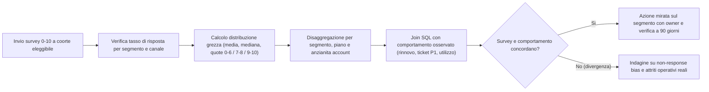

Considera uno scenario costruito su numeri di esempio realistici per un software B2B in abbonamento. Nel terzo trimestre il team Customer Experience presenta in comitato esecutivo un risultato celebrato: il **Net Promoter Score (NPS)** aziendale è salito da **+22** nel Q2 a **+28** nel Q3 su **1.000 risposte** raccolte. Tre settimane dopo, però, il report finanziario mostra che la ritenzione lorda a 90 giorni nel segmento `Mid-Market` (che genera il 65% dei ricavi ricorrenti) è scesa dal **91%** all'**84%**, mentre i ticket critici di priorità alta sono aumentati del 24%. La survey aveva restituito un falso positivo perché il peso dei rispondenti `SMB` entusiasti post-onboarding era cresciuto al 70% del campione totale, mentre gli amministratori `Mid-Market` insoddisfatti avevano smesso di aprire le email di sondaggio.

> **Idea chiave:** L'NPS aggregato nasconde la varianza tra segmenti, comprime undici punti di scala in tre etichette arbitrarie e misura un'intenzione dichiarata: senza tasso di copertura e ritenzione comportamentale osservata non può guidare alcuna decisione di prodotto.

## Origine e struttura del punteggio di Reichheld

Nel 2003 Fred Reichheld pubblicò sulla [Harvard Business Review](https://hbr.org/2003/12/the-one-number-you-need-to-grow) l'articolo *"The One Number You Need to Grow"*, proponendo una singola domanda di raccomandazione su scala da `0` a `10` ("Con quale probabilità consiglieresti l'azienda a un amico o collega?"). I rispondenti vengono classificati in tre fasce fisse: **Detrattori** (`0–6`), **Passivi** (`7–8`) e **Promotori** (`9–10`). Il punteggio finale è una differenza di quote compresa tra `-100` e `+100`: `NPS = (% Promotori - % Detrattori) * 100`.

Il successo manageriale della metrica deriva dalla sua estrema sintesi: trasforma migliaia di opinioni in un intero unico leggibile in dieci secondi. Tuttavia, nel lavoro analitico del binario **ml-tabellare**, ogni compressione estrema paga un prezzo informativo pesante. Ridurre undici livelli ordinali in tre categorie asimmetriche (sette valori finiscono in `Detrattori`, due in `Passivi`, due in `Promotori`) e poi scartare completamente i `Passivi` dal calcolo finale distrugge l'informazione sulla forma della distribuzione, rendendo il numero vulnerabile a spostamenti minimi vicino alle soglie `6/7` e `8/9` mentre resta cieco a movimenti enormi all'interno delle fasce.



Il diagramma stabilisce una regola di igiene analitica: nessuna lettura di survey termina al calcolo della differenza tra Promotori e Detrattori. Prima si verifica chi non ha risposto, poi si separa la popolazione per segmento di valore economico, infine si confronta ciò che il cliente **dichiara** nel questionario con ciò che il cliente **fa** nella piattaforma o nei rinnovi contrattuali.

## Tre distorsioni matematiche che deformano il segnale

Quando utilizzi l'NPS come metrica di guida senza affiancare la distribuzione completa e il comportamento osservato, vai incontro a tre patologie strutturali documentate nella letteratura psicometrica e di customer analytics.

La prima distorsione è la **compressione asimmetrica della scala**: un cliente che passa da voto `1` a voto `6` ha cambiato drasticamente la propria valutazione del servizio (`+5 punti` reali sulla scala `0–10`), ma per l'NPS resta identicamente un Detrattore (`0 punti` di variazione). Al contrario, un gruppo di clienti soddisfatti che scivola da `9` a `8` (`-1 punto` reale) passa da Promotore a Passivo facendo crollare l'NPS. La metrica amplifica il rumore sulle soglie alte e cancella i progressi tra gli utenti recuperati dall'insoddisfazione grave.

La seconda distorsione è il **paradosso di Simpson da cambio di mix**: la media aggregata può salire anche se ogni singolo segmento peggiora o resta fermo, semplicemente perché cambia la quota di risposte provenienti dai segmenti più ottimisti. Come mostrato nel caso d'apertura, se gli utenti nuovi rispondono di più dopo l'onboarding rispetto agli utenti maturi frustrati da un bug ricorrente, il punteggio globale sale mentre il fatturato rischia di erodersi.

La terza distorsione è il **non-response bias (distorsione da mancata risposta)** combinato all'effetto canale. Se il tasso di risposta è del `14%`, l'86% della base clienti resta invisibile. Nelle piattaforme digitali chi abbandona silenziosamente raramente compila survey lunghe o email di feedback; al contrario, i team che inviano il sondaggio subito dopo un'interazione positiva del supporto tecnico ottengono un campione sistematicamente distorto verso i Promotori.

| Scenario osservato | Variazione sui voti grezzi (0–10) | Effetto sull'NPS aggregato | Diagnosi corretta |
|---|---|---|---|
| **Recupero tra scontenti** | Media fascia bassa da `1,5` a `5,5` | `0` punti (restano tutti `0–6`) | Miglioramento sostanziale reso invisibile dalla soglia `6/7` |
| **Oscillazione lieve in alto** | Quota di voti `9` scende a `8` (`-1 punto`) | Crollo fino a `-10` o `-20` punti | Sensibilità eccessiva al confine tra `Passivi` e `Promotori` |
| **Cambio di mix rispondenti** | Segmenti invariati, più risposte `SMB` | Salita apparente (`+6` o `+8` punti) | Artefatto di composizione (paradosso di Simpson), nessun miglioramento |
| **Silenzio degli scontenti** | Calo risposte nel segmento `Enterprise` | Salita apparente dell'NPS totale | Segnale di non-response bias da incrociare con rinnovo e ticket |

## Dimostrazione numerica: il paradosso di mix e la soglia cieca

Costruiamo un **worked example numerico completo** sui dati dello scenario Q2 contro Q3 per dimostrare esattamente come un aumento apparente di **9 punti NPS** possa nascere dal nulla su **1.000 clienti intervistati**, e come la compressione nasconda movimenti opposti nei segmenti.

Nel trimestre **Q2** raccogliamo feedback da **1.000 clienti** equamente divisi tra i due segmenti principali. Nel segmento `SMB` (**500 clienti**), contiamo `300` Promotori (`60%`), `100` Passivi (`20%`) e `100` Detrattori (`20%`), quindi l'NPS del segmento vale `60 - 20 = +40`. Nel segmento `Mid-Market` (**500 clienti**), invece, contiamo `150` Promotori (`30%`), `200` Passivi (`40%`) e `150` Detrattori (`30%`), con un NPS pari a `30 - 30 = 0`. Sommando i due gruppi su tutti i `1.000 clienti` del Q2 otteniamo `450` Promotori (`45%`) e `250` Detrattori (`25%`), da cui deriva un **NPS aggregato Q2 di `+20`**.

Nel trimestre **Q3** il prodotto peggiora leggermente per i clienti `Mid-Market`, dove l'NPS scende da `0` a **`-4`**, mentre nel segmento `SMB` resta fermo a **`+40`**. Contemporaneamente, però, una nuova email automatica post-onboarding raccoglie molte più risposte tra i nuovi `SMB`, spostando la composizione dei **1.000 clienti** rispondenti a **750 clienti `SMB`** (`75%`) e **250 clienti `Mid-Market`** (`25%`).

Ricalcoliamo i conti del **Q3**. Nel gruppo `SMB` (`750 clienti`, NPS invariato a `+40`) abbiamo `450` Promotori (`60%`), `150` Passivi (`20%`) e `150` Detrattori (`20%`). Nel gruppo `Mid-Market` (`250 clienti`, NPS peggiorato a `-4`) contiamo `70` Promotori (`28%`), `100` Passivi (`40%`) e `80` Detrattori (`32%`), perché `28 - 32 = -4`. Sommando su tutti i `1.000 clienti` del Q3 arriviamo a `450 + 70 = 520` Promotori (`52,0%`) e `150 + 80 = 230` Detrattori (`23,0%`), che producono un **NPS aggregato Q3 di `+29`** (`52,0 - 23,0`).

| Periodo | `SMB` (clienti e NPS) | `Mid-Market` (clienti e NPS) | Promotori totali | Detrattori totali | NPS aggregato risultante |
|---|---|---|---:|---:|---:|
| **Q2 (`N = 1.000`)** | `500` clienti (`50%`) — NPS **`+40`** | `500` clienti (`50%`) — NPS **`0`** | `450` (`45,0%`) | `250` (`25,0%`) | **`+20`** |
| **Q3 (`N = 1.000`)** | `750` clienti (`75%`) — NPS **`+40`** | `250` clienti (`25%`) — NPS **`-4`** | `520` (`52,0%`) | `230` (`23,0%`) | **`+29`** |
| **Variazione Q3 - Q2** | `0 punti` reali | **`-4 punti` reali** | `+7,0 pp` | `-2,0 pp` | **`+9 punti` apparenti** |

Guardando solo la colonna finale, il punteggio aziendale balza da **`+20` a `+29`** (`+9 punti`), eppure nessuno dei due segmenti è migliorato e il segmento strategicamente più grande (`Mid-Market`) è sceso di 4 punti netti perdendo metà della propria rappresentanza nel sondaggio.

Vediamo anche il secondo effetto aritmetico sulla stessa base di `1.000 utenti`: se `100` Detrattori passassero da voto `2` a voto `6`, la media grezza salirebbe di `100 * 4 / 1.000 = +0,40 punti`, ma i Promotori resterebbero `520` e i Detrattori `230`, lasciando l'NPS fermo a `+29`. Se invece `80` Promotori passassero da voto `9` a voto `8` (appena `-0,08 punti` sulla media generale), i Promotori scenderebbero da `520` a `440` (`44,0%`) e l'NPS crollerebbe di **`8 punti`** da `+29` a `+21`. La media aritmetica accompagnata dalla deviazione standard o dalla quota di voti `0–6` cattura entrambi i fenomeni con fedeltà superiore.

## Scegliere la metrica giusta tra NPS, CSAT, CES e comportamento

Invece di cercare un numero unico universale, conviene combinare segnali percettivi mirati con le metriche comportamentali estratte dal database transazionale. La matrice seguente orienta la scelta in funzione della domanda decisionale da risolvere.

| Segnale | Scala e cosa misura davvero | Punto di forza operativo | Limite principale | Quando usarlo |
|---|---|---|---|---|
| **`NPS` segmentato** | `0–10` (consiglio complessivo) | Utile per confronti macro nel tempo a parità di coorte e mix | Compressione asimmetrica e vulnerabilità al non-response bias | Monitoraggio trimestrale per segmento con pesi fissi di mix |
| **`CSAT` transazionale** | `1–5` (soddisfazione su singolo evento) | Reazione immediata e chiara su supporto, consegna o onboarding | Misura l'ultimo episodio, non la fedeltà contrattuale | Subito dopo chiusura ticket, consegna ordine o call di setup |
| **`CES` (*Customer Effort Score*)** | `1–7` (fatica percepita nel compito) | Altissima correlazione con l'abbandono per attriti di prodotto e UX | Non cattura il valore percepito né il posizionamento di prezzo | Dopo flussi complessi: checkout, fatturazione, integrazione API |
| **Comportamento osservato** | Rinnovo, `MRR` expansion, ticket P1, DAU/MAU | Nessuna distorsione da dichiarazione soggettiva o survey fatigue | Segnale talvolta tardivo (il mancato rinnovo arriva a fine ciclo) | Sempre, come verifica finale e ancoraggio di ogni metrica percettiva |

Una buona pratica nei prodotti B2B e nei servizi in abbonamento consiste nell'usare il **CES** sui flussi critici (ad esempio configurazione iniziale o reso), il **CSAT** sulla qualità dell'assistenza umana, e l'**NPS disaggregato** solo come indice storico confrontato sempre con la **ritenzione effettiva a 90 giorni**.

## Query SQL per incrociare survey per segmento, copertura e ritenzione

Per impedire che un team legga l'NPS isolato dalle metriche reali, la query seguente costruisce una vista unica per segmento che unisce invii totali della survey, tasso di risposta, media grezza `0–10`, quota Promotori/Detrattori, punteggio NPS netto, densità di ticket critici e ritenzione osservata a 90 giorni dalla data di invio della survey.

```sql
-- Confronto integrato per segmento: copertura survey, distribuzione voti, NPS e ritenzione osservata a 90 giorni
WITH coorte_survey AS (
    SELECT
        s.account_id,
        a.segmento,
        s.invited_at,
        s.responded_at,
        s.score_0_10
    FROM survey_invitations AS s
    INNER JOIN accounts AS a
        ON s.account_id = a.account_id
    WHERE s.invited_at >= DATE '2026-07-01'
      AND s.invited_at < DATE '2026-10-01'
),
ritenzione_90g AS (
    SELECT
        c.account_id,
        -- Un account e trattenuto se risulta attivo o rinnova tra il giorno 80 e il giorno 100 post-invio
        MAX(
            CASE
                WHEN e.event_date >= c.invited_at + INTERVAL '80 days'
                 AND e.event_date <= c.invited_at + INTERVAL '100 days'
                THEN 1 ELSE 0
            END
        ) AS retained_90d,
        COUNT(DISTINCT t.ticket_id) AS critical_tickets_90d
    FROM coorte_survey AS c
    LEFT JOIN product_usage_events AS e
        ON c.account_id = e.account_id
       AND e.event_date >= c.invited_at
       AND e.event_date <= c.invited_at + INTERVAL '100 days'
    LEFT JOIN support_tickets AS t
        ON c.account_id = t.account_id
       AND t.priority = 'P1'
       AND t.created_at >= c.invited_at
       AND t.created_at <= c.invited_at + INTERVAL '90 days'
    GROUP BY c.account_id
)
SELECT
    c.segmento,
    COUNT(*) AS account_invitati,
    COUNT(c.score_0_10) AS rispondenti,
    ROUND(COUNT(c.score_0_10) * 100.0 / NULLIF(COUNT(*), 0), 1) AS tasso_risposta_pct,
    ROUND(AVG(c.score_0_10), 2) AS media_grezza_0_10,
    ROUND(
        (SUM(CASE WHEN c.score_0_10 >= 9 THEN 1 ELSE 0 END)
       - SUM(CASE WHEN c.score_0_10 <= 6 THEN 1 ELSE 0 END)) * 100.0
        / NULLIF(COUNT(c.score_0_10), 0),
        1
    ) AS nps_segmento,
    ROUND(AVG(r.retained_90d) * 100.0, 1) AS retention_90d_osservata_pct,
    ROUND(AVG(r.critical_tickets_90d), 2) AS ticket_p1_medi_per_account
FROM coorte_survey AS c
INNER JOIN ritenzione_90g AS r
    ON c.account_id = r.account_id
GROUP BY c.segmento
ORDER BY account_invitati DESC;
```

Osserva che questa query risolve tre fallacie in un solo passaggio: riporta sempre `tasso_risposta_pct` per smascherare i segmenti silenziosi, affianca `media_grezza_0_10` a `nps_segmento` per neutralizzare la compressione a soglia, e lega entrambi a `retention_90d_osservata_pct` sull'intera coorte invitata (compresi i non rispondenti) invece che sui soli compilatori del questionario.

## Errori comuni nella lettura delle metriche di soddisfazione

### Presentare il punteggio aggregato senza pesi costanti o tasso di risposta

Portare in riunione un `+29` globale senza indicare quante persone hanno risposto per ciascun segmento trasforma un cambiamento di composizione del campione in una falsa vittoria di prodotto. Se vuoi seguire un trend storico corretto, calcola l'NPS con **pesi di segmento fissati alla baseline** (standardizzazione diretta per mix di ricavi o account attivi) oltre al punteggio grezzo di ogni segmento.

### Legare i bonus di team o di assistenza al singolo voto NPS

Applicare la legge di Goodhart all'NPS — cioè trasformare il punteggio in obiettivo diretto di premio per agenti di supporto o account manager — induce comportamenti distorsivi immediati: i team invitano a rispondere solo i clienti più soddisfatti, sollecitano verbalmente il voto "9 o 10" prima di inviare il link oppure chiudono i ticket critici senza risolverli pur di evitare l'invio della survey automatica. I KPI operativi legati ai compensi vanno ancorati a tempi di risoluzione reali, recidiva dei ticket e tasso di rinnovo.

### Usare la survey per prevedere il churn individuale al posto dei dati d'uso

Anche quando il cliente risponde sinceramente, una survey compilata una volta a trimestre registra lo stato d'animo di un istante passato e copre una minoranza degli utenti. Per intercettare il rischio di abbandono in tempo utile servono segnali continui di comportamento (calo degli accessi settimanali, riduzione delle licenze attive, aumento degli errori in API o fatture insolute), usando i commenti testuali della survey solo per classificare le cause qualitative dell'attrito.

## Verifica sulle metriche di soddisfazione oltre l'NPS

1. Nel confronto trimestrale tra Q2 e Q3 visto nel worked example, come è stato possibile che l'NPS aziendale salisse da `+20` a `+29` mentre il segmento `Mid-Market` peggiorava da `0` a `-4`?

<details>
<summary>Mostra risposta</summary>

Si tratta di un caso classico di paradosso di Simpson dovuto al cambio di composizione del campione rispondente. Nel Q2 i rispondenti erano divisi al 50% tra `SMB` (NPS +40) e `Mid-Market` (NPS 0), producendo una media ponderata di +20. Nel Q3 il peso del segmento `SMB` è salito al 75% delle risposte mentre il `Mid-Market` è sceso al 25%: la sovra-rappresentazione del gruppo con punteggio alto ha spinto la media aggregata a +29 nonostante la flessione reale del segmento `Mid-Market`.

</details>

2. Quale distorsione introduce la soglia rigida tra voto `6` (Detrattore), `7–8` (Passivo) e `9–10` (Promotore) quando analizzi una serie storica?

<details>
<summary>Mostra risposta</summary>

La compressione in tre fasce rende l'NPS cieco a qualsiasi miglioramento interno alla fascia dei Detrattori (ad esempio un recupero da 1,5 a 5,5 lascia il punteggio identico) e amplifica in modo sproporzionato le micro-variazioni attorno al confine 8/9, dove il passaggio da 9 a 8 cancella completamente il contributo positivo di quel rispondente dal numeratore. Per questo motivo la media grezza `0–10` e la quota di ciascuna fascia vanno sempre riportate accanto al punteggio sintetico.

</details>

3. Quando ha senso sostituire o affiancare il `CES` (*Customer Effort Score*) rispetto a una domanda generica di NPS?

<details>
<summary>Mostra risposta</summary>

Il CES va preferito quando la decisione riguarda la riduzione dell'attrito operativo in uno specifico flusso di prodotto o di assistenza, come l'onboarding iniziale, il pagamento in checkout o la procedura di reso. A differenza dell'NPS, che mescola brand, prezzo e relazione complessiva, il CES isola lo sforzo percepito nel completare quell'attività precisa e indica direttamente al team prodotto o UX dove intervenire.

</details>

4. Perché nella query SQL di verifica la ritenzione a 90 giorni va calcolata su tutta la coorte `account_invitati` e non soltanto su chi ha compilato la survey?

<details>
<summary>Mostra risposta</summary>

Calcolare la ritenzione solo sui rispondenti esclude proprio la fascia degli utenti silenziosi o disimpegnati che spesso presenta il tasso di abbandono più alto (non-response bias). Misurare la ritenzione osservata e i ticket critici P1 sull'intera coorte invitata permette di confrontare il comportamento di chi risponde con quello di chi ignora il questionario e di capire se l'NPS stia sovrastimando la salute reale del segmento.

</details>
