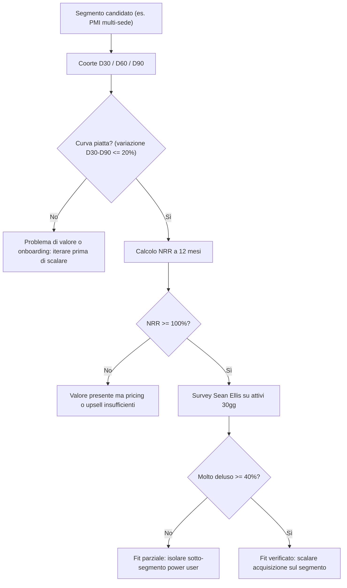

## Il falso positivo della crescita aggregata

Immagina di guidare i dati di un software B2B per la gestione dei turni chiamato TurnoChiaro, in uno scenario costruito con numeri di esempio. Il cruscotto aziendale mostra 12.000 account registrati, 180.000 euro di ricavo ricorrente mensile (`MRR`) e un tasso di crescita netto del 3% al mese. A prima vista la traiettoria sembra sana, ma il conto economico racconta una tensione diversa: per mantenere quel 3% di crescita netta, la spesa in acquisizione a pagamento è dovuta salire del 40% in due trimestri.

Quando scomponi la base clienti invece di leggere la media globale, il quadro si spacca in due realtà incompatibili. Le catene retail con almeno cinque punti vendita mantengono il prodotto aperto ogni settimana, espandono le licenze al crescere dei negozi e registrano un `Net Revenue Retention` superiore al 110%. I piccoli esercizi mono-sede, acquisiti con le stesse campagne social, abbandonano il software entro novanta giorni dal primo accesso. Dichiarare che l'azienda "ha raggiunto il product-market fit" o che "non ce l'ha ancora" porta in entrambi i casi alla decisione sbagliata: scalare il budget su un pubblico che brucia cassa oppure riscrivere un prodotto che per un segmento preciso funziona già.

> **Idea chiave:** Il product-market fit non è un attributo globale del prodotto, ma una proprietà relazionale tra una specifica proposta di valore e un segmento omogeneo di clienti che la dimostra con uso ricorrente e spesa netta crescente.

Trattare il fit come una diagnosi segmentata cambia il ruolo dell'analista. Il compito non consiste nel cercare un numero magico che rassicuri il management, ma nel separare il segnale dal rumore: identificare quale fetta di mercato trattiene valore nel tempo, verificare se l'espansione economica compensa l'abbandono naturale e capire dove il modello di acquisizione sta portando utenti fuori bersaglio.

## Come i segnali comportamentali ed economici convergono sul fit

Nessuna metrica isolata è sufficiente per certificare il fit di un segmento. Una survey ottimista senza uso reale misura soltanto l'entusiasmo iniziale degli intervistati; una retention alta sostenuta da contratti annuali vincolati o da sconti aggressivi maschera una debolezza di prodotto destinata a esplodere al rinnovo. Per formulare un verdetto robusto conviene combinare quattro famiglie di segnali secondo una gerarchia precisa: prima i comportamenti osservati, poi i flussi di cassa ricorrenti, infine la percezione dichiarata e la spinta organica.



Il diagramma chiarisce perché la sequenza non è intercambiabile. Iniziare dalla survey di Sean Ellis prima di aver controllato la curva di retention espone al rischio di ascoltare utenti appena registrati che non hanno ancora incontrato i limiti del prodotto. Iniziare dalla quota di traffico organico senza controllare l'`NRR` confonde la notorietà di marca o la viralità temporanea con un modello economico sostenibile.

| Metrica | Soglia operativa di fit | Finestra di osservazione | Fonte dati primaria | Limite se letta da sola |
| --- | --- | --- | --- | --- |
| Appiattimento curva `retention` | Variazione relativa tra D30 e D90 inferiore al 20% | Coorti mensili seguite per 3–6 mesi | Eventi di uso core (`product_events`) | Non distingue utenti attivi che non pagano |
| `Net Revenue Retention` (`NRR`) | Pari o superiore al 100% (espansione >= churn + contrazione) | 12 mesi mobili dalla coorte di partenza | Fatturazione e contratti (`invoices`) | Contratti annuali ritardano il segnale di abbandono |
| Test di Sean Ellis | Almeno il 40% di risposte "molto deluso" | Survey trimestrale su utenti attivi | Risposte in-app legate a `user_id` | Soggetto a distorsione di selezione e campionamento |
| Quota acquisizione organica | Oltre il 40% dei nuovi attivati senza spesa paid diretta | Trend mensile per canale di primo contatto | Tracking attribuzione e referral | Dipende da cicli PR o stagionalità temporanea |
| Progressione inter-coorte | Coorte $t+1$ superiore alla coorte $t$ a parità di età | Confronto trimestrale delle matrici | Matrice di coorte normalizzata | Sensibile a cambi nel mix di canali acquisitivi |

La priorità rimane sempre sul binomio formato da curva comportamentale piatta ed espansione dei ricavi. Quando uso settimanale e fatturato netto della coorte reggono senza nuovi incentivi, hai davanti una prova empirica solida; quando le opinioni sono brillanti ma il consumo crolla alla settimana sei, l'evidenza comportamentale prevale sempre sul questionario.

## Analisi per coorti: calcolo della retention piatta e dell'NRR su un caso numerico

Per vedere come una media aggregata nasconda il fit reale, seguiamo un esempio numerico completo su una coorte ricostruita (numeri di esempio). Nel primo trimestre dell'anno, un prodotto SaaS acquisisce 500 nuovi clienti paganti distribuiti su due segmenti: 200 aziende `PMI retail` con abbonamento medio iniziale di 150 euro al mese, e 300 `micro-attività` mono-sede con abbonamento medio iniziale di 40 euro al mese.

Il ricavo ricorrente iniziale della coorte si ottiene sommando i due segmenti:

- Ricavo iniziale `PMI retail` = $200 \text{ clienti} \times 150\text{ euro} = 30.000\text{ euro}$.
- Ricavo iniziale `micro-attività` = $300 \text{ clienti} \times 40\text{ euro} = 12.000\text{ euro}$.
- Ricavo iniziale aggregato = $30.000 + 12.000 = 42.000\text{ euro}$.

Osserviamo ora l'evoluzione comportamentale dei due gruppi a 30, 60 e 90 giorni sul consumo dell'azione core (almeno una chiusura turni completata nella settimana). Nel segmento `PMI retail`, su 200 clienti iniziali restano attivi 180 clienti a 30 giorni (`retention` = $180 / 200 = 90\%$), 174 clienti a 60 giorni ($174 / 200 = 87\%$) e 172 clienti a 90 giorni ($172 / 200 = 86\%$). La variazione relativa tra D30 e D90 è $(90 - 86) / 90 = 4,4\%$, ben al di sotto del 20%: la curva ha trovato un pavimento stabile. Nel segmento `micro-attività`, su 300 clienti restano attivi 150 a 30 giorni (50%), 108 a 60 giorni (36%) e 84 a 90 giorni (28%). Qui tra D30 e D90 l'emorragia continua con un calo relativo del $(50 - 28) / 50 = 44\%$, segno che la curva continua a scendere verso zero.

Passiamo alla verifica economica a dodici mesi calcolando l'`NRR` esatto della stessa coorte di partenza, secondo la definizione standard:

$$\text{NRR}_{12m} = \frac{\text{MRR}_{\text{iniziale}} - \text{MRR}_{\text{churn}} - \text{MRR}_{\text{contrazione}} + \text{MRR}_{\text{espansione}}}{\text{MRR}_{\text{iniziale}}}$$

Nel segmento `PMI retail`, a fine anno risultano persi 30 clienti rispetto ai 200 iniziali (churn = $-30 \times 150 = -4.500\text{ euro}$). Dei 170 clienti rimasti attivi, 10 riducono il piano passando da 150 a 100 euro (contrazione = $-10 \times 50 = -500\text{ euro}$), mentre 90 clienti aggiungono nuovi punti vendita passando da 150 a 240 euro (espansione = $+90 \times 90 = +8.100\text{ euro}$). Calcoliamo l'`MRR` finale del segmento:

$$\text{MRR}_{12m,\text{ PMI}} = 30.000 - 4.500 - 500 + 8.100 = 33.100\text{ euro}$$

Dividendo per il punto di partenza otteniamo $\text{NRR}_{\text{PMI}} = 33.100 / 30.000 = 110,3\%$. Nonostante i 30 abbandoni, la coorte di partenza genera oggi il 10,3% di ricavi ricorrenti in più rispetto al giorno di ingresso senza alcun apporto di nuovi clienti.

Nel segmento `micro-attività`, dopo dodici mesi restano solo 90 clienti su 300: 210 clienti hanno cancellato (churn = $-210 \times 40 = -8.400\text{ euro}$), nessun cliente ha ridotto il piano e appena 10 clienti hanno aggiunto utenti per 40 euro extra ciascuno (espansione = $+400\text{ euro}$). L'`MRR` finale diventa $12.000 - 8.400 + 400 = 4.000\text{ euro}$, pari a un $\text{NRR}_{\text{micro}} = 4.000 / 12.000 = 33,3\%$.

Guardiamo infine il numero che finirebbe sul cruscotto aziendale se nessuno avesse separato i segmenti: l'`MRR` totale a 12 mesi è $33.100 + 4.000 = 37.100\text{ euro}$ su $42.000\text{ euro}$ iniziali, quindi $\text{NRR}_{\text{aggregato}} = 37.100 / 42.000 = 88,3\%$. Un analista che si fermasse all'88,3% concluderebbe che il prodotto non ha fit e proporrebbe una revisione completa del software. In realtà il prodotto ha un fit netto sulle `PMI retail` (retention piatta all'86% e NRR al 110,3%), ma il marketing sta diluendo capitale e capacità di supporto acquistando `micro-attività` strutturalmente incompatibili.

## Query SQL e pipeline Python per la matrice di coorte e il test di Sean Ellis

Tradurre questa analisi in codice riproducibile richiede attenzione al denominatore e alla finestra temporale. Un errore ricorrente nei calcoli di coorte nasce dal contare l'`MRR` iniziale solo sui clienti ancora presenti al mese dodici, oppure dal mescolare clienti entrati in mesi diversi dentro la stessa percentuale. La query SQL seguente calcola per ciascun segmento e coorte di ingresso sia la retention relativa ai periodi chiave sia il `Net Revenue Retention` esatto a dodici mesi sullo stesso perimetro iniziale.

```sql
-- Calcolo segmentato di Retention D30/D60/D90 e NRR a 12 mesi per coorte di ingresso
WITH customer_monthly_mrr AS (
    -- Aggrega le fatture per cliente e mese solare troncato al primo giorno del mese
    SELECT
        c.customer_id,
        c.segment,
        DATE_TRUNC('month', i.billing_month)::DATE AS mrr_month,
        SUM(i.net_mrr_eur) AS mrr_eur
    FROM customers AS c
    INNER JOIN invoices AS i
        ON c.customer_id = i.customer_id
    WHERE i.net_mrr_eur > 0
    GROUP BY c.customer_id, c.segment, DATE_TRUNC('month', i.billing_month)::DATE
),
cohort_base AS (
    -- Fissa il mese di partenza e il MRR iniziale di ogni cliente pagante
    SELECT
        customer_id,
        segment,
        MIN(mrr_month) AS cohort_month
    FROM customer_monthly_mrr
    GROUP BY customer_id, segment
),
cohort_enriched AS (
    -- Unisce il mese 0 con i mesi successivi sullo stesso denominatore di coorte
    SELECT
        cb.segment,
        cb.cohort_month,
        cb.customer_id,
        m0.mrr_eur AS start_mrr,
        COALESCE(m1.mrr_eur, 0) AS mrr_m1,
        COALESCE(m2.mrr_eur, 0) AS mrr_m2,
        COALESCE(m3.mrr_eur, 0) AS mrr_m3,
        COALESCE(m12.mrr_eur, 0) AS mrr_m12
    FROM cohort_base AS cb
    INNER JOIN customer_monthly_mrr AS m0
        ON cb.customer_id = m0.customer_id AND m0.mrr_month = cb.cohort_month
    LEFT JOIN customer_monthly_mrr AS m1
        ON cb.customer_id = m1.customer_id AND m1.mrr_month = cb.cohort_month + INTERVAL '1 month'
    LEFT JOIN customer_monthly_mrr AS m2
        ON cb.customer_id = m2.customer_id AND m2.mrr_month = cb.cohort_month + INTERVAL '2 months'
    LEFT JOIN customer_monthly_mrr AS m3
        ON cb.customer_id = m3.customer_id AND m3.mrr_month = cb.cohort_month + INTERVAL '3 months'
    LEFT JOIN customer_monthly_mrr AS m12
        ON cb.customer_id = m12.customer_id AND m12.mrr_month = cb.cohort_month + INTERVAL '12 months'
)
SELECT
    segment,
    cohort_month,
    COUNT(*) AS cohort_customers,
    ROUND(100.0 * COUNT(*) FILTER (WHERE mrr_m1 > 0) / COUNT(*), 1) AS ret_m1_pct,
    ROUND(100.0 * COUNT(*) FILTER (WHERE mrr_m2 > 0) / COUNT(*), 1) AS ret_m2_pct,
    ROUND(100.0 * COUNT(*) FILTER (WHERE mrr_m3 > 0) / COUNT(*), 1) AS ret_m3_pct,
    SUM(start_mrr) AS starting_mrr_eur,
    SUM(mrr_m12) AS ending_mrr_12m_eur,
    ROUND(100.0 * SUM(mrr_m12) / NULLIF(SUM(start_mrr), 0), 1) AS nrr_12m_pct
FROM cohort_enriched
WHERE cohort_month <= DATE_TRUNC('month', CURRENT_DATE)::DATE - INTERVAL '12 months'
GROUP BY segment, cohort_month
ORDER BY cohort_month DESC, segment;
```

Il filtro finale `cohort_month <= ... - INTERVAL '12 months'` evita uno degli errori più subdoli nelle analisi di coorte: includere coorti recenti che non hanno ancora maturato dodici mesi di vita, scambiando un dato incompleto per un crollo dell'`NRR` a zero.

Accanto ai dati di fatturazione, il test qualitativo-quantitativo ideato da Sean Ellis pone una domanda unica agli utenti che hanno sperimentato il valore centrale del prodotto: "Come ti sentiresti se non potessi più usare questo prodotto?", con quattro opzioni esclusive (`molto deluso`, `abbastanza deluso`, `non deluso`, `non lo uso più`). La soglia operativa del 40% di risposte `molto deluso` va però letta con un intervallo di confidenza e stratificata per segmento d'uso, altrimenti un campione piccolo può generare falsi allarmi. Lo script Python seguente implementa la stratificazione, scarta gli utenti non attivati di recente e calcola l'intervallo di Wilson al 95% su ciascun segmento.

```python
import math
import pandas as pd


def wilson_ci_95(successes: int, total: int, z: float = 1.96) -> tuple[float, float]:
    """Calcola l'intervallo di confidenza di Wilson al 95% per una proporzione."""
    if total == 0:
        return (0.0, 0.0)
    p = successes / total
    denom = 1.0 + (z ** 2) / total
    center = (p + (z ** 2) / (2.0 * total)) / denom
    half_width = (z * math.sqrt((p * (1.0 - p) + (z ** 2) / (4.0 * total)) / total)) / denom
    return (round(max(0.0, center - half_width) * 100, 1), round(min(1.0, center + half_width) * 100, 1))


def evaluate_sean_ellis_by_segment(
    survey_df: pd.DataFrame,
    segment_col: str = "segment",
    min_active_days: int = 30,
    min_core_actions: int = 2,
) -> pd.DataFrame:
    """
    Filtra il campione agli utenti realmente attivati e calcola la quota 'molto deluso'
    con intervallo di Wilson al 95% per evitare decisioni su campioni minuscoli.
    """
    eligible = survey_df[
        (survey_df["days_since_last_active"] <= min_active_days)
        & (survey_df["core_actions_last_30d"] >= min_core_actions)
    ].copy()

    rows = []
    for segment_name, group in eligible.groupby(segment_col):
        n = len(group)
        very_disappointed = int((group["response"] == "molto_deluso").sum())
        share_pct = round((very_disappointed / n) * 100, 1) if n > 0 else 0.0
        ci_low, ci_high = wilson_ci_95(very_disappointed, n)
        rows.append(
            {
                "segment": segment_name,
                "respondents": n,
                "very_disappointed": very_disappointed,
                "share_pct": share_pct,
                "ci95_low_pct": ci_low,
                "ci95_high_pct": ci_high,
                "pmf_signal": "Forte" if ci_low >= 40.0 else ("Candidato" if share_pct >= 40.0 else "Debole"),
            }
        )

    return pd.DataFrame(rows).sort_values(by="share_pct", ascending=False).reset_index(drop=True)
```

Nota come la classificazione distingua tra "Candidato" (media puntuale >= 40%, ma estremo inferiore dell'intervallo sotto il 40% per numerosità ridotta) e "Forte" (anche il limite inferiore al 95% supera il 40%). Con 25 risposte di cui 11 positive ottieni il 44,0%, ma l'intervallo di Wilson spazia dal 26,7% al 62,9%: troppo ampio per autorizzare un aumento di budget senza raccogliere altre risposte.

## Il caso Superhuman e i riferimenti pubblici B2B

Uno degli esempi più documentati di applicazione sistematica del framework è il percorso di Superhuman, client email da 30 dollari al mese guidato da Rahul Vohra. Nel 2017 la crescita organica rallentava e il team temeva di non aver ancora trovato il fit. Somministrando la domanda di Sean Ellis a circa 100–200 utenti attivi, soltanto il 22% rispose "molto deluso", un dato nettamente inferiore alla soglia del 40%.

Anziché cambiare posizionamento alla cieca, il team incrociò le risposte con i profili professionali e con le motivazioni aperte degli intervistati. Isolando il sottogruppo di utenti che apprezzavano la velocità estrema e riuscivano a svuotare la casella (raggiungendo il cosiddetto Inbox Zero), la percentuale di "molto deluso" saliva già oltre il 32%. L'analisi delle risposte di chi era invece "abbastanza deluso" rivelò quale ostacolo bloccava la trasformazione: la mancanza di un'app mobile veloce e di un percorso guidato iniziale. Riprogettando l'onboarding individuale per portare ogni nuovo iscritto a raggiungere l'esperienza chiave nelle prime sessioni e restringendo il profilo di acquisizione sui professionisti ad alto volume di email, dopo sei mesi la quota complessiva di "molto deluso" salì al 58%.

Sul fronte economico di lungo periodo, i bilanci pubblici di aziende SaaS quotate confermano come l'NRR per segmento rappresenti il vero acceleratore composto della crescita. Nelle fasi di quotazione e nei report agli investitori, Snowflake riportò un `NRR` pari al 158%, Twilio raggiunse il 135% e CrowdStrike il 125%: in tutti questi casi l'espansione dei clienti esistenti (per consumo di dati o aggiunta di moduli di sicurezza) compensava ampiamente il churn naturale, trasformando ogni euro speso in acquisizione su quel segmento in un flusso pluriennale crescente.

## Tre errori che falsificano la diagnosi di product-market fit

Anche con query corrette e tabelle ordinate, la diagnosi salta quando si trascura la qualità del campione o la natura economica dei ricavi. Tre distorsioni ricorrono con particolare frequenza nelle revisioni analitiche.

### Media aggregata su segmenti eterogenei

Il sintomo è una curva di retention che scende lentamente in modo uniforme oppure un punteggio di Sean Ellis bloccato intorno al 25–30% per mesi consecutivi. Succede quando il reparto marketing porta traffico da canali con intenzioni opposte o verso aziende di dimensioni molto diverse, e l'analista calcola un'unica media mensile. Poiché le metriche dei segmenti con fit alto vengono diluite dai segmenti incompatibili, né il prodotto né il marketing ricevono una direzione azionabile. Si evita impostando fin dalla tabella base della dashboard il disaggregato obbligatorio lungo almeno tre assi: dimensione cliente (o piano tariffario), canale di acquisizione e caso d'uso dichiarato all'onboarding.

### Survey su utenti non attivati o distorte da incentivi

Inviare il questionario di Sean Ellis a chiunque abbia creato un account negli ultimi sei mesi, oppure promettere un buono acquisto per ottenere risposte rapide, produce punteggi inutilizzabili. Nel primo caso risponde chi non ha mai completato l'azione centrale del prodotto, abbassando artificialmente la quota di "molto deluso" per un problema di attivazione e non di valore intrinseco. Nel secondo caso l'incentivo attira rispondenti opportunistici che scelgono risposte neutre o compiaciute. La correzione richiede di limitare il trigger della survey ai soli utenti con almeno due azioni core completate negli ultimi trenta giorni e di monitorare il tasso di risposta per segmento senza premi monetari diretti.

### Confondere contratti annuali o sconti con la retention organica

Un prodotto venduto con fatturazione annuale anticipata e sconto del 40% al primo anno mostra una retention economica impeccabile nei primi undici mesi, perché il cliente non può disdire prima della scadenza. Se però l'analista guarda solo la tabella delle fatture e ignora il log degli eventi di utilizzo mensile, scopre l'assenza di fit soltanto al mese tredici, quando i mancati rinnovi crollano in blocco. Il rimedio consiste nel mantenere sempre affiancate la curva di `usage retention` settimanale e la curva di `revenue retention`, verificando l'appiattimento comportamentale ben prima della scadenza contrattuale.

## Verifica operativa della diagnosi di fit

Prima di dichiarare raggiunto o mancante il product-market fit in una riunione di budget, controlla le tue analisi rispondendo a queste quattro domande.

1. In una coorte di 400 clienti divisa in due segmenti di uguale dimensione iniziale, il segmento A mostra un `NRR` del 112% a 12 mesi mentre il segmento B scende al 64%: quale errore commetteresti basando la decisione di investimento sul valore aggregato dell'88%?

<details>
<summary>Mostra risposta</summary>

La media aggregata dell'88% nasconde il fatto che il prodotto genera espansione netta positiva sul segmento A (+12% annuo senza nuova acquisizione) e distrugge valore sul segmento B. Usando il numero aggregato rischieresti di tagliare gli investimenti su un segmento profittevole oppure di ridisegnare il prodotto per accontentare il segmento B compromettendo il valore che trattiene il segmento A. La decisione corretta è fermare l'acquisizione sul segmento B e concentrare budget e roadmap sul segmento A.

</details>

2. Nel calcolo del test di Sean Ellis, perché è necessario filtrare il denominatore sugli utenti attivi negli ultimi 30 giorni che hanno completato l'azione core del prodotto invece di intervistare tutta la mailing list?

<details>
<summary>Mostra risposta</summary>

Il test di Sean Ellis misura il valore percepito del prodotto da parte di chi lo ha effettivamente sperimentato. Includere utenti registrati che non hanno completato l'onboarding o non usano lo strumento da mesi mescola un problema di attivazione e comunicazione con un problema di valore del prodotto, abbassando artificialmente la percentuale di "molto deluso" e impedendo di capire se il nucleo attivo riconosca o meno il fit.

</details>

3. Nella query SQL per l'`NRR` a 12 mesi, perché l'esclusione delle coorti entrate da meno di dodici mesi è obbligatoria prima di aggregare i risultati?

<details>
<summary>Mostra risposta</summary>

Un cliente entrato tre mesi fa non può avere fatture emesse al dodicesimo mese dalla data di ingresso. Se la `LEFT JOIN` restituisce zero per mancanza di osservazione futura e quelle coorti vengono incluse nel calcolo, la query tratta mesi che non esistono ancora come abbandoni completi (`mrr_m12 = 0`), facendo apparire l'`NRR` in caduta libera nelle coorti più recenti anche quando stanno performando meglio delle precedenti.

</details>

4. Se una curva di utilizzo core scende dal 60% al mese 1 al 22% al mese 3 e al 9% al mese 6, mentre la retention contrattuale rimane al 95% grazie a vincoli annuali, quale segnale guida la scelta di non scalare l'acquisizione?

<details>
<summary>Mostra risposta</summary>

Guida la curva di utilizzo comportamentale. Il 95% contrattuale è un artefatto amministrativo dovuto al blocco annuale e non riflette valore ricorrente: un utilizzo che continua a precipitare verso zero tra il terzo e il sesto mese senza appiattirsi indica che i clienti non hanno integrato il prodotto nei propri flussi e cancelleranno al momento del rinnovo. Scalare l'acquisizione prima di risolvere il calo d'uso moltiplica soltanto il costo di acquisizione irrecuperabile.

</details>
