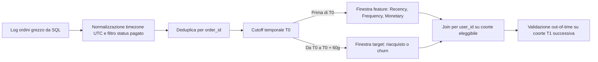

Considera uno scenario costruito su numeri di esempio realistici per comprendere dove si rompe quasi sempre il lavoro in Python sul marketing. Un e-commerce in abbonamento di cosmetica ("Aurora Box") ha raccolto negli ultimi 18 mesi circa **120.000 righe d'ordine** su **34.000 clienti attivi** e vuole stimare quali acquirenti rinnoveranno nei successivi 60 giorni. Il primo script scritto in fretta con `pandas` produce un modello di churn con `AUC` pari a **0,91**, ma messo in produzione crolla a **0,61**. Ispezionando i dati emergono tre falle tabellari classiche: il **12% delle righe** contiene duplicati generati dai retry dei webhook di pagamento, i timestamp mescolano UTC e ora locale italiana spostando i confini di giornata, e soprattutto la feature `Monetary` aggregava anche ordini e rimborsi avvenuti dopo la data di osservazione della campagna.

> **Idea chiave:** In marketing data science l'affidabilità di un modello dipende prima dalla disciplina temporale con cui aggrega le tabelle in pandas e solo dopo dall'algoritmo scelto in scikit-learn.

## Perché il workflow Python parte dalla disciplina dei timestamp

Python nel binario **ml-tabellare** non serve a inseguire architetture deep learning su tabelle da qualche decina di migliaia di utenti: serve a rendere riproducibile il ponte tra il data warehouse e la tabella su cui il modello apprende. Quando estrai ordini, ticket di assistenza o eventi email con `SQL`, ricevi un log transazionale a grana fine, dove lo stesso cliente compare su più righe con stati diversi (`paid`, `refunded`, `cancelled`, `retry`). Prima ancora di calcolare una media o una somma, devi portare quel log a una granularità unica e congelata a una precisa **data di cutoff** ($T_0$).

La data di cutoff separa il mondo noto al momento della decisione dal mondo futuro che vuoi prevedere. Tutto ciò che entra nelle colonne esplicative (`X`) deve avere timestamp strettamente precedente a $T_0$. Tutto ciò che definisce la variabile bersaglio (`y`, ad esempio "riacquista entro 60 giorni da $T_0$") deve cadere esclusivamente nella finestra successiva `[T_0, T_0 + 60 giorni]`. Se calcoli la spesa totale di un cliente sull'intero dataset e poi usi `train_test_split` casuale, il modello impara segnali dal futuro e restituisce prestazioni illusorie in validazione.



Questo schema chiarisce anche perché nei problemi di marketing la validazione incrociata casuale (`K-Fold` standard) sia spesso inadeguata. Comportamento promozionale, mix di canale e campagne stagionali cambiano nel tempo: addestrare su novembre e testare su una selezione casuale dello stesso novembre non misura se le soglie reggeranno a gennaio. La verifica credibile usa una finestra temporale precedente (`T0`) per l'addestramento e una coorte successiva (`T1`) completamente disgiunta nel tempo per stimare l'errore fuori campione.

## Scelta dello strumento nello stack Python analitico

Una volta fissata la tabella pulita, la scelta della libreria non segue la complessità ma la domanda decisionale. Molti team importano `scikit-learn` quando basterebbe una tabella aggregata in `pandas`, oppure usano una Random Forest opaca quando al direttore commerciale servono intervalli di confidenza e pendenza della risposta al prezzo in `statsmodels`.

Il punto di partenza è sempre `pandas`, responsabile di pulizia, deduplica, normalizzazione dei fusi orari e calcolo delle metriche RFM. Quando il team ha bisogno soltanto di scorecard descrittive, filtri deterministici o controlli di coorte, fermarsi a `pandas` è spesso la decisione più solida. Quando invece serve stimare una probabilità calibrata individuale di riacquisto, `churn` o `LTV`, entra in gioco `scikit-learn` con pipeline standardizzate e validazione out-of-time.

Per domande rivolte all'inferenza sui parametri — ad esempio stimare l'elasticità delle vendite a uno sconto o verificare la significatività statistica dei coefficienti — conviene spostarsi su `statsmodels`. Infine, quando la decisione riguarda volumi aggregati giornalieri o settimanali guidati da trend e festività promozionali come il Black Friday, entra in scena [Prophet](https://facebook.github.io/prophet/), reso open source da Meta nel 2017 proprio per modellare serie storiche aziendali con stagionalità multiple in modo trasparente. Su dati tabellari per utente, invece, una regressione logistica regolarizzata su feature RFM ben costruite rimane la baseline obbligatoria da battere prima di valutare alberi boosted.

## Costruzione numerica delle feature RFM senza leakage

Per verificare concretamente come la pulizia cambi i numeri, seguiamo un **worked example numerico completo** su **4 clienti** estratti dal log ordini prima di una campagna pianificata alla data di cutoff **2026-09-01**. La tabella iniziale mostra le 8 righe grezze così come arrivano dall'esportazione: contiene un duplicato tecnico da webhook, un ordine rimborsato, un ordine fuori finestra (post cutoff) e timestamp coerenti portati in data UTC.

| `order_id` | `user_id` | `order_date` | `status` | `importo_euro` | Nota di qualità |
|---|---|---|---|---:|---|
| `ORD-101` | `U01` | `2026-06-12` | `paid` | 80,00 | Valido |
| `ORD-101` | `U01` | `2026-06-12` | `paid` | 80,00 | Duplicato da retry webhook |
| `ORD-102` | `U01` | `2026-08-22` | `paid` | 120,00 | Valido |
| `ORD-103` | `U02` | `2026-05-04` | `paid` | 150,00 | Valido |
| `ORD-104` | `U02` | `2026-07-10` | `refunded` | 150,00 | Ordine annullato e rimborsato |
| `ORD-105` | `U02` | `2026-09-08` | `paid` | 90,00 | Post cutoff `2026-09-01` (appartiene alla finestra target) |
| `ORD-106` | `U03` | `2026-08-02` | `paid` | 45,00 | Valido |
| `ORD-107` | `U04` | `2026-03-05` | `paid` | 210,00 | Valido ma oltre finestra storica di 180 giorni |

Calcoliamo prima cosa produce un'aggregazione **ingenua (errata)** senza deduplica, senza filtro sullo status e senza cutoff temporale al `2026-09-01`. Per il cliente `U01`, sommare le tre righe dà `Frequency = 3` e `Monetary = 80 + 80 + 120 = 280 euro` invece del reale valore di `200 euro` (un gonfiamento del `+40%`). Per il cliente `U02`, l'aggregazione ingenua conta 3 righe inclusi il rimborso da `150 euro` e l'ordine futuro del `2026-09-08` da `90 euro`: restituisce `Recency = -7 giorni` (un valore negativo impossibile in produzione, segnale tipico di leakage temporale), `Frequency = 3` e `Monetary = 390 euro`.

Applichiamo ora le regole corrette alla finestra storica di osservazione `[2026-03-06, 2026-09-01)` (ultimi 180 giorni prima del cutoff `2026-09-01`) tenendo solo `status == "paid"` e deduplicando per `order_id`. Per il cliente `U01` restano gli ordini `ORD-101` contato una sola volta (`80 euro`) e `ORD-102` (`120 euro`): con ultimo acquisto valido il `2026-08-22`, otteniamo `Recency = 10 giorni`, `Frequency = 2 ordini` e `Monetary = 80 + 120 = 200 euro`.

Per il cliente `U02`, invece, l'ordine `ORD-104` viene scartato perché `refunded` e l'ordine `ORD-105` del `2026-09-08` viene escluso dalle feature perché successivo al cutoff `2026-09-01`, andando a popolare l'etichetta futura (`y_riacquistato = 1` nella finestra `[2026-09-01, 2026-10-31]`). Resta quindi solo `ORD-103` del `2026-05-04`: contando 27 giorni in maggio, 30 in giugno, 31 in luglio, 31 in agosto e 1 giorno al cutoff otteniamo `Recency = 120 giorni`, `Frequency = 1 ordine` e `Monetary = 150 euro`.

Per il cliente `U03` resta `ORD-106` del `2026-08-02`, che restituisce `Recency = 30 giorni`, `Frequency = 1 ordine` e `Monetary = 45 euro`. Infine, l'unico ordine `ORD-107` del cliente `U04` risale al `2026-03-05`, esattamente fuori dalla finestra `[2026-03-06, 2026-09-01)`: in base alla definizione di coorte, `U04` non è attivo nella finestra storica e riceve `Frequency = 0` oppure viene escluso dalla coorte degli acquirenti recenti.

La tabella seguente mette a confronto l'impatto numerico dei due metodi sui tre clienti attivi in finestra (`U01`, `U02`, `U03`):

| `user_id` | `Monetary` errato (euro) | `Monetary` corretto (euro) | Errore relativo su `Monetary` | `Recency` corretto (giorni) | Target 60g dopo `2026-09-01` |
|---|---:|---:|---:|---:|---:|
| `U01` | 280,00 | 200,00 | +40,0% | 10 | 0 |
| `U02` | 390,00 | 150,00 | +160,0% | 120 | 1 |
| `U03` | 45,00 | 45,00 | 0,0% | 30 | 0 |
| **Totale campione** | **715,00** | **395,00** | **+81,0%** | **Media: 53,3 giorni** | **1 riacquisto (33,3%)** |

La somma totale sul mini-campione passa da **715,00 euro** a **395,00 euro** reali: l'aggregazione frettolosa sovrastima il fatturato storico dell'**81%** e trasforma `U02` (che riacquisterà davvero a settembre) in un cliente con recency negativa, regalando al classificatore una scorciatoia impossibile da replicare quando dovrà fare previsioni oggi su utenti che non hanno ancora compiuto ordini futuri.

## Pipeline Python riproducibile con validazione out-of-time

Il blocco Python seguente traduce esattamente la logica appena verificata su un dataset tabellare completo: normalizza le date, rimuove duplicati e rimborsi, calcola le feature RFM rigorosamente prima del cutoff `T0` per il training e `T1` per il test out-of-time, e valuta una `LogisticRegression` calibrata rispetto a una semplice regola baseline sulla sola `Recency`.

```python
import numpy as np
import pandas as pd
from sklearn.linear_model import LogisticRegression
from sklearn.metrics import roc_auc_score, brier_score_loss
from sklearn.pipeline import make_pipeline
from sklearn.preprocessing import StandardScaler

def costruisci_dataset_rfm(
    ordini: pd.DataFrame,
    cutoff: pd.Timestamp,
    finestra_feature_giorni: int = 180,
    finestra_target_giorni: int = 60,
) -> pd.DataFrame:
    """Costruisce feature RFM pre-cutoff e target di riacquisto post-cutoff senza leakage."""
    df = ordini.copy()
    # 1. Normalizzazione temporale e pulizia stati non incassati
    df["order_date"] = pd.to_datetime(df["order_date"], utc=True).dt.tz_convert(None)
    df = df[df["status"] == "paid"].drop_duplicates(subset=["order_id"])

    inizio_feature = cutoff - pd.Timedelta(days=finestra_feature_giorni)
    fine_target = cutoff + pd.Timedelta(days=finestra_target_giorni)

    # 2. Separazione stretta tra storico (feature) e futuro (outcome)
    storico = df[(df["order_date"] >= inizio_feature) & (df["order_date"] < cutoff)]
    futuro = df[(df["order_date"] >= cutoff) & (df["order_date"] <= fine_target)]

    # 3. Aggregazione RFM per utente sullo storico pre-cutoff
    rfm = storico.groupby("user_id", as_index=False).agg(
        ultimo_acquisto=("order_date", "max"),
        frequency=("order_id", "count"),
        monetary=("importo_euro", "sum"),
    )
    rfm["recency"] = (cutoff - rfm["ultimo_acquisto"]).dt.days
    rfm["ticket_medio"] = rfm["monetary"] / rfm["frequency"]

    # 4. Etichetta binaria nella finestra futura
    utenti_riacquisto = set(futuro["user_id"].unique())
    rfm["y_riacquisto"] = rfm["user_id"].isin(utenti_riacquisto).astype(int)
    return rfm[["user_id", "recency", "frequency", "monetary", "ticket_medio", "y_riacquisto"]]

# Generazione di ordini sintetici su 14 mesi per simulare due coorti temporali (T0 e T1)
rng = np.random.default_rng(7)
n_righe = 25_000
date_ordini = pd.Timestamp("2025-07-01") + pd.to_timedelta(rng.integers(0, 460, size=n_righe), unit="D")
ordini_sim = pd.DataFrame({
    "order_id": [f"ORD-{i}" for i in range(n_righe)],
    "user_id": rng.integers(1, 4501, size=n_righe),
    "order_date": date_ordini,
    "status": rng.choice(["paid", "refunded"], size=n_righe, p=[0.93, 0.07]),
    "importo_euro": np.round(rng.lognormal(mean=4.1, sigma=0.55, size=n_righe), 2),
})

# Aggiunta intenzionale del 5% di duplicati webhook per testare la funzione di pulizia
duplicati = ordini_sim.sample(frac=0.05, random_state=7)
ordini_sporchi = pd.concat([ordini_sim, duplicati], ignore_index=True)

# Split out-of-time: addestramento al 2026-05-01, valutazione su coorte 2026-08-01
train_df = costruisci_dataset_rfm(ordini_sporchi, cutoff=pd.Timestamp("2026-05-01"))
test_df = costruisci_dataset_rfm(ordini_sporchi, cutoff=pd.Timestamp("2026-08-01"))

feature_cols = ["recency", "frequency", "monetary", "ticket_medio"]
modello = make_pipeline(StandardScaler(), LogisticRegression(C=1.0, random_state=7))
modello.fit(train_df[feature_cols], train_df["y_riacquisto"])

p_test = modello.predict_proba(test_df[feature_cols])[:, 1]
auc_modello = roc_auc_score(test_df["y_riacquisto"], p_test)
auc_baseline_recency = roc_auc_score(test_df["y_riacquisto"], -test_df["recency"])
brier = brier_score_loss(test_df["y_riacquisto"], p_test)

print(f"AUC LogisticRegression (out-of-time): {auc_modello:.3f}")
print(f"AUC baseline solo Recency: {auc_baseline_recency:.3f}")
print(f"Brier score calibrazione: {brier:.4f}")
```

Confrontare `auc_modello` con `auc_baseline_recency` nella stessa riga di output impone una verifica sana: se un modello con dieci feature nuove migliora l'AUC di appena `0,005` rispetto al semplice numero di giorni dall'ultimo acquisto, il costo di manutenzione in produzione non si giustifica.

## Controlli di qualità che proteggono la tabella delle feature

Prima di consegnare una tabella di feature per l'addestramento o per il calcolo dei segmenti, occorre eseguire quattro verifiche automatiche sul `DataFrame` finale. La prima verifica riguarda la monotonia e il dominio delle chiavi: bisogna accertarsi con un'asserzione esplicita che `user_id` sia unico nella tabella delle feature finali (`assert rfm["user_id"].is_unique`) e che la colonna `recency` non contenga mai valori negativi, perché qualsiasi valore sotto zero rivela un filtro temporale errato rispetto al cutoff.

La seconda verifica controlla l'integrità dei fusi orari. Tutti i timestamp vanno convertiti a UTC già durante l'estrazione `SQL` o subito in lettura con `pd.to_datetime(..., utc=True)` prima di eseguire confronti con la data di cutoff, evitando che ordini registrati alle 23:30 UTC finiscano erroneamente nel giorno successivo del target.

La terza verifica assicura la coerenza contabile delle definizioni nel tempo. Nei 18 mesi di storico può essere cambiato il criterio di calcolo dell'importo (ad esempio passando da lordo IVA a netto IVA o includendo le spese di spedizione), e una discontinuità contabile del genere imita un finto aumento di `Monetary` che confonde i modelli.

Infine, la quarta verifica controlla la copertura degli utenti silenziosi. Occorre quantificare quanti utenti eleggibili compaiono soltanto nelle tabelle di anagrafica o email senza ordini nella finestra storica: escluderli automaticamente senza tracciarne il numero altera il denominatore delle campagne CRM e sovrastima il tasso di riacquisto medio.

## Trappole frequenti nei notebook di marketing analytics

### Usare split casuali su eventi ripetuti dello stesso utente

Quando il dataset contiene più osservazioni per lo stesso cliente (per esempio un record per ogni trimestre o campagna ricevuta) e applichi `train_test_split` casuale sulle righe, lo stesso `user_id` finisce contemporaneamente nel training e nel test. Il modello memorizza le caratteristiche individuali invece di generalizzare e restituisce una stima ottimistica delle prestazioni. La difesa consiste nello split per data di cutoff (`out-of-time`) oppure nell'uso di `GroupKFold` su `user_id` quando lavori a parità di finestra.

### Aggregare senza filtrare resi, annulli e retry tecnici

Nei dati e-commerce e SaaS gli ordini pagati subiscono spesso storni parziali o completi nei 14 giorni successivi, mentre i sistemi di checkout registrano più eventi di conferma sullo stesso ordine. Aggregare `SUM(amount)` senza deduplica per `order_id` e senza sottrarre o escludere i rimborsi trasforma i clienti che fanno più resi nei clienti "più preziosi" per `Monetary`, orientando i budget verso i profili meno profittevoli.

### Consegnare un notebook esplorativo invece di una funzione testabile

Molti progetti si fermano a un notebook pieno di celle eseguite fuori ordine, dove le trasformazioni dipendono da variabili rimaste in memoria. Quando il team di ingegneria prova a portare il codice in pipeline giornaliera, i numeri non coincidono. Incapsulare la costruzione delle feature in una funzione pura parametrizzata dal `cutoff` (come mostrato nel blocco sopra) garantisce che i calcoli del backtest e quelli dello scoring quotidiano eseguano esattamente la stessa logica.

## Verifica sulle pipeline Python per il marketing

1. Se nel log transazionale compare un ordine `paid` da 120 euro il `2026-08-29` e il relativo rimborso totale (`refunded`) viene registrato il `2026-09-05`, come devi gestire l'ordine rispetto a un cutoff di predizione fissato al `2026-09-01`?

<details>
<summary>Mostra risposta</summary>

Al momento della decisione reale del 1° settembre 2026 il rimborso del 5 settembre non era ancora avvenuto né noto al sistema operativo. Pertanto nelle feature calcolate al cutoff del 1° settembre quell'ordine risulta ancora pagato, altrimenti introdurresti information leakage dal futuro rispetto a ciò che il modello potrà sapere in produzione alla data di invio. Il rimborso va invece conteggiato correttamente nella valutazione economica ex-post del margine nella finestra successiva.

</details>

2. Perché una regressione logistica su feature RFM può produrre un Brier score peggiore rispetto alla baseline pur avendo un AUC leggermente più alto?

<details>
<summary>Mostra risposta</summary>

L'AUC valuta solo l'ordinamento delle previsioni tra positivi e negativi, mentre il Brier score misura l'errore quadratico tra le probabilità predette e gli esiti osservati (quindi anche la calibrazione). Se le feature non vengono standardizzate con regolarizzazione forte, se esiste shift di tasso base tra la finestra di training e la coorte futura `T1`, oppure se si usa un algoritmo con margini estremi non calibrati, le probabilità possono risultare sistematicamente sovrastimate o sottostimate pur mantenendo un buon ranking.

</details>

3. Quando ha senso affiancare `statsmodels` o `Prophet` a `pandas` e `scikit-learn` nello stesso progetto marketing?

<details>
<summary>Mostra risposta</summary>

Conviene usare `statsmodels` quando la decisione richiede di stimare l'incertezza e la significatività dei singoli coefficienti (ad esempio misurare l'elasticità del volume ordini a una variazione di prezzo controllando per canale), mentre `Prophet` è indicato per prevedere serie storiche aggregate giornaliere o settimanali con forte stagionalità annuale, effetti giorno della settimana e festività promozionali note a calendario. Nessuno dei due sostituisce `pandas` nella pulizia tabellare o `scikit-learn` nello scoring individuale su larga scala.

</details>

4. Quale segnale numerico in un dataset RFM segnala immediatamente un errore di filtro rispetto alla data di cutoff?

<details>
<summary>Mostra risposta</summary>

La presenza di valori negativi nella colonna `recency` (differenza in giorni tra la data di cutoff e l'ultimo acquisto dell'utente) segnala in modo inequivocabile che nella tabella delle feature sono entrati ordini successivi alla data di cutoff. In modo analogo, una correlazione quasi perfetta tra il totale `monetary` e la variabile bersaglio futura deve far sospettare subito un leakage nella finestra di aggregazione.

</details>
