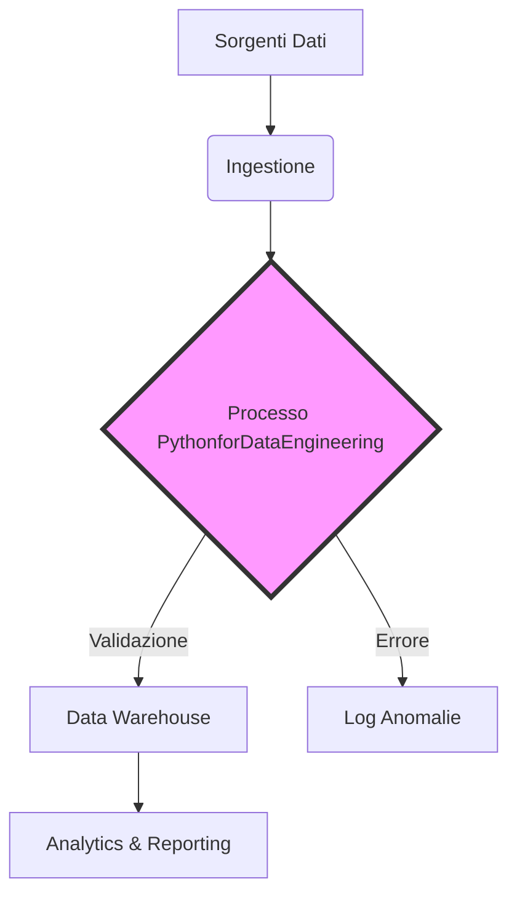
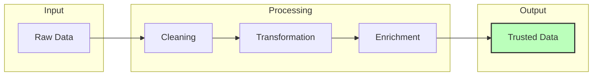

# Python for Data Engineering

> Abstract: Una guida completa e approfondita su **Python for Data Engineering**, che esplora le metodologie, gli strumenti e le strategie pratiche per un'implementazione di successo nel contesto aziendale moderno.

## Obiettivi di Apprendimento
- Comprendere i principi fondamentali di **Python for Data Engineering** e il suo ruolo nell'ecosistema MarTech.
- Analizzare le best practice per l'implementazione di **Python for Data Engineering** in contesti aziendali reali.
- Identificare gli errori comuni e le trappole da evitare quando si lavora con **Python for Data Engineering**.
- Sviluppare una metodologia critica per valutare l'efficacia di **Python for Data Engineering** nelle proprie strategie.
- Acquisire familiarità con gli strumenti e le tecnologie che supportano **Python for Data Engineering**.

## Timeline della Lezione

| Sezione | Durata | Argomento |
|---------|--------|-----------|
| Introduzione | 5 min | Contestualizzazione e importanza di Python for Data Engineering |
| Fondamenti | 12 min | Teoria, definizioni e concetti chiave |
| Implementazione | 12 min | Strategie pratiche, architetture e best practices |
| Casi Studio | 8 min | Esempi reali di successo e fallimento |
| Esercizi | 5 min | Verifica della comprensione e applicazione pratica |
| Riepilogo | 3 min | Sintesi dei punti salienti e prossimi passi |

## Introduzione (5 minuti)

Spesso sottovalutato, **Python for Data Engineering** è in realtà il motore nascosto di molte strategie di successo. Vedremo come padroneggiarlo possa trasformare il tuo approccio ai dati.

In un mondo dove il dato è il "nuovo petrolio" (cliché, ma vero), sapere come raffinare questo petrolio è ciò che distingue le aziende vincenti. **Python for Data Engineering** è proprio quella raffineria.

## Fondamenti Teorici

Per approcciare correttamente **Python for Data Engineering**, dobbiamo prima sgombrare il campo da alcuni equivoci comuni. Non stiamo parlando di una "bacchetta magica", ma di un processo strutturato.

### Definizione e Contesto

**Python for Data Engineering** si inserisce all'interno di un framework più ampio di gestione del dato. Se immaginiamo il flusso dei dati come un fiume, **Python for Data Engineering** rappresenta una diga o un sistema di filtraggio essenziale.

> **Concetto Chiave:** La qualità dell'output dipende strettamente dalla qualità dell'input e dal rigore del processo. **Python for Data Engineering** è lo strumento che garantisce questo rigore.

### Perché è rilevante oggi?

1.  **Complessità crescente:** I volumi di dati sono in aumento esponenziale.
2.  **Necessità di velocità:** Le decisioni devono essere prese in tempo reale.
3.  **Integrazione:** I sistemi non vivono più in silos isolati.

Ecco un diagramma concettuale di come **Python for Data Engineering** si posiziona:

Come si vede dal grafico, **Python for Data Engineering** agisce come un punto nevralgico. Senza di esso, il rischio è quello di alimentare i sistemi di valle con dati "sporchi" o non strutturati (Garbage In, Garbage Out).

## Strategie Avanzate e Best Practices

Ora che abbiamo coperto le basi, alziamo l'asticella. Cosa distingue un'implementazione amatoriale di **Python for Data Engineering** da una professionale? I dettagli.

### Scalabilità e Resilienza

Quando i volumi aumentano, i sistemi fragili si rompono. **Python for Data Engineering** deve essere progettato per scalare.
- **Disaccoppiamento:** Usare code (es. Kafka) per separare produttori e consumatori.
- **Idempotenza:** Assicurarsi che processare lo stesso evento due volte non crei duplicati.

### Sicurezza e Compliance

In era GDPR, **Python for Data Engineering** deve essere "Privacy by Design". Non possiamo raccogliere tutto indiscriminatamente.

### Esempio di Architettura Logica

In questo flusso, la fase di "Enrichment" è spesso quella dove **Python for Data Engineering** porta il maggior valore aggiunto, collegando punti dati apparentemente disconnessi.

## Esempi Pratici

Vediamo due scenari reali per concretizzare i concetti.

### Scenario A: L'e-commerce in crescita

Un e-commerce di moda sta scalando rapidamente. Hanno bisogno di **Python for Data Engineering** per gestire i picchi di traffico durante il Black Friday.
**Soluzione:** Implementano un'architettura basata su eventi. Invece di scrivere direttamente sul database, usano una coda di messaggi.
**Risultato:** Zero downtime anche con 10x traffico.

### Scenario B: L'app B2B SaaS

Un'azienda SaaS deve garantire che i dati di utilizzo siano corretti per la fatturazione.
**Soluzione:** Usano **Python for Data Engineering** per creare un doppio livello di verifica sui log delle API.
**Risultato:** Riduzione del 90% delle contestazioni sulle fatture.

## Esercizi

Per consolidare quanto appreso, prova a svolgere questi esercizi:

1.  **Analisi dello Stato Attuale:** Prendi un progetto su cui stai lavorando. Disegna su carta come viene gestito attualmente **Python for Data Engineering**. C'è documentazione? È un processo robusto?
2.  **Progettazione:** Immagina di dover ricostruire tutto da zero con budget illimitato. Come cambierebbe l'architettura? Disegna il diagramma ideale.
3.  **Troubleshooting:** Pensa all'ultimo incidente legato ai dati che hai vissuto. Se avessi avuto un sistema di **Python for Data Engineering** perfetto, come sarebbe stato evitato o mitigato?

## Riepilogo

In questa lezione abbiamo attraversato il complesso mondo di **Python for Data Engineering**.

Ecco i punti chiave da portare a casa:
- **Centralità:** **Python for Data Engineering** non è un accessorio, è il cuore del sistema.
- **Rigore:** Senza metodo, la tecnologia è inutile.
- **Evoluzione:** Bisogna essere pronti a iterare e migliorare costantemente.
- **Impatto:** Un buon sistema di **Python for Data Engineering** impatta direttamente sui profitti aziendali riducendo errori e migliorando la velocità decisionale.

Ricorda: la tecnologia è un mezzo, non il fine. Il fine è sempre il valore di business.

## Approfondimenti
- *Designing Data-Intensive Applications*, Martin Kleppmann (O'Reilly, 2017)
- *The Data Warehouse Toolkit*, Ralph Kimball (Wiley, 2013)
- Documentazione ufficiale e whitepaper relativi a **Python for Data Engineering**
