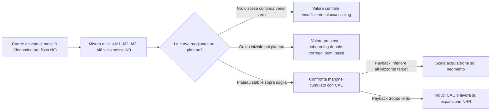

Una piattaforma italiana di software gestionale per studi dentistici in abbonamento a `120 €` al mese, con margine lordo dell'`80%`, acquisisce `400` nuovi studi ogni mese spendendo in media `380 €` di costo di acquisizione (`CAC`) per cliente (scenario costruito con numeri di esempio). Nei report settimanali il fatturato totale cresce del `+12%` rispetto al trimestre precedente e il team marketing chiede di raddoppiare il budget sulle campagne a pagamento.

Quando però l'analista scompone i ricavi per mese di ingresso, scopre che gli studi acquisiti tramite promozioni a sconto abbandonano quasi tutti entro novanta giorni, molto prima di aver generato abbastanza margine da ripagare il `CAC`.

> **Idea chiave:** La retention non è un indicatore descrittivo di customer care, ma il vincolo economico che stabilisce se ogni euro speso per acquisire nuovi clienti genera capitale composito o accelera una perdita nascosta dal volume lordo.

## Perché la media aggregata nasconde l'emorragia delle coorti

Quando una società acquisisce nuovi clienti ogni settimana, il totale dei ricavi o degli utenti attivi può salire anche mentre il prodotto perde capacità di trattenere chi entra. I nuovi ingressi coprono le uscite delle coorti precedenti, creando l'illusione di una crescita sana finché il costo marginale per attrarre nuovo traffico non esplode.

Per rendere leggibile questo fenomeno devi passare dalle serie aggregate alle **coorti**. Una coorte raggruppa gli utenti o gli account che condividono lo stesso evento di partenza nello stesso intervallo temporale, per esempio il mese di prima attivazione, il canale di acquisizione o il piano sottoscritto.

Il punto critico di metodo è bloccare il **denominatore** al momento zero. Se a gennaio si attivano `200` studi e tre mesi dopo restano attivi `144` di quei precisi `200` studi, la retention al mese 3 vale il `72%`, indipendentemente da quanti nuovi clienti siano entrati a febbraio o a marzo. Cambiare il denominatore includendo utenti acquisiti in seguito o escludendo chi ha avuto problemi tecnici rende il grafico illegibile e impedisce qualsiasi confronto tra canali.

Occorre inoltre distinguere tra registrazione e **attivazione reale**. Un account che crea una password senza completare la prima azione di valore, come importare l'anagrafica pazienti o emettere la prima fattura, non ha mai sperimentato il prodotto: includerlo o escluderlo cambia la diagnosi tra problema di traffico qualificato e problema di esperienza d'uso.



## Come leggere le forme delle curve di retention

La curva di retention traccia sull'asse orizzontale il tempo trascorso dall'attivazione (giorni 7, 30, 60, 90 o mesi M0, M1, M2) e sull'asse verticale la quota percentuale della coorte ancora attiva. Prima di lanciare qualsiasi esperimento commerciale, la forma geometrica della curva indica dove si trova il collo di bottiglia.

Non esiste una sola definizione operativa di "attivo" valida per ogni modello di business. Un'app di messaggistica o un quotidiano digitale hanno cadenza naturale giornaliera (`retention` classica a giorno N), un software gestionale o un prodotto B2B hanno cadenza settimanale o mensile, mentre un e-commerce di arredamento ha cicli di riacquisto trimestrali o annuali. Usare una finestra di sette giorni su un prodotto che l'utente usa naturalmente una volta al mese produce una falsa diagnosi di abbandono totale.

| Forma della curva | Segnale matematico osservato | Diagnosi di prodotto | Intervento prioritario |
|---|---|---|---|
| Crollo brusco a G7–G30 poi plateau piatto | Perdita iniziale del `45%–60%`, poi stabilità oltre M3 | Il nucleo del prodotto funziona ma i nuovi utenti non arrivano al primo valore | Semplificare onboarding, checklist guidata e tempi di setup |
| Discesa costante senza appiattimento | Tendenza verso lo `0%` tra M4 e M6 | Mancanza di Product-Market Fit sul segmento acquisito o sostituzione immediata | Ripensare proposta di valore o cambiare target |
| Plateau alto e stabile | Stabilizzazione oltre il `60%` nel B2B o `25%–35%` nel consumer | Abitudine consolidata e valore ricorrente difendibile | Scalare acquisizione sui canali con lo stesso profilo |
| Curva a sorriso o espansione | Ritorno di utenti dormienti o crescita spesa per utente attivo | Effetti di rete, ciclicità stagionale o espansione di piano (`upsell`) | Rafforzare trigger di riattivazione e piani multi-utente |

Vale anche distinguere tra **retention puntuale** (`bounded` o *day-N exact*) e **retention non limitata** (`unbounded` o *on-or-after*). La prima controlla se l'utente è tornato esattamente nel giorno 30; è severa e adatta a prodotti ad alta frequenza. La seconda controlla se l'utente è tornato nel giorno 30 oppure in qualsiasi giorno successivo; è più stabile quando gli intervalli d'uso sono irregolari e si presta bene a misurare la sopravvivenza di medio periodo.

## Logo retention, Net Revenue Retention e ciclo di payback

Guardare soltanto il conteggio dei clienti attivi (`logo retention` o `user retention`) non basta quando i clienti pagano importi diversi o espandono l'uso nel tempo. Un software può trattenere l'`85%` degli account ogni anno perdendo però i clienti più grandi, oppure può trattenere l'`80%` degli account vedendo aumentare i ricavi della coorte al `112%` grazie all'aggiunta di moduli extra o nuove postazioni.

Per questa ragione il controllo di crescita affianca sempre tre grandezze sullo stesso gruppo di partenza. La **Logo Retention** (o *Customer Retention*) misura il rapporto tra il numero di clienti attivi al periodo $t$ e i clienti presenti al periodo $0$, fotografando la tenuta dell'abitudine d'uso.

La **Gross Revenue Retention (GRR)** misura invece la quota di ricavo ricorrente iniziale che sopravvive al periodo $t$ considerando solo cancellazioni e riduzioni di piano, senza sommare gli aumenti di spesa. Il suo valore massimo teorico è il `100%` e rivela la solidità minima della base installata.

La **Net Revenue Retention (NRR)** include sia le perdite sia gli aumenti dovuti ad ampliamento d'uso, passaggio a piani superiori o aggiunta di utenti. Quando la `NRR` supera il `100%`, i ricavi della coorte crescono autonomamente anche a zero acquisizioni nuove.

In parallelo alla `NRR`, il collegamento diretto tra marketing e finanza passa dal **CAC payback period**, cioè il numero di mesi necessari affinché il margine lordo cumulato generato da un cliente medio di quella coorte superi il costo sostenuto per acquisirlo. Valutare il ritorno sui ricavi lordi invece che sul **margine lordo** (ricavi meno costi diretti di erogazione, infrastruttura e supporto) è uno degli sbagli che porta più velocemente a sovrastimare la sostenibilità di una campagna.

## Derivazione passo-passo su coorti e payback del CAC

Riprendiamo i numeri dello scenario in apertura sul software gestionale per studi dentistici: canone mensile di `120 €`, margine lordo dell'`80%` — quindi contribuzione lorda pari a `96 €` per ogni mese di studio attivo — e `CAC` pari a `380 €` sostenuto al momento dell'acquisizione (numeri di esempio). Mettiamo a confronto due coorti acquisite a gennaio dello stesso anno, ciascuna composta da `200` nuovi studi al mese 0 (`N0 = 200`).

La **Coorte A (Organico e passaparola)** conta `200` studi attivi al mese 0 (`100%`), `172` al mese 1 (`86%`), `154` al mese 2 (`77%`), `144` al mese 3 (`72%`), `140` al mese 4 (`70%`), `138` al mese 5 (`69%`) e `138` al mese 6 (`69%`). La **Coorte B (Paid Ads con promo iniziale)** parte sempre da `200` studi al mese 0 (`100%`), scende a `110` al mese 1 (`55%`), `68` al mese 2 (`34%`), `44` al mese 3 (`22%`), `30` al mese 4 (`15%`), `20` al mese 5 (`10%`) e `14` al mese 6 (`7%`).

Calcoliamo innanzitutto l'esborso iniziale di acquisizione: per ciascuna delle due coorti, `200` studi moltiplicati per `380 €` corrispondono a un investimento di `76.000 €` al momento zero. Ogni mese di permanenza di uno studio attivo genera inoltre un margine lordo di $120 \times 0{,}80 = 96$ €.

Nella **Coorte A**, sommando gli studi attivi rilevati da M0 a M6 otteniamo $200 + 172 + 154 + 144 + 140 + 138 + 138 = 1.086$ studio-mesi attivi. Moltiplicando per `96 €`, il margine lordo cumulato raggiunge `104.256 €`, cioè $104.256 / 200 = 521{,}28$ € per studio iniziale.

Osserviamo mese per mese il recupero del `CAC` per singolo studio della Coorte A. Alla fine di M0 il cumulato vale `96,00 €`; alla fine di M1 sale a $96{,}00 + (0{,}86 \times 96) = 178{,}56$ €; alla fine di M2 arriva a $178{,}56 + (0{,}77 \times 96) = 252{,}48$ €; alla fine di M3 tocca $252{,}48 + (0{,}72 \times 96) = 321{,}60$ €; infine alla fine di M4 raggiunge $321{,}60 + (0{,}70 \times 96) = 388{,}80$ €.

Poiché `388,80 €` supera il `CAC` di `380 €`, la Coorte A chiude il pareggio nel **mese 4** e termina il mese 6 con un utile netto cumulato di $104.256 - 76.000 = +28.256$ € (`+141,28 €` per studio), conservando inoltre un plateau stabile di `138` studi (`69%`) che continua a produrre `13.248 €` di margine lordo ogni mese.

Nella **Coorte B**, sommando gli studi attivi da M0 a M6 otteniamo invece $200 + 110 + 68 + 44 + 30 + 20 + 14 = 486$ studio-mesi attivi. Il margine lordo cumulato totale vale appena $486 \times 96 = 46.656$ €, pari a `233,28 €` per studio iniziale.

Confrontando questo rientro con i `76.000 €` spesi in acquisizione, a sei mesi la Coorte B accumula una perdita netta di `-29.344 €`, ovvero `-146,72 €` per ogni studio entrato dalla campagna in sconto. Con soli `14` studi rimasti attivi al mese 6 (`7%`) e una curva che scende ancora verso lo zero, la coorte non recupererà il `CAC` nemmeno nel secondo anno.

La decisione operativa che discende dai numeri è netta: bloccare l'espansione di budget sul canale Paid in promozione fino a quando la retention a M3 non supera almeno il `45%` e un nuovo test non dimostra la sostenibilità del payback; nel frattempo, riallocare il capitale verso programmi di passaparola incentivato e supporto all'attivazione nella prima settimana per i nuovi studi acquisiti.

## Analisi di coorte in SQL e Python sul data warehouse

Tradurre questa logica in query riproducibili garantisce che prodotto, marketing e finanza leggano la stessa tabella senza ricalcoli manuali sui fogli di calcolo. Il punto centrale della query è isolare prima la dimensione iniziale `cohort_size` di ogni gruppo (canale e mese di attivazione) e solo dopo dividere i conteggi attivi ai mesi successivi per quel denominatore bloccato.

```sql
-- Calcolo matrice di retention mensile e margine cumulato per canale
WITH attivazioni AS (
    SELECT
        account_id,
        canale_acquisizione,
        DATE_TRUNC('month', data_attivazione) AS coorte_mese
    FROM dim_account
    WHERE stato_attivazione = 'attivato'
),
dimensione_coorti AS (
    SELECT
        coorte_mese,
        canale_acquisizione,
        COUNT(DISTINCT account_id) AS n0_studi
    FROM attivazioni
    GROUP BY 1, 2
),
attivita_mensile AS (
    SELECT
        a.coorte_mese,
        a.canale_acquisizione,
        DATE_DIFF('month', a.coorte_mese, DATE_TRUNC('month', f.data_fattura)) AS mese_offset,
        COUNT(DISTINCT f.account_id) AS studi_attivi,
        SUM(f.importo_netto * f.margine_lordo_pct) AS margine_lordo_mese
    FROM attivazioni a
    JOIN fct_abbonamenti f
        ON a.account_id = f.account_id
       AND f.stato_pagamento = 'incassato'
    WHERE DATE_DIFF('month', a.coorte_mese, DATE_TRUNC('month', f.data_fattura)) BETWEEN 0 AND 12
    GROUP BY 1, 2, 3
)
SELECT
    m.coorte_mese,
    m.canale_acquisizione,
    m.mese_offset,
    d.n0_studi,
    m.studi_attivi,
    ROUND(100.0 * m.studi_attivi / d.n0_studi, 2) AS retention_pct,
    SUM(m.margine_lordo_mese) OVER (
        PARTITION BY m.coorte_mese, m.canale_acquisizione
        ORDER BY m.mese_offset
    ) / d.n0_studi AS margine_cumulato_per_studio
FROM attivita_mensile m
JOIN dimensione_coorti d
    ON m.coorte_mese = d.coorte_mese
   AND m.canale_acquisizione = d.canale_acquisizione
ORDER BY 1, 2, 3;
```

In Python puoi automatizzare rapidamente la verifica del punto di payback confrontando i due vettori di coorte calcolati sopra con la soglia del `CAC`.

```python
import pandas as pd

def valuta_payback_coorte(
    attivi_mensili: list[int],
    canone_mensile: float = 120.0,
    margine_lordo_pct: float = 0.80,
    cac_unitario: float = 380.0,
) -> pd.DataFrame:
    # Blocca il denominatore della coorte al mese 0
    n0 = attivi_mensili[0]
    contribuzione_unitaria = canone_mensile * margine_lordo_pct

    righe = []
    margine_cumulato_tot = 0.0
    payback_mese = None

    for mese, attivi in enumerate(attivi_mensili):
        retention = attivi / n0
        margine_mese = attivi * contribuzione_unitaria
        margine_cumulato_tot += margine_mese
        margine_cumulato_per_studio = margine_cumulato_tot / n0
        netto_per_studio = margine_cumulato_per_studio - cac_unitario

        if payback_mese is None and margine_cumulato_per_studio >= cac_unitario:
            payback_mese = mese

        righe.append({
            "mese": mese,
            "attivi": attivi,
            "retention_pct": round(retention * 100, 1),
            "margine_cumulato_studio": round(margine_cumulato_per_studio, 2),
            "netto_vs_cac_studio": round(netto_per_studio, 2),
        })

    df = pd.DataFrame(righe)
    df.attrs["payback_mese"] = payback_mese
    return df

coorte_organica = valuta_payback_coorte([200, 172, 154, 144, 140, 138, 138])
coorte_paid = valuta_payback_coorte([200, 110, 68, 44, 30, 20, 14])

print("Organico -> payback al mese:", coorte_organica.attrs["payback_mese"])
print("Paid promo -> payback al mese:", coorte_paid.attrs["payback_mese"])
print(coorte_organica.to_string(index=False))
```

## Segmentazione per canale, piano e profondità di attivazione

Quando scomponi le coorti su assi operativi, emergono quasi sempre differenze marcate tra origini del traffico e livello di adozione iniziale delle funzioni chiave.

| Segmento analizzato | Segnale osservato a M3 | Interpretazione prudente | Azione consigliata |
|---|---|---|---|
| Paid sotto organico | Retention `-35 pp` inferiore a parità di prodotto | La promessa pubblicitaria attrae utenti con bisogno diverso o scarsa urgenza | Allineare copy degli annunci al caso d'uso reale e separare landing |
| Clienti con sconto iniziale | Picco di conversione al mese 0 poi crollo a M2 | Lo sconto anticipa domanda sensibile al prezzo ma non crea abitudine | Eliminare sconti aggressivi o vincolarli a impegni annuali |
| Utenti con evento chiave entro G7 | Retention a M3 tripla rispetto a chi non completa l'evento | L'evento misura il momento in cui il cliente percepisce il valore centrale | Ripensare il percorso iniziale per guidare tutti verso quell'azione |
| Canale referral | Volume minore ma plateau stabile oltre M6 | I clienti esistenti filtrano naturalmente prospect compatibili | Finanziare incentivi bilaterali per aumentare la quota referral |

Il collegamento tra uso profondo del prodotto e tenuta di lungo periodo trova un riscontro concreto nel caso di Spotify (2023): la piattaforma combina meccanismi algoritmici settimanali come *Discover Weekly* — che aumentano la frequenza di ritorno legando l'ascolto a raccomandazioni personalizzate — con momenti annuali ad alta visibilità come *Wrapped*, che nel 2023 ha generato circa `120` milioni di condivisioni social organiche.

La lezione analitica non riguarda la creatività della campagna di fine anno, ma il principio strutturale. La retention migliora quando il prodotto restituisce all'utente un valore ricorrente legato ai suoi stessi dati d'uso, trasformando l'abitudine individuale in un vantaggio di rete difficile da replicare cambiando fornitore.

## Errori frequenti nell'analisi di retention

### Mescolare utenti acquisiti e attivati cambiando il denominatore

Il sintomo è una curva di retention che sembra migliorare di dieci punti percentuali da un trimestre all'altro senza che il prodotto o la spesa dei clienti siano cambiati. Succede quando il team esclude retroattivamente dal denominatore gli utenti che non hanno completato l'email di conferma o che hanno chiesto il rimborso nella prima settimana, confrontando la nuova curva depurata con le coorti storiche grezze.

Per evitarlo, registra separatamente il tasso di attivazione (`attivati / registrati`) e blocca in una tabella immutabile la dimensione $N_0$ della coorte su cui calcoli tutta la curva successiva.

### Confondere la crescita del totale utenti con la salute delle coorti

Quando il budget di marketing sale rapidamente, gli utenti attivi mensili (`MAU`) e i ricavi complessivi crescono anche se ogni coorte perde quasi tutti i clienti dopo sessanta giorni. Questo errore sembra innocuo nei primi trimestri perché i numeri in alto a destra sulla dashboard salgono, ma porta l'azienda al cosiddetto "muro della saturazione", il punto in cui per sostituire i clienti usciti serve un volume di nuove acquisizioni superiore al mercato indirizzabile.

Il rimedio è affiancare sempre al totale aggregato la matrice per coorte mensile e osservare la pendenza di M1, M3 e M6 su coorti separate.

### Scalare campagne ottimizzate sulla conversione scontata di breve periodo

Molte piattaforme pubblicitarie ottimizzano le aste sull'evento più rapido da osservare, come il primo pagamento a 1 euro o la registrazione con coupon del 50%. Il costo per acquisizione apparente scende e l'algoritmo dell'inserzionista riceve feedback positivo, ma l'intera coorte abbandona al primo rinnovo a prezzo pieno.

Prima di dichiarare vincente una fonte di traffico in base al `CPA` del giorno zero, verifica la coorte fino al punto di pareggio del `CAC` o usa un indicatore precoce di qualità verificato storicamente, come il completamento di un flusso chiave entro i primi sette giorni.

## Controllo operativo sulle tue coorti

1. In una coorte di 500 nuovi account registrati, solo 300 completano l'impostazione iniziale e di questi 150 risultano attivi al giorno 30. Perché mescolare i due denominatori altera la scelta tra intervento di marketing e intervento di prodotto?

<details>
<summary>Mostra risposta</summary>

Se calcoli la retention sui 300 attivati ottieni il 50%, segnalando un prodotto che trattiene metà di chi capisce come usarlo ma soffre di un problema di acquisizione o attrito nella configurazione iniziale (40% persi prima dell'attivazione). Se dividi invece per i 500 registrati ottieni il 30%, rischiando di attribuire al valore centrale del prodotto un problema che si verifica prima ancora che il cliente lo provi davvero. Entrambi i tassi vanno monitorati separatamente in sequenza.

</details>

2. Una coorte B2B mostra una Logo Retention annua dell'82% e una Net Revenue Retention (NRR) del 108%. Quale combinazione di eventi sta avvenendo e quale rischio nascosto devi comunque verificare?

<details>
<summary>Mostra risposta</summary>

Sta perdendo il 18% dei clienti iniziali nell'anno, ma i clienti che rimangono aumentano la propria spesa abbastanza da compensare le uscite e aggiungere un +8% netto ai ricavi della coorte (expansion). Il rischio nascosto da verificare è la concentrazione: se l'expansion proviene da due soli clienti molto grandi mentre i clienti medi continuano a uscire, il modello di crescita è fragile e dipende dal mantenimento di pochissimi account.

</details>

3. Confrontando due campagne, la prima costa `180 €` di `CAC` e genera `35 €` di margine lordo mensile con retention stabile al `30%` dal mese 3, mentre la seconda costa `380 €` di `CAC` e genera `96 €` di margine mensile con plateau al `70%` dal mese 4. Quale criterio decide quale delle due scalare per prima?

<details>
<summary>Mostra risposta</summary>

Decide il confronto tra velocità di payback del `CAC` e valore netto a orizzonte definito (es. 12 o 24 mesi). Nella seconda campagna, il plateau alto a `96 €` di margine al mese chiude il payback già al mese 4 (`388,80 €` cumulati contro `380 €`) e continua a rendere molto capitale netto per ogni cliente. Nella prima, un cliente iniziale rende appena `10,50 €` al mese a regime dopo il mese 3 (`30% * 35 €`), impiegando oltre un anno per recuperare i `180 €` iniziali e immobilizzando molta più cassa rispetto al ritorno.

</details>

4. La curva di retention di un'app fitness scende dall'100% al 28% nella prima settimana, ma chi supera il decimo giorno resta attivo al 24% fino al sesto mese. Dove concentri le risorse del prossimo sprint?

<details>
<summary>Mostra risposta</summary>

Il plateau stabile al 24% dopo la prima settimana indica che il prodotto offre valore reale a chi supera la soglia iniziale. Non conviene quindi investire prima in nuove campagne pubblicitarie per portare altro traffico che verrebbe disperso al 72% entro sette giorni: la priorità assoluta va all'onboarding della prima settimana e al raggiungimento guidato della prima sessione completata entro 48 ore dall'iscrizione.

</details>
