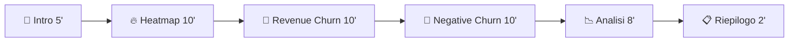
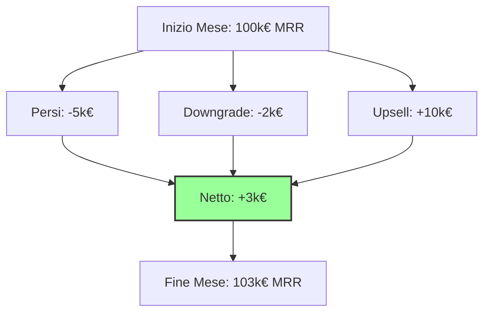

## Retention Deep-Dive: Cohort Analysis e Lifecycle — Lezione Completa

La Retention non è una singola metrica da mettere in una dashboard ("La nostra retention è del 30%"). È una funzione complessa del tempo, del comportamento e della segmentazione. Se guardi solo la media, ti perdi la storia reale. In questa lezione avanzata, andremo oltre il concetto base per analizzare le coorti triangolari, calcolare il tasso di churn negativo e progettare strategie di riattivazione basate sui dati.

### Obiettivi di Apprendimento

Al termine di questa lezione, lo studente sarà in grado di:
1.  Costruire e leggere una "Triangular Heatmap" per la Cohort Analysis.
2.  Distinguere tra *User Churn* (utenti persi) e *Revenue Churn* (fatturato perso).
3.  Calcolare il *Negative Churn* (il Santo Graal del SaaS).
4.  Identificare i segnali premonitori dell'abbandono (Leading Indicators) con l'analisi predittiva.
5.  Progettare campagne di Win-back basate sui segmenti RFM.

### Timeline della Lezione

| Fase | Argomento | Durata |
|------|-----------|--------|
| 1 | Introduzione: La media mente | 5 min |
| 2 | Metodologia: Costruire la Heatmap | 10 min |
| 3 | Metrica: Revenue Churn vs User Churn | 10 min |
| 4 | Strategia: Negative Churn e Espansione | 10 min |
| 5 | Esercizi: Analisi di una Coorte Reale | 8 min |
| 6 | Riepilogo e Domande | 2 min |
| **Totale** | | **45 min** |

### Fase 1 — Introduzione: La media mente (5 min)

Dire "La retention media è 30%" è come dire "La temperatura media dell'ospedale è 36.5°C".
Potresti avere metà pazienti con 42°C di febbre e metà in ipotermia.
Le medie nascondono i trend.
*   I nuovi utenti si comportano peggio dei vecchi? (Problema di Product-Market Fit o Marketing scadente).
*   I power user stanno abbandonando? (Problema di Pricing o Competitor).

L'unico modo per vedere la verità è separare gli utenti per data di nascita: le **Coorti**.

### Fase 2 — Metodologia: Costruire la Heatmap (10 min)

La visualizzazione standard è la tabella triangolare.

| Coorte (Mese Iscrizione) | Mese 0 (100%) | Mese 1 | Mese 2 | Mese 3 | Mese 6 |
| :--- | :--- | :--- | :--- | :--- | :--- |
| **Gennaio** (1.000 utenti) | 100% | 40% | 35% | 30% | 25% |
| **Febbraio** (1.200 utenti) | 100% | 38% | 32% | 28% | ... |
| **Marzo** (1.500 utenti) | 100% | 35% | 29% | ... | ... |

**Come leggerla:**
1.  **Verticale (Colonne):** Confronta il Mese 1 di Gennaio (40%) con il Mese 1 di Marzo (35%). La retention sta *peggiorando*! Stiamo acquisendo utenti di qualità inferiore o l'onboarding si è rotto.
2.  **Orizzontale (Righe):** Guarda come decade la coorte di Gennaio. Si stabilizza al 25% (Mese 6)? Se sì, hai trovato il PMF (Product-Market Fit). Se va a 0%, il business muore.
3.  **Diagonale:** Mostra l'effetto della stagionalità o eventi specifici (es. blackout del server a Maggio colpisce tutte le coorti).

### Fase 3 — Metrica: Revenue Churn vs User Churn (10 min)

Per un'azienda SaaS o Subscription, perdere un cliente da 10€ non è come perdere un cliente da 1.000€.

*   **User Churn Rate:** (Utenti persi / Utenti totali). Misura la popolarità.
*   **Revenue Churn Rate:** (MRR perso / MRR totale). Misura la sostenibilità finanziaria.

*Esempio:*
Hai 100 clienti. 99 pagano 10€/mese. 1 paga 1.000€/mese.
Se perdi il cliente grosso:
*   User Churn: 1% (Sembra ottimo).
*   Revenue Churn: ~50% (Disastroso).

Devi monitorare entrambi, ma il Revenue Churn è quello che paga gli stipendi.

### Fase 4 — Strategia: Negative Churn e Espansione (10 min)

Il **Negative Churn** (o Net Negative Revenue Churn) è il Sacro Graal.
Succede quando l'espansione dei ricavi dai clienti esistenti (Upsell, Cross-sell) supera i ricavi persi dai clienti che se ne vanno.

*Formula:*
`Net MRR Churn = (MRR Perso + MRR Downgrade - MRR Espansione) / MRR Iniziale`

Se l'Espansione è > (Perso + Downgrade), il risultato è negativo (es. -5%).
Significa che anche se non acquisisci *nessun* nuovo cliente, il tuo fatturato cresce del 5% ogni mese. Le aziende con Negative Churn (Slack, Zoom, Snowflake) hanno valutazioni di borsa astronomiche.

**Come ottenerlo?**
*   **Pricing a consumo (Usage-based):** Più usano, più pagano (AWS, Snowflake).
*   **Pricing per utente (Seat-based):** L'azienda cresce, assume più dipendenti, compra più licenze (Slack).
*   **Add-ons:** Vendi moduli extra.

### Fase 5 — Esercizi: Analisi di una Coorte Reale (8 min)

**Scenario:** Analisi di un'app Fitness.
*   Coorte Gennaio: Mese 1 (50%), Mese 2 (40%), Mese 3 (35%).
*   Coorte Aprile: Mese 1 (30%), Mese 2 (20%), Mese 3 (10%).

**Domande:**
1.  **Trend:** La retention sta migliorando o peggiorando? (Peggiorando drasticamente).
2.  **Ipotesi:** Cosa è successo ad Aprile?
    *   *Marketing:* Abbiamo aperto un nuovo canale (TikTok Ads) che porta utenti meno motivati?
    *   *Prodotto:* Abbiamo cambiato l'onboarding e rotto qualcosa?
    *   *Stagionalità:* Ad Aprile la gente smette di allenarsi in casa ed esce (fine dei buoni propositi di Gennaio).

**Azione:**
Segmenta la coorte di Aprile per canale di acquisizione. Se TikTok ha retention 5% e Google Ads ha 40%, il problema è il mix di canali, non il prodotto. Spegni TikTok o cambia la creatività.

### Fase 6 — Riepilogo e Domande (2 min)

1.  **Coorti > Medie.** Sempre.
2.  **Revenue > User.** Segui i soldi.
3.  **Negative Churn.** L'obiettivo ultimo della strategia di prezzo.
4.  **Segmentazione.** Se la retention scende, scava per capire *chi* sta scendendo.

### Domande di Verifica

1.  In una Heatmap di Retention, cosa indica se i valori nella prima colonna (Mese 1) diminuiscono scendendo verso il basso?
2.  Spiega la differenza tra "User Churn" e "Gross Revenue Churn" con un esempio numerico.
3.  Cos'è il "Net Negative Churn" e perché è considerato un indicatore di salute eccezionale per un'azienda SaaS?
4.  Quali sono le leve principali (Pricing) per ottenere un Negative Churn?
5.  Come l'analisi per coorte aiuta a isolare l'impatto di un aggiornamento del prodotto rilasciato in una data specifica?

### Riferimenti Bibliografici

-   Lenny Rachitsky, "The Racecar Growth Framework", Newsletter.
-   David Skok, "SaaS Metrics 2.0", ForEntrepreneurs Blog.
-   Brian Balfour, "Retention is the King of Growth", Reforge.
