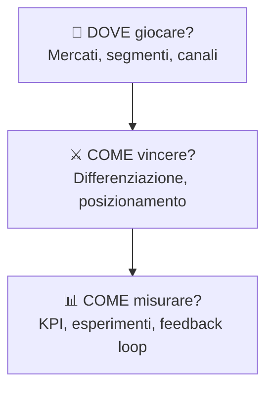

# Strategy Frameworks per il Marketing Data-Driven

> **Obiettivo:** Applicare framework strategici per allineare la data strategy agli obiettivi di business.

## 1. Il Framework delle 3 Lenti

Ogni strategia marketing data-driven deve rispondere a 3 domande:



## 2. Pirate Metrics (AARRR)

Il framework più usato nelle startup per strutturare le metriche di crescita:

| Stage | Metrica | Esempio | Tool |
|:---|:---|:---|:---|
| **Acquisition** | Come ti trovano? | Visite, signup | GA4, UTM |
| **Activation** | Hanno l'esperienza "aha"? | Onboarding completion | Mixpanel |
| **Retention** | Tornano? | DAU/MAU, D30 retention | Amplitude |
| **Revenue** | Pagano? | ARPU, LTV, conversion | Stripe |
| **Referral** | Portano altri? | K-factor, NPS | Custom |

```sql
-- Funnel AARRR completo
SELECT
    COUNT(DISTINCT CASE WHEN event = 'visit' THEN user_id END) AS acquisition,
    COUNT(DISTINCT CASE WHEN event = 'signup' THEN user_id END) AS signup,
    COUNT(DISTINCT CASE WHEN event = 'activation' THEN user_id END) AS activation,
    COUNT(DISTINCT CASE WHEN event = 'purchase' THEN user_id END) AS revenue,
    COUNT(DISTINCT CASE WHEN event = 'referral_sent' THEN user_id END) AS referral,
    -- Conversion rates
    ROUND(COUNT(DISTINCT CASE WHEN event = 'signup' THEN user_id END) * 100.0 /
          NULLIF(COUNT(DISTINCT CASE WHEN event = 'visit' THEN user_id END), 0), 1) AS visit_to_signup,
    ROUND(COUNT(DISTINCT CASE WHEN event = 'purchase' THEN user_id END) * 100.0 /
          NULLIF(COUNT(DISTINCT CASE WHEN event = 'activation' THEN user_id END), 0), 1) AS activation_to_revenue
FROM events WHERE event_date >= CURRENT_DATE - INTERVAL 30 DAY;
```

## 3. Growth Accounting

```python
def growth_accounting(current_users: set, prev_users: set, new_signups: set) -> dict:
    """Scompone la crescita in componenti."""
    retained = current_users & prev_users
    churned = prev_users - current_users
    resurrected = current_users & (prev_users - current_users)  # Tornati dopo churn
    new = new_signups & current_users
    
    return {
        "retained": len(retained),
        "churned": len(churned),
        "new": len(new),
        "resurrected": len(resurrected),
        "net_growth": len(new) + len(resurrected) - len(churned),
        "quick_ratio": (len(new) + len(resurrected)) / max(len(churned), 1)
    }
# Quick Ratio > 2 = crescita sana, < 1 = stai perdendo utenti
```

## 4. North Star Metric per Settore

| Tipo Azienda | North Star Metric | Perché |
|:---|:---|:---|
| E-commerce | Weekly purchasing users | Cattura frequenza + conversione |
| SaaS B2B | Weekly active teams | Misura il valore organizzativo |
| Marketplace | Weekly transactions | Bilancia domanda e offerta |
| Media/Content | Weekly reading time | Misura engagement reale |
| Social | Daily content creators | Cattura il valore generato |
| FinTech | Weekly transacting users | Misura l'uso effettivo |

## Risorse
- **Framework:** AARRR (Dave McClure), North Star (Sean Ellis)
- **Libro:** *Good Strategy Bad Strategy* — Richard Rumelt
