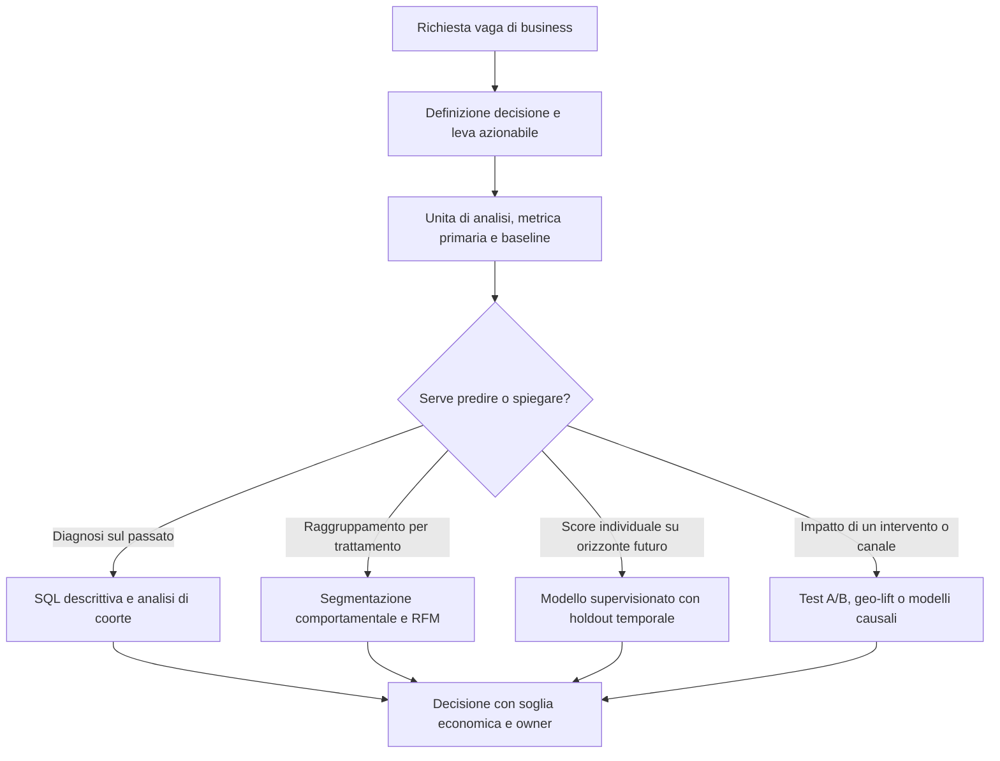

Immagina questa situazione in uno scenario costruito su numeri di esempio realistici per un e-commerce europeo. Il direttore marketing entra in riunione con un problema urgente: nelle ultime quattro settimane il tasso di conversione del mercato francese è sceso dal 3,4% al 2,1% e il team vuole lanciare entro lunedì una campagna di sconto del 15% su 60.000 utenti inattivi, con un budget promozionale massimo di 90.000 euro. Chiede al team dati di "costruire un modello di machine learning per recuperare il fatturato". Se apri subito un notebook per addestrare un classificatore di propensione, hai già perso la partita prima ancora di importare i dati. La domanda iniziale non richiede un algoritmo predittivo: richiede di separare la diagnosi di un guasto di funnel dalla scelta di allocazione del budget incrementale.

> **Idea chiave:** La marketing data science non produce punteggi o grafici isolati: produce decisioni economiche verificabili confrontando il guadagno marginale atteso di un intervento contro una baseline esplicita e un costo d'errore noto.

## Il perimetro reale della disciplina nel binario tabellare

Lavorare nel binario **ml-tabellare** significa partire da tabelle strutturate di ordini, sessioni, contatti CRM e costi media per tornare a tabelle operative che attivano azioni di budget, canale o offerta. La tentazione più diffusa quando si affronta un problema commerciale con Python e SQL è trattare ogni domanda come un esercizio di accuratezza predittiva. Un modello con area sotto la curva ROC (`AUC`) pari a 0,92 che nessuno integra nei flussi di campagna genera meno valore di una tabella decisionale con `AUC` pari a 0,71 collegata direttamente a una soglia di invio automatica.

Per governare questo passaggio serve distinguere tre piani che nel lavoro quotidiano vengono spesso sovrapposti. Il primo piano è la **domanda di business**, formulata nel linguaggio dei ricavi, dei margini o della ritenzione. Il secondo piano è il **meccanismo decisionale**, cioè la leva concreta che il team può azionare cambiando la propria regola attuale: spegnere un rilascio difettoso del checkout, escludere un segmento da uno sconto, spostare spesa tra canali o inviare un contatto a costo unitario positivo. Il terzo piano è il **metodo analitico**, che deve essere il più semplice possibile tra quelli capaci di ridurre l'incertezza su quella leva specifica.

Nel caso del calo francese citato in apertura, mescolare questi piani porta a due errori simultanei. Se il crollo dal 3,4% al 2,1% coincide con l'introduzione di un nuovo metodo di pagamento locale o di una validazione CAP difettosa sul checkout mobile, nessuna campagna di sconto via email riparerà la perdita e nessun modello di propensione spiegherà perché gli utenti abbandonano la pagina di conferma. Viceversa, se l'azienda vuole comunque allocare 90.000 euro in azioni di recupero, il problema diventa scegliere quali clienti generano margine incrementale netto al netto di chi avrebbe comprato comunque a prezzo pieno.

## Tradurre una richiesta vaga in un protocollo operativo

Ogni progetto di marketing data science che regge al contatto con la produzione segue una sequenza ordinata di traduzione prima ancora di addestrare un singolo stimatore. Saltare uno di questi passaggi sposta il rischio sul momento finale, quando il modello è pronto ma lo stakeholder non riconosce la metrica o non dispone del canale per agire.



Il diagramma chiarisce un punto spesso trascurato: la biforcazione metodologica avviene dopo aver fissato unità di analisi, metrica primaria e baseline, mai prima. L'unità di analisi stabilisce quale riga rappresenta un'entità indipendente su cui si decide: può essere il singolo `user_id` per una campagna di retention, l'account aziendale nel B2B, la coppia geo-settimana nei test territoriali oppure il singolo ordine quando si stima il reso atteso. Scegliere l'unità sbagliata distorce subito le statistiche: valutare la conversione per sessione quando il budget di retargeting si paga per utente unico porta a sovrastimare il rendimento dei visitatori seriali che tornano cinque volte prima di acquistare.

La **baseline** risponde invece alla domanda più scomoda: che cosa succederebbe se non usassimo alcun modello? Nei problemi di marketing la baseline raramente è zero. Può essere la regola attuale del CRM, l'invio casuale su tutto il database, la media storica della stessa settimana dell'anno precedente oppure un gruppo di controllo non esposto. Senza una baseline scritta prima di guardare i numeri, qualsiasi percentuale positiva sembra un successo anche quando peggiora il margine rispetto alla regola semplice già in uso.

## Le tre famiglie di problemi nel marketing analitico

Quando un'azienda investe in data science per il marketing, tutte le richieste operative ricadono in tre famiglie distinte per domanda, output e tipo di validazione richiesta. Confonderle produce l'errore classico di usare un modello di propensione per stimare l'effetto causale di uno sconto, oppure di usare una regressione storica per attribuire merito ai canali pubblicitari senza controllo incrementale.

La prima famiglia è la **segmentazione e targeting**, che risponde alla domanda su quali clienti siano simili per comportamento e quale messaggio o offerta meriti ciascun gruppo. Consegna classi o cluster stabili associati a una regola di trattamento dedicata e richiede almeno un controllo di stabilità su sottocampioni insieme alla verifica di una diversa risposta tra segmenti. Non può invece stimare da sola l'effetto incrementale di una nuova promozione.

La seconda famiglia è la **predizione supervisionata**, pensata per stabilire quale cliente acquisterà, abbandonerà o genererà più margine nei prossimi 60 giorni. Restituisce uno score calibrato o un valore continuo collegato a una soglia economica di attivazione e va validata con uno split out-of-time su coorti future e curva di profitto atteso. Il suo limite strutturale sta nel catturare correlazioni osservate sotto la politica storica, non effetti controfattuali.

La terza famiglia è la **causalità e sperimentazione**, che stima quante vendite o margine aggiuntivo generi davvero uno sconto o un canale rispetto al non attivarlo. Restituisce un effetto medio o eterogeneo (`uplift`) con relativo intervallo di incertezza e richiede un esperimento randomizzato con holdout o un disegno quasi-sperimentale dotato di potenza statistica adeguata.

Accanto a questa scelta metodologica si colloca lo stack operativo. La tabella seguente riassume come ogni strato della filiera traduca dati grezzi in decisioni verificate, ricordando che un analista capace di governare finestre temporali in `SQL` e calibrazione della soglia supera chi ottimizza iperparametri su una tabella piena di leakage.

| Livello dello stack | Ruolo nella filiera decisionale | Strumenti tipici | Controllo critico prima del rilascio |
|---|---|---|---|
| **Estrazione e coerenza dati** | Costruire tabelle storiche senza duplicati né variabili future | SQL con CTE e window function | Verifica del cutoff temporale e coerenza dei fusi orari |
| **Analisi tabellare e feature** | Trasformare eventi e ordini in metriche comportamentali stabili | `pandas`, `numpy` | Assenza di leakage e stabilità delle definizioni nel tempo |
| **Modellazione e inferenza** | Stimare probabilità calibrate, intervalli o curve di risposta | `scikit-learn`, `statsmodels` | Confronto su holdout temporale contro baseline euristica |
| **Attivazione economica** | Tradurre probabilità in soglia di contatto o allocazione budget | Python batch, `dbt`, `MLflow` | Monitoraggio drift dei punteggi e controllo su gruppo holdout persistente |

## Calcolo del valore atteso: quando il modello batte la regola fissa

Per vedere come la strategia diventi aritmetica concreta, riprendiamo lo scenario costruito sul catalogo europeo e valutiamo un intervento di retention su **10.000 clienti** attivi a rischio di abbandono nei prossimi 60 giorni. Supponiamo di conoscere dalla contabilità industriale quattro grandezze verificate: il margine lordo medio di un ordine salvato è pari a **60 euro**, il costo variabile di invio più gestione per ciascun contatto promozionale (incluso lo sconto atteso sul carrello medio) è pari a **12 euro per cliente trattato**, e un gruppo pilota precedente ha mostrato che lo stimolo recupera circa il **40%** dei veri utenti in procinto di abbandonare, mentre sui clienti che non avrebbero abbandonato genera solo il costo di 12 euro senza ricavo incrementale aggiuntivo.

Calcoliamo prima la **baseline senza modello**, cioè l'invio indifferenziato a tutti i 10.000 clienti dove la quota reale di clienti effettivamente a rischio di abbandono (tasso base) è del **20%**, cioè **2.000 clienti**. Trattando tutti i 10.000 utenti sosteniamo un costo certo pari a `10.000 * 12 euro = 120.000 euro`. I clienti effettivamente salvati grazie al tasso di recupero del 40% sui 2.000 a rischio sono `2.000 * 0,40 = 800 clienti`. Il margine lordo generato dai clienti salvati è `800 * 60 euro = 48.000 euro`. Il risultato economico netto della campagna indifferenziata è dunque `48.000 euro - 120.000 euro = -72.000 euro`. Inviare a tutti distrugge valore netto perché l'80% del budget finisce su clienti che non avevano bisogno dello stimolo.

Ora confrontiamo questa baseline con l'uso di un **modello predittivo di churn** che seleziona i **2.500 clienti** con punteggio più alto (il top 25% della base). Sul campione di validazione temporale, questo gruppo selezionato concentra **1.500 clienti** realmente a rischio di abbandono (precisione del 60%, tre volte superiore al tasso base del 20%) e **1.000 clienti** che non avrebbero comunque abbandonato. Calcoliamo i numeri della campagna mirata sui 2.500 contatti: il costo totale dell'intervento scende a `2.500 * 12 euro = 30.000 euro`. I clienti salvati con lo stesso tasso di recupero del 40% sui 1.500 reali casi a rischio sono `1.500 * 0,40 = 600 clienti`. Il margine lordo recuperato è `600 * 60 euro = 36.000 euro`. Il profitto netto della campagna guidata dal modello diventa `36.000 euro - 30.000 euro = +6.000 euro`.

Il confronto tra le due colonne chiarisce l'essenza strategica della marketing data science: rispetto alla campagna a tappeto (-72.000 euro), il modello genera un **miglioramento economico netto di +78.000 euro** pur contattando un quarto del pubblico e recuperando 200 clienti in meno in valore assoluto. Se però la precisione sul top quartile scendesse dal 60% al 45% (1.125 veri positivi su 2.500 contatti), i clienti salvati diventerebbero `1.125 * 0,40 = 450 clienti`, il margine lordo sarebbe `450 * 60 euro = 27.000 euro` e il saldo netto tornerebbe negativo a `-3.000 euro`. La soglia di pareggio minima di precisione richiesta affinché il contatto abbia valore atteso positivo è esattamente `12 euro / (60 euro * 0,40) = 0,50`, cioè **50%**. Sotto il 50% di probabilità calibrata di abbandono, non conviene inviare lo sconto nemmeno con il modello migliore del mondo.

Il codice Python seguente implementa questa valutazione economica direttamente su una tabella di punteggi di validazione, ordinando i decili per probabilità calibrata e individuando la soglia ottima di profitto invece di fermarsi all'accuracy o all'AUC.

```python
import numpy as np
import pandas as pd

# Simulazione di uno score di churn calibrato su 10.000 clienti in holdout temporale
rng = np.random.default_rng(42)
n_clienti = 10_000
prob_vera = rng.beta(a=1.2, b=4.8, size=n_clienti)  # media ~20% di churn base
y_reale = rng.binomial(n=1, p=prob_vera)

# Score del modello con rumore realistico (calibrazione quasi preservata)
prob_stimata = np.clip(prob_vera + rng.normal(0, 0.05, size=n_clienti), 0.01, 0.99)

df_val = pd.DataFrame({
    "y_churn": y_reale,
    "p_churn": prob_stimata,
})

# Parametri economici della campagna di retention
MARGINE_SALVATAGGIO = 60.0   # euro di margine lordo per cliente salvato
COSTO_CONTATTO = 12.0        # euro per utente contattato (invio + costo sconto atteso)
TASSO_RECUPERO = 0.40        # quota di veri churner recuperati dallo stimolo

# Soglia teorica di pareggio: p * TASSO_RECUPERO * MARGINE_SALVATAGGIO >= COSTO_CONTATTO
soglia_breakeven = COSTO_CONTATTO / (MARGINE_SALVATAGGIO * TASSO_RECUPERO)

# Calcolo del profitto cumulato ordinando i clienti dal rischio piu alto al piu basso
df_ordinato = df_val.sort_values("p_churn", ascending=False).reset_index(drop=True)
df_ordinato["ricavo_atteso_riga"] = df_ordinato["y_churn"] * TASSO_RECUPERO * MARGINE_SALVATAGGIO
df_ordinato["profitto_riga"] = df_ordinato["ricavo_atteso_riga"] - COSTO_CONTATTO
df_ordinato["profitto_cumulato"] = df_ordinato["profitto_riga"].cumsum()

idx_ottimo = df_ordinato["profitto_cumulato"].idxmax()
clienti_ottimi = idx_ottimo + 1
profitto_massimo = df_ordinato.loc[idx_ottimo, "profitto_cumulato"]
profitto_tutti = df_ordinato["profitto_cumulato"].iloc[-1]

print(f"Soglia teorica di pareggio (p_churn): {soglia_breakeven:.1%}")
print(f"Profitto inviando a tutti (baseline): {profitto_tutti:,.0f} euro")
print(f"Clienti ottimi da contattare: {clienti_ottimi} su {n_clienti}")
print(f"Profitto netto massimo su holdout: {profitto_massimo:,.0f} euro")
```

Nota come la logica del codice sposti immediatamente la conversazione con il marketing: la decisione non verte sul fatto che `AUC` valga 0,78 o 0,81, ma su quali e quanti clienti superano la soglia di pareggio del 50% e su quanto margine netto si perde spostando la soglia verso l'alto o verso il basso.

## Quando il modello predittivo va fermato prima di iniziare

Non tutte le situazioni meritano un modello di machine learning, e riconoscere in anticipo quando fermarsi fa risparmiare settimane di ingegneria inutile. La prima situazione in cui un modello ML è inutile riguarda le domande rivolte al passato, come capire perché il checkout sia calato in Francia ieri: un classificatore predice chi convertirà in futuro, non isola un bug di rilascio. In quel caso serve una query `SQL` di funnel segmentata per paese, device, browser e versione.

La seconda situazione riguarda i campioni ridotti con meno di mille eventi positivi stabili, dove la varianza delle stime supera il segnale e i pesi oscillano a ogni riaddestramento; qui conviene una semplice analisi tabellare con regole di segmento. Lo stesso vale per decisioni una tantum prive di riutilizzo ripetuto, dove il costo di sviluppo e monitoraggio supera il margine recuperabile e basta un modello di sensitività per scenari.

Infine, conviene fermare il progetto ML quando non esiste alcuna leva azionabile disponibile o quando gli stakeholder commerciali rifiutano i punteggi opachi. Anche conoscendo chi abbandonerà con alta precisione, senza budget o canale per intervenire il punteggio rimane in un cassetto; allo stesso modo, se il team CRM ignora la black-box, una scorecard additiva o `RFM` interpretabile ottiene adozione reale molto più in fretta.

Un caso industriale reale documentato che illustra l'integrazione tra dati, prodotto e decisione è l'approccio di Spotify descritto anche nei suoi report ingegneristici pubblici ([Spotify Engineering](https://engineering.atspotify.com/)): la raccomandazione musicale di Discover Weekly e l'engagement di Wrapped non vivono come slide separate inviate una volta al mese al management, ma entrano direttamente nel prodotto e nei trigger di retention dove il costo marginale di attivazione è quasi nullo e il feedback utente rientra subito nella pipeline. Nel marketing aziendale ordinario, dove invece inviare un buono sconto o pagare un click media costa denaro reale per ogni utente trattato, la disciplina del punto di pareggio diventa ancora più severa.

## Errori ricorrenti che svuotano la strategia analitica

### Confondere la precisione tecnica con l'impatto economico

Il primo errore nasce quando il team misura il successo con metriche puramente statistiche come `accuracy`, `F1` o `RMSE` senza collegarle al conto economico della campagna. Un modello di propensity può avere `accuracy` del 94% su un e-commerce con tasso di acquisto del 6% semplicemente prevedendo "non acquista" per tutti. Anche quando il ranking è buono (`AUC` 0,80), se il modello non è calibrato nelle probabilità o se la soglia di attivazione ignora il costo del falso positivo (lo sconto regalato a chi avrebbe comprato comunque), l'implementazione distrugge margine pur avendo metriche tecniche apparentemente rispettabili.

### Sostituire l'analisi causale con un modello di propensione

Il secondo errore consiste nel targeting diretto sui punteggi più alti di acquisto per decidere a chi inviare un incentivo economico. Un modello di propensione ordina gli utenti in base alla probabilità naturale di acquistare, non in base all'aumento di probabilità causato dallo sconto. I clienti al top del ranking comprerebbero spesso anche senza coupon: premiarli con un 15% di riduzione erode il margine lordo su ordini già acquisiti. La risposta metodologica corretta quando l'incentivo ha un costo elevato è passare al targeting incrementale (`uplift` con gruppo di controllo) oppure escludere esplicitamente il decile a propensione altissima dalla promozione.

### Consegnare analisi senza owner, baseline e piano di verifica

Il terzo errore riguarda il trasferimento verso l'operatività: consegnare un elenco di clienti o una presentazione senza aver dichiarato prima quale baseline viene battuta, chi è il proprietario operativo della lista prodotta e come si misura l'esito dopo 30 giorni. Senza un gruppo di controllo escluso dal trattamento (holdout persistente del 10% o 20% dei clienti idonei), a fine trimestre nessuno potrà dimostrare se il recupero del fatturato dipenda dal modello o dalla normale ripresa stagionale.

## Verifica operativa sulla strategia di marketing

1. In uno scenario in cui il tasso di conversione checkout crolla bruscamente in un singolo paese dopo un rilascio di prodotto, perché lanciare subito un modello di propensione agli acquisti è la scelta metodologica sbagliata?

<details>
<summary>Mostra risposta</summary>

Un modello di propensione è addestrato sulle correlazioni storiche tra caratteristiche utente e acquisto passato e serve a ordinare gli utenti futuri per probabilità di conversione, non a diagnosticare la causa di una rottura improvvisa del funnel. Nel caso di un crollo concentrato su un paese dopo un rilascio, serve prima un'analisi descrittiva in SQL e pandas segmentata per paese, device, gateway di pagamento e data del rilascio per verificare se esista un bug tecnico o un cambiamento di attrito nel checkout. Solo dopo aver stabilizzato il flusso ha senso valutare azioni predittive o promozionali.

</details>

2. Con un margine per ordine salvato di 50 euro, un costo totale per contatto di 15 euro e un tasso di recupero del 30% sui veri clienti a rischio, quale probabilità minima di abbandono deve avere un cliente per giustificare l'invio dell'offerta?

<details>
<summary>Mostra risposta</summary>

La condizione di pareggio impone che il valore atteso salvato sia almeno pari al costo del contatto: `p * Tasso_Recupero * Margine >= Costo_Contatto`. Sostituendo i valori si ottiene `p * 0,30 * 50 euro >= 15 euro`, cioè `p * 15 euro >= 15 euro`, da cui `p >= 1,00` (100%). Con questi parametri economici nessuna campagna a pagamento risulta profittevole nemmeno su un cliente quasi certo di abbandonare, perché il massimo guadagno atteso (15 euro) eguaglia appena il costo certo di invio (15 euro). Prima di scrivere codice occorre quindi rinegoziare il costo dello stimolo o scegliere un canale più economico.

</details>

3. Perché la calibrazione delle probabilità stimate conta più dell'AUC pura quando si decide quale frazione di clienti contattare con un coupon?

<details>
<summary>Mostra risposta</summary>

L'AUC misura soltanto la capacità di ordinamento relativo tra coppie casuali di positivi e negativi, quindi resta invariata se moltiplichi o sposti in modo monotono le probabilità predette. Tuttavia la soglia di pareggio economico dipende dalla probabilità assoluta effettiva che l'utente abbandoni o converta. Se il modello restituisce un punteggio di 0,65 ma la frequenza reale osservata in quella fascia è solo 0,35, applicare la formula del valore atteso sulla probabilità grezza porterà a contattare molti clienti in perdita netta pur mantenendo identico l'AUC.

</details>

4. Quale meccanismo minimo devi lasciare attivo in produzione quando lanci per la prima volta una campagna guidata da un modello predittivo?

<details>
<summary>Mostra risposta</summary>

Devi mantenere un gruppo di controllo randomizzato (holdout persistente, tipicamente tra il 10% e il 20% dei clienti elegibili sopra soglia) che non riceve il trattamento pur avendo lo stesso profilo di punteggio del gruppo esposto. Questo confronto controllato permette di misurare l'incremento reale di ordini e margine rispetto all'assenza di intervento, isolando l'effetto del modello da stagionalità, variazioni di prezzo o recuperi spontanei.

</details>
