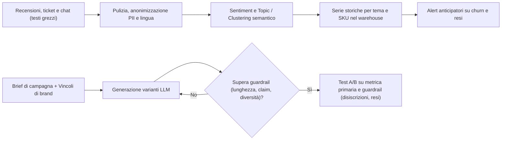

## Il rumore delle varianti AI senza una metrica di controllo

Considera uno scenario costruito con numeri di esempio su un team e-commerce che integra un modello linguistico per generare 120 varianti al mese tra oggetti email e descrizioni prodotto, riducendo del 65% il tempo speso dal team editoriale nella scrittura delle bozze. Dopo novanta giorni il bilancio mostra però due effetti collaterali imprevisti: il tasso di clic rimane pressoché identico, mentre il tasso di disiscrizione dalle newsletter sale dallo 0,18% allo 0,42% e tre invii vengono contestati per promesse promozionali non autorizzate rispetto al listino reale.

Allo stesso tempo, nei database del supporto clienti e delle recensioni giacciono 18.000 testi mensili mai collegati alle tabelle delle coorti. Quando l'analista incrocia finalmente i testi con i resi e il mancato riacquisto, scopre che un aumento improvviso di lamentele legate ai tempi di consegna e alla vestibilità anticipava già di sei settimane il calo di retention dell'ultimo trimestre. Il problema del team non era scrivere più parole al minuto, ma misurare con rigore ciò che i clienti stavano già comunicando e imporre controlli quantitativi alle parole generate in uscita.

> **Idea chiave:** Nel marketing data-driven il linguaggio naturale crea vantaggio competitivo quando trasforma testi non strutturati in indicatori anticipatori tabellari e sottopone ogni testo generato a guardrail deterministici e test controllati.

Trattare il testo sia come sensore diagnostico sia come azione sperimentale permette di chiudere il ciclo tra voce del cliente, priorità operative di prodotto e qualità delle campagne.

## La pipeline testo-tabella-esperimento: dalla voce del cliente al test

In un'architettura matura, il trattamento automatico del linguaggio non vive come esperimento isolato su singoli prompt. I flussi in ingresso (recensioni, ticket, risposte aperte alle survey, chat pre-vendita) alimentano modelli di estrazione strutturata che aggregano il segnale per coorte, prodotto o corriere; i flussi in uscita (varianti di copy, risposte assistite, sintesi prodotto) attraversano invece un filtro automatico prima di arrivare al test A/B su pubblico reale.



Separare chiaramente i due rami impedisce la confusione più frequente nei progetti NLP aziendali: valutare un modello di generazione solo perché "suona convincente" o mantenere un classificatore di sentiment che non si traduce mai in una tabella azionabile per il team di prodotto o di logistica.

| Compito NLP | Input tipico | Output strutturato | Metrica di validazione | Decisione operativa collegata |
| --- | --- | --- | --- | --- |
| `Sentiment analysis` contestuale | Recensioni, risposte survey, note NPS | Punteggio continuo `[-1, +1]` o classe a 3 livelli | F1 pesato su campione etichettato a mano (almeno 300 testi) | Monitorare deriva di qualità per SKU o coorte |
| `Topic modeling` e clustering | Ticket supporto, chat pre-vendita | Distribuzione di probabilità su $K$ temi stabili | Coerenza tematica e stabilità temporale dei cluster | Isolare la causa principale di resi o churn |
| `Embedding` e ricerca semantica | Catalogo prodotti, FAQ, richieste utente | Vettori densi normalizzati per similarità coseno | Precision@K su query storiche reali | Raggruppare reclami simili e migliorare ricerca interna |
| Classificazione intenti | Email in arrivo, chat assistenza | Etichetta di routing (`reso`, `bug`, `fattura`, `upsell`) | Recall sulla classe critica (es. richiesta disdetta) | Instradamento prioritario e trigger di salvataggio |
| Generazione `copy` vincolata | Attributi prodotto, segmento, storico promo | 2–3 varianti diverse in formato JSON controllato | Lift su conversione netta meno disiscrizioni e resi | Selezionare la variante vincente in test A/B controllato |

Nota la colonna delle metriche: nessun compito si valuta con una sola sensazione qualitativa. Persino la generazione del copy deve passare un doppio esame: prima il controllo programmatico sui vincoli di testo, poi l'esperimento controllato che pesa i clic o le vendite insieme alle metriche di danno come resi e disiscrizioni.

## Analisi numerica: correlare lo scivolamento del sentiment e dei topic al churn futuro

Per capire perché un indice aggregato spesso tace mentre un problema operativo esplode, seguiamo una derivazione numerica completa su un brand e-commerce che raccoglie 10.000 testi mensili tra recensioni post-acquisto e ticket di assistenza (numeri di esempio). Il modello di topic assignment classifica ogni testo in quattro categorie mutuamente esclusive, ciascuna dotata del proprio sentiment medio su scala da `-1,0` (totalmente negativo) a `+1,0` (totalmente positivo).

Confrontiamo i dati di **Q1** rispetto a quelli di **Q2**:

- **Tema A (`qualità_prodotto`):** in Q1 pesa per il 22% dei testi (2.200 testi) con sentiment `+0,42`. In Q2 scende leggermente al 20% (2.000 testi) con sentiment `+0,40`.
- **Tema B (`spedizione_ritardi`):** in Q1 pesa per il 15% (1.500 testi) con sentiment `-0,10`. In Q2 balza al 32% dei testi (3.200 testi) e il suo sentiment crolla a `-0,45`.
- **Tema C (`taglia_vestibilità`):** in Q1 pesa per il 18% (1.800 testi) con sentiment `-0,05`. In Q2 sale al 24% (2.400 testi) con sentiment `-0,25`.
- **Tema D (`altro_positivo`):** in Q1 raccoglie il restante 45% (4.500 testi) a `+0,30`; in Q2 scende al 24% (2.400 testi) mantenendo `+0,30`.

Calcoliamo l'indice di sentiment composito ponderato per quota dei topic nei due trimestri:

$$\text{Sentiment}_{\text{Q1}} = (0,22 \times 0,42) + (0,15 \times (-0,10)) + (0,18 \times (-0,05)) + (0,45 \times 0,30)$$
$$\text{Sentiment}_{\text{Q1}} = +0,0924 - 0,0150 - 0,0090 + 0,1350 = +0,2034$$

Ripetiamo il calcolo per il secondo trimestre:

$$\text{Sentiment}_{\text{Q2}} = (0,20 \times 0,40) + (0,32 \times (-0,45)) + (0,24 \times (-0,25)) + (0,24 \times 0,30)$$
$$\text{Sentiment}_{\text{Q2}} = +0,0800 - 0,1440 - 0,0600 + 0,0720 = -0,0520$$

La variazione totale tra Q1 e Q2 vale $-0,0520 - 0,2034 = -0,2554\text{ punti}$, superando la soglia di allerta aziendale fissata a $-0,20$. Ma il dato davvero azionabile emerge scomponendo il contributo di ciascun tema alla caduta:

- Contributo `qualità_prodotto`: $0,0800 - 0,0924 = -0,0124$ punti (impatto marginale).
- Contributo `spedizione_ritardi`: $-0,1440 - (-0,0150) = -0,1290$ punti, pari al $0,1290 / 0,2554 = 50,5\%$ dell'intero peggioramento.
- Contributo `taglia_vestibilità`: $-0,0600 - (-0,0090) = -0,0510$ punti (20,0% del peggioramento).
- Contributo `altro_positivo` (calo di quota): $0,0720 - 0,1350 = -0,0630$ punti (24,7%).

Questa scomposizione evita al marketing un errore costoso: anziché cambiare le creatività pubblicitarie o riscrivere le email automatiche per inseguire un calo del sentiment, oltre metà del deterioramento proviene dal tema `spedizione_ritardi` (raddoppiato dal 15% al 32% dei volumi e precipitato a `-0,45`). La decisione corretta è aprire un confronto immediato sulle SLA del corriere nell'area interessata e aggiornare le stime di consegna nella scheda prodotto prima ancora che il calo si rifletta sul tasso di riacquisto a 90 giorni.

Sul fronte della generazione testi, supponiamo invece di testare una nuova subject line su 40.000 iscritti (20.000 controllo, 20.000 variante): se il controllo registra un `CTR` del 2,4% (480 clic) e disiscrizioni allo 0,18% (36 disiscrizioni), mentre la variante sale al 2,9% di `CTR` (580 clic, +100 clic netti) ma porta le disiscrizioni allo 0,45% (90 disiscrizioni, +54 utenti persi per sempre), ogni 1,85 clic extra ottenuti con un titolo più aggressivo ti sta costando la perdita permanente di un iscritto dal database. La metrica combinata impone di bocciare la variante.

## Pipeline Python riproducibile: sentiment, topic modeling e ricerca semantica con guardrail

Un errore frequente nei prototipi in Python è importare lessici inglesi come `VADER` su recensioni in italiano o generare copy con API obsolete senza validazione dello schema in uscita. In ambito multilingua o italiano conviene usare un modello transformer multilingua o addestrato su italiano per il sentiment, `CountVectorizer` + `LatentDirichletAllocation` (con lista di stop-word italiane esplicita e controllo minimo di frequenza dei termini) oppure clustering su embedding per i topic, e un validatore deterministico che blocchi ogni output LLM prima del test A/B.

```python
import re
from typing import Iterable
from sklearn.decomposition import LatentDirichletAllocation
from sklearn.feature_extraction.text import CountVectorizer


ITALIAN_STOPWORDS = [
    "che", "con", "del", "della", "delle", "degli", "dei", "dal", "dalla",
    "gli", "una", "uno", "per", "non", "sono", "stato", "molto", "anche",
    "come", "più", "questo", "questa", "questi", "quello", "avere", "essere",
]


def extract_marketing_topics(
    documents: list[str],
    n_topics: int = 4,
    max_words: int = 6,
) -> list[dict[str, object]]:
    """
    Estrae topic dai testi dei clienti filtrando stop-word italiane e termini rari.
    Restituisce i termini più rappresentativi di ciascun tema per l'ispezione umana.
    """
    vectorizer = CountVectorizer(
        max_df=0.85,
        min_df=2,
        stop_words=ITALIAN_STOPWORDS,
        ngram_range=(1, 2),
    )
    doc_term_matrix = vectorizer.fit_transform(documents)
    lda = LatentDirichletAllocation(
        n_components=n_topics,
        random_state=42,
        learning_method="online",
    )
    lda.fit(doc_term_matrix)
    feature_names = vectorizer.get_feature_names_out()

    topics_summary = []
    for idx, topic_weights in enumerate(lda.components_):
        top_indices = topic_weights.argsort()[::-1][:max_words]
        top_terms = [str(feature_names[i]) for i in top_indices]
        topics_summary.append({"topic_id": idx, "top_terms": top_terms})
    return topics_summary


def validate_generated_copy(
    variants: Iterable[str],
    max_chars: int = 55,
    forbidden_claims: tuple[str, ...] = ("gratis per sempre", "garantito al 100%", "sconto 90%"),
    min_jaccard_distance: float = 0.35,
) -> list[dict[str, object]]:
    """
    Guardrail deterministico per varianti di copy generate da LLM:
    1. Verifica lunghezza massima per evitare troncamenti su mobile.
    2. Blocca promesse promozionali o legali vietate.
    3. Assicura che le varianti differiscano abbastanza da giustificare un test A/B.
    """
    accepted_tokens: list[set[str]] = []
    report = []

    for text in variants:
        clean_text = re.sub(r"\s+", " ", text).strip()
        lowered = clean_text.lower()
        violations = []

        if len(clean_text) > max_chars:
            violations.append(f"lunghezza {len(clean_text)} supera {max_chars} caratteri")

        for claim in forbidden_claims:
            if claim in lowered:
                violations.append(f"contiene claim vietato: '{claim}'")

        tokens = set(re.findall(r"[a-zàèéìòù0-9]+", lowered))
        for prev_tokens in accepted_tokens:
            union_size = len(tokens | prev_tokens)
            similarity = len(tokens & prev_tokens) / union_size if union_size > 0 else 1.0
            if (1.0 - similarity) < min_jaccard_distance:
                violations.append("variante troppo simile a una già accettata")
                break

        passed = len(violations) == 0
        if passed:
            accepted_tokens.append(tokens)
        report.append({"copy": clean_text, "passed": passed, "violations": violations})

    return report
```

Questo controllo risolve due problemi reali prima ancora che la campagna venga caricata nello strumento di invio: impedisce la pubblicazione di errori di compliance o testi troncati su smartphone, e scarta varianti quasi identiche tra loro (come cambiare una sola preposizione) che consumerebbero potenza statistica nel test A/B senza generare apprendimento sul messaggio.

Quando invece serve integrare un modello linguistico moderno tramite API per generare varianti strutturate o riassumere cluster di ticket, è buona norma usare l'interfaccia client aggiornata con parametri di schema espliciti e temperatura controllata, passando sempre il risultato attraverso `validate_generated_copy` prima di salvare le proposte in tabella.

```python
from openai import OpenAI
import json


def generate_email_subject_variants(
    product_focus: str,
    target_segment: str,
    verified_offer: str,
) -> list[str]:
    """
    Genera 3 varianti distinte di subject line con vincoli espliciti di lunghezza e offerta reale.
    Richiede variabile d'ambiente OPENAI_API_KEY configurata.
    """
    client = OpenAI()
    prompt = (
        f"Scrivi esattamente 3 oggetti email distinti in italiano per il segmento '{target_segment}'. "
        f"Focus: {product_focus}. Offerta verificata: {verified_offer}. "
        "Massimo 50 caratteri ciascuno, nessuna promessa inventata, nessun punto esclamativo. "
        'Rispondi solo in JSON nel formato {"variants": ["...", "...", "..."]}.'
    )
    response = client.chat.completions.create(
        model="gpt-4o-mini",
        temperature=0.5,
        response_format={"type": "json_object"},
        messages=[
            {"role": "system", "content": "Sei un copywriter analitico orientato alla chiarezza."},
            {"role": "user", "content": prompt},
        ],
    )
    payload = json.loads(response.choices[0].message.content)
    return payload.get("variants", [])
```

Imporre il formato JSON con `response_format={"type": "json_object"}` e passare l'elenco al validatore deterministico garantisce che l'intero flusso sia automatizzabile e verificabile senza correzioni manuali fragili basate su espressioni regolari.

## Generazione vincolata e il caso Sephora sulle recensioni multilingua

Nell'industria cosmetica e retail, Sephora ha mostrato il valore di trattare i testi dei clienti come infrastruttura analitica prima che come semplice archivio di commenti. Analizzando milioni di recensioni di prodotti con pipeline NLP per estrazione di topic e sentiment su ingredienti, texture e risultati percepiti, il team riuscì a individuare con anticipo l'ascesa di tendenze di ricerca specifiche (come l'interesse crescente verso formulazioni con acido ialuronico e specifici attivi idratanti) prima che emergessero nei report di vendita trimestrali tradizionali.

Sul versante operativo della produzione contenuti, l'integrazione di sistemi di generazione guidata per le schede e gli aggiornamenti di catalogo permise di ridurre di circa il 60% i tempi di redazione, mantenendo però un passaggio esplicito di revisione su sicurezza delle dichiarazioni e coerenza di tono del marchio. La lezione pratica è chiara: l'automazione linguistica accelera l'esecuzione soltanto quando è ancorata a dati di prodotto certificati in ingresso e a metriche di qualità e resi in uscita.

## Tre errori frequenti nell'uso dell'NLP e degli LLM nel marketing

Molti progetti di analytics testuale si arenano in produzione non per la qualità dell'algoritmo scelto, ma per tre sviste ingegneristiche facilmente evitabili.

### Applicare lessici inglesi su testi italiani o ignorare le negazioni di dominio

Eseguire librerie pensate per l'inglese come VADER su recensioni in italiano restituisce punteggi neutri (`0.0`) sulla maggior parte delle frasi perché le parole italiane non esistono nel dizionario sottostante. Anche in italiano, lessici statici senza contesto sbagliano le negazioni e il lessico di settore ("consegna veloce ma pacco aperto", oppure "prezzo basso ma qualità scadente", dove "veloce" e "scadente" richiedono pesi distinti per attributo). Prima di mettere un classificatore in dashboard, va sempre etichettato manualmente un set di validazione di almeno 300 testi reali nel proprio dominio per misurarne l'accuratezza effettiva.

### Testare varianti di copy indistinguibili o senza metrica di danno

Lanciare un test A/B tra tre varianti generate dall'LLM che differiscono solo per un aggettivo diluisce il traffico su differenze troppo piccole per raggiungere la significatività statistica in tempi ragionevoli. Peggio ancora, ottimizzare unicamente sul tasso di apertura o sul `CTR` premia titoli sensazionalistici che aumentano i clic nel breve periodo ma provocano un picco di disiscrizioni, reclami spam e resi post-acquisto quando il contenuto dell'email o della pagina non mantiene l'aspettativa creata dal titolo.

### Inviare al modello testi grezzi contenenti dati personali senza filtro deterministico

Inviare ticket di assistenza o trascrizioni di chat direttamente a un modello generativo esterno senza mascherare prima indirizzi email, numeri di telefono, codici fiscali o identificativi d'ordine viola la minimizzazione dei dati prevista dal GDPR e rischia di far trapelare riferimenti sensibili negli output riassunti. La pulizia preliminare (`regex` e rilevamento entità PII) e la validazione dell'output prima della pubblicazione devono rimanere fasi deterministiche obbligate dell'orchestratore.

## Controllo prima di portare un flusso NLP in produzione

Prima di integrare punteggi testuali nelle dashboard o di automatizzare varianti di copy verso i clienti, verifica la tua pipeline rispondendo a queste quattro domande.

1. Nel trimestre appena chiuso il sentiment medio aggregato delle recensioni scende da `+0,20` a `-0,05`, ma un topic specifico (`spedizione_ritardi`) spiega da solo il 50% del calo: perché questo risultato orienta un intervento logistico prima di qualsiasi test di copywriting?

<details>
<summary>Mostra risposta</summary>

La scomposizione per topic dimostra che la perdita di soddisfazione non deriva da una comunicazione inefficace o da una promessa creativa errata, ma da un guasto operativo concentrato sui tempi e sulle modalità di consegna. Intervenire sulle email o sugli annunci mentre i pacchi continuano ad arrivare in ritardo non riduce il churn; al contrario, correggere le SLA del corriere e aggiornare le stime reali al checkout affronta la causa diretta che spiega metà del peggioramento complessivo.

</details>

2. Nel validatore deterministico `validate_generated_copy`, perché viene imposto un controllo di distanza minima di Jaccard tra le varianti generate dall'LLM prima di avviare un test A/B?

<details>
<summary>Mostra risposta</summary>

Se l'LLM genera tre varianti che usano quasi le stesse parole in ordine diverso, la differenza attesa nel tasso di clic o conversione sarà minuscola. Dividere il traffico del test A/B su varianti quasi identiche richiede campioni enormemente più grandi per rilevare un effetto reale e spreca giorni di esperimento senza insegnare al team quale leva psicologica o informativa funzioni meglio sul segmento.

</details>

3. Perché usare un'architettura `VADER` standard su un flusso di recensioni e-commerce in italiano produce risultati sistematicamente distorti?

<details>
<summary>Mostra risposta</summary>

`VADER` è progettato su un dizionario lessicale e regole sintattiche esclusivamente inglesi. Applicato a testi italiani non riconosce la maggior parte dei termini e assegna falsi punteggi neutri (`0.0`), riuscendo a leggere al massimo prestiti inglesi o emoticon isolate. Inoltre non distingue aspetti separati dello stesso commento (es. spedizione rapida ma prodotto difettoso), rendendo necessario un modello addestrato o calibrato in italiano e validato su un campione annotato internamente.

</details>

4. Un modello LLM propone un nuovo oggetto email che aumenta i clic del 22% in un test pilota ma raddoppia il tasso di disiscrizione dallo 0,20% allo 0,40%: quale criterio decisionale deve prevalere?

<details>
<summary>Mostra risposta</summary>

Deve prevalere il criterio basato sul valore netto e sul rispetto delle metriche di danno (`guardrail`). Un aumento dei clic accompagnato dal raddoppio delle disiscrizioni indica che il titolo crea un'aspettativa eccessiva o fuorviante rispetto al contenuto dell'email. Poiché ogni iscritto perso azzera il suo valore futuro su tutte le campagne successive, una variante che erode la base indirizzi va scartata a meno che il guadagno netto di margine incrementale non superi ampiamente il valore attuale netto degli iscritti perduti.

</details>
