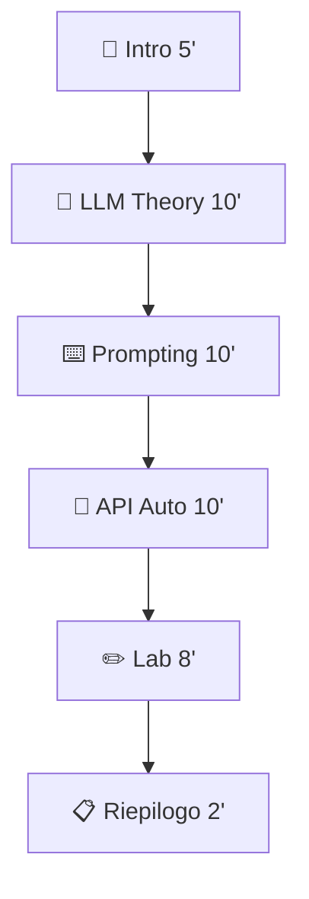

## Text Generation per il Marketing — Lezione Completa

La generazione di testo automatica (NLG - Natural Language Generation) non è più fantascienza. Con l'avvento dei Large Language Models (LLM) come GPT-4, Claude e Llama, i marketer hanno a disposizione un "stagista infinito" capace di scrivere copy, email, post social e descrizioni prodotto in secondi. Ma la potenza è nulla senza controllo. In questa lezione, esploreremo come funzionano questi modelli e come integrarli in una pipeline di marketing data-driven.

### Obiettivi di Apprendimento

Al termine di questa lezione, lo studente sarà in grado di:
1.  Comprendere il funzionamento base di un Transformer e il concetto di "predizione del prossimo token".
2.  Progettare prompt efficaci (Prompt Engineering) per ottenere output di alta qualità.
3.  Utilizzare le API (OpenAI/Anthropic) per automatizzare la creazione di contenuti su scala (Programmatic SEO).
4.  Identificare i rischi di "allucinazione" e bias nei modelli generativi.
5.  Implementare un sistema di "Human-in-the-loop" per la validazione dei contenuti.

### Timeline della Lezione

| Fase | Argomento | Durata |
|------|-----------|--------|
| 1 | Introduzione: Da N-Grams a Transformers | 5 min |
| 2 | Teoria: Come "pensano" gli LLM | 10 min |
| 3 | Tecnica: Prompt Engineering Avanzato | 10 min |
| 4 | Applicazione: Automazione via API | 10 min |
| 5 | Esercizi: Riscrittura e Ottimizzazione | 8 min |
| 6 | Riepilogo e Domande | 2 min |
| **Totale** | | **45 min** |



### Fase 1 — Introduzione: Da N-Grams a Transformers (5 min)

Fino al 2017, la generazione di testo era rudimentale. Si usavano le catene di Markov o le reti RNN, che "dimenticavano" l'inizio della frase prima di arrivare alla fine. Il risultato? Testi grammaticalmente corretti ma privi di senso logico.

La svolta è arrivata con il paper "Attention Is All You Need" di Google, che ha introdotto i **Transformers**. Questa architettura permette al modello di "prestare attenzione" a tutte le parole di un contesto contemporaneamente, capendo che "banco" in "banco di pesce" è diverso da "banco di scuola".

Oggi, la Text Generation nel marketing non serve a sostituire i copywriter, ma a liberarli dal lavoro ripetitivo (es. scrivere 5.000 descrizioni per un catalogo e-commerce) per concentrarsi sulla strategia creativa.

### Fase 2 — Teoria: Come "pensano" gli LLM (10 min)

Gli LLM (Large Language Models) non "pensano" e non "sanno" nulla. Sono motori statistici probabilistici.
Il loro unico obiettivo è: **Dato un contesto, qual è la parola (token) più probabile che viene dopo?**

*   *Prompt:* "Il gatto è sul..."
*   *Modello:* Calcola le probabilità: "tavolo" (40%), "divano" (30%), "tetto" (20%), "cane" (0.1%).
*   *Output:* Sceglie "tavolo" (spesso introducendo un po' di casualità, o "Temperature", per essere creativo).

**Parametri Chiave:**
1.  **Temperature (0.0 - 1.0):** Controlla la creatività.
    *   0.0 = Deterministico (sempre la parola più probabile). Usalo per estrazione dati o codice.
    *   0.8 = Creativo (sceglie anche parole meno probabili). Usalo per brainstorming o copy.
2.  **Context Window:** Quanta "memoria" a breve termine ha il modello (es. 128k token).

```mermaid
flowchart TD
    Input[Input: 'Il gatto è...'] --> Embedding[Vettorizzazione]
    Embedding --> Transformer[Transformer Layers (Attention)]
    Transformer --> Prob[Calcolo Probabilità Next Token]
    Prob --> Selection{Selezione (Temperature)}
    Selection --> Output[Output: 'sul tavolo']
    Output --> Loop[Loop: Input + Output diventa nuovo Input]
```

### Fase 3 — Tecnica: Prompt Engineering Avanzato (10 min)

La qualità dell'output dipende interamente dalla qualità dell'input. "Garbage In, Garbage Out".

**Framework per Prompt Efficaci:**
1.  **Persona:** Chi sei? ("Agisci come un esperto SEO con 10 anni di esperienza").
2.  **Task:** Cosa devi fare? ("Scrivi una meta description").
3.  **Context:** Per chi/cosa? ("Per un articolo su scarpe da corsa per principianti").
4.  **Format:** Come lo vuoi? ("In formato tabella, max 160 caratteri").
5.  **Constraints:** Cosa NON fare? ("Non usare aggettivi generici come 'fantastico'").

**Tecniche Avanzate:**
*   **Few-Shot Learning:** Dai al modello degli esempi prima di chiedere l'output.
    *   *Esempio:*
        *   Utente: "Trasforma in tono formale."
        *   Esempio 1: "Ciao bella" -> "Buongiorno signora."
        *   Esempio 2: "Dammi i soldi" -> "La prego di procedere al pagamento."
        *   Task: "Muoviti a rispondere" -> ...
*   **Chain of Thought:** Chiedi al modello di "pensare passo dopo passo" prima di rispondere. Migliora drasticamente la logica.

### Fase 4 — Applicazione: Automazione via API (10 min)

L'interfaccia chat (ChatGPT) va bene per task singoli. Per il marketing su scala, si usano le API (Application Programming Interface).

**Caso d'uso: Programmatic SEO**
Immagina di essere un portale di viaggi. Vuoi creare 1.000 pagine per "Cosa fare a [Città]".
1.  **Database:** Hai un CSV con 1.000 città e i loro monumenti principali.
2.  **Script Python:**
    *   Legge il CSV.
    *   Per ogni riga, chiama l'API di OpenAI: `f"Scrivi una guida turistica di 500 parole per {citta} includendo {monumento}."`
    *   Riceve il testo.
    *   Lo salva nel CMS.

**Codice Python (Concettuale):**
```python
import openai

def genera_guida(citta, attrazione):
    response = openai.ChatCompletion.create(
        model="gpt-4",
        messages=[
            {"role": "system", "content": "Sei una guida turistica esperta."},
            {"role": "user", "content": f"Descrivi cosa fare a {citta}. Focus su: {attrazione}."}
        ],
        temperature=0.7
    )
    return response.choices[0].message.content
```

### Fase 5 — Esercizi: Riscrittura e Ottimizzazione (8 min)

**Esercizio 1: Migliorare il Prompt**
*   *Prompt Iniziale:* "Scrivi una mail per vendere il nostro software." (Risultato: generico e inutile).
*   *Consegna:* Riscrivi il prompt usando il framework Persona/Task/Context/Format per vendere un CRM a piccole aziende di idraulica.

**Esercizio 2: Temperature Check**
*   Stai generando risposte automatiche per il Customer Support. Che "Temperature" imposteresti? (Bassa, es. 0.2, perché non vuoi che il bot inventi policy aziendali creative).

**Esercizio 3: Hallucination Spotting**
*   Il modello scrive: "Il Colosseo è stato costruito nel 1950." Come automatizzi il controllo di veridicità? (Fact-checking con fonti esterne o human review).

### Fase 6 — Riepilogo e Domande (2 min)

1.  **Assistente, non sostituto.** L'LLM è un motore, tu sei il pilota.
2.  **Il Prompt è codice.** Scrivilo con cura e testalo.
3.  **Scalabilità.** Le API permettono di fare in 1 ora quello che richiederebbe 1 mese.
4.  **Controllo.** Mai pubblicare output grezzi senza supervisione (umana o algoritmica).

### Domande di Verifica

1.  Cosa si intende per "Temperature" in un modello di generazione testo e come influenza l'output?
2.  Spiega la differenza tra "Zero-Shot" e "Few-Shot" learning nel prompting.
3.  Perché i modelli LLM tendono ad avere "allucinazioni" (inventare fatti)?
4.  Qual è il vantaggio principale dell'architettura Transformer rispetto alle precedenti RNN?
5.  In un contesto di e-commerce, come useresti la Text Generation per migliorare la SEO dei prodotti?

### Riferimenti Bibliografici

-   Jay Alammar, "The Illustrated Transformer", Blog Post.
-   OpenAI, "Prompt Engineering Guide", Documentation.
-   Chris Albon, "Machine Learning with Python Cookbook", O'Reilly, 2018 (per la parte tecnica).
