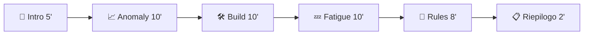
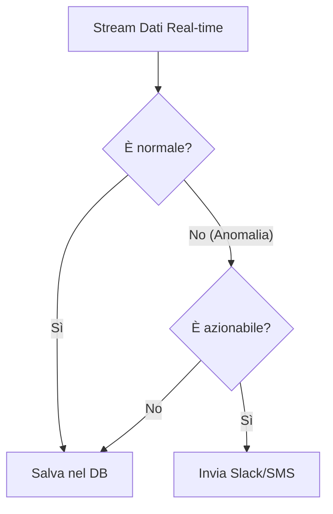

## Trigger Analytics: Quando i dati ti avvisano — Lezione Completa

Le dashboard sono morte. Nessuno ha il tempo di fissare grafici tutto il giorno aspettando che succeda qualcosa. La Trigger Analytics è l'evoluzione proattiva della Business Intelligence: invece di andare tu dai dati, sono i dati a venire da te quando serve. In questa lezione, impareremo a costruire sistemi di allerta intelligenti che rilevano anomalie, opportunità e rischi in tempo reale.

### Obiettivi di Apprendimento

Al termine di questa lezione, lo studente sarà in grado di:
1.  Distinguere tra monitoraggio passivo (Dashboard) e attivo (Alerting).
2.  Configurare trigger basati su soglie statiche (es. "Ordini < 100") e dinamiche (Anomaly Detection).
3.  Evitare la "Alert Fatigue" progettando notifiche azionabili e rilevanti.
4.  Implementare flussi di automazione (es. Zapier/Make) che reagiscono ai trigger.
5.  Utilizzare SQL e Python per costruire monitoraggi personalizzati su Data Warehouse.

### Timeline della Lezione

| Fase | Argomento | Durata |
|------|-----------|--------|
| 1 | Introduzione: Dashboard vs Alerting | 5 min |
| 2 | Teoria: Soglie e Anomaly Detection | 10 min |
| 3 | Pratica: Costruire un Trigger System | 10 min |
| 4 | Strategia: Evitare la Alert Fatigue | 10 min |
| 5 | Esercizi: Scrivere regole di alert | 8 min |
| 6 | Riepilogo e Domande | 2 min |
| **Totale** | | **45 min** |



### Fase 1 — Introduzione: Dashboard vs Alerting (5 min)

La dashboard è uno specchio: ti mostra la realtà quando decidi di guardarla.
L'alert è un campanello d'allarme: suona quando c'è un incendio.

Se il tuo sito smette di vendere alle 3 di notte, la dashboard te lo dirà alle 9 di mattina (quando apri il PC). Un sistema di Trigger Analytics te lo dice alle 3:05 via SMS.
Non solo per i disastri:
*   *Opportunità:* "Un VIP ha appena visitato la pagina Pricing". (Chiama subito!).
*   *Trend:* "Il traffico da TikTok è esploso del 500%". (Metti più budget!).

### Fase 2 — Teoria: Soglie e Anomaly Detection (10 min)

Come decidiamo *quando* inviare un alert?

**1. Soglie Statiche (Static Thresholds)**
Regole fisse basate sull'esperienza.
*   *Regola:* "Se Conversione < 2%, invia alert."
*   *Problema:* Di notte il traffico è basso e volatile. Potresti ricevere falsi allarmi alle 4:00 AM. Di Black Friday il traffico è altissimo, la soglia potrebbe essere troppo bassa.

**2. Soglie Dinamiche (Anomaly Detection)**
Usa la statistica (es. Deviazione Standard o Prophet) per calcolare la "normalità" in quel momento.
*   *Regola:* "Se Conversione < (Media ultimi 4 lunedì - 2 Sigma), invia alert."
*   *Vantaggio:* Si adatta alla stagionalità (giorno/notte, feriale/festivo).
*   *Algoritmo:* Z-Score, Moving Average, Prophet.



### Fase 3 — Pratica: Costruire un Trigger System (10 min)

Non serve comprare software costosi. Puoi farlo con strumenti semplici.

**Livello Base: GA4 Insights / Google Ads Scripts**
*   GA4 ha "Rilevamento anomalie" automatico.
*   Google Ads permette script JS: `if (cost > budget) sendEmail();`

**Livello Intermedio: Zapier / Make / Slack**
*   Collega il CRM (HubSpot) a Slack.
*   *Trigger:* "Nuovo Deal > 10.000€".
*   *Action:* Messaggio nel canale #sales-wins: "🚀 Boom! Mario ha chiuso 10k€!"

**Livello Avanzato: Python + SQL (Airflow/dbt)**
Scrivi un test dbt o uno script Python che gira ogni ora.
```python

# Esempio Python (Concettuale)

import pandas as pd
from slack_sdk import WebClient

data = get_last_hour_data()
if data['revenue'] < (data['avg_revenue_last_month'] * 0.5):
    client.chat_postMessage(channel="#alerts", text="⚠️ Crollo Fatturato! -50%")
```

### Fase 4 — Strategia: Evitare la Alert Fatigue (10 min)

Se tutto è urgente, nulla è urgente. La "Alert Fatigue" succede quando ricevi così tante notifiche che smetti di guardarle (come l'allarme dell'auto che suona sempre).

**Regole per Alert Sani:**
1.  **Azionabilità:** L'alert deve suggerire cosa fare.
    *   *Male:* "Errore 500 aumentati." (E quindi?)
    *   *Bene:* "Errore 500 su Checkout. Server DB sovraccarico. Riavviare istanza."
2.  **Destinatario Giusto:** Non mandare alert tecnici al CEO. Non mandare alert di vendita ai dev.
3.  **Priorità:**
    *   *P1 (Critical):* Sveglia qualcuno di notte (SMS/Call). (Sito giù).
    *   *P2 (Warning):* Notifica Slack in orario lavoro. (Calo performance).
    *   *P3 (Info):* Report settimanale via mail. (Nuovi iscritti).
4.  **Recovery:** Invia un messaggio quando il problema è rientrato ("✅ Allarme rientrato").

### Fase 5 — Esercizi: Scrivere regole di alert (8 min)

**Scenario:** E-commerce di scarpe.

**Esercizio 1: Stock Out**
*   *Problema:* I best-seller finiscono e perdiamo vendite.
*   *Regola:* Quando `stock_qty` < 10 AND `sales_velocity` > 5 al giorno -> Alert al Purchasing Manager: "Riordina subito Nike Air!".

**Esercizio 2: Campagna fuori controllo**
*   *Problema:* Una campagna Facebook spende 1.000€ in un'ora per errore.
*   *Regola:* Se `spend_last_hour` > 200€ AND `roas` < 0.5 -> Pausa campagna automaticamente (via API) e avvisa Marketing.

**Esercizio 3: VIP Churn**
*   *Problema:* I clienti grossi smettono di comprare.
*   *Regola:* Se `segment` = "VIP" AND `days_since_last_order` > 60 -> Crea task in Salesforce per l'Account Manager.

### Fase 6 — Riepilogo e Domande (2 min)

1.  **Dormi tranquillo.** I trigger lavorano per te 24/7.
2.  **Soglie intelligenti.** Usa la deviazione standard, non numeri a caso.
3.  **Meno è meglio.** Pochi alert, ma critici.
4.  **Chiudi il cerchio.** L'alert deve portare a un'azione (anche automatica).

### Domande di Verifica

1.  Qual è il limite principale delle "Soglie Statiche" nel monitoraggio di metriche volatili come il traffico web?
2.  Come funziona un algoritmo di "Anomaly Detection" basato sullo Z-Score?
3.  Cosa si intende per "Alert Fatigue" e quali sono le 3 strategie per prevenirla?
4.  In che situazione un alert dovrebbe essere "P1 - Critical" (svegliare le persone) rispetto a "P2 - Warning"?
5.  Come l'integrazione di un sistema di Trigger con un tool di automazione (es. Zapier) può trasformare un alert in una "Self-Healing Action"?

### Riferimenti Bibliografici

-   Google Site Reliability Engineering (SRE) Book, O'Reilly, 2016 (Capitolo su Monitoring).
-   PagerDuty, "Incident Response Guide".
-   PostHog Documentation (Alerts & Webhooks).
