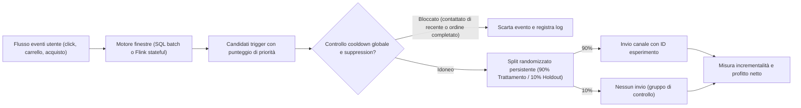

## Il messaggio automatico che ruba credito alle vendite spontanee

Immagina uno scenario costruito con numeri di esempio su un marketplace di abbigliamento che attiva una regola automatica apparentemente ovvia: quindici minuti dopo l'abbandono del carrello, il sistema invia un'email con un codice sconto del 10% a 25.000 utenti al mese. Dopo il primo mese la piattaforma CRM riporta risultati entusiastici: un tasso di conversione del 18% sugli utenti raggiunti (4.500 ordini da 80 euro l'uno) e 360.000 euro di fatturato attribuito al flusso automatico.

Prima di estendere lo stesso sconto al canale SMS, l'analista imposta un gruppo di holdout casuale sul 10% del pubblico idoneo, che non riceve alcun messaggio automatico. Il verdetto rovescia la lettura precedente: il gruppo di controllo non contattato converte comunque al 16,5%, perché molti utenti stavano semplicemente confrontando le taglie o aspettando di rientrare a casa dal lavoro. L'incremento reale prodotto dalla campagna è appena di 1,5 punti percentuali, mentre il coupon del 10% ha regalato 8 euro di margine su ogni ordine dei 4.125 acquirenti che avrebbero comprato a prezzo pieno, bruciando oltre 33.000 euro di profitto netto mensile.

> **Idea chiave:** Un trigger comportamentale crea valore economico solo quando il margine generato dall'uplift misurato contro il gruppo di holdout supera la somma del costo di contatto, dello sconto concesso agli acquirenti spontanei e della fatica di canale.

Passare dall'invio massivo a regole guidate dai dati significa sostituire l'illusione della conversione attribuita con la misura esplicita del guadagno netto incrementale e con l'attesa disciplinata della finestra in cui il cliente non completa più l'azione da solo.

## Tassonomia dei trigger e architettura di rilevamento in tempo reale

Un trigger efficace non reagisce a ogni clic isolato, ma intercetta una variazione significativa rispetto alla traiettoria normale dell'utente. Nel marketing analitico i segnali si dividono in cinque famiglie principali, ciascuna caratterizzata da un diverso bilanciamento tra urgenza temporale, rischio di cannibalizzazione e sensibilità al canale di contatto.

| Famiglia di trigger | Evento scatenante tipico | Finestra di latenza ottimale | Canale consigliato | Rischio principale |
| --- | --- | --- | --- | --- |
| Comportamentale ad alto intento | Carrello aperto senza checkout, 3 viste prodotto in 48h | 2–4 ore dopo chiusura sessione | Email o push app | Cannibalizzare acquisti che stanno per avvenire da soli |
| Rischio e contrazione uso | Calo di frequenza superiore al 50% rispetto alla baseline individuale | Entro 48–72 ore dalla deviazione | Email personale o in-app | Intervenire troppo tardi a disdetta già decisa |
| Soglia di valore o esaurimento | Crediti residui sotto il 10% o ciclo riacquisto raggiunto | 3–5 giorni prima dell'esaurimento stimato | Email o SMS leggero | Errore di stima sul ciclo di consumo per SKU diversi |
| Milestone e attivazione | Prima azione core completata oppure stallo al passo 2 onboarding | 15–60 minuti (solo stallo onboarding) | In-app o guida email | Interrompere il flusso di un utente ancora attivo in sessione |
| Riattivazione dormienti | Assenza di sessioni da 30 giorni dopo picco storico di acquisto | Giorno 30–35 (test con holdout lungo) | Email mirata | Riattivare disiscrizioni su utenti ormai persi |

Per gestire segnali sia in tempo reale sia giornalieri senza generare sovrapposizioni tra campagne diverse, la piattaforma di trigger deve separare il rilevamento dell'evento dalla decisione di invio tramite uno strato di arbitraggio centrale.



Questo schema chiarisce due regole architetturali fondamentali. La prima è che il controllo di esclusione (`cooldown` e verifica di acquisto avvenuto) risiede a valle dell'aggregazione, così che l'utente non riceva tre email nella stessa giornata da tre flussi differenti. La seconda è che il gruppo di `holdout` viene assegnato prima della chiamata al provider di invio e registrato nello stesso data warehouse degli invii reali, rendendo la misura dell'uplift immediata e verificabile senza dipendere dai report del fornitore di email.

## Valutazione economica passo-passo: uplift netto, sconto e priorità

Per decidere se attivare un flusso e se inserire uno sconto economico, svolgiamo i conti completi su un esperimento costruito su 20.000 sessioni di carrello abbandonato idonee (numeri di esempio), in cui il valore medio d'ordine (`AOV`) è 80 euro, il margine lordo unitario prima degli sconti è il 50% (40 euro per ordine) e il costo unitario di spedizione dell'email è 0,04 euro.

Il traffico idoneo viene suddiviso in tre bracci sperimentali bilanciati da 10.000 utenti nel braccio A (reminder puro), 10.000 utenti nel braccio B (reminder con coupon 10%, ossia 8 euro di sconto) e un gruppo di holdout di riferimento la cui conversione naturale osservata senza alcun messaggio è esattamente del 10,0% (corrispondente a 1.000 ordini su 10.000 utenti).

Calcoliamo il profitto incrementale netto del **Braccio A (Reminder senza sconto)** rispetto all'holdout:
1. Tasso di conversione osservato nel Braccio A = 14,0%, pari a $10.000 \times 0,14 = 1.400\text{ ordini}$.
2. Ordini incrementali generati dal trigger = $1.400 - 1.000 = 400\text{ ordini}$ (+4,0 punti percentuali di lift).
3. Margine incrementale lordo = $400 \times 40\text{ euro} = 16.000\text{ euro}$.
4. Costo totale di invio email = $10.000 \times 0,04\text{ euro} = 400\text{ euro}$.
5. Profitto incrementale netto del Braccio A = $16.000 - 400 = +15.600\text{ euro}$.

Calcoliamo ora il risultato del **Braccio B (Reminder con coupon del 10%, pari a 8 euro di sconto per ordine)** sulla stessa base di 10.000 utenti:
1. Lo sconto spinge la conversione un po' più in alto, al 15,5%, pari a $10.000 \times 0,155 = 1.550\text{ ordini}$.
2. Ordini incrementali rispetto all'holdout (1.000 ordini) = $1.550 - 1.000 = 550\text{ ordini}$ (+5,5 punti percentuali di lift).
3. Margine incrementale lordo prima dello sconto = $550 \times 40\text{ euro} = 22.000\text{ euro}$.
4. Tuttavia lo sconto di 8 euro viene incassato da tutti i 1.550 acquirenti del braccio, inclusi i 1.000 che avrebbero acquistato comunque a prezzo pieno: costo totale degli sconti = $1.550 \times 8\text{ euro} = 12.400\text{ euro}$.
5. Costo di invio email = $10.000 \times 0,04\text{ euro} = 400\text{ euro}$.
6. Profitto incrementale netto del Braccio B = $22.000 - 12.400 - 400 = +9.200\text{ euro}$.

Confrontando i due risultati, il Braccio B sembrava superiore in una lettura superficiale delle conversioni (15,5% contro 14,0%), ma nella realtà economica **distrugge 6.400 euro di profitto netto** rispetto al semplice reminder gratuito (`+9.200` contro `+15.600` euro). L'incentivo economico diventa profittevole solo se erogato selettivamente a utenti con bassa probabilità di acquisto spontaneo (modelli di *uplift modeling*) e mai a pioggia sull'intero segmento.

## Estrazione dei segnali pre-acquisto in SQL e scoring di priorità in Python

Prima di impostare i ritardi di invio in un motore di automazione, è buona regola misurare nei dati storici quanto tempo impiegano naturalmente gli utenti che convertono da soli tra l'aggiunta al carrello e il pagamento. Se l'80% dei checkout spontanei si chiude entro 75 minuti, inviare un trigger dopo 20 minuti garantisce di pagare costi di invio e sconti su clienti che non avevano ancora finito la propria sessione. La query SQL seguente calcola i quantili del tempo di chiusura spontanea ed estrae i soli candidati che hanno superato la finestra di sicurezza senza aver ancora completato l'ordine né ricevuto messaggi recenti.

```sql
-- 1. Calcola la distribuzione dei tempi di checkout spontaneo per calibrare il ritardo del trigger
-- 2. Estrae gli utenti idonei al trigger rispettando il cooldown globale di 72 ore
WITH cart_to_order_lag AS (
    SELECT
        c.user_id,
        c.cart_event_time,
        MIN(o.order_time) AS next_order_time,
        EXTRACT(EPOCH FROM (MIN(o.order_time) - c.cart_event_time)) / 60.0 AS minutes_to_checkout
    FROM cart_events AS c
    INNER JOIN orders AS o
        ON c.user_id = o.user_id
       AND o.order_time > c.cart_event_time
       AND o.order_time <= c.cart_event_time + INTERVAL '48 hours'
    GROUP BY c.user_id, c.cart_event_time
),
recent_abandoners AS (
    -- Candidati con carrello aperto tra 180 minuti e 24 ore fa senza acquisto successivo
    SELECT
        c.user_id,
        c.cart_id,
        c.cart_value_eur,
        MAX(c.cart_event_time) AS last_cart_time
    FROM cart_events AS c
    LEFT JOIN orders AS o
        ON c.user_id = o.user_id
       AND o.order_time >= c.cart_event_time
    LEFT JOIN crm_dispatch_log AS d
        ON c.user_id = d.user_id
       AND d.sent_at >= NOW() - INTERVAL '72 hours'
    WHERE c.cart_event_time BETWEEN NOW() - INTERVAL '24 hours' AND NOW() - INTERVAL '180 minutes'
      AND o.order_id IS NULL
      AND d.dispatch_id IS NULL
    GROUP BY c.user_id, c.cart_id, c.cart_value_eur
)
SELECT
    ra.user_id,
    ra.cart_id,
    ra.cart_value_eur,
    ra.last_cart_time,
    -- Assegnazione deterministica 10% holdout basata su hash dell'utente e campagna
    CASE
        WHEN MOD(ABS(HASHTEXT(ra.user_id || '_cart_abandon_v2')), 100) < 10 THEN 'holdout'
        ELSE 'treatment'
    END AS experiment_arm
FROM recent_abandoners AS ra
WHERE ra.cart_value_eur >= 25.0
ORDER BY ra.cart_value_eur DESC;
```

Nota l'uso di `HASHTEXT` (o funzione hash equivalente sul tuo database) con modulo 100 per assegnare stabilmente il gruppo `holdout` o `treatment`: evita che lo stesso utente cambi braccio da una settimana all'altra, mantenendo pulite le stime di uplift cumulato nel tempo.

Quando lo stesso utente risulta contemporaneamente idoneo a più trigger nel medesimo giorno (per esempio ha un carrello aperto, ma è anche sceso sotto la soglia dei crediti o ha visitato tre volte una categoria nuova), occorre uno strato di scoring in Python che selezioni il singolo messaggio a maggior valore atteso netto ed eviti la saturazione.

```python
from dataclasses import dataclass


@dataclass(frozen=True)
class TriggerCandidate:
    trigger_id: str
    expected_uplift_rate: float
    holdout_conversion_rate: float
    margin_per_order_eur: float
    discount_per_order_eur: float
    channel_cost_eur: float
    urgency_weight: float = 1.0


def evaluate_trigger_economics(
    candidate: TriggerCandidate,
    audience_size: int = 10_000,
) -> dict[str, float]:
    """
    Calcola profitto incrementale netto e score di priorità di un trigger candidato.
    """
    treated_rate = candidate.holdout_conversion_rate + candidate.expected_uplift_rate
    incremental_orders = audience_size * candidate.expected_uplift_rate
    total_treated_orders = audience_size * treated_rate

    incremental_margin = incremental_orders * candidate.margin_per_order_eur
    discount_leakage = total_treated_orders * candidate.discount_per_order_eur
    sending_cost = audience_size * candidate.channel_cost_eur

    net_profit = incremental_margin - discount_leakage - sending_cost
    # Score per ordinare trigger concorrenti sul singolo utente (valore netto per invio pesato per urgenza)
    priority_score = (net_profit / audience_size) * candidate.urgency_weight
    return {
        "net_profit_eur": round(net_profit, 2),
        "profit_per_send_eur": round(net_profit / audience_size, 4),
        "priority_score": round(priority_score, 4),
    }


def arbitrate_user_triggers(candidates: list[TriggerCandidate]) -> TriggerCandidate | None:
    """Seleziona il solo trigger con valore atteso positivo e priority_score massimo."""
    ranked = []
    for cand in candidates:
        metrics = evaluate_trigger_economics(cand, audience_size=1)
        if metrics["net_profit_eur"] > 0:
            ranked.append((metrics["priority_score"], cand))
    if not ranked:
        return None
    ranked.sort(key=lambda item: item[0], reverse=True)
    return ranked[0][1]


# Confronto tra reminder gratuito e coupon del 10% su carrello abbandonato
no_discount = TriggerCandidate("cart_reminder", 0.040, 0.100, 40.0, 0.0, 0.04, urgency_weight=1.2)
with_coupon = TriggerCandidate("cart_coupon_10", 0.055, 0.100, 40.0, 8.0, 0.04, urgency_weight=1.2)

print("Senza sconto:", evaluate_trigger_economics(no_discount))
print("Con coupon 10%:", evaluate_trigger_economics(with_coupon))
```

Questa struttura impedisce l'invio di messaggi in perdita sul nascere: `arbitrate_user_triggers` scarta automaticamente qualsiasi regola in cui `net_profit_eur` per singolo invio non copre il costo marginale di contatto e l'eventuale erosione da sconto.

## Finestre di esclusione, frequency capping e il caso Netflix

Un sistema di trigger ben ingegnerizzato è tanto definito dalle regole che *impediscono* l'invio quanto da quelle che lo scatenano. Oltre al `cooldown` minimo di 72 ore per utente su flussi non transazionali, servono almeno due meccanismi protettivi: la soppressione istantanea su evento completato (se il pagamento avviene mentre il job è in coda, la chiamata all'ESP viene annullata prima della consegna) e un `frequency cap` globale mensile che protegge l'indirizzo di spedizione dalla caduta della deliverability e dall'aumento delle disiscrizioni.

Un esempio industriale ampiamente analizzato riguarda l'architettura di engagement comportamentale di Netflix. La piattaforma evita regole rigide basate su orari di calendario uguali per tutti gli abbonati e attiva comunicazioni mirate soltanto al verificarsi di specifiche finestre comportamentali: la notifica di rilascio di una nuova stagione per una serie effettivamente completata dall'utente, l'invito contestuale alla ripresa di un titolo interrotto a metà prima che scada l'abitudine di visione, e il riassunto personalizzato dopo 14 giorni di assenza completa. In ciascun caso, i candidati sono sottoposti a controllo di freschezza, ordinati per probabilità incrementale di visione nelle settimane successive e valutati contro un gruppo di controllo permanente per misurare la riduzione reale del churn mensile invece del semplice tasso di clic sulla notifica.

## Tre anti-pattern che trasformano l'automazione in spam

Le implementazioni di trigger analytics falliscono spesso non per un limite tecnologico degli strumenti di automazione, ma per tre scelte progettuali sbagliate fin dal lancio.

### Attivare il trigger troppo presto prima che la sessione spontanea si chiuda

Inviare un'email o una notifica push cinque o dieci minuti dopo l'aggiunta al carrello interrompe utenti che stanno ancora confrontando i metodi di spedizione o cercando la carta di credito. Il risultato è una conversione quasi identica a quella naturale, ma con un'attribuzione falsa verso il CRM e un forte fastidio percepito. Prima di impostare la latenza di qualunque flusso, è necessario ispezionare la distribuzione empirica dei tempi di chiusura naturale in SQL e posizionare il trigger oltre il settantacinquesimo o l'ottantesimo percentile delle conversioni spontanee.

### Assenza di un frequency cap globale tra flussi indipendenti

Quando team diversi configurano automazioni separate nello stesso strumento (carrello abbandonato, ricerca prodotto, ribasso prezzo, newsletter settimanale, survey post-visita), un cliente molto attivo può ricevere quattro o cinque comunicazioni in meno di ventiquattro ore. Il danno non è solo la perdita del singolo iscritto: l'impennata di segnalazioni spam penalizza la reputazione del dominio mittente presso i provider email e riduce il recapito anche per le comunicazioni transazionali essenziali. Il controllo centrale di arbitraggio e il tetto giornaliero globale risolvono il problema alla radice.

### Ottimizzare su tassi di apertura o clic invece che su holdout incrementali

Dopo l'introduzione delle funzioni di protezione della privacy nei client di posta (come Apple Mail Privacy Protection), i tassi di apertura automatizzati includono pre-caricamenti automatici dai server proxy e non misurano più l'attenzione reale umana. Inoltre, anche un clic genuino può derivare semplicemente dal fatto che un cliente già deciso cerca il link più rapido per tornare al sito. Dichiarare il successo di un trigger senza confrontare ricavo netto, margine e tasso di disiscrizione rispetto a un `holdout` casuale persistente porta quasi sempre a mantenere accesi flussi costosi e inefficaci.

## Verifica prima di accendere un nuovo trigger

Prima di passare un flusso comportamentale dallo stato di bozza alla produzione su tutto il database, verifica la solidità dell'impianto con queste quattro domande.

1. Un flusso di carrello abbandonato con buono sconto del 15% porta la conversione dal 10% dell'holdout al 12% sul gruppo trattato, su un carrello da 100 euro con margine lordo del 40% e costo email di 0,05 euro: il trigger genera profitto o distrugge margine?

<details>
<summary>Mostra risposta</summary>

Il trigger distrugge gravemente margine. Su 1.000 utenti, l'holdout produce 100 ordini spontanei e il trattamento ne produce 120, quindi appena 20 ordini incrementali. Il margine lordo di quei 20 ordini prima dello sconto vale `20 × 40 = 800 euro`. Tuttavia lo sconto del 15% (15 euro per ordine) viene applicato a tutti i 120 ordini del gruppo trattato, con un costo di `120 × 15 = 1.800 euro`, a cui si aggiungono `1.000 × 0,05 = 50 euro` di invio. Il bilancio incrementale netto è `800 - 1.800 - 50 = -1.050 euro` ogni mille utenti contattati.

</details>

2. Perché nella query SQL di estrazione conviene usare una funzione hash deterministica sull'identificativo utente per assegnare l'holdout invece di un semplice `RANDOM() < 0.1` ad ogni esecuzione del job?

<details>
<summary>Mostra risposta</summary>

Se usassi `RANDOM() < 0.1` ad ogni esecuzione giornaliera o oraria, un utente che abbandona il carrello due volte nell'arco di tre settimane potrebbe finire oggi nel gruppo di holdout e tra dieci giorni nel gruppo trattato, contaminando il confronto longitudinale sul singolo cliente e rendendo impossibile misurare l'effetto cumulato della campagna su retention, LTV e tasso di disiscrizione. Una funzione hash deterministica garantisce che lo stesso utente resti coerente nello stesso braccio per tutta la durata del test.

</details>

3. Nel diagramma di arbitraggio tra trigger multipli, cosa succede se due campagne distinte raggiungono il medesimo utente nello stesso pomeriggio senza un layer comune di `cooldown`?

<details>
<summary>Mostra risposta</summary>

Senza un registro centralizzato degli invii recenti (`crm_dispatch_log`) e una funzione di arbitraggio basata sul valore netto atteso, l'utente riceve entrambi i messaggi a distanza di poche ore. Oltre a gonfiare artificialmente l'attribuzione di entrambi i flussi sullo stesso acquisto successivo, questo sovraffollamento aumenta il tasso di disiscrizione e degrada la reputazione del dominio presso i filtri antispam.

</details>

4. Come determini empiricamente se aspettare 30 minuti o 3 ore prima di inviare un messaggio di recupero carrello?

<details>
<summary>Mostra risposta</summary>

Estrando dai log storici la distribuzione temporale tra l'evento di aggiunta al carrello e l'ordine completato per tutti gli acquisti avvenuti senza alcun intervento email o push. Osservando i percentili di chiusura naturale (ad esempio mediana, 75° e 85° percentile), posizioni la finestra minima di attesa oltre il punto in cui la gran parte delle sessioni spontanee si è già chiusa, così da contattare prevalentemente utenti che hanno realmente interrotto il percorso d'acquisto.

</details>
