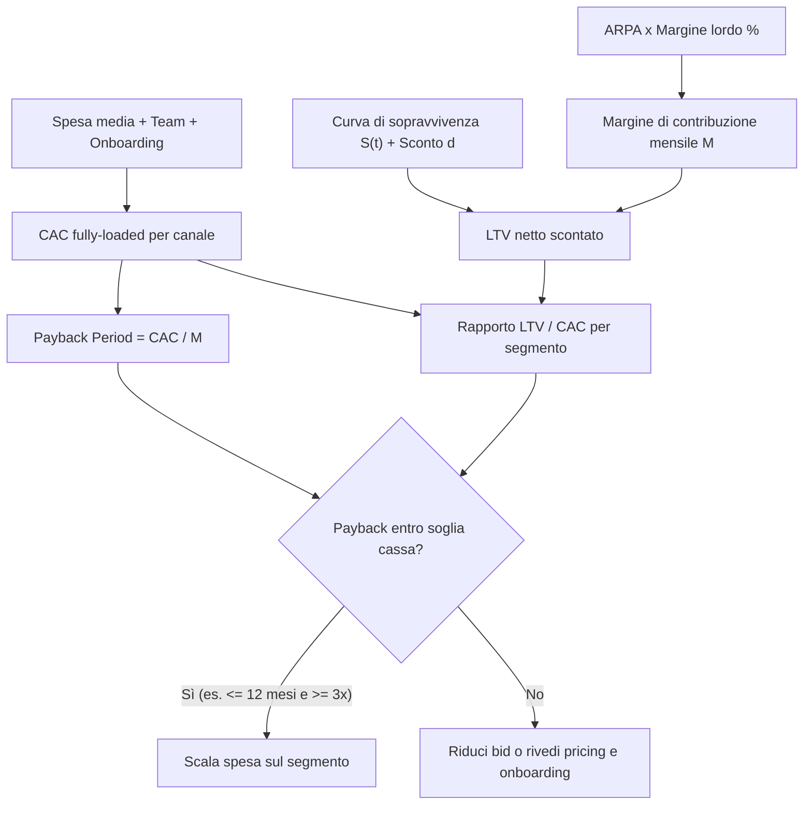

## Il caso del canale profittevole che brucia cassa

Considera uno scenario costruito con numeri di esempio su una piattaforma digitale B2B2C che acquisisce 1.200 nuovi clienti paganti al mese. Il report mensile presentato al consiglio mostra un costo di acquisizione (`CAC`) medio di 180 euro e un valore a vita (`LTV`) medio di 600 euro, con un rapporto `LTV/CAC` pari a `3,3x`. Sulla carta il modello rispetta la soglia classica del `3x` e il team marketing chiede di raddoppiare la spesa sulle campagne a pagamento. Eppure il direttore finanziario segnala un problema opposto: negli ultimi due trimestri la cassa operativa è scesa di 45.000 euro al mese proprio mentre il numero di nuovi clienti saliva.

Quando scomponi i numeri per segmento e canale, l'anomalia diventa trasparente. Il `CAC` da 180 euro era un valore `blended` che mescolava 400 clienti provenienti da ricerca organica e passaparola (con spesa media diretta quasi nulla) con 800 clienti provenienti da aste social a pagamento. Inoltre, il 70% del budget paid stava acquisendo micro-clienti su piano base che abbandonano entro il sesto mese prima ancora di aver ripagato i costi di onboarding, mentre la media dell'`LTV` risultava gonfiata da una minoranza di clienti Enterprise arrivati via inbound.

> **Idea chiave:** Un rapporto LTV/CAC aggregato superiore a 3x non garantisce la tenuta economica dell'acquisizione finché non controlli il margine di contribuzione netto, il tasso di sconto finanziario e il payback period disaggregati per segmento e per canale marginale.

Misurare le unit economics significa valutare l'economia del singolo cliente incrementale prima ancora che il capitale venga immobilizzato in aste pubblicitarie difficili da recuperare.

## Anatomia di CAC, LTV scontato e Payback Period

Per trasformare sigle contabili spesso abusate in strumenti decisionali affidabili, occorre fissare definizioni rigorose su tre dimensioni: cosa entra nel costo di acquisizione, come si misura il margine generato nel tempo e quanto velocemente l'investimento rientra in cassa.



La distinzione più critica riguarda il `CAC`. Il `CAC blended` divide la spesa totale di marketing e vendite per tutti i nuovi clienti acquisiti nel mese, inclusi quelli organici. Serve a fotografare l'efficienza media storica dell'azienda, ma diventa pericoloso quando orienta il budget incrementale perché fa sembrare economici canali a pagamento già saturi. Il `CAC paid` isola i soli costi attribuibili ai canali a pagamento sui soli clienti acquisiti da quei canali, includendo oltre al budget media anche le commissioni di agenzia, i compensi dedicati del team di acquisizione e gli sconti promozionali di ingresso (`CAC fully-loaded`). Ancora più decisivo per le aste è il `CAC marginale`, ossia il costo richiesto per acquisire il prossimo blocco di clienti incrementali aumentando la spesa oltre il livello attuale.

Sul fronte dei ricavi, l'`LTV` non va mai calcolato sul fatturato lordo (`ARPA`), ma sul margine di contribuzione mensile $M$, ottenuto moltiplicando il ricavo medio per account (`ARPA`) per il margine lordo percentuale al netto di costi di erogazione, infrastruttura cloud, commissioni di pagamento e supporto tecnico ricorrente. La formula classica stazionaria $\text{LTV} = M / c$, dove $c$ è il tasso di abbandono mensile (`churn`), presume però che il churn resti costante all'infinito e che un euro incassato tra cinque anni valga quanto un euro oggi. Inserendo il tasso di sconto mensile $d$ derivato dal costo medio ponderato del capitale (`WACC`), la versione corretta in regime stazionario diventa:

$$\text{LTV}_{\text{scontato}} = \frac{M}{c + d}$$

Se la retention cambia sensibilmente tra i primi mesi e gli anni successivi, conviene abbandonare l'approssimazione a churn costante e sommare direttamente i flussi mensili attesi lungo un orizzonte finito (tipicamente 36 o 60 mesi) pesati per la probabilità di sopravvivenza $S(t)$ misurata dalla coorte:

$$\text{LTV}_{T} = \sum_{t=1}^{T} \frac{M_t \cdot S(t)}{(1 + d)^t}$$

Infine, il `Payback Period` misura il numero di mesi necessari affinché il margine di contribuzione cumulato pareggi il `CAC`: $\text{Payback} = \text{CAC} / M$ nel caso costante, oppure il primo mese $t$ in cui il margine cumulato della coorte supera il `CAC` iniziale.

| Metrica | Formula operativa | Orizzonte tipico | Errore tipico | Soglia di riferimento B2B/SaaS |
| --- | --- | --- | --- | --- |
| `CAC paid fully-loaded` | `(Spesa media + Team + Promo) / Nuovi clienti paid` | Mensile o settimanale | Includere clienti organici nel denominatore | Coerente con `Payback` target |
| `CAC marginale` | `Delta spesa paid / Delta nuovi clienti paid` | Incremento di budget (+20%) | Assumere costo costante al raddoppio budget | Inferiore a `LTV / 2,5` sul canale |
| `LTV netto scontato` | `Somma su t di M_t * S(t) / (1 + d)^t` | 36–60 mesi di vita coorte | Usare ricavo lordo senza sconto né costi variabili | Almeno `3x` rispetto al `CAC` |
| `Payback Period` | Primo mese con `Margine cumulato >= CAC` | Mesi dalla prima fattura | Ignorare il capitale circolante in fase di crescita | Sotto 12 mesi (SMB) o 18 mesi (Enterprise) |
| `LTV / CAC` di segmento | `LTV netto scontato / CAC fully-loaded` | Coorte omogenea per canale/piano | Leggere solo la media aggregata aziendale | Tra `3x` e `5x` sul margine netto |

Un rapporto `LTV/CAC` molto alto (ad esempio `8x`) non è necessariamente un trofeo: spesso segnala che l'azienda sta sotto-investendo nella crescita e lasciando spazio ai concorrenti sui canali ancora sotto-sfruttati. Al contrario, un payback superiore ai 18 mesi in un'azienda autofinanziata crea crisi di liquidità anche in presenza di un ottimo `LTV/CAC` teorico.

## Esempio numerico svolto: smascherare il paradosso di Simpson tra due segmenti

Applichiamo le formule a un esempio numerico completo costruito su una campagna Paid Search mensile che spende 150.000 euro e acquisisce esattamente 1.000 nuovi clienti, con un `CAC` uniforme di 150 euro per utente acquisito (numeri di esempio). Il team applica un tasso di sconto finanziario mensile $d = 1\%$ (equivalente a circa il 12,7% annuo composto). I 1.000 clienti appartengono in realtà a due segmenti distinti:

- **Segmento Starter (700 clienti, 70% del volume paid):** `ARPA` = 30 euro al mese, margine lordo = 60%, tasso di churn mensile costante $c = 12\%$.
- **Segmento Pro (300 clienti, 30% del volume paid):** `ARPA` = 120 euro al mese, margine lordo = 80%, tasso di churn mensile costante $c = 3\%$.

Calcoliamo anzitutto il risultato **aggregato ingenuo** che molte dashboard producono facendo le medie di riga sull'intera coorte:
- `ARPA` medio ponderato = $(0,70 \times 30) + (0,30 \times 120) = 21 + 36 = 57\text{ euro/mese}$.
- Margine lordo medio ponderato sui ricavi = $(12.600 + 28.800) / 57.000 = 72,63\%$ -> margine mensile medio pari esattamente a $41,40\text{ euro/mese}$ (dato che Starter produce $700 \times 18 = 12.600$ euro di margine al mese e Pro produce $300 \times 96 = 28.800$ euro, quindi $(12.600 + 28.800) / 1.000 = 41,40\text{ euro/mese}$ di margine iniziale).
- Churn medio iniziale osservato nel primo mese = $(700 \times 12\% + 300 \times 3\%) / 1.000 = 9,3\%$.
- Calcolo aggregato ingenuo: $\text{LTV}_{\text{ingenuo}} = 41,40 / (0,093 + 0,010) = 41,40 / 0,103 = 401,9\text{ euro}$, con rapporto aggregato `LTV/CAC` = $401,9 / 150 = 2,68\text{x}$ e payback medio apparente = $150 / 41,40 = 3,62\text{ mesi}$. Il numero aggregato suggerirebbe di ottimizzare leggermente le campagne senza grandi stravolgimenti.

Svolgiamo la derivazione esatta **segmento per segmento**. Per il **Segmento Starter**:
1. Margine di contribuzione mensile: $M_{\text{Starter}} = 30 \times 0,60 = 18,00\text{ euro/mese}$.
2. Payback period: $\text{Payback}_{\text{Starter}} = 150 / 18,00 = 8,33\text{ mesi}$ (supponendo zero churn fino al mese 8; in realtà con il 12% di churn mensile molti abbandonano molto prima).
3. `LTV` netto scontato:
   $$\text{LTV}_{\text{Starter}} = \frac{18,00}{0,12 + 0,01} = \frac{18,00}{0,13} = 138,46\text{ euro}$$
4. Rapporto economico: $\text{LTV}/\text{CAC}_{\text{Starter}} = 138,46 / 150 = 0,92\text{x}$. Ogni singolo cliente Starter acquisito a 150 euro genera in media un valore attuale netto negativo pari a $138,46 - 150 = -11,54\text{ euro}$. Sui 700 clienti mensili, l'azienda sta bruciando $700 \times 11,54 = 8.078\text{ euro}$ di valore attuale netto ogni mese su quel segmento.

Passiamo al **Segmento Pro**:
1. Margine di contribuzione mensile: $M_{\text{Pro}} = 120 \times 0,80 = 96,00\text{ euro/mese}$.
2. Payback period: $\text{Payback}_{\text{Pro}} = 150 / 96,00 = 1,56\text{ mesi}$.
3. `LTV` netto scontato:
   $$\text{LTV}_{\text{Pro}} = \frac{96,00}{0,03 + 0,01} = \frac{96,00}{0,04} = 2.400,00\text{ euro}$$
4. Rapporto economico: $\text{LTV}/\text{CAC}_{\text{Pro}} = 2.400 / 150 = 16,0\text{x}$, con guadagno netto per cliente pari a $2.400 - 150 = +2.250\text{ euro}$.

La media aggregata (`2,68x`) nascondeva un'asimmetria radicale: il 70% dei volumi di acquisizione stava perdendo denaro (`0,92x`) mentre il restante 30% finanziava l'intera crescita (`16,0x`). L'azione immediata non è né aumentare né tagliare indiscriminatamente il budget Paid Search, ma escludere o abbassare drasticamente il bid sulle parole chiave che attraggono profili Starter, alzando al contempo il budget massimo tollerabile (`target CPA`) sui segmenti Pro fino a 500–600 euro per catturare maggiore quota di mercato profittevole.

## Calcolo delle unit economics per coorte in SQL e simulazione LTV in Python

Per calcolare `CAC`, margine cumulato e `payback_month` effettivo su dati storici di fatturazione senza appoggiarsi all'ipotesi rigida di churn costante, conviene costruire una matrice per coorte e segmento direttamente in SQL. La query seguente unisce la spesa media mensile per canale ai margini netti reali generati dalla coorte di clienti acquisiti in quel mese, restituendo l'andamento cumulato mese per mese e identificando il punto esatto di pareggio.

```sql
-- Matrice SQL per Payback Period reale e margine cumulato per canale e coorte
WITH channel_spend AS (
    -- Spesa fully-loaded mensile per canale (media + agenzia + promo ingresso)
    SELECT
        DATE_TRUNC('month', spend_date)::DATE AS cohort_month,
        acquisition_channel,
        SUM(ad_spend_eur + agency_fee_eur + promo_discount_eur) AS total_acq_cost_eur
    FROM marketing_spend
    GROUP BY DATE_TRUNC('month', spend_date)::DATE, acquisition_channel
),
cohort_customers AS (
    -- Assegna ogni cliente alla coorte di prima fattura e al canale di acquisizione
    SELECT
        c.customer_id,
        c.acquisition_channel,
        c.segment,
        DATE_TRUNC('month', MIN(f.invoice_date))::DATE AS cohort_month
    FROM customers AS c
    INNER JOIN fact_invoices AS f
        ON c.customer_id = f.customer_id
    WHERE f.net_revenue_eur > 0
    GROUP BY c.customer_id, c.acquisition_channel, c.segment
),
cohort_cac AS (
    -- Calcola il CAC paid reale per coorte e canale (escludendo organico senza spesa)
    SELECT
        cc.cohort_month,
        cc.acquisition_channel,
        COUNT(DISTINCT cc.customer_id) AS new_customers,
        COALESCE(cs.total_acq_cost_eur, 0) AS acq_cost_eur,
        COALESCE(cs.total_acq_cost_eur, 0) / NULLIF(COUNT(DISTINCT cc.customer_id), 0) AS cac_eur
    FROM cohort_customers AS cc
    LEFT JOIN channel_spend AS cs
        ON cc.cohort_month = cs.cohort_month
       AND cc.acquisition_channel = cs.acquisition_channel
    GROUP BY cc.cohort_month, cc.acquisition_channel, cs.total_acq_cost_eur
),
monthly_margin AS (
    -- Somma il margine di contribuzione (ricavo netto - COGS - fee pagamento) per mese di vita
    SELECT
        cc.cohort_month,
        cc.acquisition_channel,
        cc.segment,
        (
            EXTRACT(YEAR FROM AGE(DATE_TRUNC('month', f.invoice_date), cc.cohort_month)) * 12
            + EXTRACT(MONTH FROM AGE(DATE_TRUNC('month', f.invoice_date), cc.cohort_month))
        )::INT AS months_since_acq,
        SUM(f.net_revenue_eur - f.cogs_eur - f.payment_fee_eur) AS contribution_margin_eur
    FROM cohort_customers AS cc
    INNER JOIN fact_invoices AS f
        ON cc.customer_id = f.customer_id
    GROUP BY 1, 2, 3, 4
),
cumulative_curve AS (
    SELECT
        mm.cohort_month,
        mm.acquisition_channel,
        mm.segment,
        mm.months_since_acq,
        ccac.new_customers,
        ccac.cac_eur,
        SUM(mm.contribution_margin_eur) OVER (
            PARTITION BY mm.cohort_month, mm.acquisition_channel, mm.segment
            ORDER BY mm.months_since_acq
        ) / NULLIF(COUNT_SEG.seg_customers, 0) AS cum_margin_per_customer_eur
    FROM monthly_margin AS mm
    INNER JOIN cohort_cac AS ccac
        ON mm.cohort_month = ccac.cohort_month
       AND mm.acquisition_channel = ccac.acquisition_channel
    INNER JOIN (
        SELECT cohort_month, acquisition_channel, segment, COUNT(*) AS seg_customers
        FROM cohort_customers
        GROUP BY 1, 2, 3
    ) AS COUNT_SEG
        ON mm.cohort_month = COUNT_SEG.cohort_month
       AND mm.acquisition_channel = COUNT_SEG.acquisition_channel
       AND mm.segment = COUNT_SEG.segment
)
SELECT
    cohort_month,
    acquisition_channel,
    segment,
    ROUND(cac_eur, 2) AS cac_eur,
    MIN(months_since_acq) FILTER (WHERE cum_margin_per_customer_eur >= cac_eur) AS real_payback_month,
    MAX(cum_margin_per_customer_eur) FILTER (WHERE months_since_acq = 12) AS margin_m12_eur
FROM cumulative_curve
GROUP BY cohort_month, acquisition_channel, segment, cac_eur
ORDER BY cohort_month DESC, acquisition_channel, segment;
```

Quando invece devi stimare il valore atteso di una nuova coorte con curva di sopravvivenza non costante (ad esempio alta mortalità nei primi tre mesi e stabilizzazione successiva) e testare la sensibilità al tasso di sconto e al `CAC marginale`, conviene affiancare alla query SQL uno script Python basato sulla somma scontata mese per mese.

```python
def discounted_cohort_ltv(
    monthly_margin_eur: float,
    survival_curve: list[float],
    monthly_discount_rate: float = 0.01,
) -> float:
    """
    Calcola l'LTV netto scontato data una curva di sopravvivenza empirica S(t)
    dove survival_curve[t] è la frazione di clienti attivi al mese t+1.
    """
    ltv = 0.0
    for idx, survival_prob in enumerate(survival_curve, start=1):
        discount_factor = (1.0 + monthly_discount_rate) ** idx
        ltv += (monthly_margin_eur * survival_prob) / discount_factor
    return round(ltv, 2)


def marginal_cac_decision(
    base_spend: float,
    base_customers: int,
    new_spend: float,
    new_customers: int,
    segment_ltv: float,
    min_ltv_cac_ratio: float = 3.0,
) -> dict[str, float | str]:
    """Valuta se un aumento di budget genera clienti incrementali sopra soglia."""
    delta_spend = new_spend - base_spend
    delta_customers = new_customers - base_customers
    if delta_customers <= 0:
        return {"marginal_cac": float("inf"), "marginal_ratio": 0.0, "decision": "Ferma incremento"}

    marginal_cac = delta_spend / delta_customers
    marginal_ratio = segment_ltv / marginal_cac
    decision = "Approva espansione" if marginal_ratio >= min_ltv_cac_ratio else "Riduci bid marginale"
    return {
        "marginal_cac": round(marginal_cac, 2),
        "marginal_ratio": round(marginal_ratio, 2),
        "decision": decision,
    }


# Esempio su orizzonte 24 mesi con curva di sopravvivenza empirica decrescente che poi si appiattisce
survival_24m = [0.92, 0.85, 0.80, 0.77, 0.75, 0.73, 0.72, 0.71, 0.70, 0.69, 0.68, 0.67] + [0.65] * 12
ltv_pro = discounted_cohort_ltv(monthly_margin_eur=96.0, survival_curve=survival_24m, monthly_discount_rate=0.01)
check = marginal_cac_decision(
    base_spend=60_000.0,
    base_customers=400,
    new_spend=90_000.0,
    new_customers=500,
    segment_ltv=ltv_pro,
)
print(f"LTV 24m scontato: {ltv_pro} EUR | Analisi marginale: {check}")
```

Questo esempio mostra subito la potenza del controllo marginale: passando da 60.000 euro (400 clienti, `CAC` medio = 150 euro) a 90.000 euro (500 clienti, `CAC` medio apparente = 180 euro), gli ultimi 100 clienti sono costati `30.000 / 100 = 300 euro` ciascuno (`CAC marginale`), esattamente il doppio della media iniziale. Decidere sulla media di 180 euro nasconde il rapido rendimento decrescente del canale oltre una certa saturazione.

## Dal dato storico alla decisione di offerta: il caso Dollar Shave Club

Un riferimento noto nella valutazione delle unit economics applicate ai beni di consumo ricorrenti è l'acquisizione di Dollar Shave Club da parte di Unilever nel 2016 per circa un miliardo di dollari. Nel settore dei rasoi tradizionali, il modello di vendita occasionale affrontava costi pubblicitari televisivi e digitali elevati per singolo acquisto, con un margine sulla prima transazione troppo esiguo per sostenere la competizione sulle aste.

Trasformando il prodotto in abbonamento mensile a basso costo d'ingresso, Dollar Shave Club accettava consapevolmente un margine negativo sul primo ordine (perché il costo di acquisizione più il pacco di benvenuto superavano il prezzo iniziale), ma compensava lo scarto grazie a tre leve misurabili nelle coorti: elevata retention oltre il sesto mese su ricambi ad alto margine, espansione del paniere tramite prodotti complementari per la cura personale (`cross-sell`) e un payback period contenuto entro i primi mesi di permanenza. La sostenibilità non nasceva quindi da un singolo ordine profittevole, ma dalla combinazione disciplinata tra curva di sopravvivenza per coorte e valore netto cumulato oltre il punto di pareggio.

## Tre errori di calcolo che gonfiano artificialmente il rapporto LTV/CAC

Quando il rapporto `LTV/CAC` appare molto più roseo della reale generazione di cassa aziendale, il problema risiede quasi sempre in una delle tre distorsioni contabili seguenti.

### Usare il fatturato lordo invece del margine di contribuzione

Inserire l'`ARPA` lordo al numeratore dell'`LTV` è l'errore più comune negli e-commerce e nei servizi con costi variabili significativi. Un negozio online con ordine medio da 100 euro, margine prodotto del 45% e costi di spedizione, reso e pagamento pari al 12% lascia appena 33 euro di margine di contribuzione per ordine. Calcolare l'`LTV` su 100 euro invece che su 33 euro triplica artificialmente la capacità di spesa pubblicitaria tollerabile e porta direttamente in perdita operativa ogni campagna scalata.

### Dividere per il churn medio senza curva di sopravvivenza né tasso di sconto

La scorciatoia `LTV = M / churn` tratta una distribuzione di sopravvivenza reale come se fosse una serie geometrica infinita a tasso costante. Se un servizio registra il 25% di abbandoni nei primi sessanta giorni e poi si stabilizza al 3% mensile, inserire una media dell'8% sovrastima la durata dei nuovi entrati oppure sottostima il valore dei clienti maturi. Inoltre, senza un tasso di sconto e un orizzonte temporale finito (36 o 60 mesi), una formula con churn dell'1% attribuisce peso a ricavi teorici tra otto o dieci anni che nessuna decisione di marketing dovrebbe finanziare oggi.

### Mescolare clienti organici nel denominatore del CAC a pagamento

Quando le campagne di marca o il passaparola crescono, il `CAC blended` diminuisce anche se le inserzioni a pagamento stanno diventando progressivamente più care. Un team che usa il `CAC blended` per valutare l'efficienza dei media buyer finisce per attribuire ai social o ai motori di ricerca la spinta del traffico diretto e organico. L'unica difesa metodologica consiste nel separare nettamente i cruscotti: `CAC blended` per la direzione finanziaria, `CAC paid fully-loaded` e `CAC marginale` per il controllo quotidiano delle offerte sui canali acquistabili.

## Verifica economica prima di approvare il budget

Prima di presentare un piano di scalabilità o di alzare i tetti di spesa sulle piattaforme pubblicitarie, verifica la tenuta dei tuoi calcoli con queste quattro domande.

1. Un'azienda B2B spende 40.000 euro al mese in Google Ads ottenendo 100 clienti paganti (`CAC paid` = 400 euro), mentre altri 100 clienti arrivano gratuitamente da SEO e referral. Perché usare il `CAC blended` di 200 euro per fissare l'offerta massima su Google Ads porta a bruciare cassa?

<details>
<summary>Mostra risposta</summary>

Il `CAC blended` di 200 euro presuppone che ogni euro aggiuntivo speso su Google Ads generi un cliente pagante a 200 euro, ma il canale a pagamento ne sta già costando 400 e i 100 clienti organici non scalano proporzionalmente al budget pubblicitario. Fissare un'offerta massima basata sul `CAC blended` autorizza spesa che in realtà produce clienti al doppio o al triplo del costo tollerabile, riducendo o azzerando il margine netto dell'acquisizione incrementale.

</details>

2. Se raddoppi il budget mensile di un canale da 50.000 a 100.000 euro e i nuovi clienti passano da 250 a 375, qual è il `CAC marginale` del blocco aggiuntivo e perché differisce dal nuovo `CAC medio`?

<details>
<summary>Mostra risposta</summary>

Il nuovo `CAC medio` dell'intero canale sale a `100.000 / 375 = 266,67 euro`. Tuttavia i 50.000 euro aggiuntivi hanno prodotto soltanto `375 - 250 = 125` clienti incrementali, quindi il `CAC marginale` dell'espansione è `50.000 / 125 = 400,00 euro`. La media nasconde che il secondo blocco di budget è risultato esattamente due volte più costoso del primo blocco iniziale (`50.000 / 250 = 200 euro`).

</details>

3. Un servizio in abbonamento ha un `LTV` netto scontato di 900 euro e un `CAC` di 250 euro (`LTV/CAC = 3,6x`), ma il margine mensile per cliente è di 15 euro con costo di onboarding iniziale di 40 euro: quanto vale il payback period reale e perché un rapporto `3,6x` può comunque bloccare la crescita?

<details>
<summary>Mostra risposta</summary>

Il capitale da recuperare all'ingresso è `250 + 40 = 290 euro`. Dividendo per il margine mensile di 15 euro si ottiene un payback period di `290 / 15 = 19,3 mesi` (ancora più lungo considerando il churn reale dei primi mesi). Anche se il rapporto a lungo termine è `3,6x`, dover anticipare 290 euro per cliente e attenderne il recupero in oltre diciannove mesi immobilizza enormi quantità di capitale circolante, impedendo di finanziare una crescita rapida senza nuovo capitale esterno.

</details>

4. Nel calcolo dell'`LTV` con dati reali di fatturazione, perché è preferibile applicare la somma pesata sulla curva empirica di sopravvivenza $S(t)$ rispetto alla formula sintetica `M / (c + d)`?

<details>
<summary>Mostra risposta</summary>

La formula `M / (c + d)` assume un tasso di abbandono mensile `c` costante lungo una vita infinita del cliente. Nei business reali il churn è quasi sempre molto più alto nei primi tre mesi (mancata attivazione o fine prova) e si abbassa notevolmente tra i clienti che superano il sesto mese. Sommare i flussi scontati sulla curva empirica `S(t)` lungo un orizzonte finito di 36 o 60 mesi cattura questa pendenza reale evitando sia di sovrastimare i clienti appena acquisiti sia di proiettare ricavi irrealistici oltre l'orizzonte di piano.

</details>
