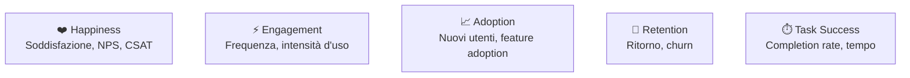

# User-Centricity: Mettere l'Utente al Centro

> **Obiettivo:** Costruire una cultura e un sistema di metriche centrato sull'utente, non sul prodotto o sul revenue.

## 1. Il Mindset User-Centric

La differenza tra aziende che crescono e aziende che stagnano spesso si riduce a una domanda: **misuri il successo dal punto di vista dell'azienda o dell'utente?**

| Company-Centric 🚫 | User-Centric ✅ |
|:---|:---|
| "Quanti utenti abbiamo?" | "Quanti utenti ottengono valore?" |
| "Quanto revenue generiamo?" | "Quanto valore generiamo per utente?" |
| "Quante feature abbiamo rilasciato?" | "Quante feature vengono effettivamente usate?" |
| "Qual è il nostro NPS?" | "Quali problemi degli utenti stiamo risolvendo?" |

## 2. Il Framework HEART (Google)



| Dimensione | Metrica | Come Misurarla |
|:---|:---|:---|
| **Happiness** | CSAT, NPS, SUS score | Survey in-app |
| **Engagement** | DAU/MAU, session duration | Event tracking |
| **Adoption** | New user activation, feature adoption | Funnel analysis |
| **Retention** | D1/D7/D30, cohort retention | Cohort analysis |
| **Task Success** | Completion rate, error rate | Task tracking |

## 3. Jobs to be Done + Metriche

```python
# Mappare i Job degli utenti alle metriche
user_jobs = {
    "Organizzare il lavoro": {
        "success_metric": "projects_with_deadlines_met_pct",
        "target": "> 80%",
        "leading_indicator": "task_created_within_1h_of_signup",
        "survey_question": "Quanto ti senti organizzato? (1-10)"
    },
    "Collaborare col team": {
        "success_metric": "team_members_active_pct",
        "target": "> 60%",
        "leading_indicator": "first_team_invite_sent",
        "survey_question": "Il tuo team usa lo strumento quotidianamente? (Y/N)"
    }
}
```

## 4. Customer Health Score

```python
def customer_health_score(user: dict) -> dict:
    """Calcola un punteggio di salute 0-100 per ogni utente."""
    weights = {
        'login_frequency': 0.25,      # Quante volte accede
        'feature_adoption': 0.25,     # Quante feature usa
        'support_tickets': 0.15,      # Meno = meglio
        'nps_score': 0.15,            # Soddisfazione dichiarata
        'contract_value_trend': 0.20  # Crescita del valore
    }
    
    scores = {
        'login_frequency': min(user['logins_last_30d'] / 20 * 100, 100),
        'feature_adoption': user['features_used'] / user['features_available'] * 100,
        'support_tickets': max(0, 100 - user['tickets_last_30d'] * 20),
        'nps_score': (user.get('nps', 5) + 100) / 200 * 100,  # Normalize -100/+100 to 0-100
        'contract_value_trend': 50 + user.get('mrr_growth_pct', 0)
    }
    
    health = sum(scores[k] * weights[k] for k in weights)
    
    return {
        "score": round(health, 1),
        "status": "🟢 Healthy" if health >= 70 else "🟡 At Risk" if health >= 40 else "🔴 Critical",
        "components": {k: round(v, 1) for k, v in scores.items()},
        "action": _recommend_action(health, scores)
    }
```

## 5. Voice of Customer (VoC) Pipeline

```sql
-- Aggregare i segnali utente da più fonti
SELECT user_id,
    MAX(nps_score) AS latest_nps,
    COUNT(DISTINCT CASE WHEN source = 'support' THEN ticket_id END) AS support_tickets,
    COUNT(DISTINCT CASE WHEN source = 'survey' AND sentiment = 'negative' THEN response_id END) AS negative_surveys,
    MAX(CASE WHEN source = 'churn_survey' THEN reason END) AS churn_reason
FROM user_feedback
WHERE created_at >= CURRENT_DATE - INTERVAL 90 DAY
GROUP BY user_id;
```

## Risorse
- **Framework:** Google HEART, Jobs to be Done
- **Libro:** *Inspired* — Marty Cagan
- **Tool:** Productboard, Amplitude per user analytics
