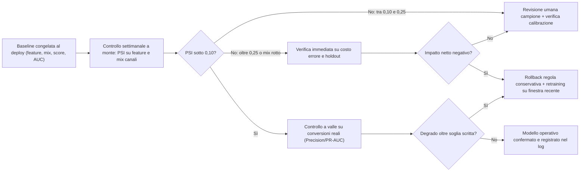

Un marketplace B2C di elettronica ricondizionata gestisce le proprie offerte promozionali con un modello di propensione all'acquisto addestrato su `180.000` sessioni storiche provenienti per il `75%` da ricerca organica ed email CRM (`tasso di conversione medio 4,8%`, margine lordo per ordine `42 €`, costo di erogazione del coupon promozionale `6 €`) (scenario costruito con numeri di esempio).

A ottobre il reparto marketing sposta il `60%` della spesa settimanale su inserzioni video brevi su social network. Il servizio di scoring continua a rispondere senza errori HTTP né eccezioni nei log di sistema, ma dopo sei settimane la precisione nella fascia più alta di punteggio scende dal `31%` all'`11%` e l'iniziativa promozionale genera perdite nette per migliaia di euro alla settimana.

> **Idea chiave:** Un modello predittivo in produzione quasi mai si rompe con un errore di codice: invecchia in silenzio mentre cambiano i canali di traffico, il profilo degli utenti o le loro risposte agli incentivi, trasformando soglie storiche in decisioni costose.

## Perché i modelli di marketing degradano senza generare errori di sistema

Nel software tradizionale un bug blocca una funzione o restituisce un'eccezione visibile nei log. Nel machine learning applicato al marketing, la pipeline può restare tecnicamente verde al `100%` — tabelle aggiornate, tempi di risposta sotto i `50 ms`, zero valori nulli — mentre l'utilità decisionale delle previsioni evapora.

Questo accade perché ogni modello apprende una fotografia statistica di un ambiente preciso: i canali attivi durante il periodo di addestramento, i prezzi praticati in quei mesi, la stagionalità corrente e le regole di tracciamento del sito. Appena una di queste condizioni cambia, le probabilità stimate dal modello perdono calibrazione o capacità discriminante.

Sorvegliare un modello richiede quindi di confrontare continuamente la distribuzione attuale contro una **baseline congelata** al momento del rilascio, osservando prima i segnali in ingresso (variabili e popolazione), poi i punteggi in uscita (`score`) e infine la performance reale legata al costo dell'errore. Attendere soltanto la metrica di conversione finale significa scoprire il guasto quando il budget è già stato bruciato, specialmente su finestre di acquisto lunghe trenta o sessanta giorni.



## Tassonomia del drift: covariate shift, prior shift e concept drift

Non tutti i cambiamenti nel tempo hanno la stessa natura né richiedono lo stesso rimedio. Confondere un cambiamento del traffico in ingresso con un cambiamento del comportamento d'acquisto porta spesso a riaddestrare modelli in modo inutile o persino dannoso.

| Tipo di deriva | Cosa cambia formalmente | Esempio concreto nel marketing | Risposta operativa corretta |
|---|---|---|---|
| Data / Schema Drift | Formato, unità o disponibilità dei campi in $X$ | Un aggiornamento dell'app smette di popolare `tempo_su_pagina` o cambia valuta | Interrompere scoring automatico (`rollback`) e riparare la pipeline ETL |
| Covariate Shift | Cambia $P(X)$, ma resta stabile $P(Y \mid X)$ | Il traffico passa da SEO a campagne video social con sessioni brevi | Verificare la calibrazione per canale, includere `canale` e fare `retraining` |
| Prior / Label Shift | Cambia la prevalenza di base $P(Y)$ | Durante il Black Friday o una crisi di fornitura il tasso base raddoppia o crolla | Ricalibrare le probabilità o aggiustare le soglie decisionali sul nuovo tasso base |
| Concept Drift | Cambia la relazione stessa $P(Y \mid X)$ | Lo sconto del `10%` non convince più gli utenti abituali che aspettano il `25%` | Raccogliere nuovi esiti puliti su gruppo di controllo e riaddestrare da zero |

Separare questi quattro casi impedisce reazioni automatiche sbagliate. Se il guasto nasce da uno **schema drift** — per esempio un campo di tracciamento rimasto a zero dopo un rilascio frontend — fare `retraining` su dati corrotti peggiora il sistema invece di salvarlo: serve fermare l'attivazione automatica, fare `rollback` a una regola robusta e correggere il dato alla fonte. Al contrario, un **concept drift** reale richiede etichette recenti raccolte su traffico non distorto dal modello stesso.

## Metriche di sorveglianza prima e dopo l'esito reale

Poiché le etichette reali di acquisto o abbandono arrivano spesso con settimane di ritardo, un buon sistema di monitoraggio opera su due livelli temporali distinti: controlli **upstream** immediati (disponibili il giorno stesso dello scoring) e controlli **downstream** ritardati (calcolati appena si chiude la finestra di esito).

Il metodo più usato nei modelli tabellari per misurare il drift **upstream** sulle variabili e sullo score è il **Population Stability Index (PSI)**. Dividendo la distribuzione di una variabile o dello score in $k$ intervalli fissati sulla baseline congelata ($B_i$ la quota nella baseline, $A_i$ la quota nel periodo attuale), il PSI misura quanto la distribuzione recente si sia allontanata da quella originaria:

$$\text{PSI} = \sum_{i=1}^{k} (A_i - B_i) \cdot \ln\left(\frac{A_i}{B_i}\right)$$

Nella pratica industriale consolidata (originata nel credit scoring e adottata nel marketing CRM), il PSI si interpreta secondo tre bande operative chiare: sotto `0,10` lo scostamento è trascurabile; tra `0,10` e `0,25` segnala una deriva moderata che richiede ispezione per segmento; oltre `0,25` indica un cambiamento strutturale che rende inaffidabili le probabilità storiche.

Affianca sempre al PSI il controllo della **distribuzione dei segmenti** (mix per canale di acquisizione, dispositivo, paese e fascia di prezzo) e, appena maturano gli esiti reali, verifica **precisione nella fascia attivata**, **calibrazione** (rapporto tra probabilità media prevista e tasso osservato reale) e **margine netto per utente contattato**.

## Derivazione passo-passo di PSI e costo dell'errore su un modello di propensione

Riprendiamo i numeri del marketplace di elettronica ricondizionata (`10.000` sessioni valutate ogni settimana, margine lordo per ordine `42 €`, costo di invio e riscatto del coupon `6 €`) (numeri di esempio). Il modello assegna a ogni sessione una probabilità stimata di acquisto entro 7 giorni e invia il coupon da `6 €` soltanto a chi entra nella **Fascia 4** (score compreso tra `0,75` e `1,00`).

Confrontiamo la distribuzione degli utenti nelle quattro fasce di score tra la **Baseline congelata** (traffico pre-ottobre) e la **Settimana attuale** (dopo il cambio di mix verso campagne video social).

Nella **Fascia 1 (Score `0,00–0,25`, nessuna azione)** la quota passa da $B_1 = 0{,}40$ a $A_1 = 0{,}20$. Nella **Fascia 2 (Score `0,25–0,50`, solo email informativa)** scende da $B_2 = 0{,}30$ a $A_2 = 0{,}22$. Nella **Fascia 3 (Score `0,50–0,75`, retargeting leggero)** sale da $B_3 = 0{,}20$ a $A_3 = 0{,}28$. Infine nella **Fascia 4 (Score `0,75–1,00`, invio coupon `6 €`)** triplica da $B_4 = 0{,}10$ a $A_4 = 0{,}30$.

Calcoliamo prima il contributo al `PSI` fascia per fascia applicando $(A_i - B_i) \cdot \ln(A_i / B_i)$. Per la Fascia 1 otteniamo $(0{,}20 - 0{,}40) \times \ln(0{,}20 / 0{,}40) = (-0{,}20) \times (-0{,}6931) = 0{,}1386$. Per la Fascia 2 otteniamo $(0{,}22 - 0{,}30) \times \ln(0{,}22 / 0{,}30) = (-0{,}08) \times (-0{,}3102) = 0{,}0248$.

Procediamo allo stesso modo per le fasce superiori. Per la Fascia 3 il termine vale $(0{,}28 - 0{,}20) \times \ln(0{,}28 / 0{,}20) = (+0{,}08) \times (+0{,}3365) = 0{,}0269$, mentre per la Fascia 4 vale $(0{,}30 - 0{,}10) \times \ln(0{,}30 / 0{,}10) = (+0{,}20) \times (+1{,}0986) = 0{,}2197$.

Sommando i quattro addendi troviamo il `PSI` totale: $\text{PSI} = 0{,}1386 + 0{,}0248 + 0{,}0269 + 0{,}2197 = 0{,}4100$. Poiché `0,4100` supera ampiamente la soglia di allarme `0,25`, il modello sta classificando come altamente propensi tre volte più utenti rispetto al previsto (`30%` invece del `10%`), prima ancora che arrivino le conversioni finali.

Tradurre questo scostamento in conto economico nella Fascia 4 su `10.000` utenti settimanali rende evidente l'urgenza dell'intervento. Nello **Scenario Baseline**, il `10%` di `10.000` corrisponde a `1.000` utenti contattati con coupon: con precisione reale del `31%`, gli ordini risultanti sono $1.000 \times 0{,}31 = 310$ ordini, il margine lordo vale $310 \times 42 = 13.020$ €, i costi coupon valgono $1.000 \times 6 = 6.000$ € e il risultato netto è $+7.020$ € a settimana.

Nello **Scenario Settimana attuale (post drift)**, invece, la fascia alta raccoglie il `30%`, ossia `3.000` utenti provenienti soprattutto dagli annunci video che convertono molto meno, portando la precisione reale all'`11%`. Gli ordini risultano $3.000 \times 0{,}11 = 330$ ordini (`13.860 €` di margine lordo), ma il costo dei coupon triplica a $3.000 \times 6 = 18.000$ €, facendo precipitare il risultato netto a $13.860 - 18.000 = -4.140$ € a settimana — un peggioramento netto di `11.160 €` ogni sette giorni rispetto alla baseline.

La scelta operativa non può aspettare un nuovo ciclo trimestrale di training: va eseguito un **rollback** immediato dell'invio automatico sul traffico proveniente dalle campagne video social (sostituendolo con una soglia conservativa basata su aggiunta al carrello reale) e pianificato un **retraining** su dati recenti che integri esplicitamente `canale_acquisizione` e tempo di permanenza post-click.

## Implementazione in Python di PSI e trigger di governance

Lo script seguente replica il calcolo del PSI sullo score appena svolto, unisce la verifica del margine netto settimanale e restituisce una decisione automatica coerente con le soglie concordate con il business prima del rilascio.

```python
import math
from typing import Sequence

def calcola_psi(baseline_shares: Sequence[float], current_shares: Sequence[float], eps: float = 1e-6) -> float:
    # Evita divisioni per zero o logaritmi indefiniti su fasce vuote
    psi_tot = 0.0
    for b_raw, a_raw in zip(baseline_shares, current_shares):
        b = max(b_raw, eps)
        a = max(a_raw, eps)
        psi_tot += (a - b) * math.log(a / b)
    return psi_tot

def valuta_salute_modello(
    baseline_shares: Sequence[float],
    current_shares: Sequence[float],
    utenti_settimanali: int,
    quota_fascia_attivata: float,
    precision_attuale: float,
    margine_ordine: float = 42.0,
    costo_azione: float = 6.0,
) -> dict[str, object]:
    psi = calcola_psi(baseline_shares, current_shares)
    contattati = utenti_settimanali * quota_fascia_attivata
    ordini = contattati * precision_attuale
    netto_settimanale = (ordini * margine_ordine) - (contattati * costo_azione)

    # Regole di risposta scritte prima della messa in produzione
    if netto_settimanale < 0 or psi > 0.35:
        azione = "ROLLBACK + RETRAINING URGENTE"
    elif psi >= 0.25:
        azione = "RETRAINING PIANIFICATO + REVISIONI SEGMENTO"
    elif psi >= 0.10:
        azione = "REVISIONE UMANA SU CAMPIONE"
    else:
        azione = "OK (MONITORAGGIO ORDINARIO)"

    return {
        "psi": round(psi, 4),
        "contattati": int(contattati),
        "ordini_attesi": round(ordini, 1),
        "netto_eur": round(netto_settimanale, 2),
        "decisione": azione,
    }

report = valuta_salute_modello(
    baseline_shares=[0.40, 0.30, 0.20, 0.10],
    current_shares=[0.20, 0.22, 0.28, 0.30],
    utenti_settimanali=10_000,
    quota_fascia_attivata=0.30,
    precision_attuale=0.11,
)
print(report)
```

## Protocollo operativo: baseline congelata, soglie e caso reale

Un monitoraggio è credibile solo se definisce in anticipo chi interviene, su quale numero e con quale traccia scritta. Le soglie vanno fissate nel documento di rilascio prima che il modello tocchi il traffico reale, associando a ciascun livello un'azione precisa e una nuova registrazione della baseline dopo ogni modifica.

| Condizione rilevata | Segnale tipico | Risposta prevista | Artefatto da aggiornare |
|---|---|---|---|
| Deriva lieve locale | `PSI` tra `0,10` e `0,25` su un solo paese o piano | Revisione umana su campione recente e controllo calibrazione | Nota di verifica nel registro modelli |
| Deriva stabile diffusa | `PSI` oltre `0,25` per due settimane o calo `PR-AUC` sopra soglia | `Retraining` su finestra pulita con ri-validazione temporale | Nuova baseline congelata con data e dataset |
| Danno economico o pipeline corrotta | Margine netto negativo, campo critico a zero o feed errato | `Rollback` immediato a regola deterministica o versione `N-1` | Verbale incidente, stop targeting e fix ETL |

Quanto costi trascurare i meccanismi di arresto rapido emerge con estrema chiarezza dal celebre caso Microsoft Tay del marzo 2016: il chatbot apprendeva in tempo reale dai messaggi ricevuti dagli utenti senza filtri robusti di deriva né freni automatici sulla distribuzione in ingresso. Nel giro di meno di 24 ore, dopo aver assorbito circa `96.000` messaggi mirati con distribuzione manipolata, il modello modificò il proprio comportamento producendo risposte offensive e costringendo l'azienda a spegnere il servizio e ritirare il sistema.

Sebbene i modelli tabellari di marketing operino su log batch e non su conversazioni libere, la lezione operativa è identica: se una pipeline apprende o attiva decisioni senza controlli sulla distribuzione in ingresso e senza un interruttore di `rollback` provato in anticipo, la deriva si autoalimenta e distrugge fiducia molto prima che un controllo manuale intervenga.

## Errori tipici nel monitoraggio in produzione

### Guardare solo la metrica aggregata nascondendo i nuovi canali

Quando un canale storico continua a rappresentare il `70%` del traffico mentre un nuovo canale o segmento cresce dal `5%` al `30%`, la `ROC-AUC` complessiva del modello può scendere appena da `0,84` a `0,81`, apparendo quasi sana.

In realtà tutto il danno è concentrato sul nuovo segmento dove la calibrazione è completamente saltata. La regola di prevenzione è segmentare obbligatoriamente le viste di monitoraggio per `canale_acquisizione`, piano tariffario e fascia di anzianità dell'utente.

### Riaddestrare alla cieca su etichette contaminate dal modello precedente

Succede quando un team automatizza il `retraining` settimanale prendendo tutti i clienti storici senza escludere l'effetto delle campagne scatenate dal modello stesso. Se il modello ha inviato coupon solo agli utenti con punteggio alto e ha ignorato gli altri, il dataset futuro conterrà un bias di selezione (`feedback loop`) che rinforza le decisioni passate invece di misurare la propensione naturale.

Per evitare questa trappola, mantieni sempre attivo un gruppo di controllo casuale (`holdout`) escluso dalle azioni automatiche e usa quei dati puliti per verificare e riaddestrare.

### Impostare alert tecnici senza soglia economica né rollback pronto

Molti team configurano notifiche su Slack ogni volta che una feature varia oltre tre deviazioni standard, ma senza aver definito quale perdita in euro rende insostenibile il modello e senza avere una versione precedente (`fallback`) già testata in produzione.

Il risultato è che gli alert vengono silenziati per eccesso di rumore e, quando arriva un calo vero, nessuno osa spegnere il modello perché manca l'alternativa pronta. Lega ogni alert rosso a un impatto monetario stimato e testa mensilmente la procedura di `rollback` prima dell'emergenza.

## Verifica della tua pipeline di monitoraggio

1. Dopo l'introduzione di un nuovo partner di affiliazione, il `PSI` dello score di propensione sale a `0,38`, ma nessuna query SQL o job Python restituisce errori tecnici. Perché non devi aspettare la fine del mese per intervenire?

<details>
<summary>Mostra risposta</summary>

Un `PSI` di `0,38` (ben sopra la soglia critica `0,25`) dimostra già oggi che i clienti stanno cadendo nelle fasce di score in proporzioni molto diverse rispetto alla baseline di addestramento. Aspettare 30 giorni per vedere i tassi di acquisto reali significa continuare a spendere budget promozionale su punteggi non calibrati; conviene congelare l'automazione sul nuovo traffico o applicare subito un gruppo holdout controllato.

</details>

2. Durante un controllo di routine scopri che una variabile comportamentale usata dal modello (`click_carrello_7gg`) vale zero per tutti gli utenti iOS da tre giorni a causa di un aggiornamento dell'app. Scegli `retraining` sui dati recenti oppure `rollback` e fix ETL?

<details>
<summary>Mostra risposta</summary>

È un caso netto di `schema/data drift` dovuto a un guasto di tracciamento, non a un cambiamento dei clienti. Riaddestrare su dati con una feature azzerata consoliderebbe il difetto e degraderebbe il modello per tutti gli altri utenti: occorre applicare un `rollback` o escludere iOS dalla regola automatica finché la pipeline di raccolta eventi non viene riparata e verificata.

</details>

3. Nel nostro esempio numerico, perché il margine netto settimanale della Fascia 4 è passato da `+7.020 €` a `-4.140 €` pur generando `330` ordini invece dei `310` della baseline?

<details>
<summary>Mostra risposta</summary>

Perché il volume assoluto di ordini ignorava il costo unitario delle azioni inviate: per passare da `310` a `330` ordini (`+20` ordini, pari a `+840 €` di margine lordo), il modello spostato verso l'alto ha triplicato gli utenti messi in Fascia 4 (da `1.000` a `3.000`), facendo esplodere la spesa in coupon da `6.000 €` a `18.000 €` (`+12.000 €` di costi aggiuntivi). Senza collegare precisione e costo errore, gli ordini lordi ingannano la decisione.

</details>

4. Quale ruolo svolge un gruppo `holdout` permanente del 5%–10% nella prevenzione del model decay?

<details>
<summary>Mostra risposta</summary>

Il gruppo `holdout` non riceve il trattamento deciso dal modello e fornisce una misura non contaminata dell'andamento naturale del comportamento (`baseline continua`). Permette sia di misurare il vero lift incrementale delle azioni in produzione, sia di disporre di etichette pulite per riaddestrare il modello senza intrappolarlo nel proprio feedback loop.

</details>
