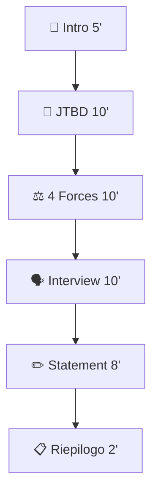

## User-Centricity: Oltre i numeri con il Jobs To Be Done (JTBD) — Lezione Completa

Il marketing ossessionato dai dati rischia di perdere di vista l'essenziale: le persone. Puoi ottimizzare il CTR di un banner all'infinito, ma se il prodotto non risolve un problema reale, fallirai. In questa lezione, impareremo a usare la ricerca qualitativa e il framework Jobs To Be Done (JTBD) per capire le motivazioni profonde dei clienti, quelle che nessun grafico analytics potrà mai mostrarti.

### Obiettivi di Apprendimento

Al termine di questa lezione, lo studente sarà in grado di:
1.  Applicare il framework Jobs To Be Done per definire il "progresso" che l'utente vuole fare.
2.  Condurre interviste qualitative "Switch" per scoprire perché i clienti cambiano prodotto.
3.  Identificare le 4 forze che agiscono sulla decisione d'acquisto (Push, Pull, Anxiety, Habit).
4.  Distinguere tra concorrenti diretti e concorrenti "Job-based" (es. Netflix vs Sonno).
5.  Tradurre gli insight qualitativi in feature di prodotto e copy di marketing.

### Timeline della Lezione

| Fase | Argomento | Durata |
|------|-----------|--------|
| 1 | Introduzione: Il milkshake di McDonald's | 5 min |
| 2 | Teoria: Il Framework JTBD | 10 min |
| 3 | Analisi: Le 4 Forze del Cambiamento | 10 min |
| 4 | Metodologia: L'Intervista "Switch" | 10 min |
| 5 | Esercizi: Definire il Job Statement | 8 min |
| 6 | Riepilogo e Domande | 2 min |
| **Totale** | | **45 min** |



### Fase 1 — Introduzione: Il milkshake di McDonald's (5 min)

Clayton Christensen, professore di Harvard, fu chiamato da McDonald's per aumentare le vendite di milkshake.
I dati dicevano: "I clienti vogliono più gusti? Più cioccolato?". Fecero i focus group, lanciarono i nuovi gusti... zero risultati.

Christensen cambiò approccio. Si sedette nel ristorante per 18 ore. Vide che il 40% dei milkshake veniva venduto alle 8:00 del mattino a pendolari soli in auto.
*   *Perché?* Non per fame. Non per dolcezza.
*   *Job:* "Ho un viaggio noioso di 30 minuti. Devo tenere una mano occupata. Non voglio aver fame alle 10:00."
*   *Competitor:* Non Burger King. Ma una banana (finisce troppo presto), una ciambella (sporca le mani), o la radio (noiosa).
*   *Soluzione:* Resero il milkshake più denso (dura 20 minuti) e con pezzetti di frutta (sorpresa). Le vendite quadruplicarono.

### Fase 2 — Teoria: Il Framework JTBD (10 min)

Le persone non comprano prodotti; li "assumono" per fare un progresso nella loro vita.
> *"Le persone non vogliono un trapano da 6mm. Vogliono un buco nel muro da 6mm."* — Theodore Levitt.
> *(O meglio: vogliono appendere un quadro per sentirsi a casa).*

**Struttura del Job Statement:**
*   **Situazione:** "Quando sono in viaggio di lavoro..."
*   **Motivazione:** "...voglio mangiare qualcosa di veloce e sano..."
*   **Risultato Atteso:** "...così non mi sento in colpa e ho energia per la riunione."

Non definire il tuo mercato in base al prodotto ("Siamo un'app di meditazione"), ma in base al Job ("Aiutiamo le persone a ridurre l'ansia prima di dormire"). I tuoi competitor diventano: pillole per dormire, un libro, una camomilla, o scrollare Instagram (che fallisce il job).

### Fase 3 — Analisi: Le 4 Forze del Cambiamento (10 min)

Ogni acquisto è una lotta tra forze opposte. Bob Moesta (co-creatore di JTBD) le definisce così:

1.  **Push (Spinta del problema attuale):** "Il mio software attuale è lento e costoso." (Forza pro-cambiamento).
2.  **Pull (Attrazione della soluzione nuova):** "Il nuovo software ha l'AI che scrive le mail da sola!" (Forza pro-cambiamento).
3.  **Anxiety (Ansia dell'ignoto):** "E se poi non funziona? E se perdo i dati? Sarà difficile imparare?" (Forza anti-cambiamento).
4.  **Habit (Abitudine / Inerzia):** "Ormai conosco i tasti a memoria, non ho voglia di cambiare." (Forza anti-cambiamento).

**Strategia:**
*   Aumenta la Push (Enfatizza il dolore attuale).
*   Aumenta la Pull (Mostra il futuro migliore).
*   Riduci l'Anxiety (Garanzia soddisfatti o rimborsati, prova gratuita senza carta).
*   Riduci l'Habit (Migrazione dati con 1 click, interfaccia familiare).

```mermaid
flowchart TD
    subgraph PRO["Pro-Cambiamento"]
    Push[Push (Dolore Attuale)] --> Decisione
    Pull[Pull (Sogno Futuro)] --> Decisione
    end

    subgraph CONTRO["Anti-Cambiamento"]
    Anxiety[Anxiety (Paura)] --> Decisione
    Habit[Habit (Inerzia)] --> Decisione
    end

    Decisione{Acquisto?}
```

### Fase 4 — Metodologia: L'Intervista "Switch" (10 min)

Come scopri queste forze? Intervistando chi ha appena "cambiato" (Switched) prodotto negli ultimi 30-60 giorni. La loro memoria è fresca.

**Lo Script dell'Intervista (Simil-Poliziesco):**
1.  **Il primo pensiero:** "Quando hai pensato per la prima volta di cercare una soluzione?" (Timeline).
2.  **L'evento scatenante:** "Cosa è successo quel giorno per farti dire 'Basta'?" (Push).
3.  **La ricerca passiva:** "Hai guardato su Google? Hai chiesto a un amico?" (Pull).
4.  **L'evento catalizzatore:** "Perché hai comprato proprio quel martedì? Perché non il mese prima?" (Urgenza).
5.  **Il post-acquisto:** "Cosa ti ha sorpreso? Cosa ti mancava del vecchio sistema?" (Habit/Anxiety).

*Obiettivo:* Costruire una timeline emotiva, non una lista di feature.

### Fase 5 — Esercizi: Definire il Job Statement (8 min)

**Scenario:** Sei PM di Zoom.
Un utente dice: "Uso Zoom per fare le chiamate." (Superficiale).

**Scava a fondo (5 Whys):**
*   Perché? "Per vedere i colleghi."
*   Perché? "Per capire se sono d'accordo con me dal linguaggio del corpo."
*   Perché? "Perché se scrivo solo email, ci sono fraintendimenti e perdo tempo."
*   Perché? "Voglio chiudere il progetto velocemente e fare bella figura."

**Job Statement:**
"Quando gestisco progetti complessi da remoto, voglio cogliere le sfumature non verbali dei colleghi, così posso evitare malintesi, velocizzare le decisioni e sentirmi un leader efficace."

*Concorrente:* Non Google Meet. Ma un volo aereo per incontrarsi di persona. O una lunga catena di email (che Zoom deve battere in efficacia).

### Fase 6 — Riepilogo e Domande (2 min)

1.  **Progresso.** L'utente vuole diventare una versione migliore di sé stesso.
2.  **Forze.** Riduci l'ansia prima di aumentare la feature.
3.  **Competitor.** Guarda fuori dalla tua categoria merceologica.
4.  **Interviste.** Parla con chi ha appena comprato (o appena abbandonato).

### Domande di Verifica

1.  Qual è la differenza tra un "Competitor Diretto" e un "Competitor Job-Based"? (Esempio Netflix).
2.  Spiega come le "4 Forze" interagiscono nel momento dell'acquisto di un nuovo smartphone.
3.  Perché i dati demografici (età, sesso) sono spesso inutili nel framework JTBD?
4.  Qual è lo scopo principale di un'intervista "Switch"?
5.  Come tradurresti il Job Statement del milkshake in una campagna pubblicitaria?

### Riferimenti Bibliografici

-   Clayton Christensen, "Competing Against Luck", HarperBusiness, 2016.
-   Bob Moesta, "Demand-Side Sales 101", Lioncrest, 2020.
-   Alan Klement, "When Coffee and Kale Compete", 2018.
