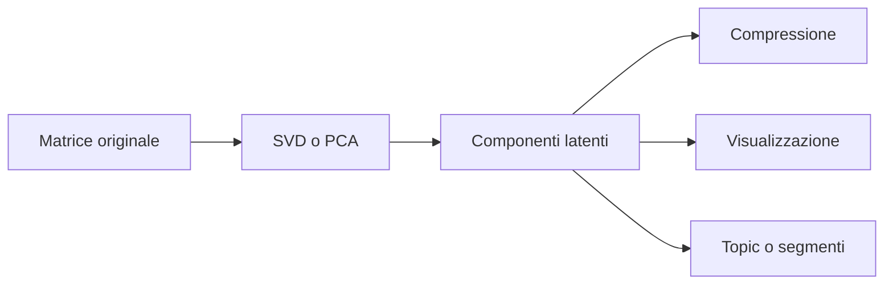

import { Aside } from '@astrojs/starlight/components'

Quando hai cento feature e non capisci piu' cosa conta davvero, il problema non e' solo il modello: e' lo spazio in cui stai lavorando. Autovalori e SVD servono a ridurre complessita' senza perdere troppa informazione.

## Mappa mentale



## Il problema reale

Esempi tipici:

- matrice utenti x prodotti
- matrice query x keyword
- matrice documenti x termini
- tabella KPI con molte colonne correlate

In questi casi vuoi trovare poche dimensioni sintetiche che spieghino gran parte della struttura.

## Idea intuitiva di autovettore

Un autovettore e' una direzione speciale che, dopo la trasformazione lineare, non cambia direzione ma solo scala.

```text
A v = lambda v
```

`lambda` e' l'autovalore: quanto quella direzione viene "allungata" o "compressa".

### Intuizione giusta prima della formula

Non devi immaginare autovalori e autovettori come oggetti astratti. Devi immaginarli come le direzioni che spiegano meglio la struttura del dato. Se una direzione ha peso alto, li' dentro c'e' molto segnale.

## SVD: la decomposizione piu' utile in pratica

La Singular Value Decomposition scompone una matrice `A` in:

```text
A = U S V^T
```

In pratica ti permette di:

- comprimere una matrice
- togliere rumore
- trovare dimensioni latenti
- preparare recommendation e topic extraction

```python
import numpy as np

A = np.array([
    [4, 0, 2],
    [3, 1, 1],
    [0, 2, 3],
    [1, 1, 0],
], dtype=float)

U, s, VT = np.linalg.svd(A, full_matrices=False)

print(s.round(3))
```

## Riduzione a poche componenti

```python
k = 2
A_reduced = U[:, :k] @ np.diag(s[:k]) @ VT[:k, :]

print(A_reduced.round(2))
```

Se la ricostruzione resta vicina all'originale, hai compresso la matrice senza perdere troppo segnale.

## Caso analytics: topic latenti su recensioni o query

Una term-document matrix molto grande puo' essere ridotta per trovare assi latenti come:

- prezzo
- qualita'
- consegna
- servizio clienti

```python
from sklearn.decomposition import TruncatedSVD

term_doc = np.array([
    [3, 0, 1, 0],
    [2, 1, 0, 0],
    [0, 2, 3, 1],
    [0, 1, 4, 2],
], dtype=float)

svd = TruncatedSVD(n_components=2, random_state=42)
latent = svd.fit_transform(term_doc)

print(latent.round(3))
print(svd.explained_variance_ratio_.round(3))
```

## Come scegliere quante componenti tenere

Non c'e' una soglia magica. In pratica guardi:

- quanta varianza spiegano le prime componenti
- se la ricostruzione resta leggibile
- se le componenti hanno ancora interpretazione operativa

Se tenere una componente in piu' non cambia quasi nulla, stai probabilmente comprimendo bene.

## Collegamento con PCA

PCA usa gli autovettori della matrice di covarianza per trovare le direzioni di massima varianza.

Business meaning:

- comprimere KPI correlati
- visualizzare segmenti in 2D
- ridurre rumore prima di clustering o regressione

## Quando usarla davvero

- troppe feature correlate
- bisogno di visualizzare strutture nascoste
- recommendation system semplice
- testo o semantica latente

<Aside type="tip">
Non usare riduzione dimensionale solo perche' hai tante colonne. Usala quando vuoi preservare struttura utile, non quando stai solo evitando di fare feature selection.
</Aside>

## Esempio avanzato con mini dataset reale

Il dataset `wine` di scikit-learn e' perfetto per vedere PCA in azione su feature numeriche reali. Prima standardizzi, poi proietti tutto su due componenti e controlli quanta varianza stai trattenendo.

```python
from sklearn.datasets import load_wine
from sklearn.decomposition import PCA
from sklearn.preprocessing import StandardScaler
import pandas as pd

wine = load_wine(as_frame=True)
X_scaled = StandardScaler().fit_transform(wine.data)

pca = PCA(n_components=2, random_state=42)
components = pca.fit_transform(X_scaled)

projection = pd.DataFrame(components, columns=["pc1", "pc2"])
projection["target"] = wine.target

print(pca.explained_variance_ratio_.round(3))
print(projection.head())
```

Se le prime due componenti spiegano una quota utile di varianza e separano gia' parte delle classi, hai una visualizzazione molto piu' leggibile dell'originale e un buon punto di partenza per clustering o segmentazione.

## Errori comuni

### Componenti interpretate come variabili "reali"

Le componenti sono combinazioni lineari, non colonne originali.

### Compressione troppo aggressiva

Se tieni troppo poche componenti, perdi segnale importante.

### Nessuna standardizzazione in PCA

Se le feature hanno scale diverse, le componenti saranno distorte.

## Output atteso

Le uscite piu' utili sono:

- singular values
- explained variance
- coordinate latenti per ogni riga
- matrice ricostruita o compressa

## Riepilogo operativo

- Autovalori e autovettori descrivono direzioni strutturali di una trasformazione.
- SVD e' la decomposizione operativa piu' utile su matrici reali.
- Riduzione dimensionale serve a leggere pattern nascosti e comprimere informazione.

## Mini esercizio

Prendi una matrice `users x categories` con frequenze di acquisto. Applica `TruncatedSVD(n_components=2)` e prova a interpretare le due dimensioni latenti.
