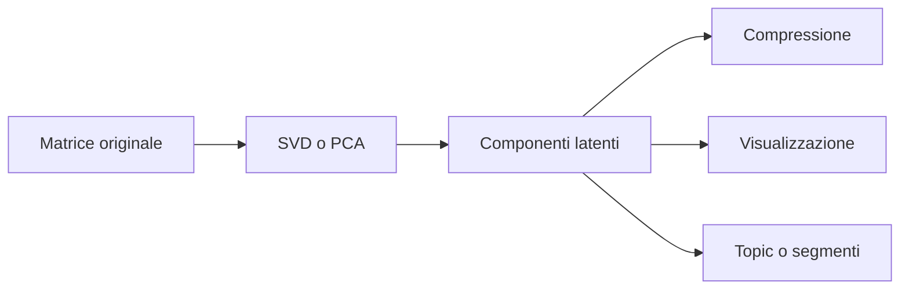

import { Aside } from '@astrojs/starlight/components'

Amazon ha 400 milioni di prodotti. Raccomandarne uno richiede di confrontare ogni utente con ogni prodotto — impossibile con la matrice originale. Con SVD decomoponi la matrice in 50 "fattori latenti" e il problema diventa trattabile. È lo stesso principio della soluzione vincitrice della Netflix Prize del 2009: Simon Funk ha pubblicato online la sua implementazione SVD e ha battuto il team interno di Netflix con una riduzione dell'errore del 10% rispetto alla baseline. Stava letteralmente comprimendo una matrice di 100 milioni di rating in pochissime dimensioni, e dalla struttura compressa emergevano pattern che nessuna regola esplicita avrebbe mai catturato.

Questo è il potere dell'algebra lineare applicata ai dati reali: non calcoli astratti, ma strumenti che trasformano problemi intrattabili in problemi risolvibili.

## Mappa mentale



## Il problema reale

Quando lavori su dati strutturati, ti trovi spesso di fronte a matrici grandi e dense di correlazioni:

- matrice utenti × prodotti (frequenze di acquisto o rating)
- matrice query × keyword (click da Google Search Console)
- matrice documenti × termini (customer feedback, ticket di supporto)
- tabella KPI con decine di colonne correlate tra loro

In tutti questi casi, le colonne originali non sono indipendenti. Due KPI come "sessioni organiche" e "nuovi utenti organici" sono quasi la stessa cosa: variano insieme, misurano lo stesso fenomeno. Portarli entrambi in un modello introduce ridondanza, non informazione.

Il compito della riduzione dimensionale è trovare poche direzioni sintetiche — le componenti principali, i fattori latenti, le dimensioni nascoste — che spiegano gran parte della struttura dei dati. Non perdi informazione: la comprimi.

## Autovalori e autovettori

### Geometria prima delle formule

Ogni matrice quadrata è una trasformazione lineare: prende un vettore e lo sposta. Ruota, allunga, schiaccia. Se moltiplichi tutti i vettori di un piano per una matrice, ottieni un nuovo piano deformato.

Gli autovettori sono le direzioni speciali che questa trasformazione non ruota — le lascia puntar nella stessa direzione, cambiando solo la loro lunghezza. L'autovalore associato dice quanto quella direzione viene allungata o compressa.

Formalmente:

```text
A · v = λ · v
```

dove `A` è la matrice, `v` è l'autovettore, `λ` (lambda) è l'autovalore.

Immagina una trasformazione che schiaccia uno spazio lungo un asse e allunga lungo un altro. Le direzioni degli assi principali di deformazione sono gli autovettori. Le intensità di deformazione sono gli autovalori.

In analytics: se hai una matrice di covarianza tra KPI, gli autovettori descrivono le direzioni di massima varianza nel dato. Quello con autovalore più alto è la direzione che spiega di più.

### Calcolo con NumPy

```python
import numpy as np

# Una matrice di esempio: rappresenta correlazione tra due metriche
A = np.array([
    [3, 1],
    [1, 3]
], dtype=float)

eigenvalues, eigenvectors = np.linalg.eig(A)

print("Autovalori:", eigenvalues)
print("Autovettori (colonne):\n", eigenvectors)

# Verifica: A @ v == lambda * v
v0 = eigenvectors[:, 0]
lam0 = eigenvalues[0]
print("\nA @ v0 =", A @ v0)
print("lam0 * v0 =", lam0 * v0)
```

L'output mostra due autovalori: 4 e 2. Il primo autovettore è `[0.707, 0.707]` — la diagonale a 45°. Il secondo è `[-0.707, 0.707]` — perpendicolare al primo. La matrice schiaccia di meno lungo la diagonale e di più lungo l'altra direzione.

<Aside type="note">
Per matrici simmetriche (come le matrici di covarianza) gli autovalori sono sempre reali e gli autovettori sono ortogonali tra loro. Questa proprietà è fondamentale per PCA.
</Aside>

### Perché importa in pratica

Gli autovalori ordinati in modo decrescente ti dicono quanto "segnale" c'è in ogni direzione. Se il primo autovalore vale 80 e il secondo vale 2, la quasi totalità della struttura sta nel primo. Puoi ignorare il secondo senza perdere quasi nulla.

Questo è esattamente il meccanismo che sta sotto PCA: trova le direzioni di massima varianza (autovettori della matrice di covarianza) e le usa come nuovo sistema di coordinate.

## Diagonalizzazione

### Cos'è e perché è utile

Una matrice quadrata `A` può essere scritta come:

```text
A = Q Λ Q⁻¹
```

dove:
- `Q` è la matrice le cui colonne sono gli autovettori di `A`
- `Λ` (Lambda maiuscolo) è la matrice diagonale con gli autovalori
- `Q⁻¹` è l'inversa di `Q`

Questa è la diagonalizzazione. Il significato geometrico: cambi il sistema di riferimento (moltiplichi per `Q⁻¹`), applichi una scala semplice (moltiplichi per `Λ`, che è solo una diagonale), poi torni al riferimento originale (moltiplichi per `Q`).

### Utilità per operazioni ripetute

La diagonalizzazione diventa potente quando devi applicare la stessa trasformazione più volte. Il prodotto di `A` con se stessa `n` volte è:

```text
Aⁿ = Q Λⁿ Q⁻¹
```

Elevare una matrice diagonale alla `n`-esima potenza è banale: basta elevare ogni elemento diagonale. Questo ha applicazioni concrete nei modelli Markoviani (transizioni di stato ripetute), nei sistemi di raccomandazione iterativi e nell'analisi di reti.

```python
import numpy as np

A = np.array([
    [3, 1],
    [1, 3]
], dtype=float)

eigenvalues, Q = np.linalg.eig(A)
Lambda = np.diag(eigenvalues)
Q_inv = np.linalg.inv(Q)

# Ricostruzione: A = Q @ Lambda @ Q_inv
A_reconstructed = Q @ Lambda @ Q_inv
print("Differenza dalla matrice originale:", np.allclose(A, A_reconstructed))

# A al quadrato tramite diagonalizzazione
Lambda_squared = np.diag(eigenvalues**2)
A_squared_via_diag = Q @ Lambda_squared @ Q_inv
A_squared_direct = A @ A
print("A^2 uguale:", np.allclose(A_squared_via_diag, A_squared_direct))
```

## PCA passo per passo

### Il meccanismo interno

PCA — Principal Component Analysis — è un algoritmo di riduzione dimensionale basato sugli autovettori della matrice di covarianza. Il processo ha tre fasi:

**Fase 1: standardizzazione.** Le feature con scale diverse dominano la covarianza. Un KPI in milioni di euro e uno in percentuale non sono comparabili. Prima di tutto standardizzi: sottrai la media e dividi per la deviazione standard.

**Fase 2: matrice di covarianza.** La covarianza tra due variabili misura quanto variano insieme. La matrice di covarianza raccoglie tutte queste relazioni. Per un dataset con `p` feature, è una matrice `p × p`.

**Fase 3: autodecomposizione.** Gli autovettori della matrice di covarianza sono le componenti principali. Il primo autovettore punta nella direzione di massima varianza del dataset. Il secondo punta nella direzione di massima varianza rimanente, perpendicolare al primo. E così via.

### PCA su un dataset di marketing reale

Supponiamo di avere dati di clienti con feature numeriche: spesa media, frequenza di acquisto, numero di categorie esplorate, tasso di apertura email, click su offerte.

```python
import numpy as np
import pandas as pd
from sklearn.decomposition import PCA
from sklearn.preprocessing import StandardScaler

# Dataset simulato: 200 clienti, 5 metriche
np.random.seed(42)
n = 200

spesa = np.random.normal(150, 50, n)
frequenza = spesa * 0.03 + np.random.normal(0, 0.5, n)  # correlata con spesa
categorie = np.random.normal(4, 1.5, n)
apertura_email = np.random.normal(0.35, 0.1, n)
click_offerte = apertura_email * 0.4 + np.random.normal(0, 0.05, n)  # correlata con apertura

X = np.column_stack([spesa, frequenza, categorie, apertura_email, click_offerte])
feature_names = ["spesa", "frequenza", "categorie", "apertura_email", "click_offerte"]

# Standardizzazione obbligatoria
scaler = StandardScaler()
X_scaled = scaler.fit_transform(X)

# PCA
pca = PCA(n_components=5)
X_pca = pca.fit_transform(X_scaled)

# Varianza spiegata
varianza = pca.explained_variance_ratio_
print("Varianza per componente:", varianza.round(3))
print("Varianza cumulativa:", varianza.cumsum().round(3))

# Le prime due componenti
pca2 = PCA(n_components=2)
X_2d = pca2.fit_transform(X_scaled)
df_vis = pd.DataFrame(X_2d, columns=["PC1", "PC2"])
print(df_vis.describe())
```

In questo caso le prime due componenti catturano circa il 70-75% della varianza totale. La prima componente riflette principalmente il comportamento di acquisto (spesa + frequenza correlate), la seconda l'engagement via email.

<Aside type="tip">
Interpreta sempre le componenti guardando i loadings — i pesi di ogni feature originale sulla componente. `pca.components_[0]` ti dà i pesi della prima componente. Feature con peso alto in valore assoluto dominano quella direzione.
</Aside>

### Errori da evitare con PCA

**Non standardizzare.** Se una feature è in euro e un'altra in percentuale, la covarianza è dominata dall'euro per motivi puramente di scala, non di informazione.

**Interpretare le componenti come variabili reali.** Le componenti sono combinazioni lineari di tutte le feature originali, non colonne isolate. Non puoi dire "la componente 1 è la spesa".

**Applicarla su variabili categoriali.** PCA funziona su spazi euclidei. Per dati misti esiste MCA (Multiple Correspondence Analysis). Per dati binari, considera PCA su rappresentazioni numeriche opportune.

## SVD: la decomposizione più utile in pratica

### La struttura matematica

La Singular Value Decomposition scompone qualsiasi matrice `A` di dimensioni `m × n` in:

```text
A = U Σ Vᵀ
```

dove:
- `U` è una matrice ortogonale `m × m` — i "vettori singolari sinistri", uno per ogni riga di `A`
- `Σ` (Sigma) è una matrice diagonale `m × n` — i valori singolari, sempre non negativi e in ordine decrescente
- `Vᵀ` è la trasposta di una matrice ortogonale `n × n` — i "vettori singolari destri", uno per ogni colonna di `A`

I valori singolari in `Σ` misurano quanto ogni coppia (U_i, V_i) contribuisce alla struttura della matrice originale. Il primo valore singolare è il più grande — quella coppia cattura la direzione di massima energia della matrice.

### SVD vs PCA: differenze e quando usare quale

PCA e SVD sono strettamente legate. PCA sulle feature di un dataset centrato è equivalente a SVD sulla matrice dei dati stessa. Ma ci sono differenze pratiche importanti:

**Usa PCA quando:**
- hai una matrice densa con feature numeriche
- vuoi un'interfaccia semplice con spiegazione della varianza
- il dataset sta in memoria

**Usa SVD (e in particolare TruncatedSVD) quando:**
- la matrice è sparsa (molti zeri, come in matrici utenti × prodotti)
- non puoi centrare i dati senza perdere la sparsità
- lavori con term-document matrix o user-item matrix
- il dataset è troppo grande per eigendecomposizione completa

```python
import numpy as np

A = np.array([
    [4, 0, 2],
    [3, 1, 1],
    [0, 2, 3],
    [1, 1, 0],
], dtype=float)

U, s, VT = np.linalg.svd(A, full_matrices=False)

print("Valori singolari:", s.round(3))
print("Forma U:", U.shape)
print("Forma VT:", VT.shape)

# Verifica: ricostruzione completa
A_ricostruita = U @ np.diag(s) @ VT
print("Ricostruzione corretta:", np.allclose(A, A_ricostruita))
```

### Interpretazione dei valori singolari

I valori singolari non sono le stesse cose degli autovalori, ma sono collegati: per la matrice `AᵀA`, gli autovalori sono i quadrati dei valori singolari di `A`. I vettori singolari destri sono gli autovettori di `AᵀA`.

In una matrice utenti × prodotti, il primo valore singolare cattura la "dimensione latente" più forte — forse la tendenza generale ad acquistare molto o poco. Il secondo potrebbe separare utenti che preferiscono prodotti tecnici da chi preferisce prodotti lifestyle. Queste dimensioni emergono dai dati, non vengono definite a priori.

## Ricostruzione e approssimazione a basso rango

### L'idea di base

Tenere solo i primi `k` valori singolari — chiamata approssimazione a rango `k` — è il modo più efficiente possibile di comprimere una matrice. Il teorema di Eckart-Young garantisce che nessun'altra matrice a rango `k` può essere più vicina all'originale (in norma di Frobenius).

```python
import numpy as np

A = np.array([
    [4, 0, 2],
    [3, 1, 1],
    [0, 2, 3],
    [1, 1, 0],
], dtype=float)

U, s, VT = np.linalg.svd(A, full_matrices=False)

for k in [1, 2, 3]:
    A_k = U[:, :k] @ np.diag(s[:k]) @ VT[:k, :]
    errore = np.linalg.norm(A - A_k, 'fro')
    varianza_spiegata = (s[:k]**2).sum() / (s**2).sum()
    print(f"k={k}: errore={errore:.3f}, varianza spiegata={varianza_spiegata:.1%}")
```

### Visualizzare la qualità di ricostruzione

Per capire quante componenti servono, il metodo più diretto è tracciare la varianza cumulativa spiegata. Il "gomito" della curva — il punto dove aggiungere un'altra componente non porta miglioramento significativo — è spesso una buona soglia.

```python
import numpy as np
import matplotlib.pyplot as plt

# Simula una matrice con struttura reale
np.random.seed(0)
# 3 fattori latenti reali + rumore
latenti = np.random.randn(50, 3)
mixing = np.random.randn(3, 20)
rumore = np.random.randn(50, 20) * 0.5
A = latenti @ mixing + rumore

U, s, VT = np.linalg.svd(A, full_matrices=False)
var_spiegata = (s**2).cumsum() / (s**2).sum()

plt.figure(figsize=(8, 4))
plt.plot(range(1, len(s)+1), var_spiegata, marker='o')
plt.axhline(0.90, color='red', linestyle='--', label='90% soglia')
plt.xlabel("Numero di componenti (k)")
plt.ylabel("Varianza cumulativa spiegata")
plt.title("Quante componenti tenere?")
plt.legend()
plt.tight_layout()
plt.savefig("varianza_svd.png")
```

In questo esempio con 3 fattori latenti reali, la curva fa un gomito netto dopo la terza componente. Il resto è rumore.

<Aside type="caution">
L'approssimazione a basso rango non è sempre "togliere rumore". A volte il segnale debole è reale e importante. Verifica sempre la qualità della ricostruzione sul tuo dominio, non solo sulla metrica di varianza.
</Aside>

## Explained variance ratio: scegliere k in modo rigoroso

### Il metodo del gomito

Il metodo del gomito guarda la curva della varianza spiegata per componente (non cumulativa) e cerca il punto dove la pendenza cambia drasticamente — il "gomito" della curva. Dopo quel punto, ogni componente aggiuntiva spiega solo rumore.

### Il criterio dell'80-90%

Una regola pratica comune è tenere abbastanza componenti da spiegare l'80% o il 90% della varianza cumulativa. Non è una legge fisica, ma funziona bene in molti contesti.

```python
from sklearn.decomposition import PCA
from sklearn.datasets import load_wine
from sklearn.preprocessing import StandardScaler
import numpy as np

wine = load_wine(as_frame=True)
X_scaled = StandardScaler().fit_transform(wine.data)

# PCA completa per vedere tutta la curva
pca_full = PCA()
pca_full.fit(X_scaled)

var_cum = pca_full.explained_variance_ratio_.cumsum()

# Quante componenti per 90% di varianza?
k_90 = np.argmax(var_cum >= 0.90) + 1
k_80 = np.argmax(var_cum >= 0.80) + 1

print(f"Feature originali: {wine.data.shape[1]}")
print(f"Componenti per 80% varianza: {k_80}")
print(f"Componenti per 90% varianza: {k_90}")
print(f"Varianza per componente: {pca_full.explained_variance_ratio_.round(3)}")
```

Il dataset wine ha 13 feature originali. Con PCA bastano tipicamente 5-6 componenti per il 90% di varianza — una compressione quasi del 50% senza perdita significativa.

### Quando il gomito non esiste

Alcuni dataset non hanno un gomito netto. La varianza decresce lentamente e uniformemente. Questo può significare due cose opposte:

1. Il dataset ha davvero molte dimensioni indipendenti — la struttura è genuinamente ad alta dimensionalità
2. Il dataset è quasi solo rumore — non c'è struttura comprimibile

In entrambi i casi, la riduzione dimensionale aggressiva non funziona bene. Nel secondo caso, hai un problema di dati, non di algoritmo.

## TruncatedSVD su matrici sparse: applicazione pratica

### Il contesto: user-item matrix

Una matrice utenti × prodotti in un e-commerce è sparsa per natura: ogni cliente ha acquistato una piccola frazione del catalogo. Memorizzarla come matrice densa sarebbe uno spreco enorme. `TruncatedSVD` di scikit-learn lavora direttamente su matrici sparse senza doverle densificare.

```python
import numpy as np
from scipy.sparse import csr_matrix
from sklearn.decomposition import TruncatedSVD
from sklearn.preprocessing import normalize

# Simula una matrice utenti × prodotti sparsa
# 500 utenti, 200 prodotti, ~2% di riempimento
np.random.seed(42)
n_utenti = 500
n_prodotti = 200
n_interazioni = 2000

righe = np.random.randint(0, n_utenti, n_interazioni)
colonne = np.random.randint(0, n_prodotti, n_interazioni)
valori = np.random.randint(1, 6, n_interazioni).astype(float)  # rating 1-5

# Crea matrice sparsa
user_item = csr_matrix((valori, (righe, colonne)), shape=(n_utenti, n_prodotti))
print(f"Matrice: {user_item.shape}, densità: {user_item.nnz / (n_utenti * n_prodotti):.1%}")

# TruncatedSVD: non richiede centering, funziona su sparse
svd = TruncatedSVD(n_components=20, random_state=42)
user_latent = svd.fit_transform(user_item)

print(f"Forma embedding utenti: {user_latent.shape}")
print(f"Varianza cumulativa (20 comp): {svd.explained_variance_ratio_.sum():.1%}")

# Embedding normalizzati per cosine similarity
user_latent_norm = normalize(user_latent, norm='l2')

# Trova utenti simili a utente 0
from sklearn.metrics.pairwise import cosine_similarity
sim = cosine_similarity(user_latent_norm[0:1], user_latent_norm)[0]
top5 = np.argsort(sim)[::-1][1:6]
print(f"Utenti più simili a utente 0: {top5}")
print(f"Similarità: {sim[top5].round(3)}")
```

Questo è il cuore del collaborative filtering basato su SVD: proietti utenti e prodotti in uno spazio latente comune e usi la similarità coseno per trovare utenti simili o prodotti rilevanti.

<Aside type="note">
TruncatedSVD non centra i dati. Se usi PCA su matrice sparsa, il centering distrugge la sparsità (ogni elemento diventa non-zero). Per questo TruncatedSVD è lo strumento corretto per matrici utenti × prodotti o term-document.
</Aside>

## Applicazioni in marketing analytics

### Topic modeling del feedback clienti

Le recensioni o i ticket di supporto possono essere rappresentati come una term-document matrix: righe = documenti, colonne = parole, valori = frequenze o TF-IDF. SVD su questa matrice trova "topic latenti" — direzioni nello spazio semantico che raggruppano parole con significato simile.

```python
from sklearn.feature_extraction.text import TfidfVectorizer
from sklearn.decomposition import TruncatedSVD
import numpy as np

# Simulazione recensioni clienti
recensioni = [
    "consegna veloce pacco arrivato in anticipo spedizione rapida",
    "spedizione lenta ritardo pacco non arrivato",
    "prodotto ottimo qualita eccellente materiale solido",
    "qualita pessima rotto dopo una settimana materiale scadente",
    "servizio clienti gentile assistenza rapida risposta immediata",
    "assistenza clienti impossibile nessuna risposta email ignorata",
    "prezzo conveniente offerta economica risparmio acquisto",
    "troppo caro costoso prezzo elevato non vale la spesa",
    "imballaggio robusto packaging curato protezione ottima",
    "consegna rapida qualita buona servizio eccellente",
    "ritardo spedizione qualita mediocre prezzo alto",
]

# TF-IDF
vectorizer = TfidfVectorizer(min_df=1)
tfidf = vectorizer.fit_transform(recensioni)
print(f"Matrice term-doc: {tfidf.shape}")

# SVD a 3 componenti (cerchiamo 3 topic latenti)
svd = TruncatedSVD(n_components=3, random_state=42)
topic_scores = svd.fit_transform(tfidf)

# Parole chiave di ogni topic
feature_names = vectorizer.get_feature_names_out()
for i, comp in enumerate(svd.components_):
    top_words = [feature_names[j] for j in comp.argsort()[-5:][::-1]]
    print(f"Topic {i+1}: {', '.join(top_words)}")
```

I topic emergenti tipicamente corrispondono ai macrotemi del feedback: logistica, qualità del prodotto, assistenza. Ogni documento riceve uno score su ciascun topic — puoi segmentare le recensioni negative per capire dove concentrare gli interventi.

### Compressione di matrici comportamentali

Una matrice utenti × eventi (pagine visitate, categorie cliccate, prodotti visualizzati) può diventare enorme. Con SVD comprimi ogni utente in un vettore denso di 20-50 dimensioni che ne cattura il comportamento. Questi embedding possono essere usati come feature per modelli di churn, LTV o segmentazione.

### Collaborative filtering

Il recommender system di Netflix, Spotify, Amazon e praticamente ogni piattaforma digitale usa varianti di SVD o Matrix Factorization. L'idea: decomponi la matrice rating in due matrici — una che descrive gli utenti nello spazio latente, una che descrive i prodotti nello stesso spazio. Per raccomandare a un utente, calcoli il prodotto scalare tra il suo vettore latente e quello di ogni prodotto non ancora visto.

### Riduzione per clustering

Prima di applicare k-means o DBSCAN su dati ad alta dimensionalità, applicare PCA o SVD migliora drasticamente i risultati. La "curse of dimensionality" rende le distanze euclidee in alta dimensione quasi indistinguibili. Proiettare in 10-30 componenti risolve questo problema e accelera il calcolo.

## t-SNE e UMAP: alternative non lineari

PCA e SVD sono trasformazioni lineari. Se la struttura reale dei dati è non lineare — cluster che seguono curve, varietà manifold — PCA la appiattisce e la perde. Per la visualizzazione esplorativa in 2D o 3D esistono metodi non lineari più potenti.

### t-SNE

t-SNE (t-distributed Stochastic Neighbor Embedding) è ottimizzato per visualizzare cluster separati in 2D. Conserva le distanze locali molto bene: punti vicini nello spazio originale restano vicini. Ma le distanze globali (tra cluster distanti) non sono affidabili.

**Quando usare t-SNE:**
- vuoi visualizzare segmenti di clienti o cluster in 2D
- i dati hanno struttura a cluster chiari
- non ti interessano le distanze tra cluster, solo la struttura interna

**Limitazioni di t-SNE:**
- non è deterministico (risultati diversi a ogni run senza seed)
- non puoi proiettare nuovi punti — devi rifare tutto
- è lento su dataset grandi (usa BH-t-SNE o la versione approximate)
- non è interpretabile: gli assi non hanno significato

### UMAP

UMAP (Uniform Manifold Approximation and Projection) è più recente e in molti casi migliore di t-SNE. È più veloce, conserva meglio la struttura globale e permette di proiettare nuovi punti.

**Quando preferire UMAP a PCA:**
- la struttura è non lineare
- hai bisogno di visualizzazione esplorativa su dati ad alta dimensionalità
- stai esplorando segmenti o anomalie

**Quando preferire PCA a UMAP:**
- hai bisogno di interpretare le componenti (PCA ha loadings, UMAP no)
- devi proiettare frequentemente nuovi dati in modo consistente
- stai preparando feature per modelli (PCA è più stabile e riproducibile)

```python
# Installazione: pip install umap-learn
# from umap import UMAP
#
# umap_model = UMAP(n_components=2, random_state=42)
# X_umap = umap_model.fit_transform(X_scaled)
#
# Per sklearn-like interface:
# X_new_projected = umap_model.transform(X_new)
```

<Aside type="tip">
Il flusso tipico di esplorazione dati: applica PCA per ridurre a 50 dimensioni (veloce, stabile), poi applica UMAP o t-SNE sulle 50 componenti per visualizzare in 2D. Questa pipeline combina la stabilità di PCA con la potenza visiva delle proiezioni non lineari.
</Aside>

## Esempio avanzato con dataset reale: wine

Il dataset `wine` di scikit-learn è perfetto per vedere PCA in azione su feature numeriche reali. Prima standardizzi, poi proietti tutto su due componenti e controlli quanta varianza stai trattenendo.

```python
from sklearn.datasets import load_wine
from sklearn.decomposition import PCA
from sklearn.preprocessing import StandardScaler
import pandas as pd
import numpy as np

wine = load_wine(as_frame=True)
X_scaled = StandardScaler().fit_transform(wine.data)

# PCA completa per analisi
pca_full = PCA()
pca_full.fit(X_scaled)
print("Varianza per componente:", pca_full.explained_variance_ratio_.round(3))
print("Cumulativa:", pca_full.explained_variance_ratio_.cumsum().round(3))

# PCA a 2 componenti per visualizzazione
pca = PCA(n_components=2, random_state=42)
components = pca.fit_transform(X_scaled)

projection = pd.DataFrame(components, columns=["pc1", "pc2"])
projection["target"] = wine.target

print(pca.explained_variance_ratio_.round(3))
print(projection.groupby("target")[["pc1", "pc2"]].mean().round(3))

# Loadings: quali feature pesano di più sulla prima componente?
loadings = pd.DataFrame(
    pca.components_.T,
    columns=["PC1", "PC2"],
    index=wine.data.columns
)
print("\nTop features per PC1:")
print(loadings["PC1"].abs().sort_values(ascending=False).head(5))
```

Se le prime due componenti spiegano una quota utile di varianza (tipicamente 55-65% per wine) e separano già parte delle classi, hai una visualizzazione molto più leggibile dell'originale e un buon punto di partenza per clustering o segmentazione.

## Errori comuni

### Componenti interpretate come variabili "reali"

Le componenti sono combinazioni lineari di tutte le feature originali. Non puoi nominare una componente "fatturato" come se fosse una colonna. Puoi solo dire "questa componente è dominata da feature di fatturato e frequenza di acquisto".

### Compressione troppo aggressiva

Se tieni 2 componenti solo per visualizzare, ricorda che stai buttando informazione. Usa 2 componenti per la vis, ma considera k più alto per le analisi downstream.

### Nessuna standardizzazione in PCA

Se le feature hanno scale diverse, le componenti saranno dominate dalle feature con varianza più alta per ragioni di scala, non di contenuto informativo.

### Confondere SVD e PCA

Sono strettamente legate ma non identiche. PCA centra i dati prima. TruncatedSVD no. Su matrici sparse, usa sempre TruncatedSVD.

### Applicare PCA prima della divisione train/test

Calcola PCA solo sul training set, poi applica la stessa trasformazione al test set. Se fai PCA su tutto il dataset, stai "guardando" il test set durante il training — un classico data leakage.

```python
from sklearn.pipeline import Pipeline
from sklearn.decomposition import PCA
from sklearn.preprocessing import StandardScaler
from sklearn.linear_model import LogisticRegression
from sklearn.model_selection import train_test_split
from sklearn.datasets import load_wine

X, y = load_wine(return_X_y=True)
X_train, X_test, y_train, y_test = train_test_split(X, y, test_size=0.2, random_state=42)

# Pipeline corretta: PCA solo fit su train, transform su test automatico
pipeline = Pipeline([
    ("scaler", StandardScaler()),
    ("pca", PCA(n_components=5)),
    ("clf", LogisticRegression(max_iter=1000))
])

pipeline.fit(X_train, y_train)
print(f"Accuracy: {pipeline.score(X_test, y_test):.3f}")
```

## Riepilogo operativo

**Autovalori e autovettori** descrivono le direzioni strutturali di una trasformazione. L'autovalore misura quanto quella direzione viene allungata; l'autovettore ne indica la direzione. Sono la base geometrica di PCA.

**Diagonalizzazione** (`A = QΛQ⁻¹`) permette di scomporre una trasformazione nel suo sistema di riferimento naturale. Utile per operazioni matriciali ripetute e per capire la struttura di una matrice.

**SVD** (`A = UΣVᵀ`) è la decomposizione operativa più universale: funziona su qualsiasi matrice (non solo quadrate), gestisce matrici sparse, ed è usata in recommendation system, LSA, compressione di immagini, e analisi semantica.

**PCA** usa autovettori della matrice di covarianza per trovare le direzioni di massima varianza. Richiede standardizzazione. Usa `sklearn.decomposition.PCA` per dati densi.

**TruncatedSVD** è la versione scalabile per matrici sparse. Usa `sklearn.decomposition.TruncatedSVD` per user-item matrix o term-document matrix.

**Scegliere k**: traccia la curva della varianza cumulativa spiegata. Cerca il gomito oppure usa la soglia 80-90%. Verifica sempre che la ricostruzione sia accettabile nel tuo dominio.

**t-SNE e UMAP** sono alternative non lineari per visualizzazione esplorativa. Non producono componenti interpretabili, ma rivelano strutture cluster che PCA non cattura.

**Pipeline corretta**: standardizza → applica PCA/SVD su train → trasforma test con la stessa PCA.

## Mini esercizio

Prendi una matrice `users × categories` con frequenze di acquisto reali o simulate (500 utenti, 30 categorie). Applica `TruncatedSVD(n_components=5)` e poi:

1. Stampa la varianza spiegata per componente — quante ne bastano per l'80%?
2. Guarda `svd.components_[0]` — quali categorie hanno peso più alto?
3. Interpreta quella prima dimensione latente: cosa descrive nel comportamento utenti?
4. Calcola la cosine similarity tra utenti nello spazio latente e identifica i 5 utenti più simili all'utente 0.
